 

## $\textrm{II}$.22 교류 회로 {#sec-FLP_2_22}

### $\textrm{II}$.22-1 임피던스 {#sec-FLP_2_22_1}

#### **교류 회로**

이 강의의 대부분은 맥스웰의 완전한 방정식에 도달하는 것을 목표로 했고, 지난 두 장에서는 방정식들의 결과에 대해 논의했다. 하지만 아직도 우리가 다루고자 하는 전자기학 분야의 몇 가지 주제가 남아 있다. (1) 상대성 이론과 맥스웰 방정식의 관계—이동 좌표계와 관련하여 맥스웰 방정식을 바라볼 때 어떤 일이 일어나는지, (2) 전자기 시스템에서의 에너지 보존에 관한 질문, 그리고 (3) 물질의 전자기적 특성이라는 광범위한 주제가 있다. 지금까지는 유전체의 특성 연구를 제외하고는 자유 공간의 전자기장만을 고려해 왔다. 그리고 제 $\mathrm{I}$ 권에서 빛에 관한 주제를 다소 자세히 다루었지만, 장 방정식의 관점에서 다시 다뤄야 할 몇 가지 사항이 남아 있다.

특히, 우리는 굴절률, 특히 응집물질에서의 굴절률에 대해 다시 진행하고자 한다. 마지막으로, 제한된 공간 영역에 구속된 파동과 관련된 현상이 존재한다. 앞서 음파를 다룰 때 유사한 문제에 대해 간략히 언급했다. 맥스웰 방정식은 전기장과 자기장의 제한된 파동을 나타내는 해로도 이어집니다. 우리는 중요한 기술적 적용이 있는 이 주제를 다음 장 중 일부에서 다룰 것이다. 그 주제로 진행하기 위해, 우리는 저주파 전기 회로의 특성을 먼저 다룬다. 그렇다면 우리는 맥스웰 방정식의 거의 정적인 근사값이 적용되는 상황과 고주파 효과가 우세한 상황을 비교할 수 있게 될 것이다.

따라서 우리는 이전 마지막 몇 장의 위대하고 난해한 고지에서 벗어나 비교적 낮은 수준의 전기 회로 주제로 전환한다. 그러나 우리는 그러한 평범한 주제조차도 충분히 자세히 살펴보면 대단히 복잡할 수 있다는 것을 알게 될 것이다.

우리는 이미 [$\textrm{I}$.23 공명](../vol1/vol1_3.qmd#sec-FLP_1_23) 과 [$\textrm{I}$.25 선형 시스템](../vol1/vol1_3.qmd#sec-FLP_1_25) 에서 전기 회로에 대해 약간 다루었느데 여기서는 좀 더 자세히 다룰 것이다. 특히, 여기서는 선형 시스템과 전압 및 전류가 모두 사인파로 변하는 경우만 다룰 것이다. 즉 시간에 따라 변하는 전압 $V(t)$ 는 다음과 같다.

$$
V(t)=\hat{V}e^{i\omega t}.
$$ {#eq-FLP_1_25_1}

여기서 $\hat{V}$ 는 $t$ 에 독립적인 복소수를 나타낸다. 물론, 실제 시간에 따라 변하는 전압 $V(t)$ 는 @eq-FLP_1_25_1 의 실수부이다. 마찬가지로, 다른 모든 시간 변동량은 동일한 진동수 $\omega$ 에서 사인파로 변환된다. 

$$
\begin{aligned}
I &= \hat{I} e^{i\omega t} \qquad &&\text{(전류)}, \\[0.3em]
\mathcal{E} &= \hat{\mathcal{E}} e^{i\omega t} &&\text{(기전력)}, \\[0.3em]
\bf{E} &= \hat{\bf{E}}e^{i\omega t} && \text{(전기장)}.
\end{aligned}
$$

등등.

#### **인덕턴스**

전기 소자인 인덕턴스와 관련하여 아래와 같이 가정한다.

- 코일 내 전류에 의해 생성되는 자기장이 전체 공간에 강하게 퍼져 회로의 다른 부분과 상호작용하지 않는다. 
- 인덕턴스 터미널 근처의 자기장은 무시할 수 있을만큼 작다. 
- 인덕턴스 코일 와이어의 전기 저항을 무시할 수 있다. 
- 전기장을 형성할 때 전선 표면에 나타나는 전하의 양을 무시할 수 있다.

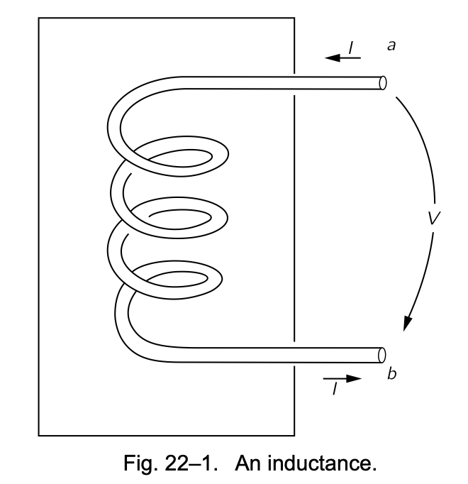{#fig-FLP_2_22_1 width=400}

이런 가정은 이상적인 인덕턴스를 의미한다. (나중에 다시 돌아와서 실제 인덕턴스에서 무슨 일이 일어나는지 논의할 것이다.) 이상적인 인덕턴스 양단에 걸리는 전위를 구해보자. 인덕턴스에 전류가 흐르면, 전류에 비례하는 자기장이 코일 내부에 발생한다. 이제 @fig-FLP_2_22_1 에서 다음과 같은 경로를 생각하자 : $a$ 단자에서 시작하여 코일을 따라(항상 와이어 내부에 머무르며) $b$ 단자 까지 이동한 뒤, 인덕턴스 외부 공간의 공기를 통해 단자 $b$ 에서 단자 $a$ 로 돌아간다. 이 닫힌 경로를 에 대한 $\bf{E}$ 의 선 적분은 두 부분의 합으로 표현될 수 있다:

$$
\oint \bf{E\cdot} d\bf{l} = \underset{\text{coil}}{\underset{\text{via}}{\int_a^b}} \bf{E\cdot} d\bf{l} + \underset{\text{outside}}{\int_a^b} \bf{E\cdot} d\bf{l}.
$$ {#eq-FLP_1_22_3}

이미 알고 있듯이 완전한 도체 내부에는 전기장이 존재하지 않는으므로 코일을 통한 $a$ 에서 $b$ 까지의 적분은 $0$ 이다. $\bf{E}$ 의 선적분에 기여하는 것은 단자 $b$ 에서 단자 $a$ 까지의 인덕턴스 외부 경로에 대한 적분이다. 우리는 상자 외부 공간에 자기장이 없다고 가정했으므로, 이 부분의 적분은 경로와 독립적이며 두 단자의 퍼텐셜, 즉 전위차 $V$ 를 정할 수 있다. 

$$
V = −\int_a^ b \bf{E\cdot} d\bf{l} =−\oint \bf{E\cdot} d\bf{l} 
$$

여기서 코일의 인덕턴스 $L$ 에 대해 기전력 $\mathcal{E} = \oint\bf{E\cdot} d\bf{l} = -L (dI/dt)$ 을 생각하면

$$
V = - \mathcal{E} = (i\omega)LI.
$$ {#eq-FLP_2_22_4}

이상적인 인덕턴스를 설명한 위와 같은 방식은 일반적으로 다른 이상적인 회로 요소를 다루는 방식을 보여준다. 요소의 특성은 단자에 나타나는 전류와 전압을 기준으로 완전히 설명된다. 적절한 근사를 통해 회로 요소 내부에 나타나는 장들들의 큰 복잡성을 무시할 수 있다. 내부에서 일어나는 일과 외부에서 일어나는 일 사이에 구분이 이루어진다.

모든 회로 요소에 대해 우리는 @eq-FLP_2_22_4 에 있는 것과 같은 관계를 찾게 됩니다. 전압이 전류에 비례하고, 일반적으로 복소수인 비례 상수를 갖는 경우. 이 복소 비례 계수를 **임피던스 (impedence)** 라고 하며 보통 $z$ 로 표기한다. 일반적으로 임피던스는 진동수 $\omega$ 의 함수이다. 즉

$$
z = \dfrac{V}{I} = \dfrac{\hat{V}}{\hat{I}}.
$$ {#eq-FLP_2_22_5}

인덕턴스의 경우

$$
z(\text{인덕턴스})=z_L=i\omega L.
$$ {#eq-FLP_2_22_6}

#### **축전기**

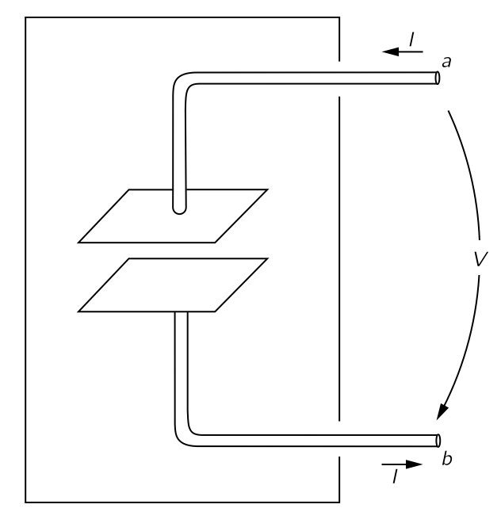{#fig-FLP_2_22_2 width=400}

이제 같은 관점으로 축전기를 살펴보자. 축전기는 두 개의 전도성 판과 각각의 판을 터미널과 잇는 두 개의 전선으로 구성된다(@fig-FLP_2_22_2). 판은 어떤 형태든 될 수 있으며, 종종 유전체에 의해 분리되어 있다. 다시 몇 가지 가정을 하자. 

- 판과 전선이 완벽한 전도체라고 가정한다. 
- 판 사이의 절연은 완벽히며 한 판에서 다른 판으로 절연을 가로질러 전하가 흐르지 않는다. 
- 두 도체가 서로 가깝지만 다른 모든 도체와는 멀리 떨어져 있으므로, 하나의 판을 떠나는 모든 전기장은 다른 판을 향한다. 따라서 두 판에는 크기가 같고 극성이 반대인 전하가 존재하며, 판에 있는 전하는 인입 전선 표면의 전하보다 훨씬 크다.  
- 축전기 근처에 자기장이 없다.

이제 $\bf{E}$ 의 선 적분을 세 부분으로 나누어 생각하자. 

$$
\oint \bf{E \cdot}\,d\bf{l} = \underset{\text{along wires}}{\int_a^b} \bf{E\cdot}\,d\bf{l} + \underset{\text{plate}}{\int} \bf{E\cdot} \,d\bf{l} + \underset{\text{outside}}{\int_a^b}\bf{E\cdot}\,d\bf{l}.
$$ {#eq-FLP_2_22_7}

완전 전도체 내부에는 전기장이 없기 때문에 전선을 따르는 적분은 0 이다. 축전기 외부의 $b$ 에서 $a$ 까지의 적분은 단자 간 전위 차이의 음수와 같다. 우리가 두 판이 어느 정도 세계의 나머지와 격리되어 있다고 상상했으므로, 두 판의 총 전하는 $0$ 이어야 한다. 만약 상부 판에 전하 $Q$ 가 존재한다면, 하부 판에는 동일한 양의 반대 극성 전하 $−Q$ 가 존재한다. 판 사이의 전위 차이는 $Q/C$ 이며 @eq-FLP_2_22_7 에서 $a$ 와 $b$ 단자 사이의 전위차는 판 사이의 전위차와 같다. 따라서 

$$
V=Q/C.
$$

전류 $I$ 가 단자 $a$ 를 통해 축전기에 들어오고 단자 b를 통해 나간다면 $I=dQ/dt$ 는 플레이트상의 전하의 변화율이다. $dV/dt = i\omega V$ 이므로 축전기의 전압‐전류 관계는

$$
i\omega V=\dfrac{I}{C},
$$

또는

$$
V=\dfrac{I}{i\omega C}.
$$ {#eq-FLP_2_22_8}

이제 축전기의 임피던스 z는

$$
z(\text{축전기})=z_C=\dfrac{1}{i\omega C}.
$$ {#eq-FLP_2_22_9}

#### **저항**

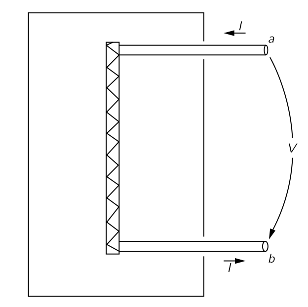{#fig-FLP_2_22_3 width=400}

세 번째로 저항을 보자. 아직 실제 재료의 전기적 특성을 논의하지 않았으므로, 실제 도체 내부에서 일어나는 일에 대해 논의할 준비가 아직 되지 않았다. 우리는 전기장이 실제 물질 내부에 존재할 수 있다는 사실과, 이러한 전기장이 전하 흐름, 즉 전류를 발생시켜 그 전류가 도체의 한쪽 끝에서 다른 쪽 끝까지의 전기장 적분에 비례한다는 사실을 받아들여야 한다. 이후 @fig-FLP_2_22_3 과 같이 구성된 이상적인 저항을 상상한다. 

- 완전 도체로 볼 수 있는 두 개의 전선은 단자 $a$ 와 $b$ 에서 저항성 재료 막대의 양쪽 끝까지 연결된다. 
- $a$ 와 $b$ 단자 사이의 전위 차이는 외부 전기장의 선적분과 같으며, 이는 저항성 물질 막대를 통한 전기장의 선적분과도 동일하다. 그 결과, 저항을 통과하는 전류 $I$ 는 단자 전압 $V$ 에 비례한다.
  $$
  I=VR.
  $$

  여기서 $R$ 을 **저항 (resistance)** 이라고 한다. 나중에 실제 전도성 물질에서 전류와 전압 사이의 관계가 대략적으로 선형이라는 것을 알게 될 것이다. 
- 우리는 또한 이 근사적인 비례성이 전류와 전압의 진동수 빈도와는 무관할 것으로 예상하며, 이는 주파수가 너무 높지 않을 경우에만 해당한다. 
- 교류 전류의 경우, 저항을 가로지르는 전압은 전류와 위상이 맞으며, 이는 임피던스가 실수임을 의미한다.

  $$
  z(\text{저항})=z_R=R.
  $$ {#eq-FLP_22_10}

#### **수동 소자**

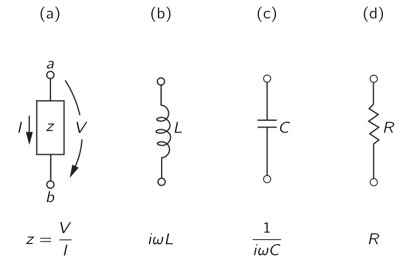{#fig-FLP_2_22_4 width=400}

지금까지 살펴본 세 회로 요소-인덕터, 축전지, 저항-에 대해 @fig-FLP_2_22_4 에 요약하였다. 이 그림과 앞선 그림들에서도 전압은 한 단자에서 다른 단자를 가리키는 화살표로 표시되었다. 전압이 양수인 경우—즉, 단자 $a$ 가 단자 $b$ 보다 높은 전위에 있는 경우—화살표는 양의 “전압 강하” 방향을 나타낸다.

우리는 교류에 대해 이야기하고 있지만, 진동수 $\omega \to 0$ 극한을 취함으로써 정상 전류를 가진 회로의 특수한 경우를 포함시킬 수 있다. 진동수가 0인 경우—즉, 직류의 경우—인덕턴스의 임피던스가 $0$ 이 되며, 이는 단락 회로가 된다. 직류에서는 축전지의 임피던스가 무한대로 올라가며, 이는 개방 회로가 된다. 저항기의 임피던스는 주파수와 무관하므로, 직류 회로를 분석할 때 남은 유일한 요소이다.

지금까지 설명한 회로 소자에서는 전류와 전압이 서로 비례한다. 우리는 보통 다음과 같은 용어로 생각합니다: 적용된 전압은 전류를 **책임지며**, 전류는 단자 전체에 전압을 **유도한다**. 이는 어느 정도 소자들은 적용된 외부 조건에 반응한다 의미이므로 이런 소자들을 **수동소자 (passive element)** 라고 부른다. 다음 절에서 검토할 발전기와 같은 능동소자와 대비될 수 있다.

마지막으로 수동소자의 임피던스를 요약하면 다음과 같다.
$$
\boxed{z_R = R,\qquad z_L = i\omega L,\qquad z_C = 1/i\omega C.}
$$ {#eq-FLP_summary_impedence_of_passive_element}

### $\textrm{II}$.22–2 발전기 {#sec-FLP_2_22_2}

이제 우리는 전류와 전압의 원천인 **능동 소자 (active element)** 인 발전기에 대해 알아본다.

#### **발전기 타입 1 : 회전하는 자기장과 고정된 코일**

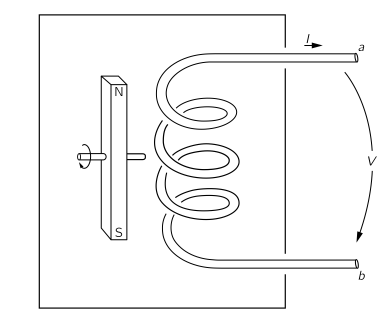{#fig-FLP_2_22_5 width=400}

인덕턴스와 같은 코일이 있지만 회전이 매우 적다고 가정하면, 그 자체 전류의 자기장을 무시할 수 있다. 그러나 이 코일은 @fig-FLP_2_22_5 에서와 같이 회전하는 자석에 의한 변화하는 자기장 안에 놓여 있다. (우리는 앞서 이러한 회전 자기장이 교류가 있는 적절한 코일 세트에 의해 생성될 수 있음을 확인했다.) 다시 한 번 우리는 몇 가지 문제를 단순화하는 가정을 해야 한다. 이 가정들은 모두 인덕턴스 경우에 나온 것이다. 특히, 변동하는 자기장이 코일 주변의 특정 영역에 제한되어 있으며, 단자 사이의 공간에서 발전기 외부에 나타나지 않는다고 가정한다.

인덕턴스에서와 같이 단자 $a$ 에서 시작하여 코일을 거쳐 단자 $b$ 까지, 그리고 두 단자 사이의 공간에서 시작점으로 돌아오는 완전한 루프에 대한 $\bf{E}$ 의 선적분을 생각한다. 다시 한 번, 우리는 단자 간 전위 차이가 루프를 중심으로 E의 전체 선 적분과 동일하다고 결론합니다:

$$
V=−\oint \bf{E\cdot}\,d\bf{l}.
$$

이 선 적분은 회로의 기전력과 동일하므로, 발전기의 단자 간 전위 차 $V$ 는 코일을 연결하는 자기 플럭스 $\Phi_B$ 의 변화율과 동일하다:
$$
V=−\mathcal{E}= \dfrac{d}{dt}\Phi_B.
$$ {#eq-FLP_2_22_11}

이상적인 발전기의 경우, 코일에 대한 자기 플럭스는 회전하는 자기장의 각속도와 같은 외부 조건에 의해 결정되며, 발전기를 통과하는 전류에 의해 어떠한 방식으로도 영향을 받지 않는다고 가정한다. 따라서 적어도 우리가 고려하고 있는 이상적인 발전기는 임피던스가 아니다. 그 말단에 걸친 전위 차이는 임의로 할당된 기전력 $\mathcal{E}(t)$ 에 의해 결정된다. 이러한 이상적인 발전기는 @fig-FLP_2_22_6 에 표시된 기호로 표현된다. 작은 화살표는 양수일 때의 기전력의 방향을 나타냅니다. @fig-FLP_2_22_6 의 발전기는 단자 $a$ 가 단자 $b$ 보다 $V=\mathcal{E}$ 만큼 높은 전위를 가진다.

#### **발전기 타입 2 : 고정된 자기장과 회전하는 코일**

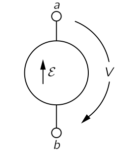{#fig-FLP_2_22_6 width=150}

방금 설명한 것과는 내부적으로는 매우 다르지만 단자 밖에서는 구별할 수 없는 또 다른 형태의 발전기가 있다. @fig-FLP_2_22_7 에 표현된 바와 같이 고정된 자기장 안에서 회전하는 와이어 코일이 있다고 하자. 막대 자석이 내부의 자기장을 생성한다. 물론, 이는 일정한 전류를 전달하는 추가 코일과 같이 일정한 자기장의 다른 원천으로 대체될 수 있다. 그림에 표시된 바와 같이, 회전하는 코일은 슬라이딩 접점 또는 슬립 링을 통해 외부 세계와 연결된다. 우리는 두 단자 $a$ 와 $b$ 사이에 나타나는 전위 차이에 관심이 있다. 이는 물론 발전기 외부 경로를 따라 단자 $a$ 에서 단자 $b$ 까지의 전기장의 적분이다.

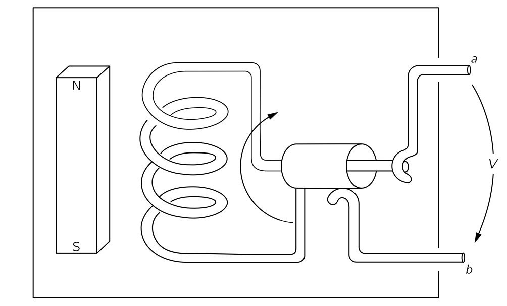{#fig-FLP_2_22_7 width=400}

@fig-FLP_2_22_7 의 시스템에서는 변하는 자기장이 존재하지 않으므로, 처음에는 발전기 단자에 전압이 어떻게 나타날 수 있는지 궁금해 할 수 있다. 사실, 발전기 내부 어디에도 전기장이 없다. 우리는 평소와 같이 이상적인 소자에 대해 내부의 전선이 완전 전도성 물질로 만들어졌다고 가정하고 있으며, 여러 차례 말했듯이, 완전 도체 내부의 전기장은 0 이라고 가정하였다. 하지만 그것은 도체가 자기장 안에서 움직이고 있을 때는 사실이 아니다. 진정한 명제는 **완전 도체 내부의 모든 전하에 대한 전체 힘이 0이어야 한다** 는 것이다. 그렇지 않으면 자유 전자가 무한히 흐르게 될 것이다. **따라서 언제나 참인 것은 도체 내에서 로렌츠 힘은 항상 $0$ 이다.**

$$
\dfrac{\bf{F}}{\text{단위 전하}} = \bf{E} + \bf{v} \times \bf{B} = \bf{0}\qquad (\text{완전한 도체 내부에서}).
$$ {#eq-FLP_2_22_12}

완전 도체 내부에 전기장이 없다는 앞서의 명제는 도체의 속도 $\bf{v}$ 가 0 이면 모두 옳으며, 그렇지 않은 경우 올바른 명제는 @eq-FLP_2_22_12 에 의해 제시된다.

@fig-FLP_2_22_7 의 발전기로 돌아가면, 이제 우리는 발전기의 전도 경로를 통해 단자 $a$ 에서 단자 $b$ 까지의 전기장 $\bf{E}$ 의 선적분이 동일한 경로상의 $\bf{v}\times \bf{B}$ 의 선적분과 같아야 함을 알 수 있다.

$$
\underset{\text{conductor}}{\underset{\text{inside}}{\int_a^b}} \bf{E\cdot}\,d\bf{l}=−\underset{\text{conductor}}{\underset{\text{inside}}{\int_a^b}} (\bf{v}\times \bf{B})\bf{\cdot} \, d\bf{l}.
$$ {#eq-FLP_2_22_13}

그러나 전체 루프에 대한 $\bf{E}$ 의 선적분은 발전기 밖에서의 $b$ 에서 $a$ 로의 선적분을 포함하며, 변동하는 자기장이 없기 때문에 반드시 $0$ 이어야 한다.($\nabla \times \bf{E}=-\partial \bf{B}/\partial t$ 를 생각하라.) 따라서 @eq-FLP_2_22_13 의 첫 번째 적분은 또한 두 단자 사이의 전압인 $V$ 와 같다. 식의 오른쪽 적분이 밝혀졌다. @eq-FLP_2_22_13 은 코일을 통과하는 플럭스의 변화율에 불과하며, 따라서 플럭스 규칙에 따라 코일 내의 기전력과 같으며 이는 @eq-FLP_2_22_11 과 일치한다. 고정된 코일 근처에서 자기장이 변하는 발전기이든, 코일이 고정된 자기장 안에서 움직이는 발전기이든, 발전기의 외부 특성은 동일하다. 단자 전체에 전압 차이 $V$ 가 존재하며, 이는 회로의 전류와는 무관하지만 발전기 내부의 된 조건에만 의존한다.

#### **발전기 타입 3 : 화학전지**

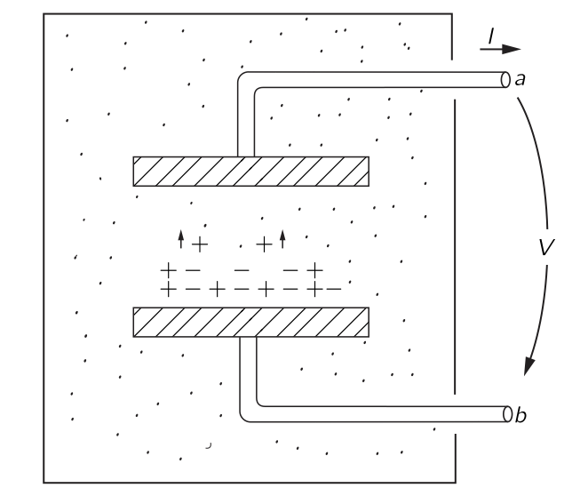{#fig-FLP_2_22_8 width=400}

지금까지 맥스웰 방정식의 관점에서 발전기의 작동을 이해하려고 노력했지만, 손전등 배터리와 같은 일반적인 화학 셀에 대해서도 물어볼 수 있다. 이 역시 발전기, 즉 전압원지만, 직류 회로에만 등장한다. 가장 이해하기 쉬운 종류의 셀은 @eq-FLP_2_22_8 에 표현되어 있다. 화학 용액에 담겨 있는 두 개의 금속 판을 상상하자. 

- 이 용액에 양이온과 음이온이 포함되어 있으며, 이 가운데 한 종류의 이온, 예를 들어 음이온이 양이온보다 훨씬 무겁다고 가정한다. 따라서 확산 과정을 통해 용액을 통과하는 움직임이 훨씬 느리다.
- 어떤 방법이든 용액의 농도가 균일하지 않아 예를 들어 하부 판 근처에 있는 양쪽 극성의 이온 수가 상부 판 근처의 이온 농도보다 훨씬 많다고 가정한다. 

양전하의 빠른 이동도(mobility)로 인해 양이온은 농도가 낮은 영역으로 더 쉽게 이동하게 되며, 그 결과 상부 판에 도달하는 양전하가 약간 과잉된다. 상부 판은 양전하를 띠게 되고 하부 판은 순음전하를 띠게 됩니다.

점점 더 많은 전하가 상부 판으로 확산됨에 따라, 이 판의 전위가 상승하여 판들 사이에 발생하는 전기장이 이온에 힘을 가해 과도한 이동성을 보상하게 되며, 따라서 셀의 두 판은 내부 구조로부터 정해지는 특징정인 전위차에 빠르게 도달한다.

이상적인 축전지를 다룰 때 본 바와 같이, 우리는 단자 $a$ 와 $b$ 사이의 전위 차이가 이온의 순확산이 더 이상 없을 때 두 판 사이의 전기장의 선적분과 동일함을 확인할 수 있다. 물론, 축전지와 그러한 화학전지 사이에는 본질적인 차이가 있다. 축전지의 단자를 잠시 단락하면 방전되어 단자 간 전위 차이가 더 이상 존재하지 않게 된다. 화학 셀의 경우, 전류를 단자에서 지속적으로 끌어올 수 있으며, 기전력은 (셀 내부의 화학 물질이 소진될 때까지는) 전혀 변하지 않는다. 실제 셀에서는 셀에서 끌어온 전류가 증가함에 따라 단자 간 전위 차이가 감소하게 된다. 우리는 단자를 가로지르는 전압이 전류와 독립적인 이상적인 전지를 상상할 수 있다. 실제 셀은 저항기와 직렬로 존재하는 이상적인 셀로 볼 수 있다.

### $\mathrm{I}$.22–3 이상적인 소자들의 연결과 키르히호프 규칙.

#### **회로 분석**

앞에서 보았듯이, 이상적인 회로 소자를 그 소자 외부에서 발생하는 것으로 설명하는 것은 매우 간단하다. 전류와 전압은 선형적으로 관련되어 있다. 하지만 소자 내부에서 실제로 일어나고 있는 일은 상당히 복잡하며, 맥스웰 방정식을 기준으로 정확한 설명을 제공하기는 상당히 어렵다. 수백 개의 저항기, 커패시터 및 인덕터가 포함된 라디오 내부의 전기 및 자기장을 정확히 설명하려고 시도한다는 것을 상상해 보라. 맥스웰 방정식을 사용하여 그런 것을 분석하는 것은 불가능하다. 하지만 [$\mathrm{II}$.22–2 발전기](#sec-FLP_2_22_2) 에서 설명한 많은 근사와 실제 회로 소자의 본질적 특성을 이상화시켜 요약함으로써 전기 회로를 비교적 간단한 방식으로 분석하는것이 가능하다. 이제 그 방법을 알아보자.

#### **총 전압 강하**

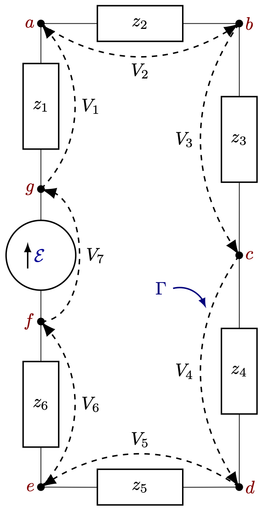{#fig-FLP_2_22_9 width=300}

@fig-FLP_2_22_9 와 같이 발전기와 여러 임피던스가 서로 연결된 회로가 있다고 가정하자.개별 회로 소자 외부 영역에는 자기장이 없다(고 가정하고 근사한다). 따라서 소자를 통과하지 않는 모든 곡선에 대한 $\bf{E}$ 의 선적분은 0 이다. 그럼 회로를 전체적으로 감싸는 파선으로 표시된 곡선 $\Gamma$ 를 생각하자. 이 곡선에 대한 $\bf{E}$ 의 선적분은 여러 조각으로 구성되어 있다. 각 조각은 회로 요소의 한 단자에서 다른 단자까지의 선적분이다. 이 선적분은 우리가 소자를 통과하는 데 대한 전압 강하라고 부르는 그것이다. 전체 선적분은 회로 내 모든 소자에 걸친 전압 강하의 합에 불과하다:

$$
\oint \bf{E\cdot}\,d\bf{l} = \sum V_n.
$$

전체 선 적분이 $0$ 이므로, 회로 전체 루프 주변의 전위 차이의 합이 $0$ 이라고 할 수 있다:

$$
\sum_{\text{around any loop}} V_n=0.
$$ {#eq-FLP_2_22_14}

이 결과는 맥스웰 방정식 중 하나의 결론이다.

#### **노드를 통과하는 전류**

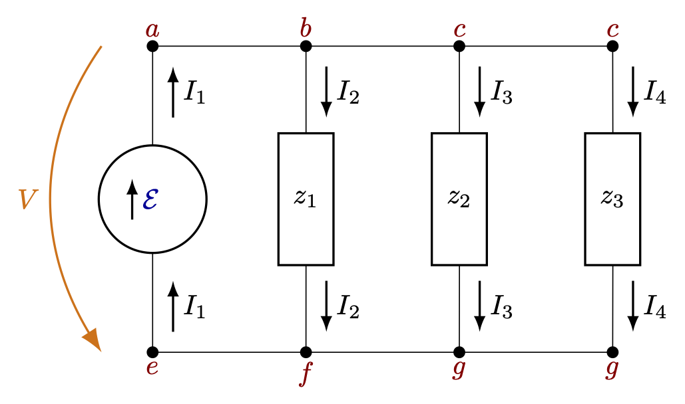{#fig-FLP_2_22_10 width=400}

이제 @fig-FLP_2_22_10 에 표현된 것과 같은 회로를 생각한다. 단자 $a$, $b$, $c$, $d$ 를 연결하는 수평선은 이들 단자가 모두 연결되어 있거나 저항이 거의 없는 전선으로 연결되어 있음을 나타낸다. 어쨌든, 도면은 단자 $a$, $b$, $c$, $d$ 가 모두 동일한 전위에 있으며, 마찬가지로 단자 $e$, $f$, $g$, $h$ 도 동일한 공통 전위에 있음을 의미한다. 그렇다면 네 개의 소자 각각에 대한 전압 강하 $V$ 는 동일하다.

현재 우리의 이상화 중 하나는 임피던스의 단자에 축적되는 전하는 무시할 만 하다는 것이다. **우리는 이제 단자를 연결하는 전선에 있는 모든 전하도 무시될 수 있다고 가정한다. 그렇다면 전하 보존에 따라 한 회로 요소를 떠나는 모든 전하는 즉시 다른 회로 요소로 들어가야 한다. 즉 주어진 모든 노드에 들어가는 전류들의 대수적 합이 0이어야 한다.** 노드란 $a$, $b$, $c$, $d$ 와 같은 연결된 모든 단자 집합을 의미한다. 

$$
I_1 − I_2 − I_3 − I_4 = 0.
$$ {#eq-FLP_2_22_15}

$e$, $f$, $g$, $h$ 네 개의 단자로 구성된 노드에 들어가는 전류의 합도 0 이어야 한다:

$$
−I_1 + I_2 + I_3 + I_4 = 0.
$$ {#eq-FLP_1_22_16}

이는 물론 @eq-FLP_2_22_15 와 동일하다. 두 방정식은 독립적이지 않다. 일반적인 규칙은 모든 노드에 대한 전류의 합이 0이어야 한다는 것이다:

$$
\sum_{\text{into a node}} I_n = 0.
$$ {#eq-FLP_2_22_17}

#### **키르히호프의 규칙**

앞서 폐쇠 루프에 대한 전압 강하와 노드에 대한 전류의 결론을 요약한 것이 **키르히호프의 규칙 (Kirchhoff’s rules)** 이다.

::: {.callout-important icon="false"}

#### **키르히호프의 규칙**

**제 1 규칙** : 폐쇄 회로에 대한 전압 강하의 합이 0 이다.

**제 2 규칙** : 노드에 대한 전류의 합이 0 이다.

:::

::: {#exm-FLP_chapter_2_22_1}

#### 회로 분석 1

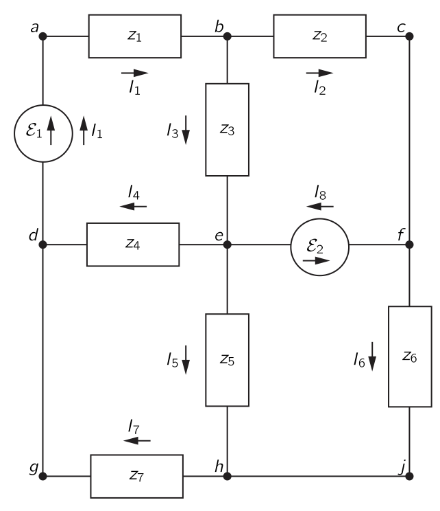{#fig-FLP_2_22_11 width=450}

@fig-FLP_2_22_11 과 같은 보다 복잡한 회로를 분석해보자. 이 회로에서 전류와 전압을 어떻게 알 수 있을까? 회로에 나타나는 네 개의 부수적인 폐쇄 루프 각각을 별도로 생각하자. 예를 들어, 단자 $a$, $b$, $e$, $d$ 로 이루어진 부수적인 루프. 각 루프에 대해 키르히호프의 제 1 규칙을 적용한다. 전류 방향으로 가는 경우 전압 강하는 양수이며, 전류와 반대 방향으로 요소를 가로지르는 경우 전압 강하는 음수가 된다. 또한 발전기에 대한 전압 강하는 그 방향의 기전력의 음수임을 기억해야 한다. 따라서 $a$ 끝에서 시작하고 끝나는 작은 루프를 고려하면 아래의 식이 성립한다.

$$
z_1 I_1 + z_3 I_3 + z_4 I_4−\mathcal{E}_1=0.
$$

같은 규칙을 남은 루프에 적용하면, 같은 종류의 방정식을 세개 더 얻을 수 있다.

다음으로, 회로의 각 노드에 대해 키르히호프의 제 2 구칙을 적용한다. 예를 들어 단자 $b$ 에 있는 노드에 전류를 합산하면 다음 방정식이 된다.

$$
I_1 − I_3 − I_2 = 0.
$$

마찬가지로, $e$ 노드에 대해서는 

$$
I_3 − I_4 + I_8 − I_5 = 0.
$$

주어진 회로에 대해 이러한 전류 방정식이 다섯 개 있지만 이것들은 서로 독립적인 것이 아니며 독립적인 방정식은 네 개 뿐이다. 따라서 우리는 총 8개의 독립적인 선형 방정식을 갖게 된다. 전압 방정식 네 개와 전류 방정식 네 개. 이 여덟 개의 방정식을 사용하면 우리는 여덟 개의 미지의 전류를 해결할 수 있고 전류가 알려지면 회로가 해결된다. 미리 주어지는 전압원을 제외한 어떤 소자에 가해지는 전압 강하는 해당 요소를 흐르는 전류에 그 임피던스를 곱함으로써 얻을 수 있다. 

방정식을 작성할 때, 다른 방정식들과 독립적이지 않은 하나의 방정식을 얻는다는 것을 확인했다. 일반적으로 전압 방정식을 지나치게 많이 적는 것도 가능하다. 예를 들어, @fig-FLP_2_22_11 의 회로에서는 네 개의 작은 루프만을 고려했지만 전압 방정식을 작성할 수 있는 다른 루프-예를 들어 경로 $abcfeda$ 를 따르는 루프-가 하나 이상 존재 할 수 있다.  복잡한 회로를 분석할 때는 너무 많은 방정식을 얻기가 매우 쉽다. 최소 수의 방정식만 적도록 진행하는 방법을 알려주는 규칙이 있지만, 보통 약간의 생각만으로도 가장 간단한 형태로 올바른 수의 방정식을 얻는 방법을 알 수 있다. 게다가, 추가 방정식을 하나 또는 두 개 작성하는 것은 해가 되지 않는다. 그들은 오답을 초래하지 않을 것이며, 여분의 불필요한 계산을 요구할 뿐이다.

:::

 

::: {#exm-FLP_chapter_2_22_2}

#### 회로 분석 2

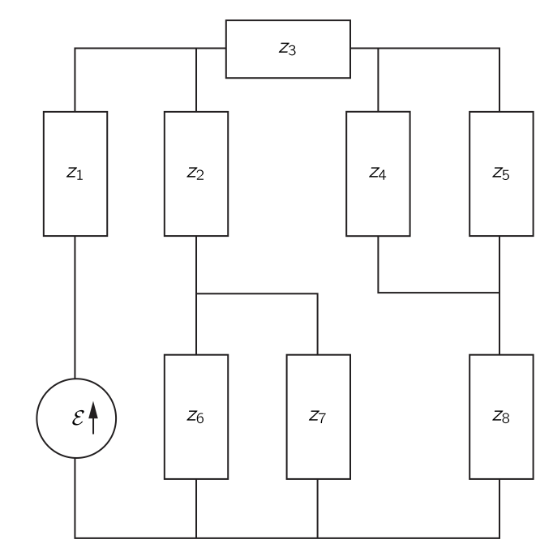{#fig-FLP_2_22_12 width=450}

[$\mathrm{I}$.25 선형 시스템](../vol1/vol1_3.qmd#sec-FLP_1_25) 에서 우리는 두 임피던스 $z_1$ 과 $z_2$ 가 직렬일 경우, 아래와 같이 주어진 단일 임피던스 $z_s$ 와 동등함을 보였다.

$$
z_s = z_1 + z_2.
$${#eq-FLP_2_22_18}

또한 두 임피던스가 병렬로 연결될 경우에는 아래와 같은 단일 임피던스 $z_p$ 와 동등함을 보였다.

$$
z_p = \dfrac{1}{1/z_1 + 1/z_2} = \dfrac{z_1 z_2}{z_1+z_2}.
$$ {#eq-FLP_2_22_19}

돌이켜보면 이결과를 유도할 때 사실상 키르히호프의 규칙을 사용하고 있었다. 복잡한 회로를 직렬 및 병렬 임피던스 공식을 반복적으로 적용함으로써 분석하는 것이 종종 가능하다. 예를 들어, @fig-FLP_2_22_12 의 회로. 우선, 임피던스 $z_4$ 와 $z_5$ 는 그들의 병렬 등가값으로 대체될 수 있으며, $z_6$ 과 $z_7$ 도 마찬가지다. 그렇다면 임피던스 $z_2$ 는 직렬 규칙에 따라 $z_6$ 및 $z_7$ 의 병렬 등가값과 결합될 수 있다. 이와 같이 진행하면 전체 회로를 단일 임피던스 $Z$ 를 가진 직렬 발전기로 축소할 수 있다. 그때 발전기를 통과하는 전류는 단순히 $\mathcal{E}/Z$ 가 된다. 그런 다음 역방향으로 작업함으로써 각 임피던스의 전류를 구할 수 있다.

:::

 

::: {#exm-FLP_chapter_2_22_3}

#### 회로 분석 3

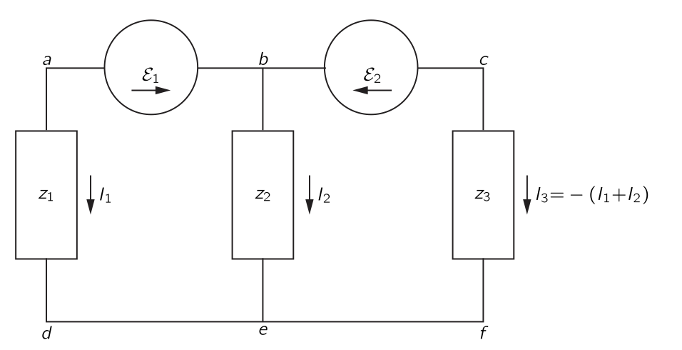{#fig-FLP_2_22_13 width=450}

@fig-FLP_2_22_13 의 회로는 @exm-FLP_chapter_2_22_2 의 방법으로는 분석할 수 없는 꽤 단순한 회로의 예이다. 이 회로를 분석하려면 키르히호프의 규칙에서 전류와 전압 방정식을 적어야 한다. 현재 방정식은 하나뿐입니다:

$$
I_1 + I_2 + I_3 = 0.
$$

이로부터

$$
I_3 = −( I_1 + I_2).
$$

우리는 전압 방정식을 작성할 때 이 결과를 즉시 활용하면 계산을 절약할 수 있다. 이 회로에는 두 개의 독립적인 전압 방정식이 있다.

$$
−\mathcal{E}_1 + I_2 z_2 − I_1 z_1 = 0, \qquad \mathcal{E}_2−( I_1 + I_2 ) z_3 − I_2 z_2=0.
$$

두 개의 방정식과 두 개의 미지의 전류가 있다. $I_1$ 과 $I_2$ 에 대한 이 방정식들을 풀면,

$$
I_1 = \dfrac{z_2 \mathcal{E}_2 − ( z_2 + z_3 ) \mathcal{E}_1}{z_1 ( z_2 + z_3 ) + z_2 z_3},$$ {#eq-FLP_2_22_20}

그리고

$$
I_2 = \dfrac{z_1\mathcal{E}_2 + z_3\mathcal{E}_1}{z_1(z_2 + z_3) + z_2z_3}.
$$ {#eq-FLP_2_22_21}

세 번째 전류는 이 두 개의 합으로부터 얻을 수 있다.

:::

 

::: {#exm-FLP_chapter_2_22_4}

#### 회로 분석 4

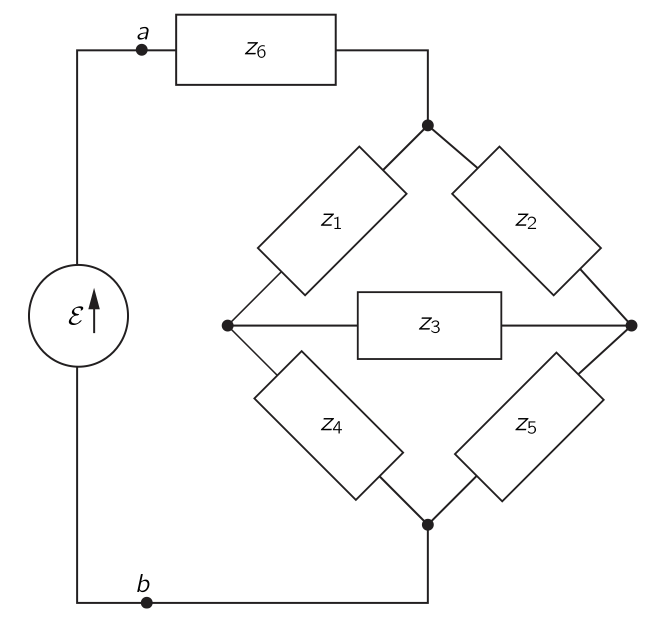{#fig-FLP_2_22_14 width=450}

직렬 및 병렬 임피던스 규칙을 사용하여 분석할 수 없는 회로의 또 다른 예는 @fig-FLP_2_22_14 에 표현되어 있다. 이런 회로를 '브리지' 라고 한다. 임피던스를 측정하는 데 사용되는 많은 기기에서 사용된다. 이러한 회로에서는 보통 다음과 같은 질문에 관심을 갖게 된다: 임피던스 $z_3$ 를 통과하는 전류가 0 이 될 경우, 다양한 임피던스는 어떻게 관련되어야 하는가? 이것은 독자에게 맡긴다.

:::

### $\mathrm{II}$.22-4 등가 회로 {#sec-FLP_2_22_4}

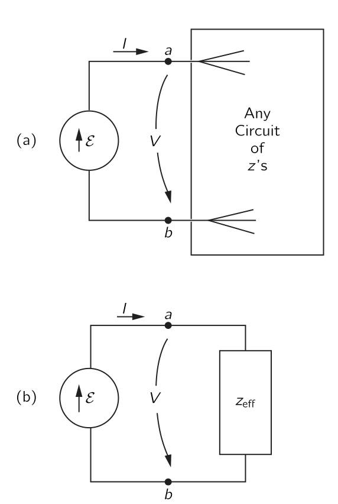{#fig-FLP_2_22_15 width=300}

@fig-FLP_2_22_15 (a) 에 표현된 바와 같이, 복잡한 임피던스 내부 연결을 포함하는 회로에 발전기 $\mathcal{E}$ 를 연결한다고 가정하자. 키르히호프의 규칙으로부터 얻는 모든 방정식은 선형이며, 따라서 발전기를 통해 전류 $I$ 에 대해 풀면

$$
I=\dfrac{\mathcal{E}}{z_\text{eff}}.
$$

여기서 $z_\text{eff}$ 는 회로의 모든 원소들의 대수적 함수인 복소수이다. 회로에 표시된 것 외에 다른 발전기가 없을 경우, $\mathcal{E}$ 에 독립적인 추가 항은 존재하지 않는다. 하지만 이 방정식은 @fig-FLP_2_22_15 (b) 의 회로와 같다. 두 단자 $a$ 와 $b$ 의 왼쪽에서 일어나는 일에만 관심을 갖는 한, @fig-FLP_2_22_15 의 두 회로는 동일하다. 따라서 우리는 모든 2단자 수동 소자 네트워크를 회로의 나머지 전류와 전압을 변경하지 않고 단일 임피던스 $z_\text{eff}$ 로 대체할 수 있다. 이 사실은 키르히호프의 규칙에서 나오는 것에 대한 주석일 뿐이며, 궁극적으로는 맥스웰 방정식의 선형성에서 비롯된다.

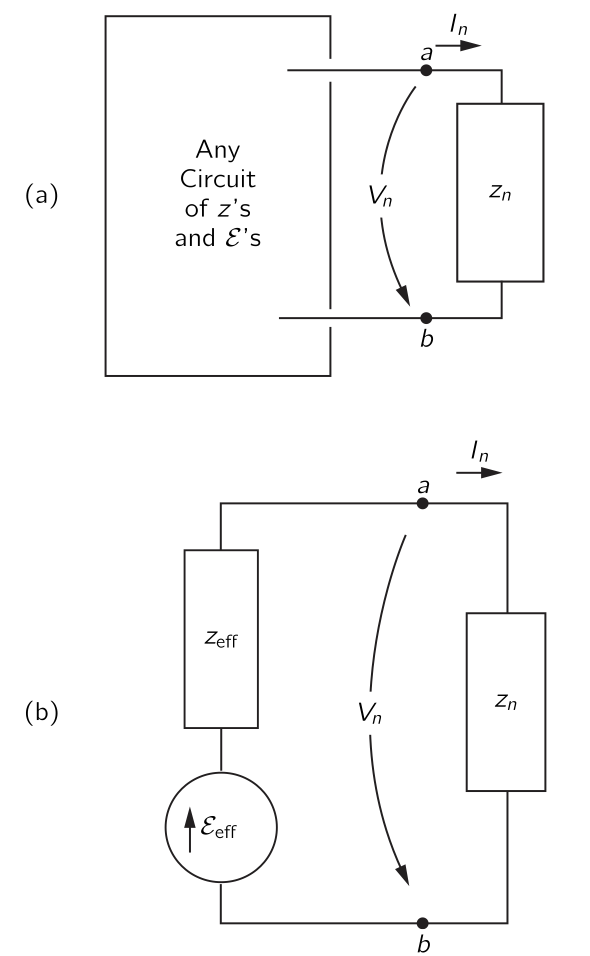{#fig-FLP_2_22_16 width=300}

이 아이디어는 발전기와 임피던스를 모두 포함하는 회로에 일반화될 수 있다. 예를 들어 @fig-FLP_2_22_16 (a)에서와 같이, 우리가 $z_n$ 이라고 부르는 임피던스 중 하나의 관점에서 회로를 살펴본다고 가정하자. 전체 회로에 대한 방정식을 풀면, 두 단자 $a$ 와 $b$ 사이의 전압 $V_n$ 이 $I_n$ 의 선형 함수임을 알 수 있으며, 이를 다음과 같이 쓸 수 있다.

$$
V_n = A − B I_n.
$$ {#eq-FLP_2_22_22}

여기서 $A$ 와 $B$ 는 터미널 왼쪽에 있는 회로의 발전기와 임피던스에 의존한다. 예를 들어 @fig-FLP_2_22_13 의 회로에 대해 우리는 $V_1 = I_1 z_1$ 임을 안다. @eq-FLP_2_22_20 을 재배열함으로써

$$
V_1=\left[\left(\dfrac{z_2}{z_2+z_3}\right)\mathcal{E}_2 − \mathcal{E}_1\right] − \dfrac{z_2z_3}{z_2 + z_3}I_1.
$$ {#eq-FLP_2_22_23}

을 얻는다. 완전한 해는 이 방정식을 임피던스 $z_1$ 에 대한 방정식, 즉 $V_1 = I_1 z_1$ 과 결합하거나 일반적인 경우에는 @eq-FLP_2_22_22 를 결합함으로써 얻을 수 있다.

$$
V_n = I_n z_n.
$$

만약 지금 우리가 $z_n$ 이 @fig-FLP_2_22_16 (b) 와 같이 발전기와 임피던스의 단순 직렬 회로에 연결된다고 간주한다면, 방정식은 @eq-FLP_2_22_22 에 해당한다. 

$$
V_n = \mathcal{E}_\text{eff} − I_n z_\text{eff}.
$$

이는 $\mathcal{E}_\text{eff}=A$ 와 $z_\text{eff}=B$ 에 대해 @eq-FLP_2_22_22 와 동일하다. 따라서 단자 $a$ 와 $b$ 의 오른쪽에서 일어나는 일에만 관심이 있다면, @fig-FLP_2_22_16 의 회로는 임피던스를 갖는 직렬 발전기의 동등한 조합으로 언제든지 대체될 수 있다.

### $\mathrm{II}$.22-5 에너지 {#sec-FLP_2_22_5}

우리는 인덕턴스에서 전류 $I$ 를 만들기 위해 외부 회로가 에너지 $U=\frac{1}{2}LI^2$ 를 제공해야 함을 확인했다. 전류가 $0$ 으로 되돌아가면, 이 에너지는 외부 회로로 다시 전달된다. 이상적인 인덕턴스에는 에너지 손실 메커니즘이 존재하지 않는다. 인덕턴스를 통해 교류가 흐르면, 에너지가 인덕턴스와 회로의 나머지 부분 사이를 오가며 흐르지만, 회로에 에너지가 전달되는 평균 속도는 $0$ 입니다. 이때문에 인덕턴스를 **비손실 소자(nondissipative element)** 라고 부른다. 즉 전기 에너지가 손실되지 않는다.

마찬가지로, 축전지의 에너지인 $U=\frac{1}{2}CV^2$ 는 축전지가 방전될 때 외부 회로로 반환된다. 축전지가 교류 회로에 있을 때 에너지가 그 안으로 들어와 밖으로 흐르지만, 각 사이클의 순수 에너지 흐름은 $0$ 이다. 이상적인 축전지 역시 비손실 소자이다. 

우리는 기전력이 에너지의 원천임을 알고 있다. 전류 $I$ 가 기전력 방향으로 흐를 때, 에너지는 $dU/dt=\mathcal{E}I$  비율로 외부 회로에 전달된다. 전류가 회로의 다른 발전기에 의해 기전력에 반대로 구동되면, 기전력은 $\mathcal{E}I$ 비율로 에너지를 흡수하게 된다. $I$ 가 음수이므로 $dU/dt$ 도 음수가 된다.

발전기가 저항 $R$ 에 연결되면, 저항을 통과하는 전류는 $I=\mathcal{E}/R$ 이다. $\mathcal{E}I$ 비율로 발전기에 의해 공급되는 에너지는 저항기에 의해 흡수된다. 이 에너지는 저항에서 열로 변해가 회로의 전기 에너지로부터 손실된다. 우리는 전기 에너지가 저항에서 소멸된다고 말한다. 저항에서 에너지가 소멸되는 속도 $dU/dt=RI^2$ 이단.

교류 회로에서 저항에 손실되는 에너지의 평균 속도는 한 사이클 동안의 $RI^2$ 의 평균이다. $I=\hat{I}e^{i\omega t}$ 한 사이클 동안 $I^2$ 의 평균은 $|\hat{I}|^2/2$ 이다. 

발전기가 임의의 임피던스 $z$ 에 연결될 때 에너지 손실은 어떻게 될까? (여기서 손실은 전기 에너지를 열 에너지로 변환하는 것을 의미한다.) 임피던스 $z$ 는 실수부와 허수 부분의 합으로 표현될 수 있습니다.

$$
z=R+iX.
$$ {#eq-FLP_2_22_24}

등가 회로의 관점에서 볼 때, 모든 임피던스는 저항($R$) 과 순허수인 임피던스($X$ 이를 **리액턴스(reactance)** 라고 한다)의 직렬연결과 동등하다고 말할 수 있다(@fig-FLP_2_22_17).

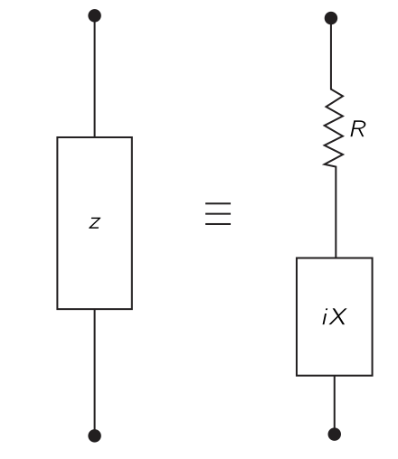{#fig-FLP_2_22_17 width=200}

우리는 $L$ 과 $C$ 만을 포함하는 모든 회로는 허수 임피던스를 가진다는 것을 안다. 평균적으로 $L$ 과 $C$ 모두 에너지 손실이 없으므로, $L$ 과 $C$ 만을 포함하는 순수 리액턴스는 에너지 손실이 없다. 우리는 이것이 일반적인 리액턴스에 대해 반드시 사실임을 알 수 있다.

만약 기전력 $\mathcal{E}$ 를 가진 발전기가 @fig-FLP_2_22_17 의 임피던스 $z$ 에 연결되어 있다면, 기전력과 발전기로부터의 전류 $I$ 는 아래의 관계가 있다.

$$
\mathcal{E} = I(R+iX).
$$ {#eq-FLP_2_22_25}

에너지가 전달되는 평균 속도를 찾기 위해, 우리는 $\mathcal{E}I$ 의 평균을 구해야 한다. 여기서 조심할 할 것은 실제 양 $\mathcal{E}(t)$ 와 $I(t)$ 를 다루어야 한다는 것이다. (복소 함수의 실수 부분은 선형 방정식이 있을 때만 실제 물리량을 나타낸다. 그러나 지금은 확실히 선형이 아닌 곱에 대해 논의하고 있다.)

$\hat{I}$ 가 실수가 되도록 $t$ 의 원점을 선택하여 $\hat{I}=I_0$ 라고 하면

$$
I(t) =I_0 \cos\omega t.
$$

@eq-FLP_2_22_25 의 기전력 $\mathcal{E}=\text{Re}(I_0e^{i\omega t}(R+iX))$ 이다. 즉

$$
\mathcal{E} = I_0 R \cos \omega t−I_0 X \sin \omega t.
$$ {#eq-FLP_2_22_26}

@eq-FLP_2_22_26 의 두 항은 @fig-FLP_2_22_17 에서 $R$ 과 $X$ 에 걸친 전압 강하를 나타냅니다. 우리는 저항을 가로지르는 전압 강하가 전류와 위상이 같으며, 리액턴스를 가로지르는 전압 강하는 전류와 위상이 맞지 않음을 알 수 있다.

발전기에서 발생하는 평균 에너지 손실률 $\langle P \rangle_\text{av}$ 는 한 사이클 동안의 $\mathcal{E}I$ 의 적분을 주기 $T$ 로 나눈 값이다. 즉

$$
\langle P\rangle_\text{av}=\dfrac{1}{T}\int_{0}^T \mathcal{E}I\,dt = \dfrac{1}{T}\left[\int_0^T I^2_0 R \cos^2 \omega t\, dt - \int_0^T I^2_0 X \cos \omega t \sin \omega t\, dt\right].
$$

첫 번째 적분은 $\frac{1}{2}I^2_0R$ 이며, 두 번째 적분은 $0$ 입니다. 따라서 임피던스 $z=R+iX$ 에서 평균 에너지 손실은 $z$ 의 실수부에만 의존하여 $I^2_0R/2$ 이며, 이는 저항에서의 에너지 손실에 대한 이전 결과와 일치한다. 리엑턴스 부위에서는 에너지 손실이 없다.

### $\mathrm{II}$.22–6 사다리 네트워크 {#sec-FLP_2_22_6}

::: {#exm-FLP_chapter_2_22_4}

#### 동등한 임피던스

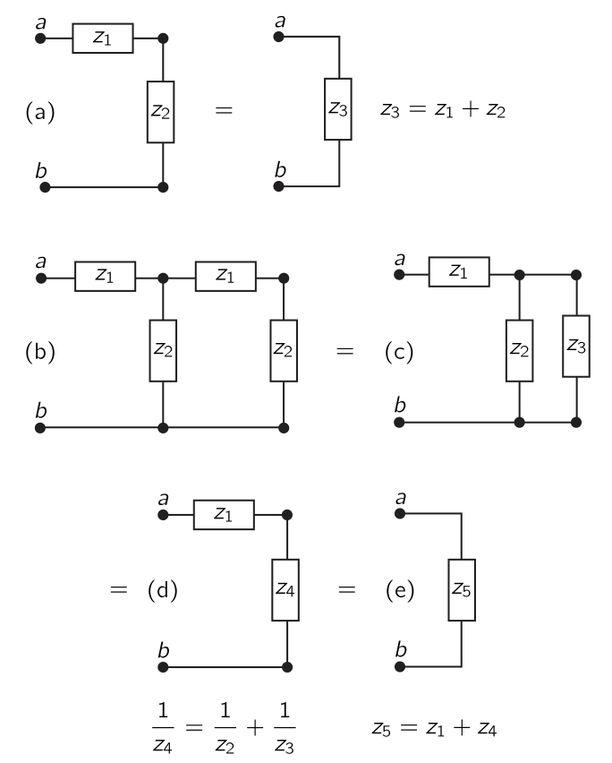{#fig-FLP_2_22_18 width=400}

이제 직렬 및 병렬 조합으로 분석할 수 있는 흥미로운 회로에 대해 알아보자. @fig-FLP_2_22_18 (a) 를 보자. 이 경우 $a$ 단자에서 $b$ 단자까지의 임피던스가 $z_1+z_2$ 임을 알 수 있다. @fig-FLP_2_22_18 (b) 는 조금 더 어렵다. 키르히호프 규칙을 사용하는 것보다 직렬 및 병렬 조합을 사용하는 것이 더 쉽다. 오른쪽 끝에 있는 두 임피던스를 단일 임피던스 $z_3 = z_1 + z_2$ 로 교체할 수 있으며, 이는 (c) 와 같다. 그렇다면 $z_2$ 와 $z_3$ 는 그림의 (d) 에 보이는 동등한 병렬 임피던스 $z_4$ 로 교체할 수 있으며 마지막으로, $z_1$ 과 $z_4$ 는 (e) 와 같이 단일 임피던스 $z_5$ 와 동등하다.

:::

 

::: {#exm-FLP_chapter_2_22_5}

#### 무한 사다리의 임피던스-1

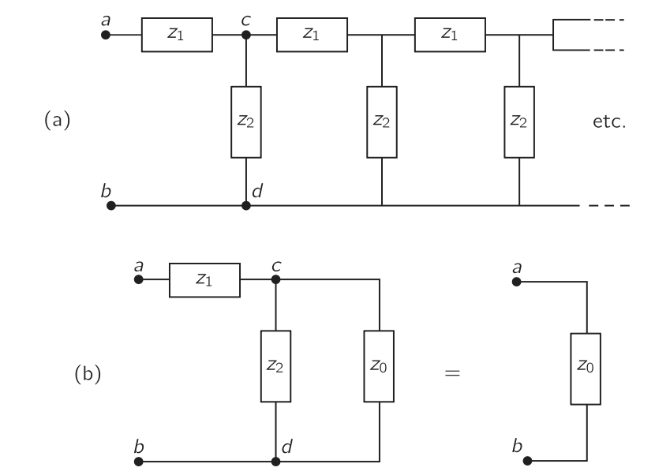{#fig-FLP_2_22_19 width=450}

이제 우리는 재미있는 질문을 할 수 있다: @fig-FLP_2_22_18 (b) 의 네트워크에서 우리가 영원히 더 많은 섹션을 계속 추가하여 @fig-FLP_2_22_19(a) 의 점선으로 표시된 부분이 무한히 이어지는 무한 네트워크라면? 이건 그렇게 어렵지 않다. 우선 끝에 섹션을 하나 더 추가하더라도 무한 네트워크가 변하지 않는다는 것을 안다. 무한 네트워크의 두 단자 $a$ 와 $b$ 사이의 임피던스를 $z_0$ 라고 하면, 두 단자 $c$ 와 $d$ 의 오른쪽에 있는 모든 요소들의 임피던스도 $z_0$ 가 된다. 따라서 우리는 @fig-FLP_2_22_19 (b) 와 같이 네트워크를 표현할 수 있다. $z_2$ 와 $z_0$ 의 병렬 조합을 형성하고 그 결과를 $z_1$과 직렬로 더하면, 이 회로의 임피던스는 다음과 같다.

$$
z = z_1 + \dfrac{1}{(1/z_2)+(1/z_0)} \quad \text{or}\quad z = z_1 + \dfrac{z_2z_0}{z_2 + z_0}.
$$

그런데 이 임피던스는 $z_0$ 와 같으므로

$$
z_0 = z_1 + \dfrac{z_2 z_0}{z_2+z_0}.
$$

비로소 $z_0$ 를 얻을 수 있다.

$$
z_0 = \dfrac{z_1}{2} + \sqrt{(z_1^2/4)^2  + z_1z_2}.
$$ {#eq-FLP_2_22_27}

우리는 반복되는 직렬 및 병렬 임피던스의 무한 사다리에 대한 임피던스를 구했다. 이 때 임피던스 $z_0$ 를 이러한 무한 네트워크의 **특성 임피던스 (characteristic impedance)** 라고 한다.

:::

 

::: {#exm-FLP_chapter_2_22_6}

#### 무한 사다리의 임피던스-2

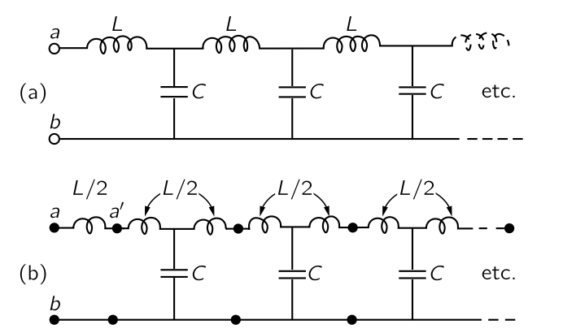{#fig-FLP_2_22_20 width=450}

이제 @fig-FLP_2_22_20 (a) 에 표시된 바와 같이, 직렬 요소가 인덕턴스 $L$ 이고 분기된 요소가 정전용량 $C$ 인 구체적인 예를 살펴보자. 이 경우 우리는 $z_1 = i\omega L$ 와 $z_2 = 1/i\omega C$ 로 설정하여 앞서 보았던 무한 네트워크의 임피던스를 구하고자 한다. @eq-FLP_2_22_27 의 첫 번째 항 $z_1/2$ 은 첫 번째 요소의 임피던스의 절반에 해당한다. 따라서 무한 네트워크를 @fig-FLP_2_22_20 (b) 와 같이 그리면 더 자연스럽거나 최소한 다소 단순해 보일 것이다. $a'$ 단자에서 무한 네트워크를 보면 특성 임피던스를 확인할 수 있다.

$$
z_0 = \sqrt{(L/C)−(\omega^2L^2/4)}.
$$ {#eq-FLP_2_22_28}

이제 진동수 $\omega$ 에 따라 두 가지 흥미로운 경우가 있다. $\omega^2 < 4/LC$ 이면 임피던스 $z_0$ 는 실수이며, $\omega^2 > 4/LC$ 이면 $z_0$ 는 허수로 

$$
z_0=i\sqrt{(\omega^2L^2/4)-(L/C)}
$$

이다. 인덕턴스와 정전용량 같은 허수 임피던스만을 포함하는 회로는 허수 임피던스를 갖게 된다. 그렇다면 현재 우리가 연구하고 있는 $L$ 과 $C$ 만 있는 회로에 대해 진동수가 $\sqrt{4/LC}$ 보다 작을 때, 어떻게 순수한 저항일 수 있을까? 높은 주파수에서는 임피던스가 순전히 허수이므로, 이는 앞서 언급한 바와 일치한다. 저주파에서는 임피던스가 순수한 저항이며 따라서 에너지를 흡수합니다. 하지만 회로가 인덕턴스와 정전용량만으로 구성된다면, 저항과 같이 에너지를 지속적으로 흡수할 수 있는 방법은 무엇인가? **답변:** 인덕턴스와 커패시턴스가 무한히 존재하기 때문에, 전원이 회로에 연결될 때 첫 번째 인덕턴스와 커패시턴스에 에너지를 공급하고, 그 다음 두 번째 인덕턴스와 세 번째에 에너지를 공급하며, 이것이 계속 이어진다. 이와 같은 회로에서는 에너지가 일정한 속도로 발전기로부터 지속적으로 흡수되어 네트워크로 끊임없이 흐르며, 그 과정에서 인덕턴스와 정전용량에 저장된 에너지를 공급한다.

이 아이디어는 회로에서 일어나고 있는 일에 대해 흥미로운 점을 제시한다. 우리는 소스를 프론트엔드에 연결하면, 그 소스의 효과가 네트워크를 통해 무한한 끝으로 전파될 것으로 예상한다. 직선상에서 파동이 전파되는 것은 구동원으로부터 에너지를 흡수하는 안테나의 복사와 매우 유사하다; 즉, 임피던스가 실수일 때, 즉 $\omega < \sqrt{4/LC}$ 일 때 이러한 전파가 발생할 것으로 기대합니다. 하지만 임피던스가 순허수일 때, 즉 $\omega > \sqrt{4/LC}$ 인 경우, 우리는 그러한 전파를 기대하지 않을 것이다.

:::

### $\mathrm{II}$.22-7 필터 {#sec-FLP_2_22_7}

우리는 마지막 절에서 @fig-FLP_2_22_20 의 무한 사다리 네트워크가 특정 임계 진동수 $\sqrt{4/LC}$ 이하의 진동수로 구동될 경우 지속적으로 에너지를 흡수한다는 것을 확인했다. 앞으로 이를 **차단 진동수 (cutoff frequency)** $\omega_0$ 라고 부를 것이다. 우리는 이 효과를 지속적인 에너지 전달이라는 관점에서 이해될 수 있다고 제안했다. 반면에, $\omega > \omega_0$ 인 고주파에서는 에너지의 연속적인 흡수가 존재하지 않으며, 따라서 전류가 매우 멀리 “penetrate”되지 않을 수도 있다고 예상할 수 있다. 이 아이디어들이 옳은지 확인해 보자.

사다리의 앞부분을 어떤 교류 발전기에 연결했다고 가정하고, 사다리의 754번째 구간에서 전압이 어떻게 보이는지 물어보는다고 가정해 보자. 네트워크가 무한하기 때문에, 한 구간에서 다음 구간으로 전압이 변하는 일은 항상 동일합니다; 따라서 어떤 구간, 예를 들어 $n$ 번째 구간에서 다음 구간으로 갈 때 어떤 일이 일어나는지 살펴보겠습니다. 우리는 @fig-FLP_2_22_21 (a) 에 표시된 대로 전류 $I_n$ 과 전압 $V_n$ 을 정의한다.

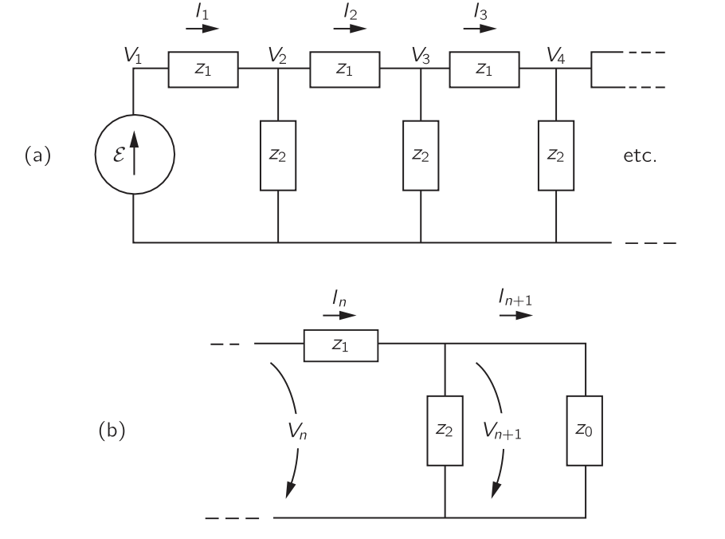{#fig-FLP_2_22_21 width=450}

$V_n$ 으로부터 전압 $V_{n+1}$ 을 얻을 수 있으며, $n$ 번째 구간 이후의 나머지 부분을 특성 임피던스 $z_0$ 로 교체할 수 있다는 점을 기억하라. 그러면 @fig-FLP_2_22_21 (b) 의 회로만 분석하면 된다. 우선 $z_0$ 를 가로지르는 모든 $V_n$ 은 $I_n z_0$ 와 같아야 한다 또한, $V_n$ 과 $V_{n+1}$ 의 차이는 단지 $I_n z_1$ 이다.

$$
V_n − V_{n+1} = I_n z_1 = V_n\dfrac{z_1}{z_0}.
$$

이로부터 

$$
\dfrac{V_{n+1}}{V_n} = 1−\dfrac{z_1}{z_0}=\dfrac{z_0−z_1}{z_0}.
$$

이 비율을 사다리의 한 구간에 대한 전파 계수라고 하며, $\alpha$ 라고 표기하자. 이 관계는 모든 섹션에서 동일하다.

$$
\alpha := \dfrac{z_0−z_1}{z_0}.
$$ {#eq-FLP_2_22_29}

이 때 $n$ 번째 구간 이후의 전압은

$$
V_n = \alpha^n\mathcal{E}.
$$ {#eq-FLP_2_22_30}

이제 754 구간 이후에 전압은 $\alpha^{754}\mathcal{E}$ 임을 안다.

@fig-FLP_2_22_20 (a) 의 $L‐C$ 사다리에서 $α$ 가 어떻게 보이는지 생각해보자. @eq-FLP_2_22_27 에서 $z_0$ 를 사용한다. 그리고 $z_1=i\omega L$ 이다. 이로부터 

$$
\alpha = \dfrac{\sqrt{(L/C)−(\omega^2L^2/4)} - i (\omega L/2)}{\sqrt{(L/C)−(\omega^2L^2/4)} + i (\omega L/2)}
$$ {#eq-FLP_2_22_31}

구동 진동수가 차단진동수 $\omega_0=\sqrt{4/LC}$ 이하인 경우, $|\alpha|=1$ 이므로

$$
\alpha = e^{i\delta},
$$

로 쓸 수 있다. 즉, 전압의 크기는 모든 구간에서 동일하고 위상만 변화한다. 위상 변화 $\delta$ 는 실제로 음수이며, 전압이 네트워크를 따라 전달되는 동안의 *지연(delay)* 을 나타낸다.

$\omega > \omega_0$ 에 대해서는 @eq-FLP_2_22_31 의 분자와 분모에서 $i$ 를 제거하면

$$
\alpha = \dfrac{\sqrt{(\omega^2L^2/4)-(L/C)} - (\omega L/2)}{\sqrt{(\omega^2L^2/4)- (L/C)} + (\omega L/2)}.
$${#eq-FLP_2_22_32}

전파 계수 $\alpha$ 이며, $\alpha<1$ 이다. 즉, 어느 구간의 전압은 항상 이전 구간의 전압보다 $\alpha$ 배 낮다. $\omega_0$ 보다 높은 모든 진동수에 대해, 네트워크를 따라 이동함에 따라 전압이 빠르게 소모된다. $\alpha$ 의 절대값을 $\omega$ 함수로 보면 @fig-FLP_2_22_22 와 같다.

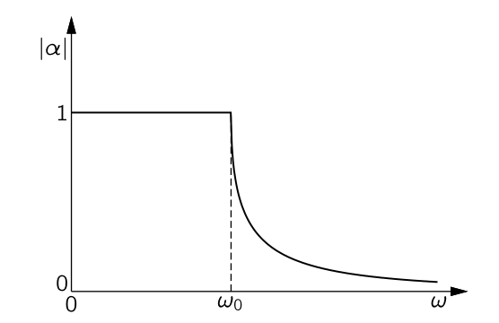{#fig-FLP_2_22_22 width=250}

이 네트워크에서 저주파는 “통과”하고 고주파는 “거부” 하거나 “필터링된다”고 말한다. 진동수에 따라 정해진 방식으로 특성이 변하도록 설계된 모든 네트워크를 **필터 (filter)** 라고 한다. 낮은 진동수가 통과하므로 **low-pass filter** 라고 한다.

당연히 실제로 일어날 수 없는 무한 네트워크에 대한 논의가 왜 이렇게 많은지 궁금하실 수도 있다. 핵심은 유한 네트워크에서 동일한 특성이 특성 임피던스 $z_0$ 와 같은 임피던스로 마무리하면, 유한 네트워크에서도 발견된다는 점이다. 현재 실제로는 $R$, $L$, $C$ 와 같은 몇 가지 간단한 요소만으로 특성 임피던스를 정확히 재현하는 것이 불가능하다. 하지만 특정 주파수 범위에 대해 공정한 근사값을 적용하면 종종 그렇게 할 수 있다. 이와 같이 하면 무한 네트워크의 경우와 거의 동일한 특성을 가진 유한 필터 네트워크를 만들 수 있다. 예를 들어, $L‐C$ 사다리는 순수 저항 $R=\sqrt{L/C}$ 에서 종료될 경우, 우리가 설명한 대로 거의 동일하게 동작한다.

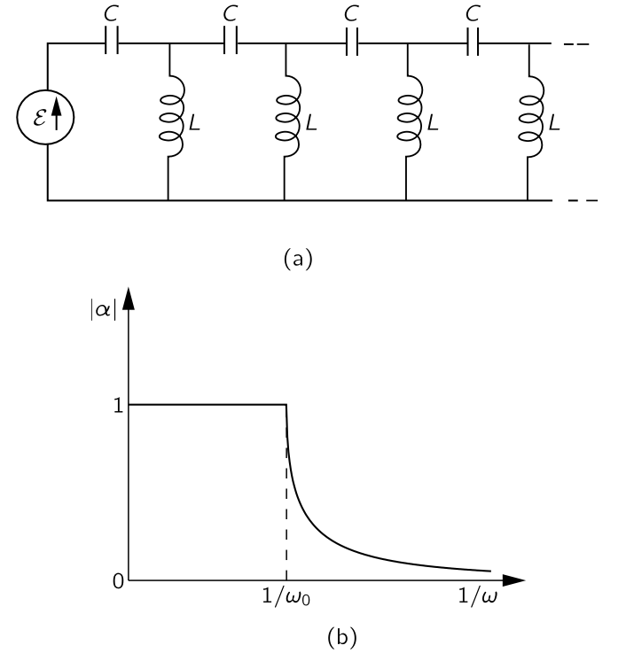{#fig-FLP_2_22_23 width=350}

우리의 $L‐C$ 사다리에서 $L$ 과 $C$ 의 위치를 교환하여 @fig-FLP_2_22_23 (a) 에 표시된 사다리를 만들면, 고주파를 전파하고 저주파를 차단하는 필터가 된다. @eq-FLP_summary_impedence_of_passive_element 을 보면 @eq-FLP_2_22_32 에서 $(L,\,C,\,\omega)$ 를 $(C,\, L,\,1/\omega)$ 로 바꾸면 된다. 이는 @fig-FLP_2_22_23 (b) 에서 보이는 것고 ㅏ같다.

이러한 low-pass 및 high-pass 필터는 다양하게 이용된다. $L-C$ low-pass 필터는 직류 전원 공급 장치에서 종종 "smoothing" 필터로 사용된다. 교류 전원으로부터 직류 전력을 만들려면 전류가 한 방향으로만 흐르도록 허용하는 정류기부터 시작한다. 정류기에서 @fig-FLP_2_22_24 에 표시된 함수 $V(t)$ 와 같은 일련의 펄스를 얻을 수 있는데, 이는 위아래로 흔들리기 때문에 형편없는 직류이다. 정류기와 부하 사이에 low-pass 필터를 삽입함으로써 직류에 근접한 전류를 얻을 수 있다.

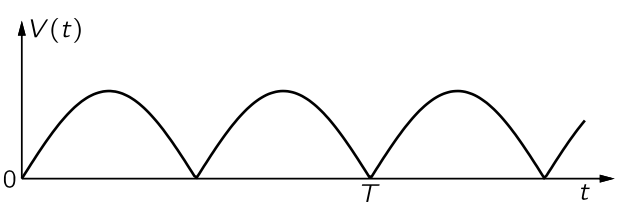{#fig-FLP_2_22_24 width=350}

@fig-FLP_2_22_24 의 시간에 대한 함수는 푸리에 급수로 의해 표현될 수 있다는 것을 안다. 우리의 필터가 선형이라면(우리가 가정해 온 바와 같이 $L$ 과 $C$ 가 전류나 전압에 따라 변하지 않는 경우) 필터에서 나오는 것은 입력에서 각 부품의 출력이 겹쳐진다. 우리 필터의 절단 주파수 $\omega_0$ 가 함수 $V(t)$ 에서 가장 낮은 주파수보다 훨씬 낮게 배치하면, ω=0인 dc는 잘 흐르지만 첫 번째 고조파의 진폭이 크게 감소합니다. 그리고 고조화음의 진폭은 더욱 감소될 것입니다. 따라서 우리는 원하는 만큼 부드러운 출력을 얻을 수 있으며, 이는 우리가 구매할 의향이 있는 필터 섹션의 수에만 달려 있습니다.

특정 저주파를 차단하고자 할 경우 고역통과 필터를 사용합니다. 예를 들어, 축음기 앰프에서는 고역통과 필터를 사용하여 음악을 통과시키는 동시에 턴테이블 모터에서 발생하는 저음의 울림을 차단할 수 있습니다.

또한 “밴드패스” 필터를 만들어 특정 주파수 ω1 이하와 다른 주파수 ω2 이상(ω1보다 큰 주파수)을 차단하고, ω1과 ω2 사이의 주파수를 통과하도록 하는 것이 가능합니다. 이는 고역 통과 필터와 저역 통과 필터를 결합함으로써 간단히 수행할 수 있지만, 일반적으로는 임피던스 z1과 z2가 더 복잡한 사다리를 만들어 각각 L과 C의 조합이 되도록 하는 경우가 더 일반적입니다. 이러한 대역통과 필터는 그림 22–25(a)에 표시된 것과 같은 전파 상수를 가질 수 있습니다. 예를 들어, 고주파 전화 케이블의 여러 음성 채널 각각이나 라디오 전송의 변조 반송선과 같이 주파수 간격만을 차지하는 신호를 분리하는 데 사용될 수 있습니다.

## $\textrm{II}$.23 공동 공진 {#sec-FLP_2_23}

## $\textrm{II}$.24 웨이브가이드 {#sec-FLP_2_24}