 

## $\textrm{II}$.25 전기동역학의 상대론적 표기법 {#sec-FLP_2_25}

### $\textrm{II}$.25-1 4-벡터 {#sec-FLP_2_25_1}

이제 특수 상대성 이론을 전기역학에 적용하는 것에 대해 알아보자. 우리는 앞서 특수 상대성 이론을 알아보았으므로 기본 아이디어를 간단히 짚고 넘어가겠다..

실험적으로 우리가 균일한 속도로 움직인다면 물리학 법칙은 변하지 않는 것으로 밝혀졌다. 우주선 밖을 바라보거나 최소한 외부 세계와 관련된 관찰을 하지 않는 한, 직선으로 일정한 속도로 이동하는 우주선 안에 있는지 알 수 없다. 우리가 기록하는 모든 진정한 물리학 법칙은 자연의 이 사실이 내재하도록 배치되어야 한다다.

두 좌표계 $S,\,S'$ 에서 $S'$ 이 $S$ 에 대해 균일한 속도 $v\bf{e}_x$ 로 움직이는 경우의 공간과 시간 사이의 관계는 로렌츠 변환으로 주어진다.

$$
t' = \dfrac{t - vx}{\sqrt{1-v^2}},\qquad x' = \dfrac{x-t}{\sqrt{1-v^2}},\qquad y'=y,\qquad z'=z.
$$ {#eq-FLP_2_25_1}

로렌츠 변환 후에 물리법칙의 새로운 형태의는 옛 형태와 똑아야 한다. 이는 물리 법칙이 좌표계의 방향에 의존하지 않는다는 원리와 같다. [$\mathrm{I}$.11 벡터](../vol1/vol1_1.qmd#sec-FLP_1_11) 에서 우리는 회전에 관한 물리학의 불변성을 수학적으로 설명하는 방법이 방정식을 벡터로 표현하는 것임을 보였다.

예를 들어, 두 개의 벡터 $\bf{A}=(A_x,A_y,A_z)$ 와 $\bf{B}=(B_x,B_y,B_z)$ 에 대해

$$
\bf{A\cdot B} = A_xB_x + A_yB_y + A_zB_z
$$

를 회전 좌표계로 변환했을 경우 변하지 않았다. 따라서 방정식의 양변에 $\bf{A\cdot B}$ 와 같은 스칼라 곱이 있으면, 그 방정식은 모든 회전 좌표계에서 정확히 동일한 형태를 갖게 된다. 우리는 또한 연산자 $\nabla$ 를 스칼라 함수에 적용했을 때, 벡터와 같이 변환되는 세 개의 양을 얻는다는 것을 알게 되었다. 이 연산자를 사용하여 우리는 기울기를 정의했으며, 다른 벡터와 결합하여 발산과 라플라시안을 정의했다. 마침내 우리는 두 벡터의 구성 요소 쌍의 특정 곱들의 합을 취함으로써 새로운 벡터와 유사하게 동작하는 세 개의 새로운 양을 얻을 수 있음을 발견했습니다. 우리는 그것을 두 벡터의 벡터곱(cross product) 이라고 부른다. $\nabla$ 연산자와 벡터곱을 사용하여 우리는 벡터의 컬을 정의했다.

특수 상대성 이론의 경우 시간과 공간은 불가분하게 뒤섞여 있으며, 우리는 4차원에 대해 유사한 일을 해야 한다. 우리는 회전뿐만 아니라 모든 관성 기준틀에 대해서도 방정식이 동일하게 유지되기를 원한다. 즉, 우리의 방정식은 로렌츠 변환(@eq-FLP_2_25_1) 하에서 불변이어야 한다. 이 장의 목적은 그것을 어떻게 할 수 있는지 보이는 것이다. 하지만 시작하기 전에, 우리는 작업을 훨씬 더 쉽게 하면서 혼란을 줄일 수 있는 무언가를 하려 한다. 그리고 그것은 빛의 속도 $c$ 가 $1$ 과 같도록 길이와 시간의 단위를 선택하는 것이다. 시간 단위를 빛이 1미터를 이동하는 데 걸리는 시간(약 3×10−9 초)이라고 생각하면 된다. 우리는 이 시간 단위를 “1미터”라고 부를 수도 있다. 이 단위를 사용하면, 우리의 모든 방정식이 시공간 대칭을 보다 명확하게 보여줄 것이다. 또한, 모든 $c$ 는 우리의 상대론적 방정식에서 사라질 것이다. (만약 이것이 불편하시다면, 모든 t를 ct로 교체하거나, 일반적으로 필요한 곳마다 $c$ 를 붙여 넣어 방정식의 차원을 정확히 만들 수 있다.) 이 기초 작업을 통해 우리는 시작할 준비가 되었다. 우리 프로그램은 시공간의 4차원에서 3차원을 위한 벡터를 사용한 모든 작업을 수행하는 것이다. 정말 꽤 간단한 게임이며, 우리는 단지 유추에 따라 작업한다. 유일한 실제 복잡성은 표기법(우리는 이미 3차원에 대해 벡터 기호를 다 사용했습니다)과 약간의 기호 변형이다.

먼저, 3차원 벡터와 유사하게, 우리는 4벡터를 4개의 양으로 구성된 집합으로 정의하고 $(X^0,\,X^1,\,X^2,\,X^3)$ 와 같이 표기하는데, 이동하는 좌표계에서 $t, x, y, z$ 와 같이 변환된다. 네 개 벡터에 대해 사람들이 사용하는 여러 가지 표기법이 있다. $X^\mu$ 라고 쓰면 $(X^0,\,X^1,\,X^2,\,X^3)$ 를 의미한다. 즉, $\mu$ 는 $0,\,1,\,2,\,3$ 의 네 가지 값을 취할 수 있다. 때때로 세 개의 공간 성분을 다음과 같이 삼중 벡터로 표시하는 것이 편리할 수 있다: $X^\mu=(X^0,\bf{X})$.

우리는 이미 [$\mathrm{I}$.17 시공간](../vol1/vol1_2.qmd#sec-FLP_1_17) 에서 입자의 에너지와 운동량으로 구성된 4벡터를 하나 접했다. 새로운 표기법으로는 다음과 같다.

$$
P^\mu = (E,\,\bf{p}).
$$ {#eq-FLP_2_25_2}

이것은 물리학에서 각 3벡터마다 남은 구성 요소가 무엇이어야 하는지를 찾기만 하면 4벡터가 되는 정말 매우 간단한 게임처럼 보인다.  하지만 이것이 사실이 아님을 보이는데는 속도 벡터 $\bf{v}$ 를 생각해 보면 된다. 그렇다면 속도벡터에 대한 시간 성분은 무엇인가 이다? 네 개의 벡터가 $t,\, x,\, y,\, z$ 와 같으므로, 우리는 시간 성분이

$$
V^0=\dfrac{dt}{dt}=1
$$

이라고 결론을 내릴 수도 있다. 하지만 이것은 잘못되었다. 그 이유는 로렌츠 변환을 할 때 각 분모의 $t$ 가 불변이 아니기 때문이다. 분자들은 네 벡터를 만들기에 올바른 동작을 가지고 있지만, 분모의 $dt$ 는 상황을 망친다. 이는 비대칭이며 두 개의 서로 다른 시스템에서 동일하지 않다.

결과적으로, 우리가 적어 놓은 네 개의 “속도” 구성 요소는 $\sqrt{1−v^2}$ 로 나누면 네 벡터의 구성 요소가 된다. 우리는 그것이 사실임을 알 수 있다, 왜냐하면 모멘텀 4벡터부터 시작하면

$$
P^\mu = (E,\bf{p}) = \left(\dfrac{m}{\sqrt{1−v^2}},\,\dfrac{m \bf{v}}{\sqrt{1-v^2}}\right),
$$ {#eq-FLP_2_25_3}

이것을 질량 $m$ 으로 나누면, 이는 4차원에서 불변 스칼라이며,

$$
\dfrac{P^\mu}{m}=\left(\dfrac{1}{\sqrt{1−v^2}},\,\dfrac{ \bf{v}}{\sqrt{1-v^2}}\right)
$$ {#eq-FLP_2_25_4}

이것은 여전히 4벡터여야 한다. (불변 스칼라로 나누어도 변환 속성은 변하지 않는다.) 따라서 우리는 속소 4-벡터를 다음과 같이 정의할 수 있다.

$$
U^\mu = \left(\dfrac{1}{\sqrt{1−v^2}},\,\dfrac{ v_x}{\sqrt{1-v^2}},\,\dfrac{ v_y}{\sqrt{1-v^2}},\,\dfrac{ v_z}{\sqrt{1-v^2}}\right)
$$

4속도는 유용한 양이다.: 예를 들어 우리는 다음과 같이 쓸 수 있다.

$$
P^\mu = mU^\mu.
$$ {#eq-FLP_2_25_6}

이는 상대론적으로 올바른 방정식이 가져야 할 전형적인 형태다. 각 변은 4-벡터이다. 오른쪽은 불변량에 4벡터를 곱한 것으로, 여전히 4벡터이다.

### $\mathrm{II}$.25–2 스칼라곱 {#sec-FLP_2_25_2}

좌표 회전 하에서 점이 원점으로부터의 거리가 변하지 않는 것은 인생의 우연이다. 이는 수학적으로 $r^2=x^2+y^2+z^2$ 가 불변량임을 의미한다. 다시 말해, 회전 이후 $r'^2=r^2$ 이다. 이제 질문은 다음과 같다: 로런츠 변환 하에서 불변인 유사한 양이 존재하는가? 물론이다. @eq-FLP_2_25_1 로부터 볼 수 있다

$$
t'^2−x'^2=t^2−x^2.
$$

이것은 꽤 괜찮지만  $x$-방향의 선택에 따라 달라진다. 우리는 $y^2$ 와 $z^2$ 를 빼면 이를 해결할 수 있다. 로런츠 변환에 회전을 더하면 양은 변하지 않는다. 따라서 4차원에서 3차원에 대해 $r^2$ 와 유사한 양은

$$
t^2−x^2−y^2−z^2.
$$

이는 **완전 로런츠 군 (complete Lorentz group)** 이라고 불리는 불변량이며, 이는 일정한 속도와 회전에서 두 평행 이동을 변환하는 것을 의미한다.

이제 이 불변성은 방정식의 변환 규칙 @eq-FLP_2_25_1 과 회전에만 의존하는 대수적 문제이므로 이는 모든 사변수 $X^\mu$ 에 대해 참이다(정의상 모두 동일하게 변환된다.) 

::: {.callout-note icon="false"}

#### 4-벡터의 제곱 거리

아래와 같이 정의된 $|X^\mu|^2$ 을 4-벡터 $X^\mu$ 의 제곱거리라고 한다.
$$
|X^\mu|^2 = X_\mu X^\mu := (X^0)^2-(X^1)^2 - (X^2)^2 - (X^3)^2 = X'_\mu X'^\mu
$$ {#eq-FLP_2_25_8}

:::

이제 두 벡터 $A^\mu$ 와 $B^\mu$ 에 대해 

$$
A_\mu B^\mu = A^\mu B_\mu = A^0B^0-A^1B^1 - A^2B^2 - A^3B^3 
$$ {#eq-FLP_2_25_7}

역시 불변(스칼라) 양이다. 로렌츠 변환 하에서 스칼라 곱의 불변성은 다음과 같이 표현될 수 있다.

$$
A'_\mu B'^\mu   = A_\mu B^\mu.
$$

@eq-FLP_2_25_7 의 마지막 세 항은 3차원에서의 스칼라곱이므로, $A^\mu = (A^0,\,\bf{a})$, $B^\mu = (B^0,\,\bf{b})$ 일 때 종종 이렇게 쓰기도 한다.

$$
A_\mu B^\mu = A^0B^0 − \bf{a \cdot b}.
$$

::: {#exm-FLP_chaper_2_25_1}

#### 반양성자 생성

반양성자 $\overline{p}$ 는 거대 가속기에서 다음 반응으로 생성된다.

$$
p+p  \to p + p + p + \overline{p}.
$$

즉, 높은 에너지의 양성자($p$) 가 정지 중인 양성자와 충돌하할 때, 입사 양성자에 충분한 에너지가 있다면 원래의 두 양성자 외에 양성자‐반양성자 쌍이 생성될 수 있다. 질문은 다음과 같다: 이 반응이 가능하려면 입사 양성자의 에너지는 어느정도여야 하는가?

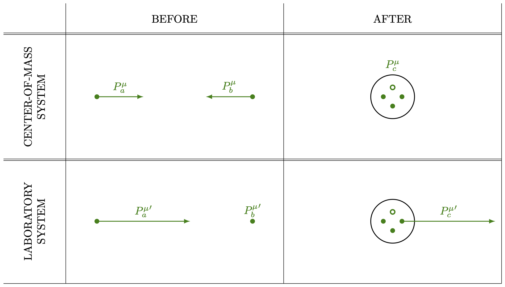{#fig-FLP_2_25_1 width=500}

답을 얻는 가장 쉬운 방법은 질량 중심(CM) 좌표계에서 보는 것이다(@fig-FLP_2_25_1 을 참고하라). 우리는 입사 양성자 $a$ 의 4-운동량을 $P^\mu_a$ 라고 하자. 마찬가지로 표적 양성자 $b$ 의 4-운동량을 $P^\mu_b$ 라고한다. 만약 입사 양성자가 반응을 일으키기에 아슬아슬하게 충분한 에너지를 가지고 있다면, 충돌 후의 최종 상태는 CM 좌표계에서 정지된 세 개의 양성자 반양성자로 구성된 한덩어리이다. 입사 에너지가 약간 더 높다면, 최종 상태 입자들은 약간의 운동 에너지를 가지고 서로 떨어지게 된다. 입사 에너지가 약간 낮다면 네 입자를 만들 충분한 에너지가 없을 것이다.

최종 상태에서 전체 구의 총 4-운동량을 $P^\mu_c$ 라고 하면, 에너지와 운동량의 보존으로부터 $\bf{p}_a+\bf{p}_b=\bf{p}_c$ 와 $E_a+E_b=E_c$ 를 얻는다. 이 두 방정식을 결합하면, 

$$
P^\mu_a + P^\mu_b = P^\mu_c.
$$ {#eq-FLP_2_25_9}

릉 얻는다. 이제 중요한 점은 이것이 4-벡터 사이의 방정식이며, 따라서 모든 관성 좌표계에서 성립한다는 이 사실을 사용하여 계산을 단순화할 수 있다. @eq-FLP_2_25_9 의 양쪽의 의 길이가 동일하다는 것부터 시작한다.

$$
|P_a^\mu + P_b^\mu|^2 = |P_c^\mu|^2.
$$ {#eq-FLP_2_25_10}

$|P_c^\mu|$ 는 불변이므로, 어떤 좌표계에서도 이를 평가할 수 있다. CM 시스템에서, $P_c^\mu$ 의 시간 성분은 네 개의 양성자의 정지 에너지이며 이를 $4M$ 이라고 하자. $P_c^\mu$ 공간 부분은 0 이므로 $P_c^\mu = (4M, \bf{0})$ 이다. 우리는 반양성자의 정지질량이 양성자의 정지질량과 같다는 사실을 사용했으며, 이 공통 질량을 $M$ 이라고 했다. 따라서 @eq-FLP_2_25_10 은

$$
P_a^\mu P_a^\mu + 2P_a^\mu P_b^\mu  + P_b^\mu P_b^\mu =16M^2.
$$ {#eq-FLP_2_25_11}

여기서 질량 $m$ 인 입자에 대해 

$$
P^\mu P^\mu = E^2−\|\bf{p}\|^2 = m^2.
$$

이다. 이것은 직접 계산으로 보일 수도 있지만 정지된 입자에 대해 $P^\mu=(m,0)$ 으로부터 $|P^\mu|^2=m^2$ 으로 보일 수도 있다. 이것은 불변량이므로 모든 기준틀에서 $m^2$ 와 같다. 이 결과를 @eq-FLP_2_25_11 에 사용하면

$$
P_a^\mu P_b^\mu =7M^2.
$$ {#eq-FLP_2_25_12}

이제 우리는 실험실 기준틀에서 $P_a^\mu P_b^\mu = {P_a^\mu}' {P_b^\mu}'$ 를 평가할 수 있다. ${P_a^\mu}'= (E_a',\,\bf{p}_a′)$ 이며 실험실 기준틀에서 $b$ 는 정지된 양성자이므로 ${P_b^\mu}'=(M,\,0)$ 이다. 따라서 ${P_a^\mu}' {P_b^\mu}' = ME_a′$ 와 이며 스칼라 곱이 불변이므로 이는 @eq-FLP_2_25_12 와 동일해야 합니다. 이로부터

$$
E_a'= 7M.
$$

이것은 우리가 물었던 결과입니다. 초기 양성자의 총 에너지는 최소 $7M$(약 $6.6\,\text{GeV}$, $M=938\,\text{MeV})$ 이어야 하며, 나머지 질량 $M$ 을 제외하면 운동 에너지는 최소 $6M$(약 $5.6\,\text{GeV}$)이어야 한다. 버클리의 베바트론 가속기는 가속하는 양성자에게 약 $6.2\,\text{GeV}$ 의 운동 에너지를 부여하도록 설계되었으며, 이를 통해 반양성자를 만들 수 있게 되었다.

스칼라 곱은 불변이기 때문에 평가하기에 항상 흥미롭다. 4-속도의 제곱길이 $U^\mu U^\mu$ 는

$$
U^\mu U^\mu =\dfrac{1}{1-v^2} - \dfrac{v^2}{1-v^2} = 1.
$$

따라서 $U^\mu$ 는 단위 4-벡터 이다.
:::

### $\mathrm{II}$.25–3 4차원 그래디언트 {#eq-FLP_2_25_3}

#### **4-그래디언트**

다음에 논의해야 할 사항은 그라디언트의 4차원 유사체이다. 3차원 공간에서의 그래디언트를 생각하면 4차원 그래디언트가 $(\partial/\partial t,\partial / \partial x,\partial /\partial y, \partial /\partial z)$ 이어야 한다고 추정할 수 있지만 이것은 잘못되었다. 오류를 확인해보자. $x$ 와 $t$ 에만 의존하는 스칼라 함수 $\phi$ 를 생각하자. $x$ 를 일정하게 유지하면서 $t$ 에 작은 변화 $\Delta t$ 를 가할 경우,

$$
\Delta \phi = \dfrac{\partial \phi}{\partial t}\Delta t.
$$ {#eq-FLP_2_25_13}

반면에, 움직이는 관찰자에 대해서는

$$
\Delta \phi = \dfrac{\partial \phi}{\partial x'}\Delta x' +  \dfrac{\partial \phi}{\partial t'}\Delta t'
$$

우리는 @eq-FLP_2_25_1 을 사용하여 $\Delta x'$ 와 $\Delta t'$ 를 $\Delta t$ 로 표현할 수 있다. 여기서 $x$ 를 일정하게 유지하고 있으므로 $\Delta x=0$ 이다. 따라서 

$$
\Delta x' = - \dfrac{v}{\sqrt{1-v^2}} \Delta t;\qquad \Delta t' = \dfrac{\Delta t}{\sqrt{1-v^2}}
$$

이므로

$$
\Delta \phi = \dfrac{\partial \phi}{\partial x'}\left(- \dfrac{v}{\sqrt{1-v^2}} \Delta t \right) +  \dfrac{\partial \phi}{\partial t'} \left(\dfrac{\Delta t}{\sqrt{1-v^2}} \right)
$$

이 결과를 @eq-FLP_2_25_13 과 비교하면

$$
\dfrac{\partial \phi}{\partial t} = \dfrac{1}{\sqrt{1−v^2}}\left( \dfrac{\partial \phi}{\partial t'} − v \dfrac{\partial \phi}{\partial x'}\right).
$$ {#eq-FLP_2_25_14}

지금까지와 비슷하게 계산하면 다음을 얻는다.

$$
\dfrac{\partial \phi}{\partial x}=\dfrac{1}{\sqrt{1−v^2}} \left( \dfrac{\partial \phi}{\partial x'}− v \dfrac{\partial \phi}{\partial t'}\right).
$$ {#eq-FLP_2_25_15}

이 그래디언트가 다소 이상하지 않은가? @eq-FLP_2_25_1 으로부터의 $x$ 와 $t$ 에 대한 $x'$ 와 $t'$ 에 대한 공식은 

$$
t=\dfrac{t'+vx'}{\sqrt{1−v^2}}, \qquad x = \dfrac{x'+vt'}{\sqrt{1−v^2}}
$$

으로 이것은 4-벡터가 변환되는 방식이다. 하지만 @eq-FLP_2_25_14 와 @eq-FLP_2_25_15 는 몇 개의 부호가 잘못되었다!

해법은 잘못된 $(\partial /\partial t,\nabla)$ 대신, $\nabla_μ$ 라고 부를 4차원 그래디언트 연산자를 정의해야 한다는 것이다.

::: {.callout-note icon="false"}

#### **4 차원 그래디언트 연산자**

4차원 그래디언트 연산자 $\nabla_\mu$ 는 아래와 같이 정의된다.
$$
\nabla_\mu := \left(\dfrac{\partial}{\partial t},\,−\nabla\right) = \left(\dfrac{\partial}{\partial t},\,−\dfrac{\partial }{\partial x},\, -\dfrac{\partial }{\partial y},\, -\dfrac{\partial }{\partial z} \right).
$$ {#eq-FLP_2_25_16}

:::

이 정의에 따라 위에서 겪은 부호 문제는 사라지며, $\nabla_\mu$ 는 4-벡터가 그래야 하는 대로 동작합니다. (그런 마이너스 기호가 있는 것이 다소 어색하지만, 세상은 원래 그렇다.) 물론, $\nabla_\mu$ 가 4-벡터처럼 행동한다는 의미는 단순히 스칼라의 네 가지 그라디언트가 4-벡터라는 뜻이다. $\phi$ 가 스칼라 불변장(scalar invariant fields) 이라면$^1$ $\nabla_\mu \phi$ 는 4-벡터 이다.[$^1$ 이를 **로런츠 불변량 (Lorentz invarnants)** 라고 한다.]{.aside}

#### **4-발산**

자, 이제 벡터와 그래디언트, 그리고 스칼라곱이 생겼다면, 다음으로는 3차원 벡터 해석학의 발산과 유사한 불변량을 찾아야 한다. 분명히, 4-벡터장 $B^\mu$ 에 대해 $∇_μB^\mu$ 와 같은 표현이 되어야 한다. 

::: {.callout-note icon="false"}

#### 4-발산

4-벡터장 $B^\mu = (B^0,\,B^1,\,B^2,\,B^3)$ 에 대해 $B^\mu$ 의 발산을 **4-발산 (4-divergence)** 이라고 하고 $\nabla_\mu B^\mu$ 로 표기하며 다음과 같이 정의한다.

$$
\nabla_\mu B^\mu := \dfrac{\partial B^0}{\partial t} + \dfrac{\partial B^1}{\partial x} + \dfrac{\partial B^2}{\partial y} + \dfrac{\partial B^3}{\partial z}
$$ {#eq-FLP_2_25_17}

:::

부호를 잘 살펴야 한다. 스칼라곱의 정의(@eq-FLP_2_25_7) 와 $\nabla_\mu$ 의 정의(@eq-FLP_2_25_16) 로부터 @eq-FLP_2_25_17 이 나온다. @eq-FLP_2_25_17 에 의해 정의된 발산은 불변이며, 로렌츠 변환에 의해 차이가 나는 모든 좌표계에서 동일한 답을 제시한다.

4-발산이 나타나는 물리적 예를 알아보자. 움직이는 전선 주변의 필드 문제를 해결할 수 있다. 우리는 이미 [$\mathrm{II}$.13-7 전류와 전하의 변화](vol2_3.qmd#sec-FLP_2_13_7) 에서 전하 밀도 $\rho$ 와 전류 밀도 $\bf{J}$ 가 4-벡터 $J^\mu=(\rho,\,\bf{J})$ 를 형성한다는 것을 보았다. 만약 전하가 없는 전선이 전류 $J_x$ 를 전달한다면, 속도 $v\bf{e}_x$ 로 그 위를 지나가는 기준틀에서, 그 전선은 로렌츠 변환 @eq-FLP_2_25_1 에서 얻은 전하와 전류 밀도를 갖게 된다.

$$
\rho′ = \dfrac{−vJ_x}{\sqrt{1−v^2}},\qquad J′_x=\dfrac{J_x}{\sqrt{1−v^2}}.
$$

이것은 우리가 [$\mathrm{II}$.13-7 전류와 전하의 변화](vol2_3.qmd#sec-FLP_2_13_7) 에서 발견한 바로 그 내용이다. 그런 다음 우리는 움직이는 기준틀에서 맥스웰 방정식의 이러한 소스들을 사용하여 장을 찾을 수 있다.

[$\mathrm{II}$.13-2 전류와 전하 보존](vol2_3.qmd#sec-FLP_2_13_2) 에서의 전하 보존 법칙 또한 4-벡터 표기법으로 간단한 형태를 취한다. $J^\mu$ 의 4-발산은

$$
\nabla_\mu J^\mu =\dfrac{\partial \rho}{\partial t} + \nabla \bf{\cdot J}.
$$ {#eq-FLP_2_25_18}

전하 보존 법칙에 따르면, 단위 부피당 전류의 유출량은 전하 밀도 증가의 음수와 같아야 한다. 즉

$$
\nabla \bf{\cdot J}=-\dfrac{\partial \rho}{\partial t}.
$$

이며 이를 @eq-FLP_2_25_18 에 대입하면

$$
\nabla_\mu J^\mu=0.
$${#eq-FLP_2_25_19}

$\nabla_\mu J^\mu$ 는 불변 스칼라이므로, 한 기준틀에서 0이면 모든 기준틀에서도 0이 된다. 즉 전하가 하나의 기준틀에서 보존된다면, 균일한 속도로 움직이는 모든 기준틀에서도 보존된다는 결과를 얻게 된다.

#### **달랑베르 연산자**

마지막으로 기울기 연산자 ∇μ의 스칼라 곱에 대한 발산, 즉 3차원에서의 라플라시안 연산자에 대한 4차원 유사체를 알아보자. 4-벡터 스칼라곱 및 4-그라디언트에 대한 규칙을 따르는 4차원 유사체를 **달랑베르 연산자 (d’Alembertian)** 라고 한다.

::: {.callout-note icon="false"}

#### 달랑베르 연산자

달랑베르 연산자 $\square^2$ 는 다음과 같이 정의된다.

$$
\square^2  := \nabla_\mu \nabla^\mu =\dfrac{\partial^2}{\partial t^2}−\dfrac{\partial^2}{\partial x^2} −\dfrac{\partial^2}{\partial y^2} − \dfrac{\partial^2}{\partial z^2}
$$

:::

이 정의에 따르면 달랑베르 연산자는 불변 스칼라 연산자이며, 4-벡터장에 대해 하면 새로운 4-벡터장을 생성한다.

### $\mathrm{II}$.25–4 4차원 표기법을 사용한 전기동역학

우리는 이미 [$\mathrm{II}$.18‐6 멕스웰 방정식의 해](vol2_4.qmd#sec-FLP_2_18_6) 에서 달랑베르 연산자를 접해 본 적이 있다. 포텐셜에 대한 미분방정식은 달랑베르 연산자를 통해 다음과 같이 쓸 수 있다.

$$
\square^2\Phi = \dfrac{\rho}{\epsilon_0},,\qquad \square^2\bf{A} = \dfrac{\bf{J}}{\epsilon_0}.
$$ {#eq-FLP_2_25_21}

@eq-FLP_2_25_21 에 있는 두 방정식의 오른쪽 변에 있는 네 개의 양은 $\rho,\,J_x,\,J_y,\,J_z$ 를 $\epsilon_0$ 로 나눈 값이며, $\epsilon_0$ 는 모든 기준틀에서 동일한 보편적인 상수이다. 따라서 네 개의 양 $\rho/\epsilon_0$, $J_x/\epsilon_0$, $J_y/\epsilon_0$, $J_z/\epsilon_0$ 도 4-벡터로 변환된다. 우리는 그것들을 $J^\mu/\epsilon_0$ 로 쓸 수 있다. 달랑베르 연산자는 좌표계가 바뀔 때 변하지 않으므로, $\Phi, A_x, A_y, A_z$ 양도 네 벡터와 같이 변환되어야 하며, 이는 그들이 4-벡터의 구성 요소임을 의미한다. 

::: {.callout-note icon="false"}

#### **4-포텐셜**

$$
A^\mu := (\Phi,\,\bf{A})
$$

:::

$A^\mu$ 역시 4-벡터이다. 우리가 스칼라 퍼텐셜과 벡터 퍼텐셜이라고 부르는 것은 실제로 같은 물리적 사물의 서로 다른 측면이다. 그들은 함께 어울린다. 그리고 그것들이 함께 유지된다면 세계의 상대론적 불변성은 명백하다. 

4-벡터 표기법 으로 @eq-FLP_2_25_21 은 간단히 다음과 같이 표현된다.

$$
\square^2 A^\mu = \dfrac{J^\mu}{\epsilon_0}.
$$ {#eq-FLP_2_25_22}

이 방정식의 물리학은 맥스웰 방정식과 동일하다. 하지만 그것들을 우아한 형태로 다시 쓸 수 있다는 것에 약간의 즐거움이 있다. 보기 좋은 형태도 의미가 있다. 이는 로렌츠 변환 하에서 전기역학의 불변성을 직접적으로 보여준다. @eq-FLP_2_25_21 은 아래의 게이지 조건을 적용한 경우에만 맥스웰 방정식으로부터 유도될 수 있다는 것을 기억하라.

$$
\dfrac{\partial \Phi}{\partial t} + ∇\bf{\cdot A}=0
$$ {#eq-FLP_2_25_23}

이 식은 $\nabla_\mu A^\mu = 0$ 임을 말하며 이 조건을 **로렌츠 조건 (Lorenz condition)** 이라고 한다. 불변 조건이기 때문에 매우 편리하며, 따라서 맥스웰 방정식은 모든 기준틀에 대해 @eq-FLP_2_25_22 식의 형태를 유지한다. 

### $\mathrm{II}$.25-5 움직이는 전하의 4-포텐셜 {#sec-FlP_2_25_5}

앞서 설명한 것에 암시되어 있지만, 움직이는 기준틀 $S'$ 에서의 4-포텐셜 $A'^\mu$ 를 고정 기준틀 $S$ 에서의 4-포텐셜 $A^\mu$ 로 변환하는 변환 법칙을 알아 보자. $A^\mu=(\Phi,\,\bf{A})$ 는 4-벡터이므로, @eq-FLP_2_25_1 과 똑같은 형태여야 한다. $S'$ 이 $S$ 에서 측정된 바와 같이 양의 $x$ 방향에서 속도 $v$ 로 움직이고 있다고 가정한다.

$$
\Phi' = \dfrac{\Phi-vA_x}{\sqrt{1-v^2}},\qquad A'_x = \dfrac{A_x-v\Phi}{\sqrt{1-v^2}},\qquad A'_y = A_y,\qquad A'_z = A_z.
$$ {#eq-FLP_2_25_24}

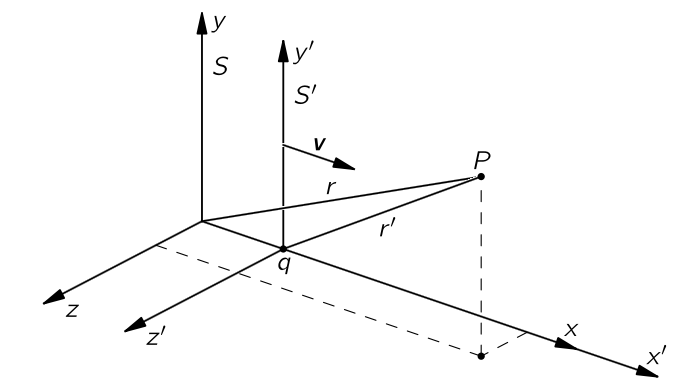{#fig-FLP_2_25_2 width=350}

4-포텐셜이라는 개념의 유용성에 대한 한 예를 들어보자. $v\bf{e}_x$ 로 이동하는 전하 $q$ 에 대한 벡터와 스칼라 퍼텐셜은 무엇일까? 전하와 함께 움직이는 좌표계에서는 전하가 정지해 있기 때문에 문제는 쉽다. 전하가 @fig-FLP_2_25_2 와 같이 $S'$ 기준틀의 원점에 있다고 하자. 그 후 움직이는 기준틀에서의 스칼라 퍼텐셜은

$$
\Phi′ =\dfrac{q}{4\pi \epsilon_0 r'}
$$ {#eq-FLP_2_25_25}

이다. 여기서 $r'$ 은 움직이는 기준틀에서 측정된 $q$ 로부터의 거리이다. 벡터 퍼텐셜 $\bf{A}'$ 는 물론 $\bf{0}$ 이다. 이제 정지 기준틀에서의 포텐셜 $\Phi$ 와 $\bf{A}$ 는 쉽게 구할 수 있다. @eq-FLP_2_25_14 에 대한 역관계는

$$
\Phi = \dfrac{\Phi' + vA'_x}{\sqrt{1-v^2}},\qquad A_x = \dfrac{A'_x + v\Phi'}{\sqrt{1-v^2}},\qquad A_y = A'_y,\qquad A_z = A'_z.
$$ {#eq-FLP_2_25_26}

@eq-FLP_2_25_25 의 $\Phi'$ 과 $\bf{A}'=\bf{0}$ 을 이용하면 

$$
\Phi = \dfrac{q}{4\pi \epsilon_0} \dfrac{1}{r'\sqrt{1−v^2}} = \dfrac{q}{4\pi \epsilon_0} \dfrac{1}{\sqrt{1−v^2}\sqrt{x'^2+y'^2+z'^2}}
$$

이다. 이것은 $S$ 에서의 스칼라 포텐셜이지만, 아직 $S'$ 의 좌표로 표현되어 있다. @eq-FLP_2_25_1 을 통해 $t,\,x,\,y,\,z$ 를 구하면

$$
\Phi = \dfrac{q}{4\pi \epsilon_0} \dfrac{1}{\sqrt{1-v^2}} \dfrac{1}{\sqrt{[(x-vt)/\sqrt{1-v^2}]^2 + y^2+z^2}}.
$$ {#eq-FLP_2_24_27}

위와 동일한 과정으로 $\bf{A}$ 를 구하면

$$
\bf{A}=\bf{v}\Phi .
$$ {#eq-FLP_2_25_28}

[$\mathrm{II}$.21 전하와 전류가 있을 때의 멕스웰 방정식의 해](vol2_4.qmd#sec-FLP_2_21) 에서 다른 방법으로 유도한 동일한 공식들이다.

### $\mathrm{II}$.25–6 전기동역학 방정식의 불변성 {#sec-FLP_2_25_6}

$\Phi$ 와 $\bf{A}$ 를 합쳐 4-벡터 $A^\mu$ 를 형성한다는 것을 발견했으며, 파동 방정식—$A^\mu$ 를 $J^\mu$ 로부터  결정하는 전체 방정식—은 @eq-FLP_2_25_22 와 같이 표현될 수 있다. 이 방정식은 전하 보존식 @eq-FLP_2_25_19 와 함께 전자기장의 기본 법칙을 보여준다.:

$$
\square^2 A^\mu =\dfrac{J_\mu}{\epsilon_0},\qquad \nabla_\mu J^\mu = 0.
$$ {#eq-FLP_2_25_29}

아름다우면서도 단순한 방정식이다. 하지만 우리가 지금까지 배워온 것의 정리일 뿐 새로운 것이 잇는 것은 아니다. 단지 새로운 표기법일 뿐. 그렇다면 방정식을 이 간단한 형태로 쓸 수 있다는 사실의 의미는 무엇인가? 아마도, 방정식의 단순함은 자연도 일정한 단순성을 가지고 있음을 의미할 것이다.

최근에 발견한 흥미로운 것을 보이겠다. 모든 물리 법칙은 하나의 방정식에 포함될 수 있다. 그 방정식은

$$
\mathsf{U}=0.
$$ {#eq-FLP_2_25_30}

정말 간단한 방정식이다! 당연히 기호가 의미하는 바를 알아야 한다. $\mathsf{U}$ 는 상황의 “비현실성”이라고 부를 만한 물리적 양이다. 그리고 우리는 그것에 대한 공식이 있습니다. 다음은 비현실성을 계산하는 방법이다. 당신은 알려진 모든 물리 법칙을 취하여 특별한 형태로 작성합니다. 예를 들어, 역학 법칙 $\bf{F}=m\bf{a}$ 에 대해 $\bf{F}−m\bf{a}=\bf{0}$ 으로 다시 작성한다고 하자. 그렇다면 $(\bf{F}−m\bf{a})$—물론 0이어야 함—을 역학의 “비현실성” 이라고 부를 수 있다. 다음으로, 이 불일치의 제곱을 $\mathsf{U}_1$ 이라고 부르며, 이는 “역학적 효과의 비현실성” 이라고 부를 수 있다. 다시 말하면, 

$$
\mathsf{U}_1=(\bf{F}−m\bf{a})^2.
$$ {#eq-FLP_2_25_31}

이제 $\nabla \bf{\cdot E} = \rho/\epsilon_0$ 와 같이 또 다른 물리 법칙에 대해

$$
\mathsf{U}_2=\left(\nabla \bf{\cdot E} − \dfrac{\rho}{\epsilon_0}\right)^2
$$

라고 하면 이것을 “전기의 가우시안적 비현실성” 이라고 부를 수 있다. 우리는 계속해서 각 법칙마다 $\mathsf{U}_3,\,\mathsf{U}_4, \ldots$ 로 이어갈 수 있다. 최종적으로 세계의 전체 비현실성 $\mathsf{U}$ 를 관련된 모든 하위 현상에 대한 다양한 비현실성 $\mathsf{U}_i$ 의 합이라고 하자. 즉, $\mathsf{U} = \sum \mathsf{U}_i$. 그렇다면 위대한 “자연의 법칙”은

$$
\mathsf{U}=0.
$$ {#eq-FLP_2_25_32}

이 “법칙”은 물론 모든 개별 불일치들의 제곱합이 0임을 의미하며, 많은 제곱의 합이 0이 될 수 있는 유일한 방법은 각 항이 0이 되는 것 뿐이다. 따라서 @eq-FLP_2_25_32 의 “아름다우면서도 단순한” 법칙은 우리가 원래 적어 놓은 전체 방정식 시리즈와 동일하다. 따라서 기호의 정의에 복잡성을 숨기는 단순한 표기법은 진정한 단순함이 아니라는 것이 절대적으로 명백하다. 그것은 단지 속임수일 뿐이다. @eq-FLP_2_25_32 에 나타나는 아름다움은 그 안에 여러 방정식이 숨겨져 있다는 사실만으로도 그저 속임수에 불과하다. 전체를 풀어내면, 이전에 있던 곳으로 돌아가게 된다.

그러나 전기자기 법칙이 @eq-FLP_2_25_29 의 형태로 작성된 단순함에는 더 많은 것이 있다. 그것은 더 많은 것을 의미한다, 마치 벡터 해석학이 더 많은 것을 의미하는 것처럼. 전자기 방정식이 로렌츠 변환의 4차원 기하학을 위해 설계된 매우 특수한 표기법, 즉 사공간의 벡터 방정식으로 표현될 수 있다는 사실은 로렌츠 변환 하에서 불변임을 의미한다. 맥스웰 방정식이 그 변환들 아래에서 불변이기 때문에 아름다운 형태로 표현될 수 있다.

전기역학의 방정식을 @eq-FLP_2_25_29 와 같이 아름답게 우아한 형태로 작성할 수 있다는 것은 우연이 아니다. 상대성 이론은 맥스웰 방정식이 예측한 현상이 모든 관성계에서 동일하다는 것이 실험적으로 밝혀진 결과로 개발되었다. 그리고 바로 맥스웰 방정식의 변환 성질을 연구함으로써 로렌츠는 이 변환이 방정식을 불변하게 만드는 변환임을 발견했다.

하지만, 우리 방정식을 이렇게 쓰는 또 다른 이유가 있다. 아인슈타인이 그럴 수도 있다고 추측한 뒤, 모든 물리 법칙이 로렌츠 변환에 따라 불변한다는 것이 발견되었다. 그것이 상대성 원리이다. 따라서, 법칙이 기록될 때 그것이 불변인지 아닌지를 즉시 표시하는 표기법을 고안한다면, 새로운 이론을 만들려고 할 때 상대성 원리와 일치하는 방정식만을 작성하게 될 것임을 확신할 수 있다.

맥스웰 방정식이 이 특정 표기법에서 단순하다는 사실은 기적이 아니며, 그 표기법은 멕스웰 방정식을 염두에 두고 고안되었다. 하지만 흥미로운 물리적인 점은 모든 물리 법칙—메존 파동의 전파나 베타 붕괴에서의 중성미자 거동 등—이 동일한 변환 하에서 동일한 불변성을 가져야 한다는 것이다. 그렇다면 우주선 안에서 균일한 속도로 움직일 때, 자연의 모든 법칙이 함께 변환되어 새로운 현상이 나타나지 않는다. 상대성 원리가 자연의 사실이기 때문에 4차원 벡터의 표기법에서는 세계의 방정식이 단순하게 보인다.

 

## $\textrm{II}$.26 장의 로런츠 변환 {#sec-FLP_2_26}

### $\mathrm{II}$.26-1 움직이는 전하의 4-포텐셜 {#sec-FLP_2_26_1}

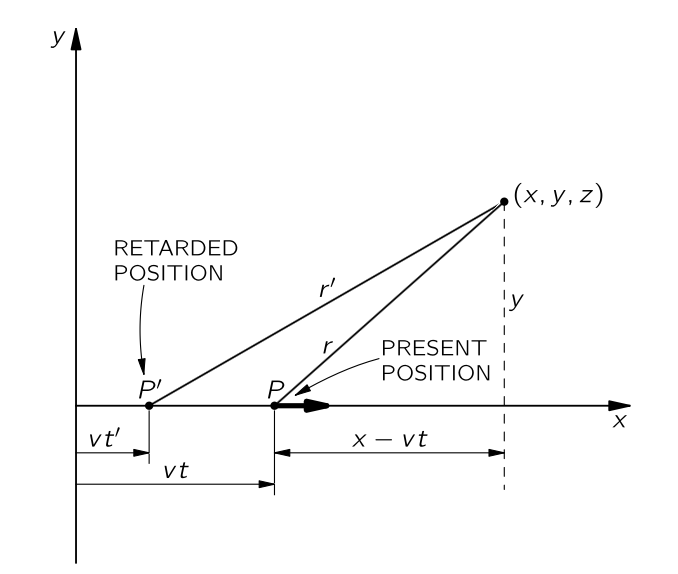{#fig-FLP_2_26_1 width=350}

우리는 지난 장에서 포텐셜 $A^\mu=(\Phi,\,\bf{A})$ 가 4-벡터임을 확인했다. 우리는 또한 로렌츠 변환을 이용하여 직선상에서 일정한 속도로 이동하는 입자의 퍼텐셜을 계산했다. (물론 앞서 [$\mathrm{II}$.21 전하와 전류가 있을 때의 멕스웰 방정식의 해](vol2_4.qmd#sec-FLP_2_21) 에서 다른 방법으로 찾았다.) 시간 $t$ 에서 위치가 $(vt,0,0)$ 인 점 전하에 대해, $(x,y,z)$ 지점의 포텐셜은

$$
\begin{aligned}
\Phi &= \dfrac{1}{4\pi\epsilon_0 \sqrt{1-v^2}} \dfrac{q}{\left[\dfrac{(x-vt)^2}{1-v^2} + y^2 + z^2\right]^{1/2}}, \\[0.3em]
A_x &= \dfrac{1}{4\pi\epsilon_0 \sqrt{1-v^2}} \dfrac{qv}{\left[\dfrac{(x-vt)^2}{1-v^2} + y^2 + z^2\right]^{1/2}}, \\[0.3em]
A_y &= A_z = 0.
\end{aligned}
$$ {#eq-FLP_2_26_1}

@eq-FLP_2_26_1 은 시간 $t$ 에서 $x, y, z$ 에서 전위를 제공하며, 그 전하의 “현재” 위치(즉, 시간 $t$ 의 위치)는 $x=vt$ 이다. 방정식은 $(x−vt), y, z$ 에서이며, 이는 이동 전하의 현재 위치 $P$ 에서 측정된 좌표임을 기억하라(@fig-FLP_2_26_1). 우리가 실제로 알고 있는 영향은 속도 $c$ 로 전달되므로, 지연된 위치 $P'$ 에서의 전하 반환 거동이 진정으로 중요하다$^2$.[$^2$ 여기서 지연된 위치와 시간을 나타내기 위해 사용된 $'$ 는 앞 장에서 로렌츠 변환된 프레임을 가리키는 $'$ 과 혼동해서는 안된다.]{.aside} 점 $P'$ 는 $x=vt'$ 에 해당한다(여기서 $t'=t−r'/c$ 는 지연된 시간이다). 하지만 우리는 전하가 직선상에서 균일한 속도로 움직이고 있다고 가정했으므로, 자연스럽게 $P'$ 에서의 행동과 현재 위치는 직접적으로 관련된다. 실제로, 전위가 지연된 순간의 위치와 속도에만 의존한다는 추가 가정을 하면, @eq-FLP_2_26_1 에서 어느 방향으로든 이동하는 전하의 전위에 대한 완전한 공식이 있다. 예를 들어 @fig-FLP_2_26_2 의 궤적과 같이 임의의 궤적으로 전하가 움직이고 있다고 가정하고, $(x, y, z)$ 지점에서 전위를 구해보자. 먼저, 그 지점에서 지연 위치 $P'$ 와 속도 $v'$ 를 찾는다. 그렇다면 전하가 지연 시간 $(t'−t)$ 동안 이 속도로 계속 이동한다고 상상하면, 그 전하가 가상의 위치 $P_\text{proj}$ 에 나타나며, 이를 “투영된 위치”라고 부를 수 있고, 속도 $v'$ 로 그곳에 도달하게 된다. (물론, 실제로 그렇지는 않다. $t$ 에서의 실제 위치는 $P$ 이다.) 그렇다면 $(x,y,z)$ 에서의 포텐셜은 투영된 위치 $P_\text{proj}$ 에서의 가상의 전하에 대해 @eq-FLP_2_26_1 에 의한 것과 같다. 우리가 말하고자 하는 바는 전위가 지연 시점에 전하가 어떻게 움직이는지에만 의존하기 때문에, 전하가 일정한 속도로 계속 움직이든 $t'$ 이후에 속도가 변하든 전위는 동일하다는 것이다—즉, $(x,y,z)$ 시점에 나타날 전위가 이미 결정된 후의 경우이다.

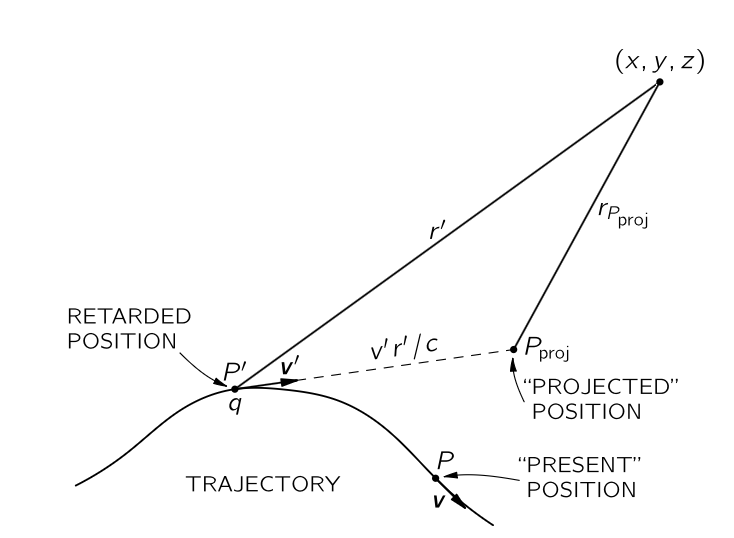{#fig-FLP_2_26_2 width=350}

알다시피 움직이는 전하의 포텐셜에 대한 식을 얻는 순간, 우리는 완전한 전기역학을 가지게 된다. 우리는 모든 전하 분포의 전위를 중첩을 통해 얻을 수 있다. 따라서 우리는 맥스웰 방정식을 쓰거나 아래의 세가지 사실을 통해 전기역학의 모든 현상을 요약할 수 있다. (혹시 무인도에 가게 될 경우를 대비해 그들을 기억하라. 그들로부터 모든 것을 재구성할 수 있다. 당연히 로렌츠 변환을 알게 될 것이며, 사막 섬이나 다른 어느 곳에서도 그것을 절대 잊지 못할 것이다.)

&emsp; 첫째, $A^\mu$ 는 4-벡터이다. 

&emsp; 둘째, 정지 전하에 대한 쿨롱 퍼텐셜은 $q/4\pi \epsilon_00 r$ 이다. 

&emsp; 셋째, 움직이는 전하에 의해 발생하는 전위는 지연된 시점의 속도와 위치에만 의존한다. 

이 세 가지 사실로 우리는 모든 것을 가지고 있다. $A^\mu$ 가 4-벡터라는 사실로부터 쿨롱 퍼텐셜을 변환하고, 어떤 속도에 대한 퍼텐셜을 얻는다. 그렇다면, 전위가 지연된 시점의 과거 속도에만 의존한다는 마지막 사실로부터 우리는 투영 위치 게임을 사용하여 이를 찾을 수 있다. 특별히 유용한 방법은 아니지만, 물리 법칙을 이렇게 다양한 방식으로 활용할 수 있다는 것을 보여주는 것은 흥미롭다.

때때로 부주의한 사람들에 의해, 모든 전기역학은 로렌츠 변환과 쿨롱 법칙만으로 추론될 수 있다고 말한다. 물론, 그것은 완전히 거짓이다. 먼저, 스칼라 퍼텐셜과 벡터 퍼텐셜이 함께 4-벡터를 만든다고 가정해야 한다. 그것은 전위가 어떻게 변하는지를 알려준다. 그렇다면 왜 지연된 시점의 효과가 유일하게 중요한가? 더 나아가, 왜 포텐셜이 위치와 속도에만 의존하고 예를 들어 가속도에 의존하지 않는 걸까? 전기장 $\bf{E}$ 와 자기장 $\bf{B}$ 는 가속도에 따라 달라진다. 그들에 대해 같은 종류의 주장을 제시하려 한다면, 그들은 지연된 시간에 위치와 속도에만 의존한다고 말하게 될 것이다. 하지만 그 경우 가속 전하에서 발생하는 필드는 투영된 위치의 전하에서 발생하는 장과 동일하게 되며, 이는 거짓이다. 장은 경로상의 위치와 속도뿐만 아니라 가속도에도 의존한다. 따라서 이 위대한 진술에는 모든 것이 로렌츠 변환으로부터 추론될 수 있다는 몇 가지 추가적인 암묵적 가정이 있다. (아주 적은 수의 가정으로부터 엄청난 양이 나올 수 있다는 포괄적인 진술을 볼 때마다, 항상 그것이 거짓임을 알게 된다.) 보통 충분히 신중하게 생각해 보면 명백하지 않을 수 있는 암묵적인 가정이 많이 존재한다.

### $\mathrm{II}$.26–2 일정한 속도로 움직이는 전하에 의한 장 {#sec-FLP_2_26_2}

이제 일정한 속도로 움직이는 점 전하로부터 포텐셜을 알게 되었으므로, 실용적인 이유로 장을 구해야 한다. 많은 경우—예를 들어, 구름 챔버를 통과하는 우주선이나 와이어 안의 느리게 움직이는 전자- 입자는 균일한 속도로 움직인다. 가속이 없다고 가정할 때, 장이 실제로 어떻게 보이는지 알아보자. 이는 광속에 가까운 경우도 포함한다. 

@eq-FLP_2_26_1 의 포텐셜로부터 아래의 규칙을 통해 장을 구할 수 있다. (@exr-FLP_2_26_1)

$$
\bf{E} = −\nabla \Phi − \dfrac{\partial \bf{A}}{\partial t},\qquad \bf{B} = \nabla \times \bf{A}.
$$

$$
E_x=\dfrac{q}{4\pi\epsilon_0 \sqrt{1 − v^2}} \dfrac{x − vt}{\left[\dfrac{(x − vt)^2}{1 − v^2} + y^2+ z^2\right]^{3/2}}.
$$ {#eq-FLP_2_26_6}

$$
E_y=\dfrac{q}{4\pi\epsilon_0\sqrt{1−v^2}}\dfrac{y}{\left[ \dfrac{(x − vt)^2}{1 − v^2} + y^2 + z^2\right]^{3/2}}.
$$ {#eq-FLP_2_26_3}

$$
E_z = \dfrac{q}{4\pi \epsilon_0\sqrt{1 − v^2}}\dfrac{z}{\left[\dfrac{(x − vt)^2}{1 − v^2} + y^2 + z^2\right]^{3/2}}.
$$ {#eq-FLP_2_26_2}

이제 $\bf{B}$ 를 구한다. $B_z = \partial A_y/\partial x - \partial A_x/\partial y$ 이며 $A_y=0$ 이다. $A_x= v\Phi$ 이므로 

$$
Bz=vEy.
$$ {#eq-FLP_2_26_7}

마찬가지로,

$$
By=−vEz.
$$ {#eq-FLP_2_26_8}

마지막으로, $A_y = A_z=0$ 이므로 $B_x=0$ 이다. 이로부터 자기장은 간단히 다음과 같다.

$$
\bf{B} = \bf{v}\times \bf{E}.
$$ {#eq-FLP_2_26_9}

이제 장의 형태를 알아보자. 현재 전하 위치 주변의 여러 위치에서 장의 그림을 그려보겠습니다. 전하의 영향이 지연된 위치에서 비롯되지만, 움직임이 정확히 특정되기 때문에 지연된 위치는 현재 위치에 따라 유일하게 주어진다. 균일한 속도의 경우, 장을 현재 위치와 연관시키는 것이 더 좋다. 왜냐하면 $(x,y,z)$ 에서의 필드 성분은 $(x−vt), y, z$ 에만 의존하기 때문이며, 이는 현재 위치에서 $(x,y,z)$ 까지의 변위 $\bf{r}$ 의 성분들이다(@fig-FLP_2_26_3 을 보라).

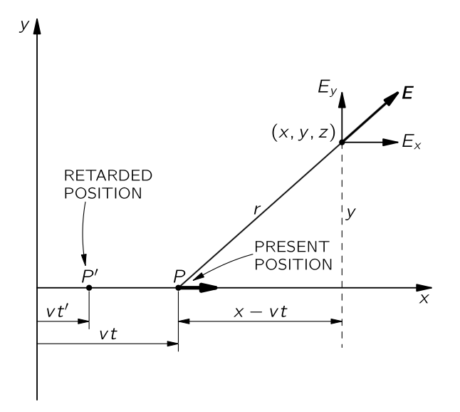{#fig-FLP_2_26_3 width=400}

먼저 $z=0$ 인 위치를 생각해보자. 그렇다면 $\bf{E}$ 는 $x$, $y$ 성분만 가진다. @eq-FLP_2_26_3 과 @eq-FLP_2_26_6 으로부터 이 성분들의 비율은 변위의 $x$, $y$ 성분의 비율과 동일하다. 즉, $\bf{E}$ 는 @fig-FLP_2_26_3 에 표시된 바와 같이 $\bf{r}$ 과 같은 방향이다. $E_z$ 가 역시 $z$ 에 비례하기 때문에, 이 결과가 3차원에서도 성립한다. 요컨대, 전기장은 전하로부터 직접 방출되는 방사형이며, 이는 정지 전하의 경우와 같다. 물론, 정지 전하의 전기장과 같자는 않은데, 이는 $(1-v^2)$ 추가 팩터 때문이다. 하지만 우리는 꽤 흥미로운 것을 보여줄 수 있다. 그 차이는 $x$ 의 축척이 $\sqrt{1−v^2}$ 로 압축된 특이한 좌표 집합을 사용하여 쿨롱장을 그릴 때 얻을 수 있다. 그렇게 하면, 필드 라인이 전하 앞쪽과 뒤쪽으로 펼쳐지고, @fig-FLP_2_26_4 에 표시된 바와 같이 측면을 따라 함께 압축된다. 

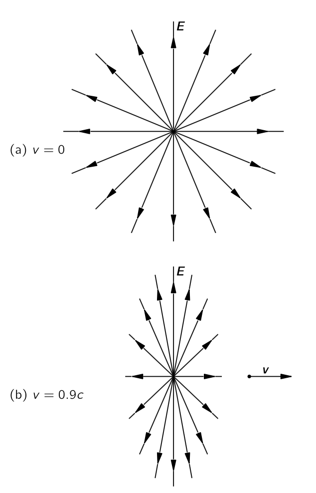{#fig-FLP_2_26_4 width=400}

전통적인 방법으로 $\bf{E}$ 의 강도를 장선의 밀도와 연결하면, 좌우가 위아래보다 더 강한데, 이는 방정식이 의미하는 것과 같다. 먼저, 운동선에 직각인 경우, 즉 $(x−vt)=0$ 일 때 전하로부터의 거리는 $\sqrt{y^2+z^2}$ 이다. 이 때 전기장의 강도는 $\sqrt{E_y^2 + E_z^2}$ 이며, 

$$
E=\dfrac{q}{4 \pi \epsilon_0 \sqrt{1−v^2}}\dfrac{1}{y^2 + z^2}.
$$ {#eq-FLP_2_26_10}

전기장의 세기는 거리의 역제곱에 비례하지만 추가 계수 $1/\sqrt{1−v^2} > 1$ 만큼 증가한다. 따라서 움직이는 전하의 측면에서는 전기장이 쿨롱 법칙에서 얻는 것보다 더 강하다. 실제로, 측면 방향의 장은 입자의 에너지와 그 휴지 질량의 비율에 따라 쿨롱 퍼텐셜보다 크다.

전하의 앞(그리고 뒤)에서, $E_y =E_z=0$ 이며

$$
E=E_x=\dfrac{q(1−v^2)}{4\pi \epsilon_0(x−vt)^2}.
$$ {#eq-FLP_2_26_11}

이 장 역시 전하로부터의 거리의 역제곱에 따라 변하지만, 이제는 $(1−v^2)<1$ 라는 계수로 인해 감소하며, 이는 필드 선의 그림과 일치한다. $v/c$ 가 작다면, $v^2/c^2$ 는 여전히 더 작으며, $(1−v^2)$ 항의 효과는 매우 작다. 우리는 다시 쿨롱의 법칙으로 돌아간다. 하지만 입자가 빛의 속도에 매우 가깝게 움직이면, 전방 방향의 장은 크게 감소하고, 옆쪽 방향의 장은 크게 증가한다.

전하의 전기장에 대한 우리의 결과는 다음과 같이 정리할 수 있다: 종이 한 장에 정전하에 대한 전하의 필드 라인을 그린 다음, 그 그림을 속도 $v$ 로 이동하도록 설정한다. 그렇다면 당연히 전체 그림은 로렌츠 수축에 의해 압축될 것이며, 즉 종이 위의 탄소 입자들이 서로 다른 위치에 나타나게 된다. 그 기적은 페이지가 지나가는 동안 보게 될 그림이 여전히 점전하의 필드 라인을 나타낸다는 점이다. 수축은 양쪽에서 그것들을 더 가깝게 이동시키고 앞뒤로 퍼지게 하여 올바른 선 밀도를 정확히 제공한다. 우리는 앞서 필드 라인이 실제가 아니라 필드를 나타내는 한 가지 방법일 뿐임을 강조해 왔다. 하지만 여기서는 거의 실제인 것처럼 보인다. 특정한 경우에, 필드 라인이 실제로 공간에 존재한다고 착각하고 이를 변환하면 올바른 필드를 얻을 수 있다. 하지만 그것이 필드 라인을 더 현실로 만들지는 않는다. 그것들이 실제가 아니라는 것을 스스로에게 상기시키기 위해 해야 할 일은 전하와 자석이 함께 생성하는 전기장을 생각하는 것이다; 자석이 움직이면 새로운 전기장이 생성되어 아름다운 그림을 파괴한다. 따라서 수축하는 사진이라는 깔끔한 아이디어는 일반적으로 효과가 없다. 하지만, 빠르게 움직이는 전하의 필드가 어떤지 기억하는 편리한 방법이긴 하다.

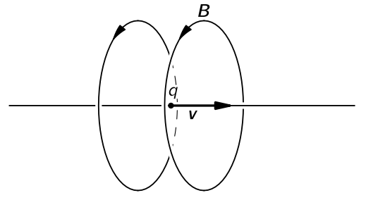{#fig-FLP_2_26_5 width=300}

자기장은 $\bf{v}×\bf{E}$ 이다(@eq-FLP_2_26_9). 방사형 전기장 $\bf{E}$ 에 교차된 속도를 취하면, @fig-FLP_2_26_5 에 표시된 바와 같이 운동선을 둘러싸는 $\bf{B}$ 를 얻을 수 있다. $c$ 를 다시 넣어 보면, 저속 전하에 대해 우리가 가졌던 결과와 동일함을 확인하실 수 있다. $c$ 가 어디로 가야 하는지 확인하는 좋은 방법은 힘 법칙을 다시 참고하는 것이다.

$$
\bf{F}=q(\bf{E} + \bf{v} \times \bf{B}).
$$

$\bf{B}=\bf{v}×\bf{E}$ 는 속도에 자기장을 곱하면 전기장과 같은 차원을 가진다고 말한다. 따라서 @eq-FLP_2_26_9 의 오른쪽에 계수 $1/c^2$ 이 와야 한다:

$$
\bf{B}=\dfrac{\bf{v} \times \bf{E}}{c^2}.
$$ {#eq-FLP_2_26_12}

느리게 움직이는 전하($v \ll c$)에 대해, $\bf{E}$ 를 쿨롱장으로 하면,

$$
\bf{B} = \dfrac{q}{4 \pi \epsilon_0 c^2}\dfrac{\bf{v}\times \bf{r}}{r^3}.
$$ {#eq-FLP_2_26_13}

이 공식은 [$\mathrm{II}$.14-7 비오-사바르의 법칙](vol2_3.qmd#sec-FLP_2_14_7) 에서 찾은 전류의 자기장에 대한 방정식과 정확히 일치한다.

여기에 더하여, 생각해 볼 만한 흥미로운 점을 언급하고자 한다. (나중에 다시 논의하기 위해 돌아온다.) 직각의 속도를 갖는 두 개의 양성자를 생각하자. 그 중 하나는 다른 하나의 경로를 가로지되, 그 앞에 있어 충돌하지 않는다고 하자. 어느 순간, 그들의 상대 위치는 @fig-FLP_2_26_6 (a) 와 같을 것이다. $q_2$ 때문에 $q_1$ 에 힘이 가해지고, 그 반대도 가해진다. $q_2$ 에서는 $q_1$ 에서 발생하는 전기력만 존재하며, $q_1$ 은 그 이동선을 따라 자기장을 만들지 않는다. 하지만 $q_1$ 에서는 다시 전기력이 존재하고, 추가로 자기력도 존재하며, 이는 $q_2$ 에 의해 만들어진 $\bf{B}$ 에서 움직이고 있기 때문이다. 힘은 @fig-FLP_2_26_6 (b) 에 표시된 대로이다. $q_1$ 과 $q_2$ 에 작용하는 전기력은 크기가 동일하고 방향이 반대이다. 하지만 $q_1$ 에는 측면힘(자기력)이 존재하고 $q_2$ 에는 측면힘이 없다. 작용과 반작용은 같아야 하지 않나? 그 답은 독자에게 맡긴다.

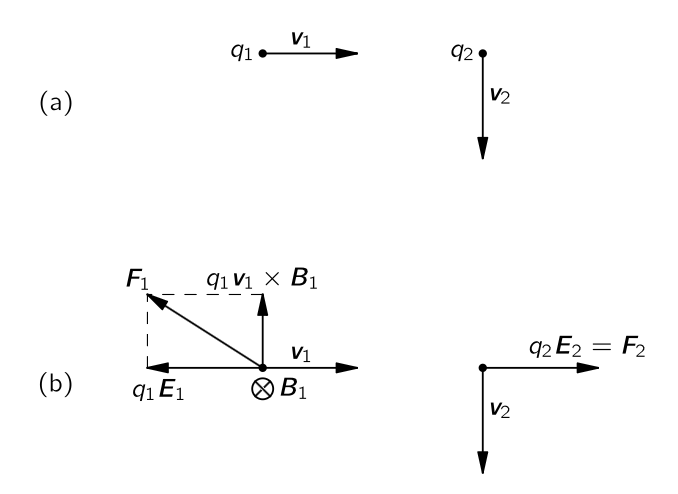{#fig-FLP_2_26_6 width=400}

### $\mathrm{II}$.26–3 장의 상대론적 변환 {#sec-FLP_2_26_3}

앞서 변환된 포텐셜로부터 전기장과 자기장을 계산했다. 장 역시 중요하다. 앞서 제시된 바와 같이 포텐셜에 물리적 의미와 현실이 존재한다는 주장에도 불구하고. 장 역시 실제이다. 이미 어떤 정지된 기준틀의 장을 알고 있다면, 움직이는 기준틀의 필드를 계산할 수 있는 방법이 있다면 여러 목적에 편리할 것이다.  $\Phi$ 와 $\bf{A}$ 는 $A^\mu$ 4-벡터 이므로 변환 법칙을 가지고 있다. $\bf{E}$ 와 $\bf{B}$ 의 변환 법칙을 알아보려 한다. $\bf{E}$ 와 $\bf{B}$ 가 한 기준틀에 주어졌을 때, 움직이는 다른 기준틀에서 어떻게 될까? 우리는 언제든지 포텐셜로 진행할 수 있지만, 때때로 직접 장을 변환하는 것이 유용하다. 이제 그것을 알아보자.

어떻게 장의 변환 법칙을 찾을 수 있을까? 우리는 $\Phi$ 와 $\bf{A}$ 의 변환 법칙을 알고 있으며, $\Phi$ 와 $\bf{A}$ 에 대해 장이 어떻게 주어지는지 알고 있다$^3$. [$^3$ 모든 벡터마다 네 벡터를 만들기 위한 무언가가 있어야 한다고 생각할 수도 있지만, $\bf{E}$ 에 대해서 네 번째 구성 요소에 사용할 수 있는 다른 무언가가 있어야 한다. 이것은 $\bf{B}$ 에 대해서도 마찬가지이다. 하지만 그렇지는 않다.]{.aside}  우선, 자기장 $\bf{B}$ 부터 생각하자. 알다시피 $\bf{B}=\nabla \times \bf{A}$ 이다.

::: {.callout-note icon="false"}

#### **장 텐서**

4-벡터 $A^\mu = (A^0,\,A^1,\,A^2,\,A^3)=(\Phi,\,A_x,\,A_y,\,A_z)$ 와 $X^\mu = (X^0,\,X^1,\,X^2,\,X^3)$ 에 대한 쌍대 벡터 $X_\mu = (X_0,\,X_1,\,X_2,\,X_3) = (t,\,-x,\,-y,\,-z)$ 에 대해 **전자기장 텐서 (electromagnetic field tensor)** $F^{\mu\nu}$ 는 다음과 같이 정의된다.

$$
F^{\mu\nu} := \dfrac{\partial A^\nu}{\partial X_\mu} - \dfrac{\partial A^\mu}{\partial X_\nu}, \qquad \mu,\,\nu = 0,\,1,\,2,\,3.
$$ {#eq-FLP_2_26_19}

:::

전자기장 텐서의 정의로부터 다음을 쉽게 보일 수 있다.

$$
F^{\mu\mu}=0,\qquad F^{\mu\nu} = -F^{\nu\mu}
$$ {#eq-FLP_properties_of_electromagnetic_field_tensor}

위 식의 두번째 성질로부터 $F^{\mu\nu}$ 는 반대칭 텐서이다. 이제 전자기장 텐서의 성분을 구해보자.

$$
\begin{aligned}
F^{01} &= \dfrac{\partial A_x}{\partial t} + \dfrac{\partial \Phi}{\partial x} = -E_x, \\[0.3em]
F^{02} &= \dfrac{\partial A_y}{\partial t} + \dfrac{\partial \Phi}{\partial y} = -E_y, \\[0.3em]
F^{03} &= \dfrac{\partial A_z}{\partial t} + \dfrac{\partial \Phi}{\partial z} = -E_z, \\[0.3em]
F^{12} &= - \dfrac{\partial A_y}{\partial x} + \dfrac{\partial A_x}{\partial y} = -B_z ,\\[0.3em]
F^{13} &= - \dfrac{\partial A_z}{\partial x} + \dfrac{\partial A_x}{\partial z} = B_y ,\\[0.3em]
F^{23} &= - \dfrac{\partial A_z}{\partial y} + \dfrac{\partial A_y}{\partial z} = -B_x.
\end{aligned}
$$ {#eq-FLP_components_of_electromagnetic_field_tensor}

전자기장 탠서는 행렬 형태로 다음과 같이 쓸 수 있다.

$$
F^{\mu\nu} = \begin{bmatrix} 0 & -E_x & - E_y & - E_z \\ E_x & 0 & -B_z & B_y \\ E_y & B_z & 0 & -B_x \\ E_z & -B_y & -B_x & 0\end{bmatrix}
$$ {#eq-FLP_matrix_form_of_electromagnetic_field_tensor}

로렌츠 부스트

$$
\Lambda^\mu_\nu = \begin{bmatrix} \gamma & - \gamma \beta & 0 & 0 \\- \gamma \beta & \gamma & 0 & 0 \\ 0 & 0 & 1 & 0 \\ 0 & 0 & 0 & 1 \end{bmatrix}
$$

에 대해

$$
X'^\mu = \Lambda^\mu_\nu X^\nu,\qquad \dfrac{\partial}{\partial X_\mu} = \Lambda^\mu_\nu \dfrac{\partial}{\partial X_\nu}
$$

이므로

$$
F'^{\mu\nu} = \dfrac{\partial A'^\nu}{\partial X'_\mu} - \dfrac{\partial A'^\mu}{\partial X'_\nu} = \Lambda^\nu_\eta\Lambda^\mu_\delta \left(\dfrac{\partial A^\eta}{\partial X_\delta}-\dfrac{\partial A^\delta}{\partial X_\eta}\right) = \Lambda^\mu_\delta \Lambda^\nu_\eta F^{\delta\eta}
$$

로부터 $\bf{E}',\,\bf{B}'$ 의 각 성분을 아래와 같이 계산 할 수 있다.
$$
\begin{aligned}
E_x' &= - {F'}^{01} = -\Lambda^0_\delta \Lambda^1_\eta F^{\delta \eta} = E_x, \\[0.3em]
E_y' & = - (F')^{02} = -\Lambda^0_\delta \Lambda^2_\eta F^{\delta \eta} = \dfrac{E_y-vB_z}{\sqrt{1-v^2}}, \\[0.3em]
E_z' &= - (F')^{03} = -\Lambda^0_\delta \Lambda^3_\eta F^{\delta \eta} = \dfrac{E_z-vB_y}{\sqrt{1-v^2}}, \\[0.3em]
B_x' &= - (F')^{23} = -\Lambda^2_\delta \Lambda^3_\eta F^{\delta \eta} = B_x, \\[0.3em]
B_y' &=  (F')^{13} = \Lambda^1_\delta \Lambda^3_\eta F^{\delta \eta} = \dfrac{B_y + vE_z}{\sqrt{1-v^2}}, \\[0.3em]
B_z' &=  -(F')^{12} = \Lambda^1_\delta \Lambda^2_\eta F^{\delta \eta} = \dfrac{B_z - vE_y}{\sqrt{1-v^2}}.
\end{aligned}
$$ {#eq-FLP_2_26_3_lorentz_transform_of_fields}

이것을 관성기준틀과 평행한 방향 ($E_\parallel$, $B_\parallel$) 과 수직한 방향 ($E_\perp$, $B_\perp$) 로 표현하면 (그리고 생략되었던 $c$ 를 명시적으로 표기하면)

$$
\boxed{
\begin{aligned}
E'_\parallel &= E_\parallel,\quad & E'_\perp &= \dfrac{(\bf{E}+\bf{v}\times\bf{B})_\perp}{\sqrt{1-v^2/c^2}},\\[0.3em]
B'_\parallel &= B_\parallel,& B'_\perp &= \dfrac{\left(\bf{B}-\dfrac{\bf{v}\times\bf{E}}{c^2}\right)_\perp}{\sqrt{1-v^2/c^2}}.
\end{aligned}
}
$$ {#eq-FLP_table_26_4}

장의 변환은 우리가 이전에 수행한 문제들을 해결하는 또 다른 방법을 제공한다. 예를 들어, 움직이는 점 전하의 장를 구하기 위해 이전에는 포텐셜을 미분하였다. 하지만 이제 우리는 쿨롱장을 변환한다. $S$-기준틀에 점전하가 정지하고 있다면, 단순 방사형 $\bf{E}$ 만 존재한다. $S'$ 기준틀이 $S$ 기준틀에 대해 속도 $v=-u$ 로 움직이고 있다면 $S'$ 기준틀에서는 점전하가 속도 $u$ 로 움직인다. 우리는 @eq-FLP_2_26_3_lorentz_transform_of_fields 와 @eq-FLP_table_26_4 의 변환을 통해 얻은 장이 [$\mathrm{II}$.26-2 일정한 속도로 움직이는 전하에 의한 장](#sec-FLP_2_26_2) 에서 얻은 전기장 및 자기장과 동일하다는 것을 보일 수 있다.

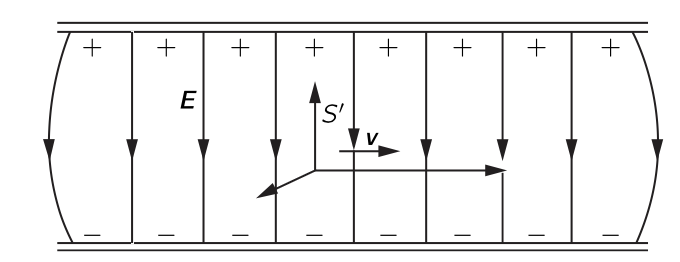{#fig-FLP_2_26_7 width=400}

 @eq-FLP_2_26_3_lorentz_transform_of_fields 의 변환은 전하가 고정된 기준틀에서 움직일 때 우리가 보는 것에 대한 흥미롭고 간단한 답을 제시한다. 예를 들어, 우리가 그림 @eq-FLP_2_26_7 에서 표현된 바와 같이 축전지의 의 판 사이를 이동하고 있을 때 우리의 $S'$ 기준틀에서의 장을 구한다고 하자. (당연히, 전하를 띤 축전지가 우리 옆을 지나는 것과 동일하다.) 이 경우 변환은 원래 기준틀에서 $\bf{B}=0$ 이므로 쉽다. 먼저, 우리가 $\bf{E}$ 에 수직으로 움직인다고 가정하면 $\bf{E}' = \bf{E}/\sqrt{1−v^2/c^2}$ 은 여전히 완전히 횡방향이다. 여기에 추가로 자기장 $\bf{B}' = −\bf{v}\times \bf{E}'/c^2$ 이다.(@eq-FLP_table_26_4 의 $\bf{E}$ 를 $\bf{E}'$ 으로 바꾼다.) 따라서 정전기장에 수직으로 이동한다면, 추가된 횡방향 $\bf{B}$ 를 보게 된다. 우리의 운동이 $\bf{E}$ 에 수직이 아니면, $\bf{E}$ 를 $\bf{E}_\parallel$ 와 $\bf{E}_\perp$ 로 분해하여 계산한다. 

반대의 경우, 즉 우리가 순수한 정적 자기장을 장에 수직인 방향으로 지나고 있다고 하자. 이번에는 전기장 $\bf{E}' = \bf{v}\times \bf{B}'$ 이며 $\bf{B}' = \bf{B}/\sqrt{1-v^2/c^2}$ 이다. $v \ll c$ 라면 자기장의 변화는 무시할만 하며, 주된 효과는 전기장이 나타나는 것이다. 이 효과의 한 예로, 한때 유명했던 비행기의 속도를 결정하는 문제가 있다. 이제는 레이더를 이용해 지면 반사를 통해 항공 속도를 측정할 수 있게 되었기 때문에 더 이상 유명하지 않지만, 수년간 악천후에서 비행기의 속도를 알기가 매우 어려웠다. 땅을 볼 수 없었고, 어느 방향이 위인지 알지 못했으며, 다른 여러 상황이 있었다. 하지만 지구에 비해 비행기가 얼마나 빠르게 움직이고 있는지를 아는 것이 중요했다. 지구를 보지 않고는 어떻게 할 수 있을까? 변환 공식을 알고 있던 많은 사람들은 비행기가 지구의 자기장 안에서 움직인다는 사실을 활용하는 아이디어를 생각했다. 비행기가 어느 정도 알려진 자기장이 있는 곳을 비행하고 있다고 가정해 보자. 자기장이 수직인 단순한 경우를 생각한다. 만약 비행기가 수평 속도 $\bf{v}$ 로 비행한다면, 전기장은 $\bf{v}\times \bf{B}$, 즉 운동에 수직인 자기장을 보게 된다. 비행기에 절연된 전선을를 매달면, 이 전기장은 와이어 끝에 전하를 유도한다. 그것은 새로운 것이 아니다. 지면에 있는 사람의 관점에서 보면, 우리는 전선을 장에서 이동시키고 있으며, $\bf{v}\times \bf{B}$ 의 힘이 전하를 전선의 끝으로 이동하게 한다. 변환 방정식은 같은 말을 다른 방식으로 말한다. (우리가 그 말을 여러 가지 방법으로 말할 수 있다는 사실이 한 방법이 다른 방법보다 낫다는 뜻은 아니다.) 우리는 매우 다양한 방법과 도구를 많이 활용하고 있어 보통 65가지 다른 방법으로 동일한 결과를 얻을 수 있다!

따라서 $\bf{v}$ 를 측정하려면 전선 끝 사이의 전압 측정하기만 하면 된다. 동일한 장이 전압계의 전선에 작용하기 때문이 전압계로는 이 일을수행할 수 없다. 이러한 장을 측정하는 방법이 있습니다. 우리는 9장에서 대기 전기에 대해 논의할 때 그 중 일부에 대해 이야기했다. 따라서 비행기의 속도를 측정할 수 있어야 한다.

하지만 이 중요한 문제는 결코 이렇게 해결되지 않았다. 그 이유는 발생한 전기장이 미터당 밀리볼트 정도이기 때문이다. 이러한 장을 측정하는 것은 가능하지만, 문제는 안타깝게도 이러한 필드가 다른 전기장과 전혀 다르지 않다는 점이다. 자기장을 통한 운동에 의해 생성되는 장은 이미 다른 원인, 예를 들어 공기 중의 정전하나 구름에 존재하는 전기장과 구별할 수 없다. 우리는 9장에서 일반적으로 지구 표면 위에 약 100볼트/미터의 강도를 가진 전기장이 존재한다는 것을 설명했다. 하지만 그것들은 꽤 불규칙하며, 따라서 비행기가 공중을 비행할 때, 대기 전기장의 변동을 관측하게 되는데, 이는 $\bf{v}\times \bf{B}$ 에 의해 생성된 작은 전기장에 비해 매우 거대하고, 실용적인 이유로 비행기의 속도를 지구 자기장을 통과하는 운동으로 측정하는 것이 불가능하다는 것이 밝혀졌다.

### $\mathrm{II}$.26–4 운동방정식의 상대론적 표기법

전기장과 자기장이 무엇을 하는지 모른다면 맥스웰 방정식에서 전기장과 자기장을 찾는 것은 큰 도움이 안된다. 장은 전하에 가해지는 힘을 정하며, 그 힘이 전하의 움직임을 결정한다. 따라서 당연히 전기역학 이론의 일부는 전하의 운동과 힘 사이의 관계이다.

$\bf{E}$ 와 $\bf{B}$ 내부의 단일 전하에 가해지는 힘은

$$
\bf{F} = q (\bf{E} + \bf{v}\times \bf{B}).
$$ {#eq-FLP_2_26_23}

이 힘은 저속에서는 질량에 가속도를 곱한 값과 같지만, 모든 속도에 대한 올바른 법칙은 힘이 $d\bf{p}/dt$ 와 같다는 것이다. $\bf{p} = m\bf{v}/\sqrt{1−v^2/c^2}$ 으로부터 상대론적으로 올바른 운동 방정식을 얻는다.

$$
\dfrac{d}{dt}\left(\dfrac{m\bf{v}}{\sqrt{1−v^2/c^2}}\right) =\bf{F} = q (\bf{E} + \bf{v} × \bf{B}).
$$ {#eq-FLP_2_26_24}

우리는 이제 상대성 이론의 관점에서 이 방정식을 논의하고자 한다. 맥스웰 방정식을 상대론적 형태로 넣었으므로, 운동 방정식이 상대론적 형태로 어떻게 보일지 알아보자. 방정식을 4-벡터 표기법으로 다시 쓸 수 있는지 확인해 보자.

우리는 운동량 4-벡터의 시간 성분이 에너지 $mc^2/\sqrt{1−v^2/c^2}$ 를 $c$ 로 나눈 값임을 안다. 따라서 우리는 @eq-FLP_2_26_24 의 오른쪽 항을 교체하는 것을 생각할 수 있습니다. 그렇다면 우리는 $\bf{F}$ 와 함께 사용할 네 번째 구성 요소만 찾으면 된다. 이 네 번째 구성 요소는 에너지의 변화율, 즉 작업 수행 속도, 즉 $\bf{F \cdot v}$ 와 관련되어야 한다. 그렇다면 @eq-FLP_2_26_24 의 오른쪽 항을 $(\bf{F\cdot v}/c,\,F_x,\,F_y,\,F_z)$ 와 같은 형태로 시도해 볼 수 있을 것이다. 하지만 이것은 4-벡터를 만들지 않는다.

4-벡터의 시간 미분은 더 이상 4벡터가 아니다. 왜냐하면 $d/dt$ 는 $t$ 를 측정하기 위해 특별한 프레임을 선택해야 하기 때문이다. 우리는 $\bf{v}$ 를 4-벡터로 만들려고 시도했을 때 그 문제를 겪었다. 우리의 첫 번째 추측은 시간 구성 요소가 $cdt/dt=c$ 가 될 것이라는 것이었다. 하지만 

$$
\left( c,\, \dfrac{dx}{dt},\,\dfrac{dy}{dt},\, \dfrac{dz}{dt}\right) = (c,\,\bf{v})
$$ {#eq-FLP_2_26_25}

는 4-벡터의 구성 요소가 아니다. 그러나 각 구성 요소에 $1/\sqrt{1−v^2/c^2}$ 를 곱하면 1 로 만들 수 있음을 발견했다. 아래의 $U^\mu$ 는 4-벡터이다.

$$
U^\mu = \left(\dfrac{c}{\sqrt{1−v^2/c^2}},\,\dfrac{\bf{v}}{\sqrt{1−v^2/c^2}}\right).
$$ {#eq-FLP_2_26_26}

이로부터 생각해보면 미분을 4-벡터로 만들고자 한다면, $d/dt$ 에 $1/\sqrt{1−v^2/c^2}$ 를 곱하는 것이 요령인 것으로 보인다. 그렇다면 우리의 두 번째 선택은 

$$
\dfrac{1}{\sqrt{1−v^2/c^2}}\dfrac{d}{dt}P^\mu 
$$ {#eq-FLP_2_26_27}

이 4-벡터이어야 한다는 것이다. 하지만 $\bf{v}$ 가 무엇인가? 그것은 입자의 속도이며, 좌표계가 아니다! 그렇다면 

$$
K^\mu = \left(\dfrac{\bf{F \cdot v}/c}{\sqrt{1−v^2/c^2}},\, \dfrac{\bf{F}}{\sqrt{1−v^2/c^2}}\right)
$$ {#eq-FLP_2_26_28}

로 정의된 $K^\mu$ 는 힘의 4-차원 확장으로, 우리는 이를 4-힘이라고 부를 수 있다. 이는 실제로 네 개의 벡터이며, 그 공간 성분은 $\bf{F}$ 의 성분이 아니라 $\bf{F}/\sqrt{1−v^2/c^2}$ 의 성분이다.

문제는 $K^\mu$ 가 4-벡터인 이유이다. 그 $1/\sqrt{1−v^2/c^2}$ 인자에 대해 조금이라도 이해하면 좋겠다. 두 번이나 등장했으니 $d/dt$ 가 항상 같은 인자로 고정될 수 있는 이유를 확인할 때이다. 답은 다음과 같다: 어떤 함수 $x$ 의 시간 미분은 변수 $t$ 의 작은 구간 $\Delta t$ 에서 증분 $\Delta x$ 를 계산한다. 하지만 다른 프레임에서는 구간 $\Delta t$ 가 $t'$ 과 $x'$ 모두의 변화에 해당할 수 있으므로, $t'$ 만 변하면 $x$ 의 변화가 달라진다. 우리는 미분을 위한 변수를 찾아야 하는데, 이는 시공간의 “구간”을 측정하는 것이며, 그 변수는 모든 좌표계에서 동일하게 된다. 그 구간에 대해 $\Delta x$ 를 취하면, 모든 좌표계에 대해 동일하다. 입자가 4-공간에서 “움직일” 때, $\Delta t, \Delta x, \Delta y, \Delta z$ 와 같은 변화가 있다. 그것들로 불변 구간을 만들 수 있습니까? 음, 그것들은 네 벡터 $x^\mu =(ct,x,y,z)$ 의 구성 요소이며, 따라서 $\Delta \tau$$^4$ 랴는 양을 [$^4$ 파인만은 $s$ 라는 변수를 썼지만 여기서는 현재 훨씬 널리 쓰이는 $\tau$ 표기법을 사용한다.]{.aside}

$$
(\Delta \tau)^2 := \dfrac{1}{c^2}ΔX_\mu \Delta X^\mu =\dfrac{1}{c^2}\left(c^2\Delta t^2−\Delta x^2−\Delta y^2−\Delta z^2\right)
$$ {#eq-FLP_2_26_29}

로 정의한다. 이는 4-벡터 스칼라곱으로 이후 4차원 구간의 측정값으로 사용할 수 있는 좋은 4스칼라를 갖게 된다. $\Delta \tau$ -또는 그 극한 $d\tau$—로부터 우리는 매개변수 $\tau = \int d\tau$ 를 정의할 수 있다. 그리고 $s$ 에 대한 미분, $d/d\tau$ 는 로렌츠 변환에 대해 불변이기 때문에 좋은 4차원 연산이다.

움직이는 입자에 대해 $d\tau$ 를 $dt$ 와 연관시키는 것은 쉽다. 움직이는 점 입자에 대해,

$$
dx=v_x\,dt,\quad dy=v_y\,dt,\quad dz=v_z\,dt,
$$ {#eq-FLP_2_26_30}

그리고

$$
d\tau=\sqrt{\left( dt^2/c^2\right) \left( c^2 − v_x^2 − v_y^2 − v_z^2 \right)} = dt\sqrt{1-v^2/c^2}.
$$ {#eq-FLP_2_26_31}

그래서 연산자

$$
\dfrac{1}{\sqrt{1−v^2/c^2}}\dfrac{d}{dt}
$$

는 불변 연산자이다. 그것으로 어떤 네 벡터에 대해 연산하면, 또 다른 네 벡터를 얻게 된다. 예를 들어, $(ct,x,y,z)$ 에 대해 연산하면 4속도 $U^\mu$ 를 얻을 수 있다:

$$
\dfrac{dX^\mu}{d\tau} = U^\mu.
$$

우리는 이제 $\sqrt{1−v^2/c^2}$ 이 문제를 해결하는 이유를 알게 되었다.

불변 변수 $\tau$ 는 유용한 물리량이다. 입자의 경로를 따라르는 **고유 시간 (proper time)** 라고 불리는데, 이는 $d\tau$ 가 특정 순간에 입자와 함께 움직이는 프레임 내에서 항상 시간 구간이기 때문이다. (그렇다면, $\Delta x= \Delta y= \Delta z= 0$, 그리고 $\Delta \tau = \Delta t$.) 가속도에 의존하지 않는 “시계”를 상상할 수 있다면, 입자와 함께 실려 있는 그런 시계는 시간 $\tau$ 를 표시하게 된다.

이제 우리는 (아인슈타인에 의해 수정된) 뉴턴의 법칙을 깔끔한 형태로 다시 쓸 수 있다.

$$
\dfrac{dP^\mu}{d\tau} =K^\mu.
$$ {#eq-FLP_2_26_32}

여기서 $K^\mu$ 는 @eq-FLP_2_26_28 로 주어진다. 또한, 운동량 $P^\mu$ 는 다음과 같이 쓸 수 있다.

$$
P^\mu = mU^\mu = m\dfrac{dX^\mu}{d\tau}.
$$ {#eq-FLP_26_33}

여기서 좌표 $X^\mu=(ct,x,y,z)$ 는 이제 입자의 궤적을 기술한다. 마지막으로, 4차원 표기법은 우리에게 이 매우 간단한 형태의 운동 방정식을 제시한다:

$$
K^\mu =m \dfrac{d^2X^\mu}{d\tau^2}.
$$ {#eq-FLP_2_26_34}

이는 $F=ma$ 를 연상시킨다. @eq-FLP_2_26_34 는 $F=ma$ 와 동일하지 않으며 빠른 속도에서 뉴턴 법칙과 다른 상대론적 역학이 포함되어 있다. 맥스웰 방정식의 경우와는 달리, 우리는 의미를 전혀 바꾸지 않고 상대론적 형태로 방정식을 다시 쓸 수 있었지만 표기법만 바꾸면 된다.

이제 @eq-FLP_2_26_24 로 돌아가자. 그리고 이 식의 오른쪽을 4-벡터 표기법으로 어떻게 쓸 수 있는지 확인한다. 세 성분을 $\sqrt{1-v^2/c^2}$ 으로 나누면 $K^\mu$ 의 성분이며, 따라서

$$
\begin{aligned}
K^1 &= \dfrac{q(\bf{E} + \bf{v}\times \bf{B})_x}{\sqrt{1−v^2/c^2}} \\[0.3em]
&= q\left[\dfrac{E_x}{\sqrt{1−v^2/c^2}}+\dfrac{v_yB_z}{\sqrt{1−v^2/c^2}}−\dfrac{v_zB_y}{\sqrt{1−v^2/c^2}}\right].
\end{aligned}
$$ {#eq-FLP_2_26_35}

이제 우리는 모든 양을 상대론적 표기법으로 넣어야 한다. @eq-FLP_components_of_electromagnetic_field_tensor 에서 $F^{\mu\nu}$ 의 $E_x,\,B_z, \,B_y$ 에 해당하는 성분들을 살펴보면 다음과 같다.

$$
K^1= q (U^0F^{10}−U^2F^{12}−U^3F^{13}).
$$

이제 흥미롭게 보이기 시작한다. 모든 항은 첨자에 $x$ 성분을 의미하는 첨자 $1$ 을 가지며, 우리가 $K^1$ 을 구하므로 납득할 만 하다. $F^{11}=0$ 임을 이용하며 아인슈타인 규칙을 사용하면 다음과 같이 쓸 수 있다.

$$
K^1 = q(U^0 F^{10} - U^1F^{11} - U^2 F^{12} - U^3F^{13})
$$ {#eq-FLP_2_26_36}

이제 $U_\mu = (ct,\,-x,\,-y,\,-z)$ 임을 이용하면

$$
K^\mu = qU_\nu F^{\mu \nu}.
$$ {#eq-FLP_2_26_37}

$\mu=1$ 일 때 이 방정식은 @eq-FLP_2_26_36 과 동일하다. $\mu=2,\,3$ 일 때도 성립한다는 것은 쉽게 짐작 할 수 있다. 그렇다면 $\mu=0$ 일 때는? @eq-FLP_2_26_37 로부터

$$
K^0 = qU^\nu F^{0\nu} = \dfrac{q\bf{v\cdot E}/c}{\sqrt{1-v^2/c^2}}=  \dfrac{q\bf{v\cdot E}/c}{\sqrt{1-v^2/c^2}}
$$ {#eq-FLP_2_26_38}

이다. @eq-FLP_2_26_28 로부터

$$
K^0 = \left(\dfrac{\bf{F\cdot v}/c}{\sqrt{1-v^2/c^2}}\right) = \left(\dfrac{q(\bf{E}+\bf{v}\times \bf{B})\bf{\cdot v}/c}{\sqrt{1-v^2/c^2}}\right)=  \dfrac{q\bf{v\cdot E}/c}{\sqrt{1-v^2/c^2}}
$$

이므로 @eq-FLP_2_26_38 의 결과와 같다.

요약하자면, 우리의 운동방정식은 아래와 같은 우아한 형태로 쓸 수 있다.

$$
\boxed{m \dfrac{d^2 X^\mu}{d\tau^2} = K^\mu = qU_\nu F^{\mu \nu}.}
$$ {#eq-FLP_2_26_39}

그런데 우아한 형태이긴 하지만, 특별히 유용하지 않다. 보통 원래 방정식 @eq-FLP_2_26_24 를 사용하여 입자 운동을 푸는 것이 더 편리하다.

### 연습문제 {.unnumbered}

::: {#exr-FLP_2_26_1}

@eq-FLP_2_26_1 로부터 전기장 @eq-FLP_2_26_2, @eq-FLP_2_26_3, @eq-FLP_2_26_6 을 구하라.

::: 

::: {.solution}

$E_y,\,E_z$ 를 구할 때 $A_y=A_z=0$ 이다. 따라서 @eq-FLP_2_26_2, @eq-FLP_2_26_3 은 쉽게 구할 수 있다. $E_x$ 를 구해보자. 

$$
\begin{aligned}
-\dfrac{\partial \Phi}{\partial x} &= \dfrac{q}{4\pi \epsilon_0\sqrt{1 − v^2}}\dfrac{(x - vt)/(1-v^2)}{\left[\dfrac{(x − vt)^2}{1 − v^2} + y^2 + z^2\right]^{3/2}}, \\[0.3em]
-\dfrac{\partial A_x}{\partial t} &= \dfrac{q}{4\pi \epsilon_0\sqrt{1 − v^2}}\dfrac{-v^2(x - vt)/(1-v^2)}{\left[\dfrac{(x − vt)^2}{1 − v^2} + y^2 + z^2\right]^{3/2}},
\end{aligned}
$$

이며 $E_z = -\partial \Phi/\partial x - \partial A_x/\partial t$ 로부터 @eq-FLP_2_26_6 을 얻는다.

:::

 

## $\textrm{II}$.27 장의 에너지와 운동량 {#sec-FLP_2_27}

### $\textrm{II}$.27-1 국소적 보존 {#sec-FLP_2_27_1}

물질의 에너지가 보존되지 않는 것이 명백하다. 물체가 빛을 방출하면 에너지를 잃게 된다. 하지만 손실된 에너지는 빛과 들 등 다른 형태로 기술될 수 있다. 따라서 에너지 보존 이론은 빛과 관련된 에너지, 혹은 일반적으로 전자기장과 연관된 에너지를 고려하지 않으면 불완전히다. 이제 장에 대한 에너지 보존 법칙과 또한 운동량의 법칙을 알아보자. 그리고 상대성 이론에서는 그것들이 동일한 네 가지 벡터의 서로 다른 측면이다.

$\mathrm{I}$권 초반에 우리는 에너지 보존에 대해 논의했으며, 그때 우리는 단지 세계의 전체 에너지가 일정하다고 말했다. 이제 우리는 에너지 보존 법칙이라는 개념을 에너지가 어떻게 보존되는지에 대해 자세히 설명하는 방식으로 확장하고자 한다. 새로운 법칙은 에너지가 한 영역에서 멀어지는 경우, 에너지가 그 영역의 경계를 통해 흐르기 때문이라고 말한다. 그러한 제한이 없는 경우, 이는 에너지 보존보다 다소 강한 법칙이다.

그 진술이 의미하는 바를 확인하려면, 전하 보존 법칙이 어떻게 작동하는지 살펴보자. 우리는 전하 보존을 다음과 같이 설명했다: 전류 밀도 $\bf{J}$ 와 전하 밀도 $\rho$ 에 대해, 전하가 어느 한 곳에서 감소하면 그 위치로부터 전하 흐름이 반드시 존재해야 한다. 전하 보존 법칙의 수학적 형태는

$$
\nabla \bf{\cdot J} = −\dfrac{\partial \rho}{\partial t}.
$$ {#eq-FLP_2_27_1}

이 법칙의 결론은 다음과 같다: 전 세계의 총 전하가 항상 일정하다는 결과를 낳으며, 전하에 대한 순 이득이나 손실은 전혀 존재하지 않는다. 하지만, 세계의 총 전하가 다른 방식으로 일정할 수 있습니다. 어떤 지점 (1) 근처에 전하 $Q_1$ 이 존재하고, 어느 지점 (2) 근처에는 전하가 없다고 가정하자 (@fig-FLP_2_27_1). 이제 시간이 흐름에 따라 전하 $Q_1$ 이 점차 사라지고, $Q_1$ 이 감소함에 따라 동시에 일부 전하 $Q_2$ 가 점 (2) 근처에 나타난다고 가정하면, 매 순간 $Q_1$ 과 $Q_2$ 의 합이 상수가 된다. 다시 말해, 어떤 중간 상태에서도 $Q_1$ 이 손실한 전하량이 $Q_2$ 에 추가된다. 그렇다면 전 세계의 총 전하량이 보존된다. 그것은 “전 세계적” 보존이지만, 우리가 “국소적” 보존이라고 부를 수 있는 것은 아니다. 왜냐하면 (1) 에서 (2) 로 전하가 이동하기 위해서는 (1) 과 (2) 사이의 어느 공간에도 나타날 필요가 없었기 때문이다. 국소적으로는 전하는 단순히 사라졌다.

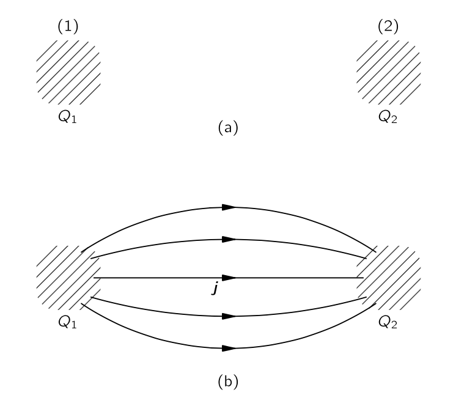{#fig-FLP_2_27_1 width=350}

상대성 이론에서 이러한 “전 세계적” 보존 법칙에는 어려움이 있다. 먼 지점에서의 “동시 순간”이라는 개념은 서로 다른 시스템에서는 동등하지 않다. 한 시스템에서 동시에 일어나는 두 사건은 지나가는 다른 시스템에서는 동시에 일어나는 것이 아니다. '전 세계적' 보존과 같은 유형의 경우, $Q_1$ 에서 손실된 전하가 $Q_2$ 에 동시에 나타나야 하며, 그렇지 않으면 전하가 보존되지 않은 순간이 있었을 것이다. 전하 보존 법칙을 상대론적으로 불변하게 만들려면 “지역” 보존 법칙으로 만들지 않고는 방법이 없는 것 같다. 사실, 로렌츠 상대론적 불변성의 요구는 가능한 자연 법칙들을 놀라운 방식으로 제한하는 것처럼 보인다. 예를 들어 현대 양자장 이론에서는 사람들은 종종 우리가 “비국소적” 상호작용이라고 부르는—여기서 무언가가 저기서 무언가에 직접적인 영향을 미치는—을 허용함으로써 이론을 변경하고자 했지만, 상대성 원리 때문에 문제가 발생한다.

“국소적” 보존은 또 다른 아이디어를 포함한다. 그것은 전하가 한 장소에서 다른 장소로 이동하려면 그 사이의 공간에서 무언가가 일어날 경우에만 가능하다고 말한다. 법칙을 설명하기 위해서는 전하의 밀도 $\rho$ 뿐만 아니라, 표면 전체에 걸친 전하 흐름 속도를 나타내는 벡터 $\bf{J}$ 라는 또 다른 종류의 양도 필요하다. 그렇다면 흐름은 @eq-FLP_2_27_1 에 의해 밀도의 변화율과 관련된다. 이것은 보다 극단적인 보존법칙이다. 이 법칙은 전하가 특수한 방식-"국소적"-으로 보존된다고 말한다.

에너지 보존도 국소적 과정이라는 것이 밝혀졌다. 주어진 공간 영역에는 에너지 밀도뿐만 아니라 표면을 통한 에너지 흐름 속도를 나타내는 벡터도 존재한다. 예를 들어, 광원이 방사될 때, 우리는 광원으로부터 빛 에너지가 빠져 나가는 것을 찾을 수 있다. 광원을 둘러싼 수학적 표면을 상상한다면, 표면 내부에서 손실되는 에너지는 표면을 통해 흐르는 에너지와 동일하다.

### $\textrm{II}$.27-2 에너지 보존과 전자기 {#sec-FLP_2_27_2}

이제 전자기학에 대한 에너지 보존을 정량적으로 구해보자. 이를 위해 공간의 모든 부피 요소에 얼마나 많은 에너지가 있는지와 에너지 흐름의 속도를 기술해야 한다. 먼저 전자기장 에너지만을 생각한다. 장에 있는 에너지 밀도(즉, 공간의 단위 부피당 에너지 양) 를  $u$ 라고 하고, 벡터 $\bf{S}$ 를 장의 에너지 플럭스(즉, 흐름에 수직인 단위 면적을 가로지르는 단위 시간당 에너지 흐름)라고 하자. 그렇다면, 전하 보존 @eq-FLP_2_27_1 과 완전하게 유사하게, 장에서의 에너지 보존의 국소적 법칙을 다음과 같이 쓸 수 있다.

$$
\dfrac{\partial u}{\partial t}=−\nabla \bf{\cdot S}.
$$ {#eq-FLP_2_27_2}

물론, 이 법칙은 일반적으로 사실이 아니며, 장 에너지가 보존된다는 것 역시 사실이 아니다. 어두운 방에 있다고 가정하고, 그때 조명 스위치를 켠다고 하자. 갑자기 방이 빛으로 가득 차서, 그 전에는 에너지가 없었지만, 필드에 에너지가 존재한다. @eq-FLP_2_27_2 는 완전한 보존 법칙이 아니며, 보존되는 것은 장 에너지만이 아니라 물질의 에너지를 포함한 세계의 전체 에너지이다. 필드의 에너지는 물질이 장에서 혹은 장이 물질에 대해 어떤 일을 수행하고 있을 경우 변한다.

하지만, 관심 있는 부피 안에 물질이 있다면, 우리는 그 물질이 얼마나 많은 에너지를 가지고 있는지 알 수 있다: 각 입자는 에너지 $mc^2/\sqrt{1−v^2/c^2}$ 를 가진다. 물질의 총 에너지는 모든 입자 에너지의 합에 불과하며, 이 에너지가 표면을 통과하는 흐름은 표면을 가로지르는 각 입자가 운반하는 에너지의 합에 불과하다. 우리는 이제 전자기장의 에너지에 대해서만 이야기하고자 한다. 따라서 우리는 주어진 부피에서 전체 장 에너지가 부피 밖으로 흐르거나, 장이 물질로 에너지를 잃거나(또는 에너지를 얻는데, 이는 단순히 음의 손실)해서 장의 에너지가 감소한다는 식으로 방정식을 작성해야 한다. 부피 $V$ 내부의 장 에너지는

$$
\int_V u\,d\mathcal{V},
$$

그리고 그 감소율은 이 적분에 대한 시간 미분에 $-1$ 을 곱한 값이다. 부피 $V$ 에서 방출되는 장 에너지 흐름은 $V$ 를 둘러싸는 표면 $\Sigma$ 에 대한 $\bf{S}$ 의 법선 성분의 적분이다.

$$
\int_\Sigma \bf{S\cdot n}da.
$$

따라서 

$$
−\dfrac{d}{dt}\int_V u\,d\mathcal{V}=  \int_\Sigma \bf{S\cdot n} \, da + \left(V \text{ 내부의 물질에 수행된 일}\right).
$$ {#eq-FLP_2_27_3}

우리는 이전에 장이 물질의 각 단위 부피 및 단위 시간당 $\bf{E\cdot J}$ 만큼의 일을 한다는 것을 보았다$^5$. [$^5$ 입자에 작용하는 힘은 $\bf{F}=q(\bf{E} + \bf{v}\times \bf{B})$ 이며, 작용 속도는 $\bf{F\cdot v} = q\bf{E\cdot v}$ 이다. 단위 부피당 $n$ 개의 입자가 존재한다면 단위 부피당, 단위 시간당 $nq\bf{E\cdot v}$ 의 일을 수행하며 여기서 $nq\bf{v}=\bf{J}$ 이다.]{.aside} 따라서 $\bf{E\cdot J}$ 는 단위 시간당 및 단위 부피당 필드에서의 에너지 손실과 같아야 한다. 따라서 @eq-FLP_2_27_3 은 다음 식과 동등히다.

$$
−\dfrac{d}{dt}\int_V u\,d\mathcal{V}=  \int_\Sigma \bf{S\cdot n} \, da + \int_V \bf{E \cdot J}\,d\mathcal{V}.
$$ {#eq-FLP_2_27_4}

이것은 장에서의 에너지 보존 법칙이다. 우리는 이것을 가우스의 정리를 사용하여 @eq-FLP_2_27_2 와 같은 미분 방정식으로 변환할 수 있다. 

$$
−\dfrac{\partial u}{\partial t} = \nabla \bf{\cdot S} + \bf{E\cdot J}.
$$ {#eq-FLP_2_27_5}

이 방정식에서 $u$ 와 $\bf{S}$ 가 무엇인지 알지 않으면 우리에게 전혀 도움이 되지 않는다. 아마도 이것들이 $\bf{E}$ 와 $\bf{B}$ 에 대해 무엇인지 알려 주는 것이 좋을 것 같다. 왜냐하면 우리가 진정으로 원하는 것은 결과뿐이기 때문이다. 여기서 1884년에 포인팅이 $\bf{S}$ 와 $u$ 에 대한 공식을 얻기 위해 사용한 논증의 본질을 보일 것이며, 이를 통해 그 원천을 확인할 수 있다. (하지만, 우리 이후 작업을 위해 이 유도를 배울 필요는 없다.)

### $\textrm{II}$.27-3 전자기장에서의 에너지 밀도와 에너지 흐름 {#sec-FLP_2_27_3}

그 아이디어는 $\bf{E}$ 와 $\bf{B}$ 에만 의존하는 장 에너지 밀도 $u$ 와 플럭스 $\bf{S}$ 가 존재한다고 가정하는 것이다. (일단 우리는 정전기학에서의 에너지 밀도가 $\frac{1}{2}\epsilon_0 E^2$ 임을 알고 있다.) 물론, $u$ 와 $\bf{S}$ 는 포텐셜이나 다른 양에 의존할수도 있지만, 일단 우리가 무엇을 해결할 수 있을지 진행해 보자. 우선 @eq-FLP_2_27_5 를 아래와 같이 쓸 수 있다. 

$$
\bf{E\cdot J} = −\dfrac{\partial u}{\partial t} − \nabla \bf{\cdot S}.
$$ {#eq-FLP_2_27_6}

좌항을 먼저 장에 대해서만 표현해 보자. 멕스웰 방정식 가운데

$$
\bf{J} = \epsilon_0 c^2 \nabla \times \bf{B}−\epsilon_0 \dfrac{\partial \bf{E}}{\partial t}
$$

를 @eq-FLP_2_27_6 에 대입하면

$$
\bf{E\cdot J}= \epsilon_0c^2 \bf{E\cdot} (\nabla \times \bf{B}) − \epsilon_0 \bf{E\cdot }\dfrac{\partial \bf{E}}{\partial t}
$$ {#eq-FLP_2_27_7}

이다. 마지막 항은  $(\partial /\partial t)(\frac{1}{2}\epsilon_0 E^2)$ 이므로 $\frac{1}{2}\epsilon_0 E^2$ 는 최소한 $u$ 의 한 부분이다. 이제 우리가 해야 할 일은 다른 항을 무언가의 발산으로 만드는 것이다. 우리는 아래가 성립함을 보일 수 있다(@exr-FLP_2_27_1)

$$
\nabla \bf{\cdot} (\bf{B}\times \bf{E}) = \bf{E \cdot} (\nabla \times \bf{B}) - \bf{B\cdot} (\nabla \times \bf{E}).
$$ {#eq-FLP_2_27_11}

이로부터

$$
\bf{E\cdot J} = \epsilon_0 c^2 \nabla \bf{\cdot}(\bf{B}\times \bf{E})  + \epsilon_0 c^2 \bf{B \cdot}(\nabla \times \bf{E}) - \dfrac{\partial }{\partial t}\left(\dfrac{1}{2}\epsilon_0 E^2\right).
$$

어느정도 끝난 것 같다. $u$ 에 사용할 수 있는 $t$ 에 대한 좋은 미분 항 하나와 $\bf{S}$ 를 나타내는 아름다운 발산 항이 하나 있지만 안타깝게도, 발산도 아니고 $t$ 에 대한 미분도 아닌 항이 남아 있다. 아직 완전하지 않다. 그런데 $∇\times \bf{E}=-\partial \bf{B}/\partial t$ 이다. 이로부터

$$
\bf{B\cdot}(∇\times \bf{E})=\bf{B\cdot}\left(\dfrac{\partial \bf{B}}{\partial t}\right)=−\dfrac{\partial}{\partial t}\left(\dfrac{B^2}{2}\right).
$$

이제 우리의 에너지 방정식은 다음과 같다.

$$
\bf{E\cdot J} = \nabla \bf{\cdot}(\epsilon_0c^2\bf{B}\times \bf{E}) −\dfrac{\partial}{\partial t} \left( \dfrac{\epsilon_0 c^2}{2}\bf{B\cdot B} + \dfrac{\epsilon_0}{2}\bf{E \cdot E}\right).
$$ {#eq-FLP_2_27_13}

이는 @eq-FLP_2_27_6 와 정확히 동일하다. 

::: {.callout-note icon="false"}

#### **전기 에너지 밀도와 자기 에너지 밀도**

아래와 같이 정의되는 $u_E$ 와 $u_B$ 를 각각 **전기 에너지 밀도 (electric energy density)**, **자기 에너지 밀도 (magnetic energy density)** 라고 한다.

$$
u_E:=\dfrac{\epsilon_0}{2}\bf{E\cdot E},\qquad u_B  :=\dfrac{\epsilon_0c^2}{2}\bf{B\cdot B} = \dfrac{1}{2\mu_0}\bf{B\cdot B}
$$ {#eq-FLP_2_27_14}

:::

 

::: {.callout-note icon="false"}

#### **포인팅 벡터**

아래와 같이 정의된 벡터 $\bf{S}$ 를 **포인팅 벡터 (Poynting's vector)** 라고 한다.
$$
\boxed{S := \epsilon_0 c^2 \bf{E}\times \bf{B}.}
$$ {#eq-FLP_2_27_15}

:::

### $\textrm{II}$.27-4 장 에너지의 모호함 {#sec-FLP_2_27_4}

Poynting 공식(@eq-FLP_2_27_14, @eq-FLP_2_17_5) 의 적용으로 진행하기 전에, 우리는 실제로 그것들을 증명한것은 아니라는 것을 짚고 넘어가야 한다. 우리가 한 일은 가능한 "$u$" 와 가능한 "$\bf{S}$" 를 찾은 것 뿐이며, 더 많은 항들을 섞어서 "$u$" 나 "$\bf{S}$" 에 대한 또 다른 공식을 찾을 수 없다는 것을 알 수 있을까? 새로운 $\bf{S}$ 와 새로운 $u$ 는 이전과 다르겠지만 여전히 @eq-FLP_2_27_6 를 만족할것이다. 가능하다. 가능하지만, 발견된 형태는 항상 다양한 장의 미분을 포함한다.(항상 2차 도함수나 1차 도함수의 제곱과 같은 2차 항을 포함한다). 사실, $u$ 와 $\bf{S}$ 에 대한 다양한 가능성이 무한히 많이 존재하지만, 지금까지 어느 것이 옳은지 실험적인 방법을 생각해 본 사람은 없다! 사람들은 가장 단순한 것이 아마도 올바른 것이라고 추측해 두었지만, 우리는 전자기장 에너지의 실제 공간이 정확히 무엇인지 확실히 알지 못한다고 말해야 한다. 따라서 우리도 쉬운 길을 취하여 장 에너지가 @eq-FLP_2_17_14 로 주어진다고 하겠다. 그렇다면 $\bf{S}$ 는 @eq-FLP_2_27_15 로 주어져야 한다.

장 에너지 위치의 불확정성을 해결할 독특한 방법이 없다는 점이 흥미롭다. 다음 논증에서 중력 이론을 사용함으로써 이 문제를 해결할 수 있다고 때때로 주장된다. 중력 이론에서 모든 에너지는 중력의 원인입니다. 따라서 중력 힘이 어느 방향으로 작용하는지 알기 위해서는 전기의 에너지 밀도를 적절히 위치시켜야 합니다. 하지만 아직까지 전자기장의 중력 영향 위치를 정확히 규명할 수 있을 만큼 섬세한 실험을 수행한 사람은 없다. 전자기장만으로도 중력의 원천이 될 수 있다는 것은 없이는 할 수 없는 생각입니다. 실제로, 빛이 태양 근처를 지나갈 때 편향되는 것이 관찰되었다—태양이 빛을 아래로 끌어당긴다고 말할 수도 있다. 빛이 태양에 똑같이 끌리도록 허용하고 싶지 않은가? 어쨌든, 모든 사람은 전자기 에너지의 위치와 흐름에 대해 우리가 찾은 간단한 표현들을 항상 받아들인다. 그리고 때때로 그것들을 사용하여 얻은 결과가 이상하게 보일지라도, 아무도 그것에 대해 잘못된 점을 발견한 적이 없다—즉, 실험에 대한 이의가 없다. 따라서 우리는 나머지 세계를 따를 것이며, 게다가 우리는 그것이 아마도 완전히 옳다고 믿고 있다.

우리는 에너지 공식에 대해 한 가지 더 언급해야 한다. 우선, 그 분야에서 단위 부피당 에너지는 매우 간단하다: 정전기 에너지와 자기 에너지를 합한 것으로, 정전기 에너지를 E2로, 자기 에너지를 B2로 표현하면 됩니다. 우리는 정적 문제를 풀 때 에너지에 대한 두 가지 가능한 표현식을 발견했다. 우리는 또한 정전기장 내 에너지에 대한 여러 다른 식들을 발견했으며, 예를 들어 $\rho \Phi$ 는 정전기 경우 $\bf{E\cdot E}$ 의 적분과 같다. 그러나 전기역학 분야에서는 동등성이 실패했으며, 어느 것이 옳은지 명확한 선택이 없었다. 이제 우리는 어느 것이 옳은지 알게 되었다. 마찬가지로, 우리는 일반적으로 올바른 자기 에너지의 공식을 찾았다. 동적 장의 에너지 밀도에 대한 올바른 공식은 @eq-FLP_2_27_14 이다.

### $\textrm{II}$.27-5 에너지 흐름의 예 {#sec-FLP_2_27_5}

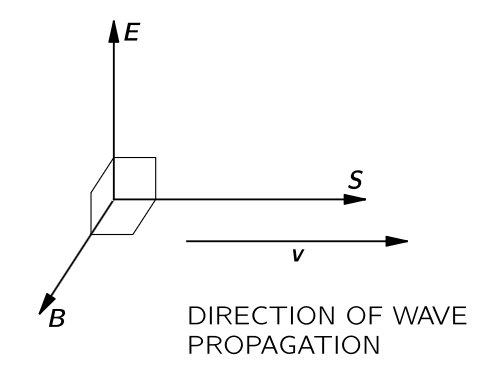{#fig-FLP_2_27_2 width=300}

에너지 흐름 벡터 $\bf{S}$ 에 대한 식은 상당히 새로운 것이다. 특정 경우에 $\bf{S}$ 가 어떻게 동작하는지 확인하고, 또한 이전에 알았던 것이 있는지 알아보자. 우리가 생각할 첫 번째 예는 빛이다. 빛 파동에서는 $\bf{E}$ 와 $\bf{B}$ 가 서로 직각을 이루며 파동 전파 방향에도 직각을 이룬다. (@fig-FLP_2_27_2) 전자기파에서 $B=E/c$ 이며 서로 직각을 이루므로 $|\bf{E}\times\bf{B}|=E^2/c$ 이다. 따라서 빛의 경우, 단위 면적당 초당 에너지 흐름은

$$
S=\epsilon_0 cE^2.
$$ {#eq-FLP_2_27_16}

$E=E_0 \cos \omega(t−x/c)$ 인 파동에 대해, 단위 면적을 통과하는 초당 에너지 흐름의 평균인 $\langle S\rangle_\text{av}$ 는 전기장의 제곱에 $\epsilon_0 c$ 를 곱한 값이며 빛의 **강도 (intensity)** 라고 불린다:

$$
\text{강도} = \langle S\rangle_\text{av} = \epsilon_0 c \langle E^2\rangle_\text{av}.
$$ {#eq-FLP_2_27_17}

믿든 말든, 우리는 이미 [$\mathrm{I}$.31–5 전파가 운반하는 에너지](../vol1/vol1_4.qmd#sec-FLP_1_31_5) 에서 이 결과를 얻었다. 빛의 빔이 있을 때, 공간에 주어진 에너지 밀도는 @eq-FLP_2_27_14 로 알 수 있다. $cB=E$ 사용하면,

$$
u=\dfrac{\epsilon_0E^2}{2} + \dfrac{\epsilon_0 c^2 (E/c)^2}{2}=\epsilon_0E^2.
$$

$\bf{E}$ 는 공간에서 변하기 때문에 평균 에너지 밀도는

$$
\langle u\rangle_\text{av} = \epsilon_0 \langle E^2\rangle_\text{av}.
$$ {#eq-FLP_2_27_18}

빛 파동은 속도 $c$ 로 이동하므로, 1초에 1제곱미터를 통과하는 에너지는 1 세제곱 미터당 에너지 양의 $c$ 배라고 생각해야 한다. 그렇다면 

$$
\langle S \rangle_\text{av} = \epsilon_0 c \langle E^2\rangle_\text{av}.
$$

이 식은 @eq-FLP_2_27_17 과 동일하다.

::: {#exm-FLP_chaper_2_27_1}

#### 축전기의 포인팅 벡터

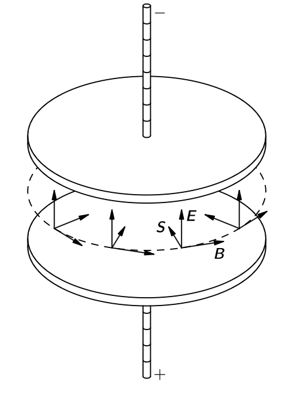{#fig-FLP_2_27_3 width=300}

천천히 충전되고 있는 충전기의 에너지 흐름을 보자. (이 충전기에 흐르는 전류는 공진 공동처럼 보일 정도로 진동수가 너무 크지는 않으며 반대로 직류도 아니라고 하자) 우리가 일반적으로 사용하는 원형 평행판 커패시터를 생각한다(@fig-FLP_2_27_3). 내부에 거의 균일한 전기장이 있으며, 시간이 지나면서 변한다. 어떤 순간이든 내부의 총 전자기 에너지는 부피의 $u$ 배이다. 원의 반지름 이 $a$ 이고 간격이 $h$ 라면 두 판 사이의 전자기 에너지 $U$ 는

$$
U=\left(\dfrac{\epsilon_0 E^2}{2}\right)(\pi a^2h).
$$ {#eq-FLP_2_27_19}

축전기가 충전될 때, 판 사이의 부피에서의 에너지의 변화는

$$
\dfrac{dU}{dt} = \epsilon_0 \pi a^2 h E ̇\dfrac{dE}{dt}.
$$ {#eq-FLP_2_27_20}

그러므로 어딘가에서 그 부피로 에너지 흐름이 있어야 한다. 당연히 그것이 충전선으로 들어와야 한다고 알고 있겠지만, 전혀 그렇지 않다! 그 방향에서 판 사이의 공간에 들어갈 수 없습니다, 왜냐하면 $\bf{E}$ 는 판에 수직이며 따라서 $\bf{E}\times \bf{B}$ 는 판에 평행하다. 우리는 [$\mathrm{II}$.23 공동 공진](#sec-FLP_2_23) 에서 축전지가 충전될 때 축을 중심으로 회전하는 자기장이 존재한다는 것을 알아보았다. 맥스웰 방정식의 마지막을 사용하면 축전기 가장자리의 자기장이 다음과 같다는 것을 안다.

$$
B =  \dfrac{a}{2c^2}\dfrac{dE}{dt} .
$$

자기장의 방향은 @fig-FLP_2_27_3 에 표시되어 있다. 따라서 그림에 표시된 바와 같이 가장자리 전체에 $\bf{E}\times \bf{B}$ 에 비례하는 에너지 흐름이 존재한다. 에너지는 실제로 전선을 통해 들어오는 것이 아니라, 커패시터를 둘러싼 공간에서 공급된다.

판의 가장자리 사이 전체 표면을 통과하는 총 흐름량이 내부 에너지 변화 속도와 항상 일치하지 않는지 확인해 보자. 표면의 면적은 $2\pi ah$ 이며, $\bf{S}=\epsilon_0c^2\bf{E}\times \bf{B}$ 의 크기는

$$
\epsilon_0c^2 E \left(\dfrac{a}{2c^2}\dfrac{dE}{dt}E\right)
$$

이므로 에너지의 총 플럭스는

$$
\pi a^2 h \epsilon_0E\dfrac{dE}{dt}.
$$

@eq-FLP_2_27_20 와 동일하다. 하지만 그것은 우리에게 특별한 사실을 알려준다. **우리가 축전기를 충전할 때, 에너지가 전선을 통해 들어오는 것이 아니라 틈의 가장자리를 통해 들어온다.** 그것이 바로 이 이론이 말하는 바이다!

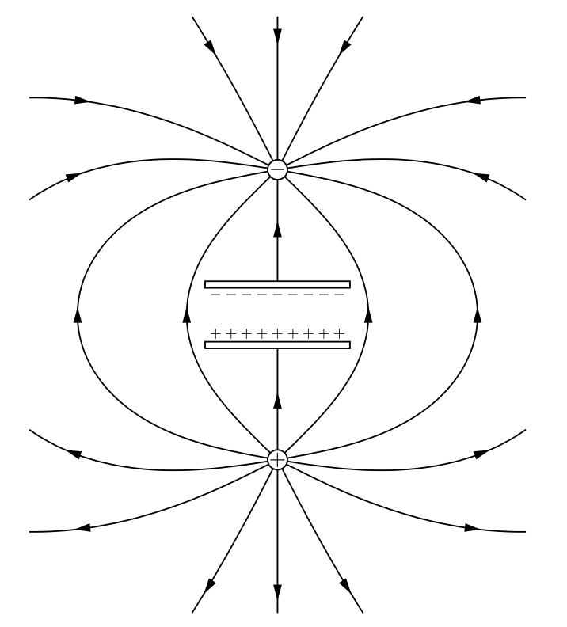{#fig-FLP_2_27_4 width=300}

어떻게 이것이 가능한가? 쉬운 질문이 아니지만, 여기 한 가지 생각하는 방법이 있다. 축전기 위와 아래에 전하가 있고 멀리 떨어져 있다고 생각핮. 전하가 멀리 떨어져 있을 때, 축전기를 둘러싸는 약하지만 매우 넓게 퍼진 장이 존재한다. (@fig-FLP_2_27_4) 그때, 전하들이 모이면서 장은 축전기에 가까워질수록 더 강해진다. 따라서 멀리 외부에 있는 장의 에너지는 축전기 쪽으로 이동하여 결국 판 사이에 도달한다.

:::

 

::: {#exm-FLP_chaper_2_27_2}

#### 전선의 에너지 흐름

전류가 흐르는 저항선 조각에서 어떤 일이 일어나는지 알아보자. 전선에 저항이 있기 때문에 전류를 구동하는 전기장이 그 주변에 존재한다. 전선을 따라 전위차가 있기 때문에, 전선 바로 바깥쪽에 표면에 평행한 전기장이 존재한다(@fig-FLP_2_27_5). 또한 전류 때문에 전선을 도는 자기장이 존재한다. $\bf{E}$ 와 $\bf{B}$ 는 직각을 이루므로, @fig-FLP_2_27_5 에 표현된 바와 같이 방사형으로 안쪽으로 향하는 포인팅 벡터가 존재한다. 전선 전체에 에너지 흐름이 있다. 물론, 이는 전선에서 열 형태로 손실되는 에너지와 동일하다. 우리의 “미친” 이론에 따르면, 전자는 외부 필드에서 와이어로 흐르는 에너지 때문에 에너지를 받아 열을 발생시킨다. 직관적으로는 전자가 전선을 따라 밀려질 때 에너지를 얻는 것처럼 보이며, 따라서 에너지는 전선을 따라 아래쪽(또는 위쪽)으로 흘러야 한다. 하지만 이론에 따르면 전자는 실제로 매우 멀리 떨어진 전하에서 온 전기장에 의해 밀려나고 있으며, 전자는 이러한 전기장으로부터 열을 생성하기 위한 에너지를 얻는다. 에너지는 어떻게든 먼 전하에서 넓은 공간 영역을 흐른 뒤, 전선 내부로 전달된다.

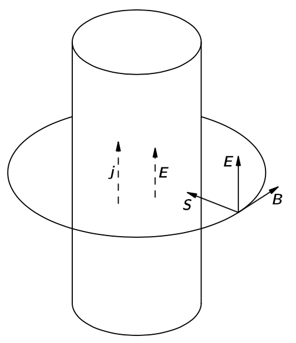{#fig-FLP_2_27_5 width=300}

:::

 

::: {#exm-FLP_chaper_2_27_3}

#### 가까이 있는 전하와 자석

전하와 자석이 서로 가까이에 정지해 있다고 하자. @fig-FLP_2_27_6 에 표현된 바와 같이 막대 자석의 중심 근처에 위치한 점 전하를 생각하자. 모든 것이 멈추고 있기 때문에 에너지는 시간에 따라 변하지 않는다. 또한, $\bf{E}$ 와 $\bf{B}$ 는  정적입니다. 그러나 $\bf{S}=\epsilon_0 c^2 \bf{E}\times \bf{B} \ne \bf{0}$ 이므로 에너지 흐름이 있다고 말할 수 있다. 에너지 흐름을 보면, 그것이 단지 여기저기로 순환한다는 것을 알 수 있다. 에너지에는 어디에서도 변화가 없으며, 한 부피에 흐르는 모든 것이 다시 흘러나온다. 그것은 비압축성 물이 흐르는 것과 같다. 따라서 이른바 정적 상태에서도 에너지 순환이 존재한다. 정말 믿을 수 없다!

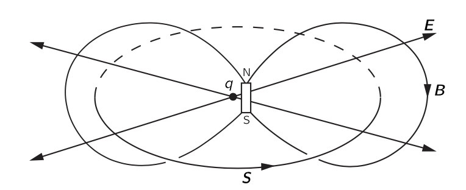{#fig-FLP_2_27_6 width=300}

우리가 “정적” 자석이라고 부른 것이 실제로는 순환하는 영구 전류라는 것을 기억하면, 그렇게 크게 당황스러운 일은 아닐지도 모른다. 영구 자석에서는 전자가 내부에서 영구적으로 회전하고 있다. 그래서 외부 에너지의 순환이 결국 그렇게 기이하지 않은 것 같다.

:::

 

당신은 의심할 여지 없이 포인팅 이론이 전자기장 내에서 에너지가 어디에 위치하는지에 대한 직관을 최소한 부분적으로는 위반한다는 인상을 받기 시작할 것이다. 당신은 모든 직관을 재정비해야 한다고 생각하실 수도 있으며, 따라서 여기서 공부할 것이 많이 있습니다. 하지만 정말 필요하지 않은 것 같다. 와이어의 에너지가 와이어를 따라가 아니라 외부에서 와이어로 흐르고 있다는 사실을 가끔 잊어버리더라도 큰 곤란에 처하게 될 것이라고 느낄 필요가 없다. 에너지 보존이라는 개념을 사용할 때, 에너지가 어떤 경로를 가는지 자세히 관찰하는 것이 거의 가치가 없는 것처럼 보인다. 자석과 전하를 중심으로 하는 에너지의 순환은 대부분의 경우 상당히 중요하지 않은 것으로 보인다. 중요한 세부 사항은 아니지만, 우리의 일반적인 직관이 상당히 틀렸다는 것이 분명하다.

### $\textrm{II}$.27-6 장 운동량 {#sec-FLP_2_27_6}

### 연습문제 {.unnumbered}

::: {#exr-FLP_2_27_1}

@eq-FLP_2_27_11 이 성립함을 보여라.

::: 

::: {.solution}

$$
\begin{aligned}
\nabla \bf{\cdot} (\bf{B}\times \bf{E}) &= \varepsilon_{ijk}\partial_i (B_j E_k) = \varepsilon_{ijk} E_k (\partial_i B_j) + \varepsilon_{ijk} B_j (\partial_i E_k) \\[0.3em]
&= E_k(\nabla \times \bf{B})_k - B_j (\nabla \times \bf{E})_j =  \bf{E \cdot} (\nabla \times \bf{B}) - \bf{B\cdot} (\nabla \times \bf{E}).
\end{aligned}
$$

:::

## $\textrm{II}$.28 전자기적 질량 {#sec-FLP_2_28}

## $\textrm{II}$.29 전자기장에서의 전하의 운동 {#sec-FLP_2_29}

