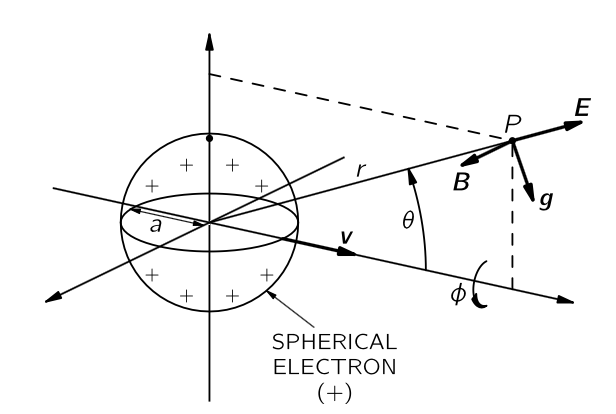
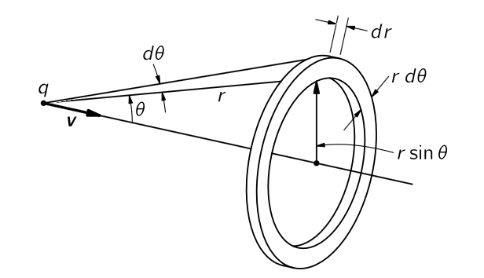
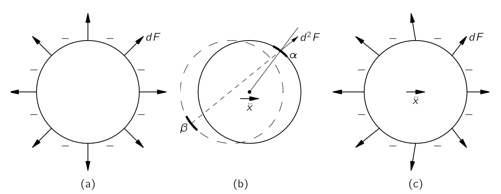

 

## $\textrm{II}$.28 전자기적 질량 {#sec-FLP_2_28}

### $\mathrm{II}$. 28–1 점입자의 장 에너지 {#sec-FLP_2_28_1}

#### **고전전자기학의 실패**

상대성 이론과 맥스웰 방정식을 결합함으로써, 전자기학 이론에 대한 주요 작업을 마쳤다. 물론, 우리가 놓친 세부 사항이 몇 가지 있으며, 앞으로 우리가 관심을 가질 큰 영역이 하나 있다-전자기장과 물질의 상호작용. 하지만 잠시 멈추어 이 거대한 건축물이 수많은 현상을 설명하는 데 있어 아름다운 성공을 거두며 그 모습을 드러내는 것을 보자. 우리의 물리학을 지나치게 따라가면, 항상 어떤 식으로든 문제가 발생한다는 것을 알게 된다. 이제 우리는 심각한 문제인 고전 전자기 이론의 실패에 대해 논의하고자 한다. 양자역학적 효과 때문에 모든 고전 물리학이 실패하고 있음을 이해하실 수 있다. 고전역학은 수학적으로 일관된 이론이지만, 경험과 일치하지 않는다. 그렇지만 고전 전자기 이론 자체가 만족스럽지 못한 이론이라는 점이 흥미롭다. 맥스웰 이론의 아이디어와 관련된 어려움은 양자역학에 의해 해결되지 않으며 직접적으로 연관되지도 않는다. 당신은 “아마도 이러한 어려움에 대해 걱정할 필요가 없을 것”이라고 말할 수 있다. 양자역학이 전기역학의 법칙을 바꾸게 될 것이므로, 우리는 수정 후에 어떤 어려움이 있는지 기다려야 한다. 하지만 전자기학을 양자역학에 결합하면 어려움은 여전히 남아 있다. 그러므로 이제 이러한 어려움이 무엇인지 살펴보는 것이 우리의 시간을 낭비하지 않을 것이다. 또한, 그것들은 큰 역사적 중요성을 가지고 있다. 게다가, 이론을 충분히 진행하여 모든 것을—그 모든 어려움까지도—볼 수 있게 되면 어느 정도 성취감을 느낄 수 니다.

우리가 논의할 문제는 전자기 운동량과 에너지 개념이 전자나 모든 전하 입자에 적용될 때와 관련이 있다. 단순 전하 입자라는 개념과 전자기장이라는 개념은 어느 정도 일관성이 없다. 문제를 설명하기 위해, 우리는 에너지와 운동량 개념을 활용한 몇 가지 연습을 시작한다.

#### **점입자의 경우**

전하를 띤 입자의 에너지를 계산해보자. 전자의 모든 전하 $q$ 가 반지름 $a$ 인 구의 표면에 균일하게 분포된 전자의 단순 모델을 가정한다면, 점 전하라는 특수한 경우에 0이라고 가정할 수 있다. 이제 전자기장의 에너지를 계산해 보자. 전하가 정지해 있으면 자기장이 없으며, 단위 부피당 에너지는 전기장의 제곱에 비례한다. 전기장의 크기는 $q/4π\epsilon_0r^2$ 이며, 에너지 밀도는

$$
u=\dfrac{\epsilon_0 E^2}{2} = \dfrac{q^2}{32 \pi^2 \epsilon_0 r^4}.
$$

전체 에너지는 전체 공간에 대한 이 밀도의 적분값이다. 

$$
U_\text{elec} = \int_a^\infty \dfrac{q^2}{8\pi \epsilon_0r^2} \,dr = \dfrac{1}{2}\dfrac{q^2}{4\pi\epsilon_0}\dfrac{1}{a}.
$$ {#eq-FLP_2_28_1}

점전하를 $0$ 으로 설정할 때까지는 모든 것이 정상이다. 장의 에너지는 중심으로부터의 거리의 네제곱에 반비례하기 때문에, 그 부피 적분은 무한하다. 점 전하를 둘러싼 장에는 무한히 많은 에너지가 존재한다.

무한한 에너지에 무슨 문제가 있을까? 에너지가 빠져 나올 수 없고 영원히 그곳에 머물러야 한다면, 무한한 에너지와 실제로 어떤 어려움이 있을까? 물론, 무한히 나오는 양이 짜증날 수 있지만, 실제로 중요한 것은 관찰 가능한 물리적 효과가 있는지 여부 뿐이다. 그 질문에 답하려면, 우리는 에너지 외에 다른 것으로 전환해야 한다. 전하를 이동시킬 때 에너지가 어떻게 변하는지 물어본다고 가정해 보자. 그렇다면 변화가 무한하면 우리는 곤란에 처하게 될 것이다.

### $\mathrm{II}$.28–2 움직이는 전하의 장 운동량 {#sec-FLP_2_28_2}

{#fig-FLP_2_28_1 width=400}

전자가 빛의 속도에 비해 매우 작은 일정한 속도로 이동하고 있다고 가정하자. 이 움직이는 전자와 연관된 운동량은 전자기가 전하를 띠기 전에 질량이 없었더라도 전자기장의 운동량 때문에 발생한다. 우리는 전하의 속도 $\bf{v}$ 방향에 대한 자기장 운동량이 $\bf{v}$ 에 해당함을 증명할 수 있으며, 작은 속도에서는 $\bf{v}$ 에 비례한다. 전하 중심으로부터 거리 $r$ 에 있는 점 $P$ 와 운동선에 대한 각도 $\theta$ (@sec-FLP_2_28_1)에서 전기장은 방사형이며, 우리가 본 바와 같이 자기장은 $\bf{v}\times \bf{E}/c^2$ 이다. @eq-FLP_2_27_21 에 따라 운동량 밀도 

$$
\bf{g} = \epsilon_0 \bf{E}\times \bf{B}.
$$

운동량 밀도는 그림에 표시된 대로 운동선을 향해 비스듬히 향하고 있으며, 그 크기는

$$
g=\dfrac{\epsilon_0 v}{c^2}E^2 \sin \theta.
$$

{#fig-FLP_2_28_2 width=400}

장은 운동선에 대해 대칭이므로, 공간상에 적분하면 횡성분들의 합이 0이 되어 최종 운동량이 $\bf{v}$ 와 평행하게 된다. 이 방향에 대한 $\bf{g}$ 의 성분은 $g\sin\theta$ 이며, 따라서 그때 전체 운동량 $\bf{p}$ 는

$$
\bf{p} = \int \dfrac{\epsilon_0 \bf{v}}{c^2}E^2 \sin^2 \theta \, (2\pi r^2) \sin \theta\, d\theta dr.
$$

$\bf{E}$ 가 $\theta$ 에 대해 독립적($v\ll c$)이므로, 우리는 즉시 θ 위에서 적분할 수 있다. $\sin^3\theta$ 에 대한 적분은

$$
\int_0^\pi \sin^3\theta\,d\theta = −\int_0^\pi (1−\cos^2\theta) d(\cos\theta) = \left[−\cos\theta + \dfrac{\cos^3 θ}{3}\right]_{\theta=0}^{\pi} = \dfrac{4}{3}.
$$

따라서

$$
\bf{p} =\dfrac{8\pi}{3}\dfrac{\epsilon_0 \bf{v}}{c^2}\int_a^\infty E^2r^2\,dr.
$$

$v\ll c$ 에 대해 $E=q^2/4\pi\epsilon_0 r^2$ 이므로

$$
\bf{p} = \dfrac{2}{3}\dfrac{q^2}{4\pi \epsilon_0 ac^2}\bf{v}.
$$ {#eq-FLP_2_28_3}

장의 운동량, 즉 전자기 운동량은 $\bf{v}$ 에 비례한다. 여기서 $\bf{v}$ 의 계수는 운동량에서 질량의 의미를 가지며, 우리는 이 계수를 **전자기적 질량 (electromagnetic mass)** $m_\text{elec}$ 이라고 부를 수 있다.

$$
m_\text{elec}=\dfrac{1}{6}\dfrac{q^2}{\pi \epsilon_0 ac^2}.
$$ {#eq-FLP_2_28_4}

### $\mathrm{II}$.28–3 전자기적 질량 {#sec-FLP_2_28_3}

질량의 근원은 무엇인가? 역학 법칙에서는 모든 물체가 우리가 질량이라고 부르는 것을 품고 있다고 가정해 왔다. 이는 또한 그 물체가 속도에 비례하는 운동량을 품고 있다는 의미이다. 이제 우리는 전하를 띤 입자는 그 속도에 비례하는 운동량을 가지고 있다고 이해될 수 있다는 것을 알게 되었다. 실제로는 질량이 전기역학의 효과일 뿐일 수도 있다. 질량의 기원은 지금까지 설명되지 않았다. 우리는 마침내 전기역학 이론에서 이전에 한 번도 이해하지 못한 것을 이해할 수 있는 큰 기회를 얻게 되었다. 뜬금없이 맥스웰과 포인팅에 의해 전하를 띤 입자는 전자기적 영향만으로 속도에 비례하는 운동량을 갖게 된다.

잠시 보수적으로 말하자면, 질량에는 두 종류가 있습니다. 물체의 전체 운동량은 기계적 운동량과 전자기 운동량의 합이 될 수 있다. 역학적 운동량은 **역학적** 질량 $m_\text{mech}$ 에 $\bf{v}$ 를 곱한 값이다. 입자의 질량을 측정하기 위해 입자의 운동량이나 궤도에서 어떻게 회전하는지를 확인하는 실험에서는 전체 질량을 측정하게 된다. 우리는 일반적으로 운동량이 전체 질량($m_\text{mech} + m_\text{elec}$)에 속도를 곱한 것이라고 말한다. 따라서 관측된 질량은 두 개의 조각(다른 장을 포함하면 더 많을 수도 있다): 역학적 조각과 전자기적 조각으로 구성될 수 있다. 우리는 전자기 조각이 확실히 존재한다는 것을 알고 있으며, 그에 대한 공식도 가지고 있다. 그리고 역학적 조각이 전혀 존재하지 않을 가능성이라는 흥미로운 가능성이 있다—그 질량이 전부 전자기적일 수도 있다.

역학적 질량이 없을 경우 전자가 어떤 크기를 가져야 하는지 살펴보자. 우리는 @eq-FLP_2_28_4 의 전자기적 질량을 전자의 관측된 질량 $m_e$ 와 같다고 놓으면

$$
a=\dfrac{1}{6}\dfrac{q_e^2}{\pi \epsilon_0 m_ec^2}.
$$ {#eq-FLP_2_28_5}

이며 이 때

$$
r_0 =\dfrac{1}{4\pi\epsilon_0}{q_e^2}{m_ec^2} \approx 2.82 \times 10^{-15}\,\text{m}
$$ {#eq-FLP_2_288_6}

를 **고전 전자 반지름 (classical electron radius)**' 라고 한다. 대략 원자 반지름의 $1/10^5$ 정도이다.

전자의 전하 분포를 어떻게 가정하느냐에 따라 앞의 계수가 바뀔 수 있다. 이 경우 많은 물리학자들이 이 $r_0$ 를 명목상의 전자 반지름으로 정한 것일 뿐이다.

이제 전자기적 질량 이론을 탐구해 보자. 앞서의 계산은 $v \ll c$ 를 가정했다. 고속에서의 초기의 시도들은 어느 정도의 혼란을 초래했지만, 로렌츠는 전하를 띤 구는 고속으로 타원체로 수축하고, [$\mathrm{II}$.26 장의 로런츠 변환](#sec-FLP_26) 에서 상대론적 경우에 대해 우리가 유도한 @eq-FLP_2_26_6 과 @eq-FLP_2_26_7 에 따라 장이 변한다는 것을 알게되었다. 그 경우 $\bf{p}$ 에 대한 적분을 수행하면, 임의의 속도 $\bf{v}$ 에 대해 운동량이 $1/\sqrt{1−v^2/c^2}$ 을 곱한 만큼 변한다는 것을 알 수 있다:

$$
\bf{p}=\dfrac{2}{3}\dfrac{q^2}{4\pi \epsilon_0 ac^2}\dfrac{\bf{v}}{\sqrt{1−v^2/c^2}}.
$$ {#eq-FLP_2_28_7}

**추가 설명 필요**

이제 장의의 에너지 계산으로 돌아가면 그 결과는 @eq-FLP_2_28_1 이다. 상대성 이론에 따르면, 에너지 $U$ 는 질량 $U/c^2$ 을 갖게 된다. @eq-FLP_2_28_1 은 전자의 장의 질랑 $m'$ 은 다음과 같아야 한다.

$$
m'_\text{elec} = \dfrac{U_\text{elec}}{c^2} =\dfrac{1}{2}\dfrac{q_e^2}{4\pi \epsilon_0 ac^2}.
$$ {#eq-FLP_2_28_8}

이는 @eq-FLP_2_28_4 의 전자기적 질량인 $m_\text{elec}$ 와 다르다. 실제로 @eq-FLP_2_28_1 와 @eq-FLP_2_28_4 를 연결하면

$$
U_\text{elec}=\dfrac{3}{4}m_\text{elec}c^2
$$

이다. 이 식은 상대성 이론 이전에 발견되었으며, 아인슈타인과 다른 사람들이 항상 $U=mc^2$ 이어야 한다는 것을 깨닫기 시작했을 때, 큰 혼란이 있었다.

### $\mathrm{II}$.28–4 전자 자신에 가해지는 힘 {#sec-FLP_2_28_4}

우리가 전기역학 이론이 상대성 원리와 일치한다는 것을 신중히 입증했기 때문에 전자기적 질량에 대한 두 공식 사이의 불일치는 특히 성가시다. 그러나 상대성 이론은 의심할 여지 없이 운동량이 에너지와 $\bf{v}/c^2$ 의 곱과 동일해야 한다고 말한다. 그래서 우리는 어떤 곤경에 처한 것 같다. 무언가 실수를 한 것이 틀림없다. 우리는 계산 실수를 저지르지 않았으므로, 무언가를 빼먹었다.

에너지와 운동량에 대한 방정식을 도출할 때, 보존 법칙을 가정했다. 모든 힘이 고려되었고, 전기적이지 절차로 수행된 모든 일과 모든 운동량이 포함된었다 가정했다. 그런데 전하의 공이 있다면, 전기적 힘은 모두 반발력이며 전자는 서로 멀어지는 경향이 있다. 시스템에 불균형적인 힘이 존재하기 때문에, 에너지와 운동량에 관한 법칙에서 다양한 오류가 발생할 수 있다. 일관된 그림을 얻기 위해서는 전자를 결합시키는 무언가가 있다고 상상해야 한다. 전하들은 전하가 날아가는 것을 방지하는 일종의 고무줄에 의해 구에 고정되어야 한다. 푸앙카레가 처음 지적한 바와 같이 고무 밴드—또는 전자를 결합하는 것이 무엇이든—에너지와 운동량 계산에 포함되어야 한다. 이러한 이유로 추가적인 비전기력은 보다 우아한 명칭인 **푸앙카레 응력 (Poincaré stress)** 이라고도 알려져 있다. 추가 힘을 계산에 포함하면, 두 가지 방법으로 얻은 질량이 변경됩니다(상세한 가정에 따라 달라진다). 그리고 결과는 상대성 이론과 일치한다; 즉, 운동량 계산에서 나오는 질량은 에너지 계산에서 나오는 질량과 동일하다. 하지만, 두 가지 모두 두 가지 기여를 포함하고 있다: 전자기적 질량과 푸앵카레 응력으로부터의 기여. 두 가지를 더할 때에만 일관된 이론을 얻을 수 있다.

명백하게도, 전자 내부의 힘을 고려하면 전체 아이디어의 아름다움이 사라지기 시작한다. 일이 매우 복잡해진다. 다음과 같은 질문은 자연스럽다: 응력은 얼마나 강한가? 전자는 어떻게 흔들리는가? 그것은 진동는가? 그것의 내부 특성은 무엇인가? 등등등. 전자가 복잡한 내부 특성을 가지고 있을 가능성이 있다. 만약 우리가 이러한 방향으로 전자에 대한 이론을 만든다면, 그것은 아직 관측되지 않은 것으로 보이는 진동 모드와 같은 특이한 특성을 예측하게 될 것이다. "않은 것으로 보이는” 이라고 말하는 이유는 자연에서 아직도 말이 안되는 것들을 관찰하기 때문이다. 우리는 언젠가 오늘 우리가 이해하지 못하는 것 중 하나(예를 들어, 뮤온)가 실제로 푸앙카레 응력의 진동으로 설명될지도 모른다. 가능성이 낮아 보이지만, 확실히 말할 수 있는 사람은 없다. 우리가 아직 이해하지 못하는 기본 입자에 관한 많은 것들이 있다. 어쨌든, 이 이론이 암시하는 복합 구조는 바람직하지 않으며, 모든 질량을 전자기학의 관점에서—적어도 우리가 기술한 방식으로—설명하려는 시도는 결국 막다른 골목으로 이어졌다는 것이다.

장의 운동량이 속도에 비례할 때 그 비례계수를 질량이라고 말하는 이유에 대해 조금 더 생각해 보자. 쉽다! 질량은 운동량과 속도 사이의 계수이다. 하지만 우리는 질량을 다른 방식으로 바라볼 수 있다: 입자는 가속하기 위해 힘을 가해야 할 경우 질량을 가지고 있다. 따라서 힘이 어디서 오는지 조금 더 자세히 살펴보면 우리의 이해에 도움이 될 것이다. 우리는 어떻게 힘이 있어야 한다는 것을 알 수 있나? 우리는 장에 대한 운동량 보존 법칙을 증명했기 때문에. 우리가 전하를 띤 입자를 가지고 그것을 잠시 밀어붙인다면, 전자기장에 약간의 운동량이 발생한다. 운동량이 어떻게든 장에 쏟아졌음에 틀림없다. 따라서 전자를 움직이게 하기 위해 전자를 밀어붙이는 힘이 있었음에 틀림없다—그 역학적 관성에 의해 요구되는 힘에 추가된 힘, 즉 전자기적 상호작용에 의한 힘이다. 그리고 “푸셔”에 해당하는 힘이 되돌아와야 합니다. 하지만 그 힘은 어디에서 오는 것인가?

{#fig-FLP_2_28_3 width=500}

그 그림은 이와 같다. 우리는 전자를 전하를 띤 구로 생각할 수 있다. 그것이 정지해 있을 때, 각 전하 조각은 전기적으로 서로 밀지만, 힘은 모두 쌍을 이루어 균형을 이루어 합력이 존재하지 않는다. [@fig-FLP_2_28_3 (a)를 참조하자.] 그러나 전자가 가속될 때, 전자기 영향이 한 조각에서 다른 조각으로 이동하는 데 시간이 걸리기 때문에 힘은 더 이상 균형을 이루지 않게 된다. 예를 들어, @fig-FLP_2_28_3 (b) 에서 조각 $\alpha$ 에 가해지는 힘은 반대쪽에 있는 조각 $\beta$ 가 이전 시점의 위치에 따라 달라진다. 힘의 크기와 방향은 모두 전하의 운동에 따라 달라진다. 전하가 가속하고 있다면, 전자의 여러 부분에 작용하는 힘은 @fig-FLP_2_28_3 (c) 와 같이 될 수 있다. 이 모든 힘을 합산하면, 그것들은 상쇄되지 않는다. 그들은 균일한 속도에 대해 상쇄될 것이지만, 처음 보면 감속이 균일한 속도에서도 불균형한 힘을 줄 것처럼 보인다. 하지만 전자가 가속되지 않는 한 합력이 없다는 것이 밝혀졌다. 가속도에서는 전자의 여러 부분 사이의 힘을 보면, 작용과 반응이 정확히 동일하지 않으며, 전자는 가속을 억제하려는 힘을 자신에게 가한다. 그것은 스스로의 부트스트랩에 의해 스스로를 제약한다.

이 자기반응력을 계산하는 것은 가능하지만 어렵다; 그러나 여기서는 그렇게 정교한 계산을 진행하지 않으려 한다. 우리는 1차원에서 비교적 복잡하지 않은 운동의 특수한 경우, 예를 들어 $x$ 에 대한 결과가 무엇인지 알려주겠다. 그렇다면, 자기 자신에게 작용하는 힘은 아래와 같은 급수로 표현 할 수 있다.

$$
F=\alpha \dfrac{q_e^2}{4\pi\epsilon_0 ac^2}\ddot {x}−\dfrac{2}{3}\dfrac{q_e^2}{4\pi\epsilon_0 c^3} \dddot{x} + \gamma \dfrac{q_e^2a}{4\pi \epsilon_0 c^4}\ddddot{x} + \cdots .
$$ {#eq-FLP_2_28_9}

여기서 $\alpha$ 와 $\gamma$ 는 1계 계수이다. $\ddot{x}$ 항의 계수 $\alpha$ 는 가정된 전하 분포에 의존하며 전하가 구면에 균일하게 분포한다면 $\alpha=2/3$ 이다. 따라서 가속도에 비례하며 전자의 반지름 $a$ 에 반비례 하는 항이 존재하며 @eq-FLP_2_28_4 에서 얻은 값 $m_\text{elec}$ 과 정확히 일치한다. 다른 전하 분포에서 $\alpha$ 가 변경되는 경우 @eq-FLP_2_28_4 의 분수 $2/3$ 같은 방식으로 변경된다. $\dddot{x}$ 항은 가정된 반지름 a와 가정된 전하의 분포와는 독립적이며, 그 계수는 항상 $2/3$ 이다. 다음 항은 반지름 $a$ 에 비례하며, 그 계수 $\gamma$ 는 전하 분포에 따라 달라진다. 전자 반지름 $a$ 를 $0$ 으로 두면 마지막 항(및 모든 이후 항)도 $0$ 이 된다. 두 번째 항은 일정하게 유지되지만, 첫 번째 항인 전자기적 질량은 무한대가 된다. 그리고 우리는 무한대가 전자의 한 부분이 다른 부분에 작용하는 힘 때문에 발생한다는 것을 알 수 있다—왜냐하면 우리는 다소 어리석은 일인 “점” 전자가 자신에게 작용할 가능성을 허용했기 때문이다.

### $\mathrm{II}$.28–5 멕스웰 방정식을 개선하려는 시도 {#sec-FLP_2_28_5}

이제 전자를 단순한 점 전하로 유지할 수 있도록 맥스웰의 전기역학 이론을 어떻게 수정할 수 있는지 논의하고자 한ㄷ. 많은 시도가 이루어졌으며, 일부 이론은 심지어 모든 전자 질량을 전자기적으로 만들도록 배치할 수 있었다. 하지만 이 이론들은 모두 사라졌다. 제안된 가능성 중 일부를 논의하는 것은 여전히 흥미롭다—인간 정신의 투쟁을 보는 것이다.

우리는 한 전하와 다른 전하의 상호작용으로부터 전기 이론을 시작했다. 그리고 이러한 상호작용하는 전하에 대한 이론을 만들어냈고, 결국 장 이론에 도달했다. 우리는 그것을 너무 믿어서 그것이 전자의 한 부분이 다른 부분에 작용하는 힘에 대해 알려주도록 허용한다. 아마도 전체적인 어려움은 전자가 스스로에게 작용하지 않기 때문일 것이다. 또한 개별 전자들의 상호작용으로부터 전자가 자신과 상호작용한다는 생각을 지나치게 크게 외삽하고 있는 것일지도 모른다. 따라서 전자가 자체에 작용할 가능성을 배제하는 몇몇 이론이 제안되었다. 그렇다면 자기작용으로 인한 무한이 더 이상 존재하지 않게 된다. 또한, 입자와 관련된 전자기적 질량이 더 이상 존재하지 않으며, 모든 질량이 역학적 질량으로 돌아왔지만 이론에는 새로운 난점이 있다.

이러한 이론들은 전자기장에 대한 개념을 수정할것을 요구한다. 지금까지 힘은 어느 지점에서든 두 양, 즉 $\bf{E}$ 와 $\bf{B}$ 에 의해 결정된다고 말해왔다. 우리가 “자기 자신에게 작용하는 힘”을 포기한다면, 이는 더 이상 참이 될 수 없다. 왜냐하면 특정 위치에 전자가 존재한다면, 그 힘은 전체 $\bf{E}$ 와 $\bf{B}$ 에 의해 주어지는 것이 아니라, 다른 전하에 의해 발생하는 그 부분들에 의해서만 작용하기 때문이다. 따라서 우리는 힘을 계산하고 있는 전하에 의해 발생하는 $\bf{E}$ 와 $\bf{B}$ 를 항상 추적해야 하며, 다른 전하에 의해 발생하는 양도 추적해야 한다. 이것은 이론을 훨씬 더 정교하게 만들지만, 무한의 어려움을 없애줍니다.

::: {.callout-tip icon="false"}

#### **위 논의에 대한 Claude Falble 5.1 의 답변**

> **Q**: 왜 self-force 를 포기하면 힘이 전기장과 자기장에 의해 결정되지 않지?

혼란의 뿌리는 "장(field)"이라는 개념이 원래 무엇을 약속하는지에 있어. 결론부터: 표준 이론에서 $\bf{E}, \bf{B}$는 "그 점의 공간 상태"이지 "누가 만들었는지 꼬리표가 붙은 것"이 아니야. self-force를 버리면 꼬리표가 필요해지고, 그 순간 힘은 더 이상 "그 점의 장"의 함수가 아니게 돼. 🎯

표준 Maxwell-Lorentz 이론의 약속은 이거야. 공간의 각 점에 $\bf{E}(\bf{r},t)$, $\bf{B}(\bf{r},t)$ 라는 단 하나의 값이 있고, 거기 어떤 전하가 오든 힘은 $q(\bf{E} + \bf{v}\times\bf{B})$. 장은 국소적이고 익명이야 — 중첩 원리로 여러 전하의 기여가 더해지지만, 일단 더해지고 나면 "이 부분은 전하 1 것, 저 부분은 전하 2 것"이라는 정보는 사라져. 장이 그 점에 있는 이유나 내력을 몰라도 힘을 계산할 수 있다는 것, 그게 "장"이라는 개념의 핵심 효용이야. 장은 전하들 사이의 중개자이면서 독립적 실체지.

이제 전자 둘을 놓고 self-force를 버려보자. 전자 1의 위치에서 표준 이론의 총 장은 $\bf{E}_\text{total}(\bf{r}_1) = \bf{E}_1(\bf{r}_1) + \bf{E}_2(\bf{r}_1)$ 인데 첫 항이 점전하 자기 장이라 무한대야. 이걸 없애려고 "전자 1에 걸리는 힘은 $q\,\bf{E}_2(\bf{r}_1)$ 뿐"이라고 선언하면 — 봐, 힘이 **그 점의 장 $\bf{E}_{total}$ 의 함수가 아니야.** 장 중에서 "전자 2가 만든 조각"만 골라내야 하는데, 그 조각은 공간의 상태가 아니라 “(그 점, 거기 누가 있나, 다른 전하들이 누구인가)”라는 관계적 정보야. 같은 점에 전자 1 대신 전자 3이 있으면 골라내야 할 조각이 $\bf{E}_1 + \bf{E}_2$ 로 바뀌지. 장은 더 이상 익명일 수 없고, 모든 기여에 출처 꼬리표를 달고 다녀야 해. 파인만이 “how much of $\bf{E}$ and $\bf{B}$ is due to the charge on which you are calculating the force”를 계속 추적해야 한다고 한 게 정확히 이 꼬리표 장부야.

그러면 "장"의 위상이 뭐로 바뀌느냐 — 독립적 실체에서 계산 보조 장치로. $\bf{E}_2(\bf{r}_1)$ 이라는 양은 사실 "전하 2가 전하 1에 미치는 영향"이고, 이걸 끝까지 밀면 장을 아예 지우고 전하 쌍 사이의 직접 상호작용(지연을 포함한 원격작용)만 남길 수 있어. 파인만이 이 절에서 이름을 안 밝히고 말하는 게 바로 자기 대학원 시절 작업, Wheeler-Feynman 흡수체 이론이야 — 장이라는 독립 실체 없이 전하들끼리의 반-지연/반-선행 상호작용만으로 전기역학을 다시 쓰고, 그 구조에서는 self-interaction이 정의상 없으니 무한대도 없어. "장을 포기한다"는 말이 과장이 아닌 게, 그 이론에서 Maxwell의 $\bf{E}, \bf{B}$는 쌍 상호작용을 요약하는 속기법으로 강등되거든. 예전에 네가 재밌어한 28장 그 "우리 아직 몰라"의 결말이, 사실은 파인만이 이 길로 QED까지 갔다가 self-energy 문제를 끝내 못 없애고 재규격화로 돌아선 역사의 한 장면이야.

그러니 네 질문을 뒤집어 답하면 이래. "힘이 $\bf{E}, \bf{B}$ 로 결정된다"는 명제는 "그 점의 장 하나로 충분하다"는 뜻이고, 그 명제가 참이려면 장이 자기 자신의 기여까지 포함한 총합이어야 해 — 그게 self-force의 기원이자 무한대의 기원이야. 무한대를 버리려면 총합을 버려야 하고, 총합을 버리면 "그 점의 장 하나"가 사라져. 세 가지 — 장의 국소성·익명성, self-force, 무한대 — 가 한 묶음이라 하나만 뺄 수 없다는 게 이 절의 요지야.

:::

따라서 우리는 원한다면 전자가 스스로 작용한다는 것이 존재하지 않는다고 말할 수 있으며, @eq-FLP_2_28_9 에서 전체 힘 집합을 버릴 수 있다. 하지만 우리는 그때 목욕물과 함께 아기를 버렸다! 왜냐하면 @eq-FLP_2_28_9 의 두 번째 항, $\dddot{x}$ 가 있는 항이 필요하다. 그 힘은 매우 확실한 일을 하며 버리면 다시 곤란에 처하게 된다. 전하를 가속하면 전하가 전자기파를 방출하여 에너지를 잃게 된다. 따라서 전하를 가속하기 위해서는 동일한 질량의 중성 물체를 가속하는 데 필요한 힘보다 더 많은 힘이 필요하다; 그렇지 않으면 에너지가 보존되지 않을 것이다. 가속 전하에 대해 우리가 작업하는 속도는 복사에 의한 에너지 손실 속도와 같아야 한다. 우리는 이전에 이 효과에 대해 이야기한 바 있다—이를 방사선 저항이라고 한다. 우리는 아직도 그 질문에 답해야 한다: 우리가 이 일을 수행하는데 필요한 추가적인 힘은 어디에서 오는가? 큰 안테나가 방사될 때, 그 힘은 안테나 전류의 한 부분이 다른 부분에 미치는 영향에서 비롯된다. 단일 가속 전자가 비어 있는 공간으로 방사되는 경우, 힘이 나올 수 있는 유일한 장소는 전자의 한 부분이 다른 부분에 작용하는 것처럼 보인다.

**... to be filled ...**

## $\textrm{II}$.29 전자기장에서의 전하의 운동 {#sec-FLP_2_29}

