 

## $\textrm{II}$.30 결정의 기하학 {#sec-FLP_2_30}

### $\textrm{II}$.30.1 결정의 기하학 {#sec-FLP_2_30_1}

지금까지 전기와 자기의 기본 법칙에 대한 연구를 마쳤으며, 이제 물질의 전자기적 특성을 연구하려고 한다. 우리는 고체, 그중에서 결정에 대해 설명하는 것부터 시작한다. 물질의 원자들이 크게 움직이지 않을 때, 이들은 서로 달라붙어 가능한 한 낮은 에너지로 배열된다. 특정 장소의 원자들이 낮은 에너지로 보이는 패턴을 발견했다면, 다른 곳의 원자들은 아마도 같은 배열을 할 것이다. 이러한 이유로 고체 물질들은 원자들의 반복적인 패턴을 가지게 된다.

다시 말해, 결정의 조건은 다음과 같다: 결정 내 특정 원자의 주변은 특정한 배열을 가지고 있으며, 같은 종류의 원자를 더 멀리 떨어진 곳에서 바라보면, 그 주변이 정확히 동일한 원자를 발견하게 된다. 같은 거리만큼 더 멀리 떨어진 원자에서도, 조건이 다시 정확히 동일함을 발견하게 된다. 그 패턴은 지속적으로 반복되며, 물론 3차원에서도 그러하다.

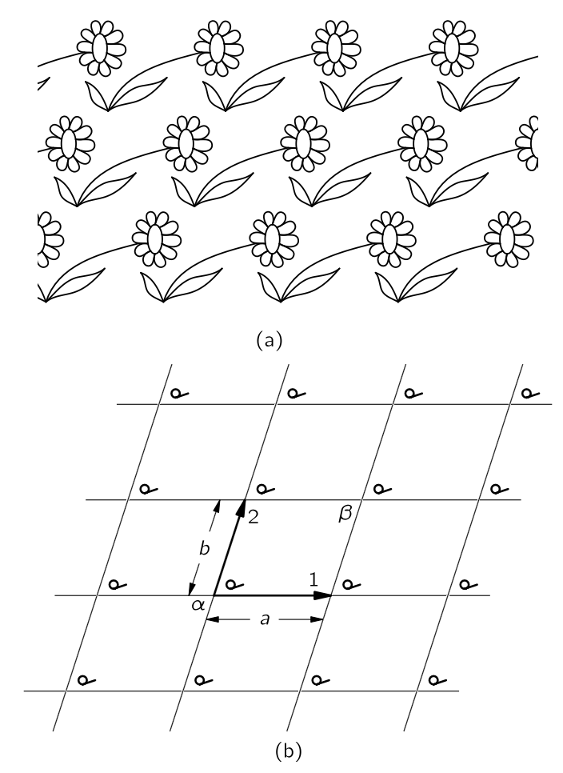{#fig-FLP_2_30_1 width=300}

벽지나 천, 혹은 평면 면적을 위한 기하학적 디자인을 설계하는 문제를 생각하자. 그 안에 반복되는 디자인 요소가 있어 원하는 만큼 영역을 크게 만들 수 있다. 이는 결정이 3차원에서 해결하는 문제의 2차원 유사체이다. 예를 들어, @fig-FLP_2_30_1 (a) 는 일반적인 벽지 디자인을 보여준다. 영원히 지속될 수 있는 패턴에 반복되는 단일 요소가 있다. 이 벽지 디자인의 기하학적 특성은 반복적 특성만을 고려하고 꽃 자체의 기하학적 형태나 예술적 가치를 고려하지 않은 경우, @fig-FLP_2_30_1 (b) 에 포함되어 있다. 어느 지점에서든 시작한다면, 화살표 1의 방향을 따라 거리 $a$ 만큼 이동시켜 해당 지점을 찾을 수 있다. 다른 화살표 방향으로 거리 $b$ 만큼 이동하면 해당 지점에 도달할 수도 있다. 물론, 다른 방향이 많이 있습니다. 예를 들어, 점 $\alpha$ 에서 점 $\beta$ 로 이동하여 해당 위치에 도달할 수 있지만, 이러한 단계는 방향 1을 따라가는 단계가 그 뒤 방향 2를 따라 단계가 이어지는 조합으로 간주될 수 있다. 패턴의 기본 속성 중 하나는 인접한 동등한 위치로 가는 가장 짧은 두 단계로 설명될 수 있다. '동등한' 위치에서는 그 중 하나에 서서 주변을 바라보면, 다른 위치에 서 있을 때와 정확히 같은 것을 보게 된다는 의미이다. 그것은 결정의 기본적인 특성이다. 유일한 차이점은 결정이 2차원 배열이 아니라 3차원 배열이라는 점이며, 자연스럽게 꽃 대신 격자의 각 원소는 일종의 원자 배열—예를 들어 수소 원자 6개와 탄소 원자 2개—의 배열 형태라는 점이다. 결정 내 원자의 패턴은 $X$-선 회절을 통해 실험적으로 발견될 수 있다. 우리는 이전에 이 방법을 간략히 언급했으며, 이제는 대부분의 단순한 결정과 다소 복잡한 결정에 대해 우주에 있는 원자들의 정확한 배열이 이미 해결되었다는 것 외에는 더 이상 언급하지 않겠다.

결정의 내부 패턴은 여러 방식으로 나타난다. 첫째, 특정 방향으로의 원자의 결합 강도는 일반적으로 다른 방향보다 더 강하다. 이는 결정이 다른 것보다 더 쉽게 부서지는 특정 평면이 존재한다는 것을 의미하며 이 면을 **절개면 (cleavage plane)** 이라고 한다. 칼날로 결정을 깨뜨리면, 그런 평면을 따라 종종 갈라진다. 둘째, 결정이 형성된 방식 때문에 내부 구조가 표면에 자주 나타난다. 결정이 용액에서 퇴적되는 모습을 상상해 보자. 용액 안에서 원자들이 떠다니다가 에너지가 가장 낮은 위치를 찾게 되면 결국 가라앉습니다. (벽지가 마치 꽃들이 떠다니다가 하나가 우연히 제자리에 끼어들었고, 그 다음 꽃들이 다시, 또 다른 꽃들이 점점 늘어나면서 패턴이 서서히 자라나는 것처럼) 특정 방향에서는 다른 방향과는 다른 속도로 성장하여 일종의 기하학적 형태로 성장한다는 점을 이해할 수 있다. 이러한 효과 때문에 많은 결정의 외부 표면은 원자 내부 배열의 특성을 일부 보여준다.

예를 들어, [![파인만 물리학 강의 2권 30장]](https://www.feynmanlectures.caltech.edu/II_30.html) Fig. 30-2 (a) 는 내부 패턴이 육각형인 전형적인 석영 결정의 형태를 보여준다. 그러한 크리스털을 자세히 살펴보면, 외부가 매우 좋은 육각형을 만들지 못한다는 것을 알게 될 것이다. 왜냐하면 변의 길이가 모두 동일하지 않기 때문이며, 실제로는 매우 다르다. 하지만 한 가지 측면에서는 매우 좋은 육각형이다: 면 사이의 각도는 정확히 120$^\circ$ 이다. 분명히, 특정 면의 크기는 성장의 우연에 의한 것이지만, 각도는 내부 기하학을 나타낸다. 따라서 석영의 모든 결정은 서로 다른 형태를 가지고 있으며, 해당 면 사이의 각도는 항상 동일하다.

소금 결정의 내부 형상은 외부 형태에서도 확인할 수 있다. [![파인만 물리학 강의 2권 30장]](https://www.feynmanlectures.caltech.edu/II_30.html) 의 Fig. 30–2 (b) 는 전형적인 소금 알갱이의 형태를 보여준다. 다시 말하지만, 그 결정은 완전한 정육면체는 아니지만, 면들은 서로 정확히 직각을 이루고 있다.

보다 복잡한 결정은 마이카(mica) 이며, 그 형태는 [![파인만 물리학 강의 2권 30장]](https://www.feynmanlectures.caltech.edu/II_30.html) 의 Fig. 30–2 (c) 이다. 이 결정은 매우 이방성이며, 한 방향으로(그림 안에서 가로로) 분리하려고 하면 매우 단단하지만, 반대 방향(수직)으로 당겨 분리하면 매우 쉽게 갈라진다는 사실에서 쉽게 알 수 있다. 이는 매우 견고하고 얇은 시트를 얻기 위해 일반적으로 사용되어 왔다. 운모와 석영은 실리카를 함유한 천연 광물의 두 가지 예시이다. 실리카가 함유된 광물의 세 번째 예는 석면이며, 이는 두 방향으로는 쉽게 분리되지만 세 번째 방향으로는 그렇지 않다는 흥미로운 특성을 가지고 있다. 매우 강한 선형 섬유로 구성된 것으로 보인다.

### $\mathrm{II}$.30–2 결정에서의 화학 결합 {#sec-FLP_2_30_2}

#### **이온 결합**

결정의 역학적 특성은 원자 사이의 화학 결합 종류에 따라 명확히 달라진다. 다양한 방향에서의 마이카의 현저히 다른 강도는 각 방향에서의 원자간 결합 종류에 따라 달라진다. 우리는 이미 다양한 종류의 화학 결합에 대해 대략적으로라도 알고 있다. 우선, 이미 염화나트륨에 대해 논의한 바와 같이 이온 결합이 있다. 대략 말하면, 나트륨 원자는 전자를 잃어 양이온이 되고, 염소 원자는 전자를 얻어 음이온이 된다. 양이온과 음이온은 3차원 체커보드에 배열되어 있으며 전기력에 의해 함께 고정된다.

#### **공유 결합**

공유 결합—전자가 두 원자 사이에 공유되는—은 더 흔하며 보통 매우 강하다. 예를 들어 다이아몬드에서는 탄소 원자가 네 방향 모두에서 가장 가까운 이웃과 공유 결합을 가지고 있기 때문에, 결정은 정말 매우 단단하다. 석영 결정에서는 실리콘과 산소 사이에도 공유 결합이 존재하지만, 그 결합은 실제로 부분적으로만 공유 결합에 불과하다. 전자의 완전한 공유가 없기 때문에 원자는 부분적으로 전하를 띠며, 결정은 다소 이온성이다. 자연은 우리가 만들려고 하는 만큼 단순하지 않으며, 공유 결합과 이온 결합 사이에는 실제로 가능한 모든 단계가 존재한다.

#### **분자 결정**

설탕 결정은 아직도 또 다른 종류의 결합을 가진다. 그 안에는 원자들이 공유 결합에 의해 강하게 결합된 큰 분자들이 존재하여, 그 분자는 견고한 구조를 가지고 있다. 하지만 강한 결합이 완전히 충족되기 때문에, 개별적인 분자들 사이에는 상대적으로 약한 인력만 존재한다. 그러한 분자 결정에서는 분자들이 말하자면 개별적인 정체성을 유지한다. 분자들이 서로 강하게 결합되지 않기 때문에 결정은 쉽게 깨진다. 그들은 다이아몬드와 같은 것과는 상당히 다르며, 다이아몬드는 실제로 어느 곳에서도 파괴될 수 없는 거대한 분자로, 강한 공유 결합을 깨뜨릴 수 있다. 파라핀은 분자 결정의 또 다른 예이다.

분자 결정의 극단적인 예는 고체 아르곤과 같은 물질이다. 각 원자는 완전히 포화된 단원자 분자이며 원자들 사이에는 매우 적은 인력이 있다. 하지만 매우 낮은 온도에서는 열운동이 매우 작기 때문에, 미세한 원자간 힘이 원자를 규칙적인 배열로 가라앉게 할 수 있다.

#### **금속 결합**

금속들은 완전히 다른 종류의 물질을 형성한다. 그 결합은 전혀 다른 종류이다. **금속에서는 결합이 인접한 원자들 사이에 있는 것이 아니라 전체 결정의 특성이다.** 원자가 전자는 하나의 원자나 원자 쌍에 결합된 것이 아니라 결정 전체에 걸쳐 공유된다. 각 원자는 보편적인 전자 풀에 전자를 하나 제공하며, 원자 양이온은 음전자의 바다에 존재한다. 전자 바다는 이온을 일종의 접착제처럼 결합한다.

금속에서는 특정 방향에 특수한 결합이 없기 때문에 결합에 강한 방향성이 없다. 원자 이온이 일정한 배열로 배열될 때 총 에너지가 가장 낮기 때문에 결정이 된다. 하지만 선호되는 배열의 에너지는 일반적으로 다른 가능한 배열에 비해 크게 낮지는 않다. 1차 근사에서 많은 금속의 원자는 가능한 한 촘촘히 채워진 작은 구와 같다.

### $\mathrm{II}$.30–3 결정의 성장 {#sec-FLP_2_30_3}

지구에서 결정이 자연스럽게 형성되는 모습을 상상해 보자. 지구 표면에는 다양한 종류의 원자들이 크게 혼합되어 있습니다. 그들은 화산 작용과 바람, 그리고 물에 의해 지속적으로 휘감겨지고 있으며, 끊임없이 움직이며 뒤섞이고 있다. 하지만, 어떤 요령을 통해 실리콘 원자들이 점차 서로를 찾기 시작하고, 산소 원자를 찾아 실리카를 만든다. 한 번에 하나의 원자를 다른 원자에 더해 결정이 형성되며, 혼합물은 섞이지 않게 된다. 그리고 근처 어딘가에서 나트륨과 염소 원자가 서로를 찾아 소금 결정체를 형성하고 있다.

결정이 시작되면 특정 종류의 원자만 결합하도록 허용되는 것은 어떻게 일어날까? 전체 시스템이 가능한 최저 에너지를 목표로 작업하고 있기 때문이다. 성장하는 결정은 에너지를 가능한 한 낮게 만들기 위해 새로운 원자를 받아들일 것이다. 하지만 실리콘—또는 산소—원자가 특정 지점에서 가장 낮은 에너지를 초래할 것이라는 것을 어떻게 알 수 있을까? 그것은 시행착오를 통해 그렇게 된다. 액체에서는 모든 원자가 영구 운동 상태에 있습니다. 각 원자는 이웃에 대해 매초 약 $10^{13}$ 번 튕겨진다. 만약 그것이 성장하는 결정의 올바른 지점에 부딪히면, 에너지가 낮을 경우 다시 뛰어오를 가능성이 다소 낮아진다. 수백만 년에 걸쳐 초당 $10^{13}$ 번의 속도로 지속적으로 시험함으로써, 원자는 에너지가 가장 낮은 곳에서 점차 축적된다. 그리고 결국 그들은 큰 결정으로 성장한다.

### $\mathrm{II}$.30–4 결정 격자 {#sec-FLP_2_30_4}

결정 내 원자들의 배열을 **결정 격자 (crystal lattice)** 라고 하며 다양한 기하학적 형태를 취할 수 있다. 먼저 대부분의 금속과 불활성 기체의 고체 형태에 많이 나타나는 가장 단순한 격자를 알아보자. 그것들은 @fig-FLP_2_30_4 (a) 의 체심 입방 격자와 (b) 의 면심 입방 격자이다. 이 그림은 물론 격자의 한 입방체만을 보여주며, 그 패턴이 3차원에서 무한히 반복되는 것으로 상상하자. 또한, 그림을 더 명확하게 하기 위해 원자들의 “중심”만 표시되었다. 실제 결정에서는 원자들이 서로 접촉하는 구와 더 비슷하다. 그림에 있는 어두운 구와 밝은 구는 일반적으로 서로 다른 종류의 원자를 의미할 수도 있고, 같은 종류일 수도 있다. 예를 들어, 철은 저온에서는 체심 입방 격자를 가지고, 고온에서는 면심 입방 격자이다. 물리적 특성은 두 결정 형태에서 상당히 다르다.

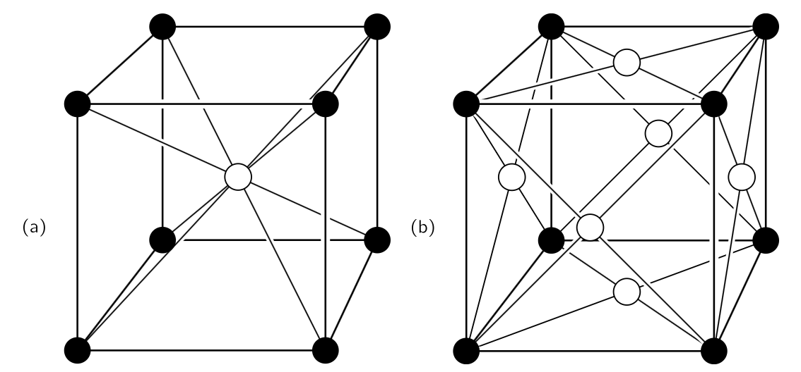{#fig-FLP_2_30_4 width=400}

이런 형태는 어떻게 형성될까? 구형 원자를 가능한 한 촘촘히 결합하는 문제를 생각하자. 한 가지 방법은 @fig-FLP_2_30_5 (a) 와 같이 **육방 밀집 격자 배열 (hexagonal close-packed array)** 에 층을 만드는 것이다. 그렇다면 첫 번째와 같이 두 번째 층을 구축하되, @fig-FLP_2_30_5 (b) 와 같이 수평으로 이동시킬 수 있다. 다음으로, 세 번째 레이어를 쌓는다. 하지만 주의할것은 세 번째 층을 배치하는 두 가지 뚜렷한 방법이 있다. @fig-FLP_2_30_5 (b) 에서 $A$ 에 원자를 배치하여 제3층을 시작하면, 제3층의 각 원자는 최하층 원자 바로 위에 위치한다. 반면에, $B$ 위치에 원자를 배치하여 세 번째 층을 시작하면, 세 번째 층의 원자들은 하단 층의 세 개 원자로 이루어진 삼각형의 정확히 중앙에 중심을 두게 된다. 다른 모든 시작 장소는 $A$ 또는 $B$ 와 동등하므로, 세 번째 층을 배치하는 방법은 두 가지뿐이다.

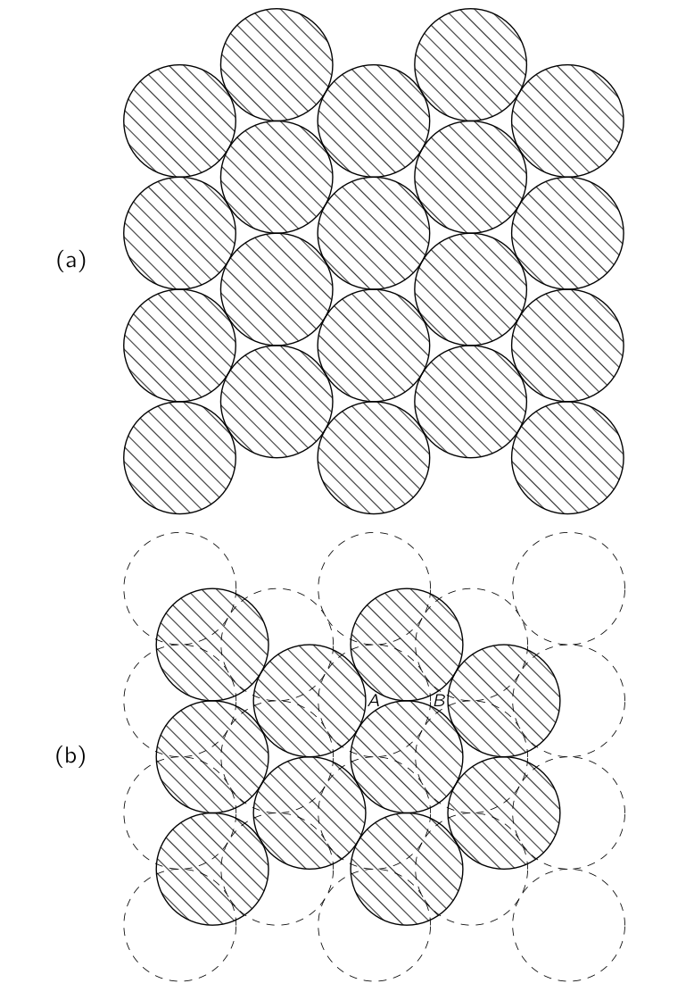{#fig-FLP_2_30_5 width=450}

만약 세 번째 층이 $B$ 점에 원자를 가지고 있다면, 결정 격자는 면심 입방체이지만 각도에서 관찰됩니다. 육각형부터 시작하면 결국 정육면체가 될 수 있다는 것이 재미있다. 하지만 모서리에서 바라본 큐브는 육각형 윤곽을 가지게 된다. 예를 들어, @fig-FLP_2_30_6 은 평면 육각형이나 원근법으로 본 정육면체를 나타낼 수 있다!

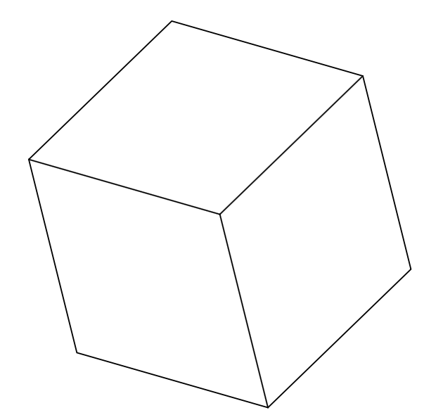{#fig-FLP_2_30_6 width=200}

@fig-FLP_2_30_5 (b) 에 원자를 $A$ 에서 시작하여 제3층을 추가하면, 입방체 구조가 없으며, 격자는 대신 육각형 대칭만을 가진다. 우리가 설명한 두 가능성이 모두 동등하게 밀지비되어 있다는 것이 명백하다.

일부 금속—예를 들어 구리와 은—은 첫 번째 대안인 면심 입방형을 선택한다. 다른 것들—예를 들어 베릴륨과 마그네슘—은 다른 대안을 선택하며, 이들은 육각형 결정을 형성한다. 분명히, 어떤 결정 격자가 나타나는지는 작은 구들의 밀집형태에만 의존할 수 없으며, 다른 요인에 의해서도 부분적으로 결정되어야 한다. 특히, 이는 원자 간 힘의 약간의 남은 각도 의존성에 따라 달라진다(또는 금속의 경우 전자 풀의 에너지에 따라 달라진다). 이런 것들은 화학과목에서 배울 것이다.

### $\mathrm{II}$.30–5 2차원 대칭 {#sec-FLP_2_30_5}

이제 우리는 결정의 내부 대칭 관점에서 몇 가지 특성을 논의하고자 한다. 결정의 주요 특징은 하나의 원자에서 시작하여 격자 단위 하나 떨어진 해당 원자로 이동하면 다시 같은 환경에 있다는 점이다. 그것이 근본적인 명제이다. 하지만 원자에게는, 같은 환경으로 다시 데려갈 수 있는 또 다른 종류의 변화가 있을 것이다—즉, 또 다른 가능한 “대칭”이 될 것이다. @fig-FLP_2_30_7 (a) 는 또 다른 가능한 “벽지형” 디자인을 보여준다. $A$ 위치과 $B$ 위치의 환경을 비교해 보자. 처음에는 그것들이 동일하다고 생각할 수도 있지만, 그렇지는 않다. $C$ 와 $D$ 는 $A$ 와 동등하지만, $B$ 의 환경은 주변 환경이 반전될 때만 $A$ 와 유사하며, 이는 거울 반사와 같다.

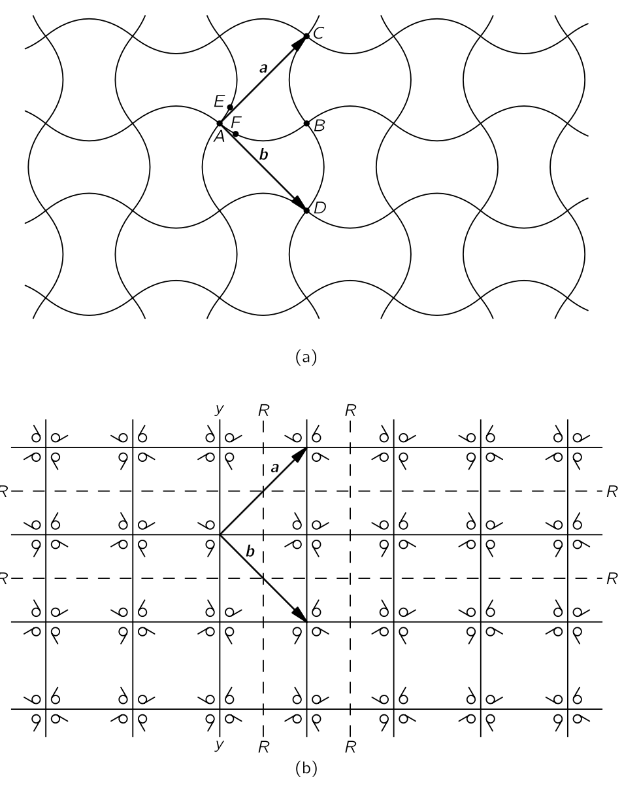{#fig-FLP_2_30_7 width=400}

패턴에는 다른 종류의 “동등한” 위치가 있다. 예를 들어, $E$ 와 $F$ 는 “동일한” 환경을 가지고 있지만, 서로에 대해 $\pi/2$ 만큼 회전한다. 그 패턴은 꽤 특별하다. $A$ 와 같은 꼭지점(vertex)에 대해 $\pi/2$ 혹은 그 정수배 회전은 동일한 패턴을 다시 보여준다. 그러한 구조를 가진 결정은 외부에 사각형 모서리가 있지만, 내부는 단순한 정육면체보다 더 복잡하다.

이제 몇 가지 특별한 예시를 설명하면서, 결정이 가질 수 있는 모든 가능한 대칭을 파악해 보자. 먼저, 우리는 비행기에서 일어나는 일을 생각한다. 평면 격자는 격자의 한 점에서 가장 가까운 두 등가점까지 가는 두 개의 이른바 **원시 벡터 (primitive vectors)** 에 의해 정의될 수 있다. @fig-FLP_2_30_1 의 두 벡터 $\bf{1}$ 과 $\bf{2}$ 는 격자에 대한 원시 벡터이다. @fig-FLP_2_30_7 (a) 의 두 벡터 $\bf{a}$ 와 $\bf{b}$ 는 해당 패턴의 원시 벡터이다. $\bf{a}$ 를 $−\bf{a}$ 로, 혹은 $\bf{b}$ 를 $−\bf{b}$ 바꿔도 동등하게 사용 할 수 있다. $\bf{a}$ 와 $\bf{b}$ 는 크기가 같고 직각이므로, $\pi/2$ 만큼의 회전은 $\bf{a}$ 를 $\bf{b}$ 로, $\bf{b}$ 를 $−\bf{a}$ 로 변환시켜 다시 같은 격자를 만들게 된다.

우리는 사측 대칭(four-sided symmetry)을 가진 격자가 있음을 알 수 있다. 그리고 앞서 육각형을 기반으로 한 밀접한 배열을 설명했는데, 이는 육각형 대칭을 의미한다. @fig-FLP_2_30_5 (a) 의 원의 배열을 원의 중심을 중심으로 $\pi/3$ 의 각도로 회전하면 그 패턴이 다시 제자리로 돌아온다.

다른 종류의 회전 대칭에는 무엇이 가능한가? 예를 들어, 5중(five-fold) 또는 8중(8-fold) 회전 대칭을 가질 수 있을까? 그들이 불가능하다는 것을 쉽게 알 수 있다. 4보다 많은 변을 가진 유일한 대칭은 6중 대칭이다. 먼저, 6중 이상의 대칭은 불가능하다는 것을 보이자. @fig-FLP_2_30_8 (a) 와 같이, $\pi/3$ 보다 작은 두 개의 동일한 원시 벡터를 가진 격자를 상상해 보자. 우리는 $B$ 와 $C$ 가 $A$ 와 동등하다고 가정하고, $\bf{a}$ 와 $\bf{b}$ 는 $A$ 에서 그 동등한 이웃까지의 두 최단 벡터라고 가정해야 한다. 하지만 그것은 명백히 잘못된 것이다, 왜냐하면 $B$ 와 $C$ 사이의 거리 $|\overline{BC}|$ 는 $|\overline{AB}|$ 나 $|\overline{AC}|$ 가운데 최소한 하나 하나보다 짧다. $D$ 에 $A$ 와 동등한 이웃이 있어야 하는데, 그 이웃은 $B$ 또는 $C$ 보다 가깝다. 우리는 $\bf{b}'$ 을 우리의 원시 벡터 중 하나로 선택해야 했다. 따라서 두 원시 벡터 사이의 각도는 $\pi/3$ 이상이어야 한다. 팔각형 대칭은 불가능하다.

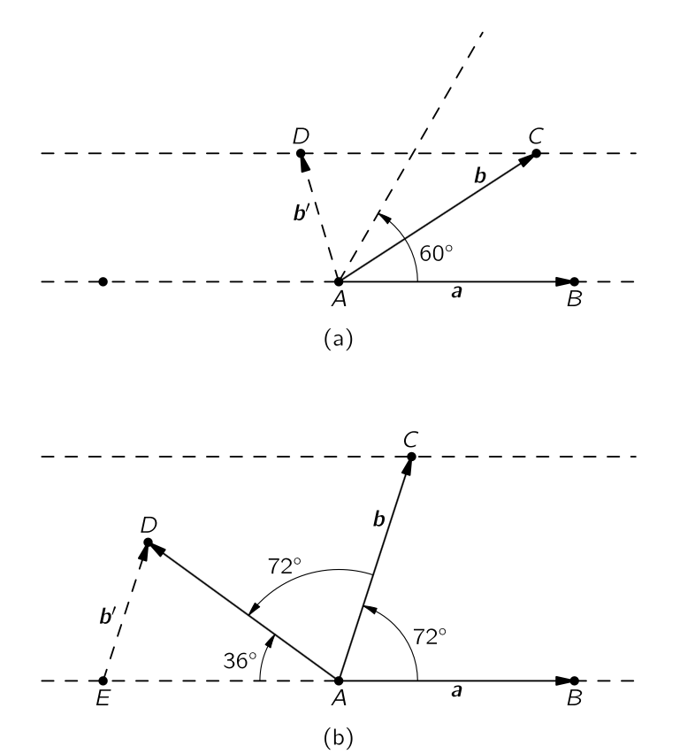{#fig-FLP_2_30_8 width=450}

5중 대칭은 어떤가? 원시 벡터 $\bf{a}$ 와 $\bf{b}$ 의 길이가 동일하고 $2\pi/5$ 의 각을 가진다면, @fig-FLP_2_30_8 (b) 와 같이, $C$ 로부터 $2\pi/5$ 인 $D$ 에 동등한 격자점이 존재해야 한다. 하지만 $E$ 에서 $D$ 까지의 벡터 $\bf{b}'$ 는 $\bf{b}$ 보다 작으므로, $\bf{b}$ 는 원시 벡터가 아니다. 5중 대칭은 존재할 수 없다. 이로부터 가능한 각은 $\theta = 0,\,\pi/3,\, \pi/2,\,2\pi/3,\, \pi$ 이다. 즉 평면에서 가능한 회전대칭은 1번 회전(원위치), 반 회전, $1/3$ 회전, $1/4$ 회전, 혹은 $1/6$ 회전 뿐이다. $\theta = 2\pi/n$ 일 때, 우리는 $n$중 회전 대칭이라고 한다. 이 경우 $n$ 값이 클 때 더 높은 대칭성를 가진다고 말한다.

@fig-FLP_2_30_7 (a) 의 패턴은 사중 회전 대칭을 가진다는 것을 알 수 있다. @fig-FLP_2_30_7 (b) 에서 (a) 와 동일한 대칭 특성을 갖는 또 다른 도안을 그렸다. 작은 쉼표 모양의 도형은 각 사각형 내부의 디자인 대칭성을 정의하는 비대칭 객체이다. 쉼표가 교대 사각형에서 뒤바뀌어 단위 셀이 작은 사각형 중 하나보다 크게 나타나는 것을 확인할 수 있다. 쉼표가 없었다면, 그 패턴은 여전히 네 배 대칭을 유지하겠지만, 단위 셀은 더 작아질 것이다. @fig-FLP_2_30_7 의 패턴은 또한 다른 대칭적 특성을 가지고 있다. 예를 들어, 파선 중 하나($R–R$)에 대한 반사는 동일한 패턴을 재현한다.

@fig-FLP_2_30_7 의 패턴은 여전히 또 다른 종류의 대칭을 가지고 있다. 패턴이 $Y–Y$ 선을 따라 반사되고 오른쪽(또는 왼쪽)으로 한 칸 이동하면 원래 패턴을 다시 얻을 수 있다. $Y–Y$ 선을 **미끄럼 반사(glide)** 선이라고 한다.

이것들이 2차원에서 가능한 모든 대칭이다. 두 차원에서는 $\pi$ 회전과 동등한 또 하나의 공간 대칭 연산이 존재하지만, 이는 3차원에서는 상당히 구별되는 연산이다. 그것은 **반전 (inversion)** 이다. 역전이란, 어떤 원점으로부터 벡터 변위 $\bf{R}$ 에 있는 모든 점[예를 들어, @fig-FLP_2_30_9 (b)의 점 $A$]이 $−R$ 의 점으로 이동한다는 의미이다.

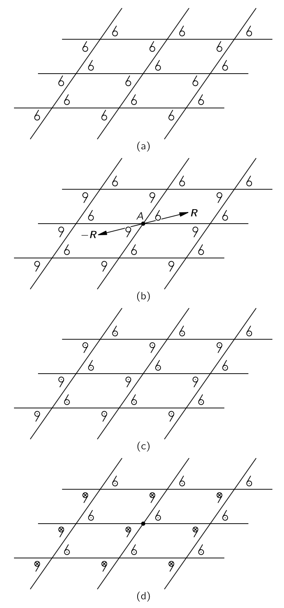{#fig-FLP_2_30_9 width=400}

@fig-FLP_2_30_9 (a) 의 반전은 새로운 패턴을 생성하지만, (b) 의 반전은 동일한 패턴을 재현한다. 2차원 패턴(그림에서 볼 수 있듯이)의 경우, 점 $A$ 를 통해 패턴 (b) 를 뒤집는 것은 같은 점에 대한 $\pi$ 회전과 동일하다. 하지만, @fig-FLP_2_30_9 (b) 의 패턴을 3차원으로 만들려면, 작은 $6$ 과 $9$ 가 각각 페이지를 가리키는 “화살표”가 있다고 가정한다. 3차원에서 역전된 후 모든 화살표가 반전되어 패턴이 재현되지 않는다. 화살표의 앞면과 뒷면을 각각 점과 십자가로 표시하면, @fig-FLP_2_30_9 (c) 와 같이 반전에서는 대칭이 아닌 3차원 패턴을 만들 수 있으며, (d)와 같이 대칭성을 갖는 패턴을 만들 수도 있다. 회전의 어떤 조합으로도 3차원 반전을 모방할 수 없다는 점에 유의하하라.

패턴—또는 격자—의 “대칭성”을 우리가 설명해 온 대칭 연산의 종류로 규정한다면, 두 차원에 대해 17개의 서로 다른 패턴이 가능하다는 것이 밝혀졌다. 우리는 @fig-FLP_2_30_1 에서 가능한 가장 낮은 대칭의 패턴 하나와 @fig-FLP_2_30_7 의 높은 대칭의 하나의 패턴을 그렸다. 우리는 17가지 가능한 패턴을 모두 파악하는 숙제를 여러분께 드리겠다.

벽지와 직물을 만들 때 17가지 가능한 패턴 중 사용되는 것이 매우 적은 것이 특이하다. 항상 같은 세 가지 또는 네 가지 기본 패턴을 보게 됩니다. 디자이너들의 상상력 부족 때문일까, 아니면 가능한 패턴 중 다수가 눈에 즐겁지 않아서일까?

### $\mathrm{II}$.30–6 3차원 대칭 {#sec-FLP_2_30_6}

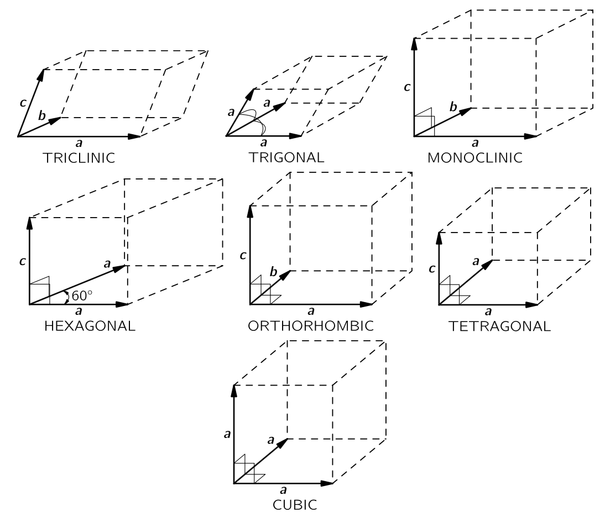{#fig-FLP_2_30_10 width=500}

지금까지 우리는 2차원에서의 패턴에 대해서만 이야기해 왔다. 하지만 우리가 실제로 관심을 갖는 것은 3차원에서의 원자 패턴이다. 우선, 3차원 결정은 세 개의 원시 벡터를 가지는 것이 분명하다. 그렇다면 3차원에서 가능한 대칭 연산에 대해 물어보면, 230가지의 서로 다른 대칭이 존재한다는 것을 알 수 있다! 어떤 목적을 위해, 이 230가지 유형은 @fig-FLP_2_30_10 에 표시된 일곱 개의 클래스로 구분될 수 있다.

#### **삼사정계와 삼방정계**

대칭이 가장 적은 격자를 **삼사정계(triclinic)** 라고 한다. 그 단위 셀은 평행육면체이다. 원시 벡터는 길이가 서로 다르며, 그 사이의 각이 두 개도 동일하지 않다. 회전이나 반사 대칭의 가능성은 전혀 없다. 하지만 여전히 두 가지 가능한 대칭이 존재한다. 단위 셀은 꼭지점(vertex)을 통한 반전에 의해 변할수도 있고 변하지 않을 수도 있다. (3차원에서의 반전은 공간상의 변위 $\bf{R}$ 이 $−\bf{R}$ 로 대체된다는 의미이며, 다시 말해 $(x,y,z)$ 가 $(−x,−y,−z)$ 로 된다는 의미이다.) 따라서 삼중 격자는 원시 벡터들 사이에 특별한 관계가 존재하지 않는 한 두 가지 가능한 대칭만을 가진다. 예를 들어, 모든 벡터의 크기가 같고 같은 각만큼 벌어져 있다면, 그림에 표시된 **삼방정계(trigonal)** 격자라고 한다. 이 도형은 추가적인 대칭을 가질 수 있으며, 긴 몸체 대각선을 중심으로 회전해도 변하지 않을 수 있다.

#### **단사정계와 육방정계**

원시 벡터 중 하나, 예를 들어 $\bf{c}$ 가 다른 두 벡터와 직각을 이루면, 우리는 **단사정계(monoclinic)** 단위 셀을 얻는다. $\bf{c}$ 에 대해 $\pi$ 회전은 대칭 변환이다. 육방정계 셀은 $\bf{a}$ 와 $\bf{b}$ 의 크기가 같고 사잇각 $\pi/3$ 인 특수한 경우이며, 따라서 벡터 $\bf{c}$ 를 중심으로 $\pi/3$, $2\pi/3$, 혹은 $\pi$ 회전이 동일한 격자를 재생한다.

#### **정방정계, 사방정계, 입방계**

세 개의 원시 벡터가 모두 직각이지만 길이가 다르면, 우리는 **정방정계 (orthorhombic)** 셀을 얻는다. 이 도형은 세 축을 중심으로 $\pi$ 회전에 대해 대칭이다. 세 원시 벡터가 모두 직각이며 이중 두 원시벡터의 크기가 같을 때 **사방정계 (tetragonal)** 셀이라고 하며 고차 대칭이 가능하다. 마지막으로, 가장 대칭적인 정육면체의 **입방계 (cubic)** 셀이 있다.

#### **결정구조와 물성**

대칭에 관한 이 모든 논의의 핵심은 결정의 내부 대칭이—때때로 미묘한 방식으로—결정의 거시적 물리적 특성에 나타나기 때문이다. 예를 들어 일반적으로 결정은 텐서 전기 편극성을 갖게 된다. 텐서를 편광의 타원형으로 설명한다면, 일부 결정 대칭이 타원형에서도 나타날 것으로 기대할 수 있습니다. 예를 들어, 입방 결정은 세 개의 직교 방향 중 하나에 대해 $\pi/2$ 의 회전에 대해 대칭적입니다. 분명히, 이 속성을 가진 유일한 타원체는 구이다. 따라서 입방정 물질은 등방성 유전체여야 한다.

반면에, 사방정계 결정은 사중 회전 대칭을 가지고 있다. 그 타원형은 두 개의 주축이 동일해야 하며, 세 번째 축은 결정의 축에 평행해야 한다. 마찬가지로, 정방정계 결정은 세 개의 직교 축에 대해 이중 회전 대칭을 가지고 있기 때문에, 그 축은 편광 타원체의 축과 일치해야 한다. 마찬가지로, 단사정계 결정의 축 중 하나는 타원체의 주요 축 중 하나와 평행해야 하지만, 다른 축에 대해서는 아무 말도 할 수 없다. 삼사정계 결정은 회전 대칭이 없기 때문에, 타원체는 어떠한 방향이든 가질 수 있다.

### $\mathrm{II}$.30–7 금속의 강도 {#sec-FLP_2_30_7}

금속은 일반적으로 단순한 입방형 결정 구조를 가진다. 이제 그 구조에 의존하는 역학적 특성을 알아보자. 금속은 일반적으로 매우 “부드럽다”고 할 수 있다, 왜냐하면 결정의 한 층은 아래 층 위에서 쉽게 미끄러지기 때문이다. 당신은 “그것은 터무니없다. 금속은 강하다”라고 생각할 수도 있다. 그러나 금속의 단일 결정은 매우 쉽게 왜곡될 수 있다.

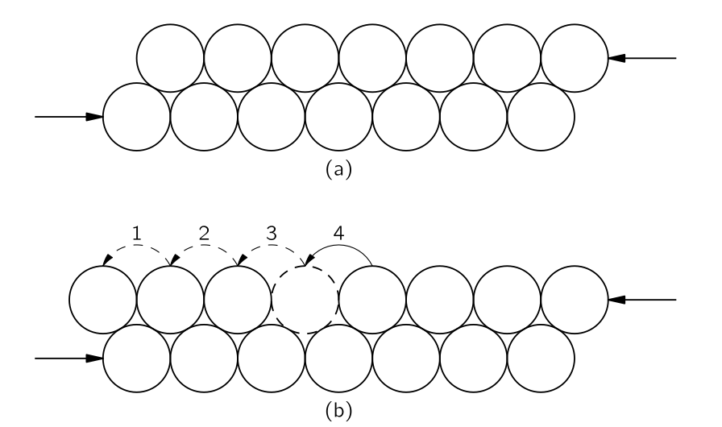{#fig-FLP_2_30_11 width=400}

예를 들어, @fig-FLP_2_30_11 (a) 에 표시된 바와 같이 **전단력 (shear force)**$^1$ 을 받는 결정의 두 층을 살펴보자.[$^1$ 전단력(Shear Force)은 물체의 한쪽 단면에 평행한 방향으로 서로 반대 방향의 힘이 작용하여, 재료를 가위로 자르듯 엇갈리게 찢거나 미끄러뜨리려고 하는 힘을 말한다]{.aside} 처음에는 힘이 충분히 커져 전체 층을 밀어내어 왼쪽으로 한 단계 이동하게 될 때까지 전체 층이 움직임에 저항할 것이라고 생각할 수도 있다. 평면에서 미끄러짐이 발생하지만, 그렇게는 일어나지 않는다. (그렇다면, 금속이 실제보다 훨씬 강하다고 계산될 것이다.) 실제 벌어지는 일은 한 번에 하나의 원자가 이동하는 것과 같다. 먼저 왼쪽 원자가 점프하고, 그 다음 원자가 점프하며, 이것이 반복된다. 이는 @fig-FLP_2_30_11 (b) 에 표현된 바와 같다. 실제로 두 원자 사이의 빈 공간이 빠르게 오른쪽으로 이동하고, 그 결과 전체 두 번째 층이 하나의 원자 간격을 움직이게 된다. 미끄러짐이 이렇게 되는 이유는 한 번에 하나의 원자를 혹 위로 들어올리는 데 전체 행을 들어올리는 것보다 훨씬 적은 에너지를 소모하기 때문이다. 힘을 충분히 확보하여 과정을 시작하면, 나머지 과정은 매우 빠르게 진행됩니다.

실제 결정에서는 미끄러짐이 한 평면에서 반복적으로 발생하고, 그곳에서 멈추어 다른 평면에서 시작한다는 것이 밝혀졌다. 그것이 시작하고 멈추는 이유에 대한 세부 사항은 상당히 신비롭다. 사실, 연속적인 슬립 영역이 종종 꽤 고르게 배치되는 것은 매우 이상하다. [![파인만 물리학 강의 2권 30장]](https://www.feynmanlectures.caltech.edu/II_30.html)의 Fig. 30.12 는 늘어난 아주 얇은 구리 결정의 사진이다. 미끄러짐이 발생한 다양한 평면을 볼 수 있다.

개별 결정면이 갑자기 미끄러지는 현상은 큰 결정이 들어 있는 주석 와이어를 귀에 대고 당기면서 늘릴 때 매우 뚜렷하게 나타난다. 결정면들이 새로운 위치로 이동하면서 “틱” 소리가 연이어 들립니다.

한 줄에 잃어버리는 원자가 있는 문제는 @fig-FLP_2_30_11 그림에서 보이는 것보다 다소 더 어렵다. 층이 더 많을 경우, 상황은 @fig-FLP_2_30_13 에 표시된 것과 같은 형태여야 한다. 결정에서 이러한 결함을 **전위 (dislocation)** 라고 한다. 그러한 전위는 결정이 형성될 때 존재했거나 표면의 어느 노치나 균열에서 발생한 것으로 추정된다. 한 번 생성되면, 그들은 결정 내를 비교적 자유롭게 이동할 수 있다. 그러한 많은 전위의 움직임에 의해 큰 왜곡이 발생한다.

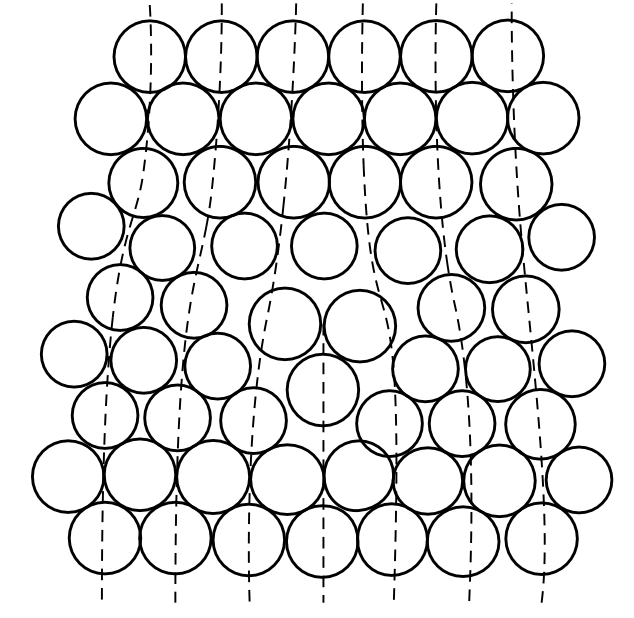{#fig-FLP_2_30_13 width=400}

전위는 자유롭게 움직일 수 있다. 즉,결정의 나머지 부분이 완벽한 격자를 가지고 있는 한 추가 에너지가 거의 필요하지 않다. 하지만 그들은 결정에서 다른 종류의 결함을 만나면 멈출 수 있다. 이를 전위 고정(**pinning** or **stuck**) 이라고 한다. 그들이 결함을 통과하는 데 많은 에너지가 필요하면, 고정된다. 이것은 바로 불완전한 금속 결정에 강도를 부여하는 메커니즘이다. 순수 철 결정은 꽤 부드럽지만, 불순물 원자의 소량 농도가 충분히 불완전하여 전위를 효과적으로 고정시킬 수 있다. 아시다시피, 주로 철인 강철은 매우 단단하다. 강철을 만들기 위해서는 소량의 탄소가 철 용융체에 용해된다. 용융물을 빠르게 냉각하면 탄소가 작은 입자로 침전되어 격자에 많은 미세한 왜곡을 만든다. 전위는 더 이상 움직일 수 없으며, 금속은 단단해진다.

순수 구리는 매우 부드럽지만, 망치로 두드리거나 앞뒤로 구부려 **가공 경화(work-hardened)** 될 수 있다. 이 경우, 서로 간섭하는 다양한 종류의 새로운 전위가 많이 만들어져 이동성을 감소시킨다. 아마도 “죽은 부드러운” 구리 막대를 잡아 부드럽게 누군가의 손목에 구부려 팔찌처럼 만드는 요령을 보았을 것이다. 그 과정에서 가공 경화되어 다시 쉽게 구부릴 수 없게 된다! 구리와 같은 가공 경화 금속은 고온에서 어닐링함으로써 다시 부드럽게 만들 수 있다. 원자의 열운동이 전위를 제거하고 다시 큰 단결정을 만든다. 우리는 지금까지 이른바 미끄러짐 전위만을 기술했다. 다른 종류가 많이 있으며, 그 중 하나는 @fig-FLP_2_30_14 에 표시된 나사 전위이다. 이러한 전위는 종종 결정 성장에 중요한 역할을 한다.

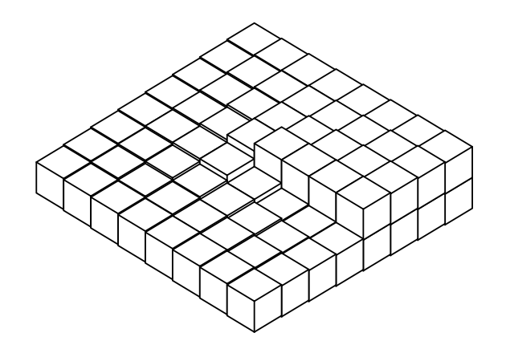{#fig-FLP_2_30_14 width=300}

### $\mathrm{II}$.30–8 전위와 결정 성장 {#sec-FLP_2_30_8}

결정이 어떻게 성장할 수 있는지는 오랬동안 이해되지 않았다. 앞서 각 원자가 반복적인 시험을 통해 결정에 존재하는 것이 더 나은지 여부를 판단할 수 있다는 것을 설명했다. 하지만 이는 각 원자가 낮은 에너지의 위치를 찾아야 함을 의미합니다. 하지만, 새로운 표면에 놓인 원자는 아래에서 하나 또는 두 개의 결합으로만 결합되며, 모서리에 배치될 경우와 같은 에너지를 가지고 있지 않습니다. @fig-FLP_2_30_15 에 표현된 바와 같이, 성장하는 결정을 블록들로 생각해 보자. 예를 들어 $A$ 위치에 새로운 블록을 시도한다면, 최종적으로 얻어야 할 여섯 이웃 중 하나만 갖게 된다. 많은 결합이 부족하므로, 그 에너지는 그리 낮지 않다. 이미 결합 할당량의 절반을 보유하고 있는 $B$ 포지션에 있는 것이 더 나을 것이다. 결정은 실제로 $B$ 와 같은 부위에 새로운 원자를 부착함으로써 성장한다.

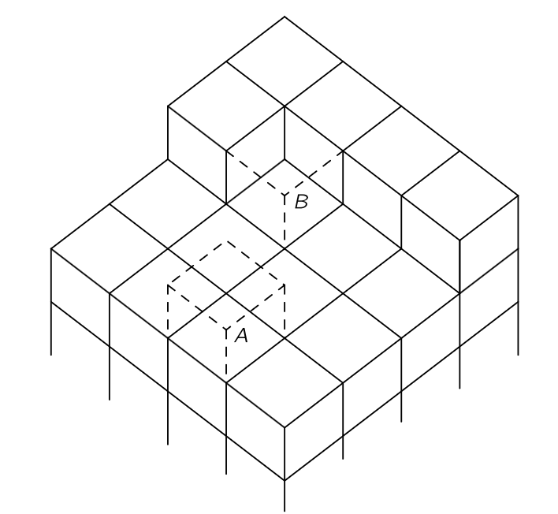{#fig-FLP_2_30_15 width=300}

그 줄이 종료되었을 때는 무슨 일이 발생할까? 새 줄을 시작하려면 원자는 두 면만 붙어 있는 상태로 안착해야 하며, 이는 다시 한 번 가능성이 낮다. 그렇다 하더라도, 레이어가 완성되면 어떻게 될까요? 새로운 레이어를 어떻게 시작할 수 있을까? 한 가지 답은 결정이 전위, 예를 들어 @fig-FLP_2_30_14 에 표시된 것과 같은 나사 전위 주변에서 성장하는 것을 선호한다는 것이다. 이 결정에 블록이 추가될 때마다, 항상 세 개의 사용 가능한 결합이 있는 곳이 있다. 따라서 그 결정은 내장된 전위와 함께 성장하는 것을 선호한다. 그러한 나선형 성장 패턴은 파라핀 단일 결정의 사진인 [![파인만 물리학 강의 2권 30장]](https://www.feynmanlectures.caltech.edu/II_30.html)의 Fig. 30.16 에 표시되어 있다.

### $\mathrm{II}$.30–9 브래그-나이 격자 모델 {#sec-FLP_2_30_9}

우리는 결정 안의 개별 원자들이 어떻게 되는지 볼 수 없다. 또한, 이제 알게 되었지만, 정량적으로 처리하기 어려운 복잡한 현상이 많이 있다. 로렌스 브래그 경과 J. F. 나이(J. F. Nye)는 실제 금속에서 발생한다고 여겨지는 많은 현상을 눈에 띄게 보여주는 금속 결정 모델을 고안했다. 다음 페이지에서는 그들의 원본 논문 를 재현했으며, 해당 논문에서는 그들의 방법을 설명하고 이를 통해 얻은 일부 결과를 보여준다. (이 논문은 *Proceedings of the Royal Society of London* , Vol. 190, September 1947, pp. 474–481 이다.) 

 

## $\textrm{II}$.31 텐서 {#sec-FLP_2_31}

### $\textrm{II}$.31.1 편극의 텐서 {#sec-FLP_2_31_1}

물리학자들은 언제나 어떤 현상의 가장 단순한 예를 들며 이를 *물리* 라고 부르는 습관이 있으며, 보다 복잡한 예는 응용수학, 전기공학, 화학, 혹은 결정학과 같은 다른 분야의 관심사로 남긴다. 고체 물리학조차도 특수 물질에 대해 지나치게 신경을 다하기 때문에 물리학의 절반에 불과합니다. 따라서 이 강의에서는 많은 흥미로운 사항들을 빼게 될 것이다. 예를 들어, 결정—또는 대부분의 물질—의 중요한 특성 중 하나는 전기 편극성이 방향에 따라 다르다는 점입니다. 어떤 방향으로든 장을 가하면 원자 전하가 약간 이동하여 쌍극자 모멘트를 생성하지만, 모멘트의 크기는 장의 방향에 크게 좌우됩니다. 그것은 물론 꽤 복잡한 일이다. 하지만 물리학에서는 보통 모든 방향에서 편극성이 동일한 특수한 경우에 대해 이야기함으로써 삶을 더 쉽게 만들곤 한다. 다른 경우는 다른 분야에 맡깁니다. 따라서, 이후 작업에서는 이 장에서 이야기할 내용이 전혀 필요하지 않을 것이다.

텐서의 수학은 방향에 따라 변하는 물질의 특성을 설명하는 데 특히 유하다—하지만 이는 그 사용의 한 예에 불과하다. 대부분의 여러분이 물리학자가 되지는 못하고, 방향에 크게 의존하는 현실 세계로 들어가게 되므로, 조만간 텐서를 사용해야 할 것이다. 아무것도 빼지 않기 위해, 우리는 텐서를 자세히 설명하지는 않겠다. 우리는 물리학에 대한 우리의 접근이 완전하다는 느낌을 원한다. 예를 들어, 우리 전기역학은 완전하다—전기 및 자기학 과목, 심지어 대학원에서도 완전하다. 우리의 역학은 완전하지 않다, 왜냐하면 우리는 높은 수준의 수학적 정교함이 없을 때 역학을 공부했으므로, 역학을 보다 우아하게 설명하는 최소 작용 원리, 라그랑지안, 해밀토니안 같은 주제를 논의할 수 없었기 때문이다. 하지만 일반 상대성 이론을 제외하고는, 우리는 역학의 완전한 법칙을 가지고 있다. 우리의 전기와 자기력은 완전하고, 다른 많은 것들도 꽤 완전하다. 양자역학은 당연히 그렇지 않을 것이며—우리는 미래를 위해 무언가를 남겨야 한다. 하지만 최소한 텐서가 무엇인지 알아야 한다.

우리는 [$\mathrm{II}$.30 결정의 기하학](#sec-FLP_2_30) 에서 결정 물질의 특성이 방향에 따라 다르다고 강조했으며, 이를 **이방성(be anisotropic)** 이라고 한다. 유도된 쌍극자 모멘트가 적용된 전기장의 방향에 따라 변하는 것은 하나의 예시일 뿐이며, 이는 우리가 텐서의 예시로 사용할 것이다. 전기장의 특정 방향에 대해, 단위 부피당 유도된 쌍극자 모멘트 $\bf{P}$ 는 가해진 $\bf{E}$ 의 강도에 비례한다고 가정한다. ($\bf{E}$ 가 너무 크지 않다면, 이는 많은 물질에 대한 좋은 근사값이다.) 여기서 비례 상수를 $\alpha$ 라고 한다(@eq-FLP_2_10_8 에서 $\alpha = \chi \epsilon_0$). 이제 적용된 장의 방향에 따라 $\alpha$ 가 달라지는 물질을 다루려 한다. 예를 들어, 방해석과 같은 결정은 투과할 때 이중 이미지가 형성된다.

특정 결정에서 $x$ 방향의 전기장 $\bf{E}_1$ 이 $x$ 방향의 편극 $\bf{P}_1$ 을 발생시킨다고 하자. 그렇다면 우리는 $y$ 방향의 전기장 $\bf{E}_2$ 가 $\bf{E}_1$ 과 동일한 강도를 가지고 $y$ 방향의 다른 편광 $\bf{P}_2$ 를 생성한다는 것을 발견한다. 전기장을 $\pi/4$ 방향으로 가하면 어떻게 될까? 이는 $x$ 와 $y$ 방향의 두 전기장을를 중첩한 것이므로, 편광 $\bf{P}=\bf{P}_1+\bf{P}_2$ 가 될 것이다. @fig-FLP_2_31_1 (a) 에서 보듯이 편극이 더 이상 전기장과 같은 방향이 아니다. 예를 들어 위아래로는 쉽게 움직일 수 있지만, 측면 움직임에 대해서는 다소 경직된 전하를 생각하자. 힘이 $\pi/4$ 의 각도로 가해지면, 전하가 측면보다 더 위쪽으로 이동한다. 비대칭적인 내부 탄성력으로 인해 변위는 외부 힘의 방향을 다르지 않는다.

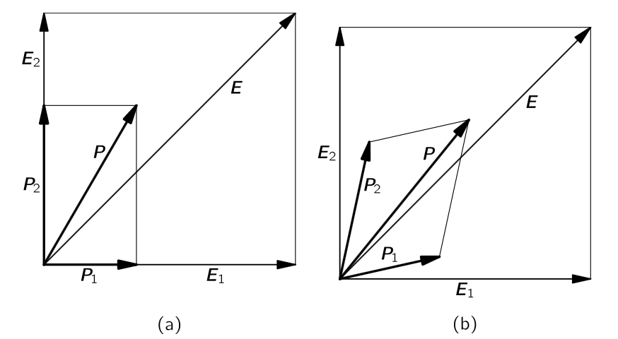{#fig-FLP_2_31_1 width=450}

물론 $\pi/4$ 는 특별한 각이 아니다. 일반적으로 결정에 유도된 편극이 전기장의 방향에 있지 않다. 위의 예시에서 우리는 $x$ 축과 $y$ 축 선택은 운이 좋았기 때문에 $\bf{P}$ 는 $x$ 축과 $y$ 축 방향에서 모두 $\bf{E}$ 와 같은 방향이었다. 결정이 좌표축에 대해 회전한다면, $y$ 방향의 전기장 $\bf{E}_2$ 는 $x$ 와 $y$ 성분을 모두 갖는 편광 $\bf{P}$ 를 생성했을 것이다. 마찬가지로, $x$-방향의 전기장에 의한 편광은 $x$-성분과 $y$-성분을 갖는 편광을 만들었을 것이다. 그렇다면 편극은 (a) 부분에 표시된 것이 아니라 @fig-FLP_2_31_1 (b) 와 같이 표시된다. 상황은 점점 복잡해지지만, 어떤 필드 $\bf{E}$ 에 대해서도 $\bf{P}$ 의 크기는 여전히 $\bf{E}$ 의 크기에 비례한다.

이제 좌표축에 대한 임의의 결정 방향방향을 다루는 일반적인 경우를 생각해보자. $x$ 방향의 전기장은 $x$, $y$, $z$ 성분을 가진 편극 $\bf{P}$ 를 생성하며, 우리는 다음과 같이 쓸 수 있다.

$$
P_x=\alpha_{xx}E_x,\qquad P_y = \alpha_{yx}E_x,\qquad P_z=\alpha_{zx}E_x.
$${#eq-FLP_2_31_1}

이것을 3 방향에 대해 일반화하면 다음과 같이 쓸 수 있다.

$$
\begin{bmatrix} P_x \\ P_y \\ P_z \end{bmatrix} = \begin{bmatrix} \alpha_{xx} & \alpha_{xy} & \alpha_{xz} \\ \alpha_{yx} & \alpha_{yy} & \alpha_{yz} \\ \alpha_{zx} & \alpha_{zy} & \alpha_{zz} \end{bmatrix} \begin{bmatrix} E_x \\ E_y \\ E_z\end{bmatrix}.
$$ {#eq-FLP_2_31_4}

여기서 $\alpha_{ij},\, (i,\,j = x,\,y,\,z)$ 을 **편극 텐서 (tensor of polarizability)** 라고 하며 수식으로 다음과 같이 쓴다.

$$
\bf{P} = \bf{\alpha E}.
$$ {#eq-FLP_2_31_4_tensor_form}

### $\mathrm{II}$.31–2 텐서 성분의 변환 {#sec-FLP_2_31_2}

한 좌표계 $(x,\,y,\,z)$ 에서 다른 좌표계 $(x',\,y',\,z')$ 로 바꾸면 벡터의 구성 요소인 $\bf{E}'=(E_x', E_y', E_z')$ 과 $\bf{P}'=(P_x',P_y',P_z')$ 역시 바뀐다. 따라서 편극 텐서 $\bf{\alpha}$ 의 성분 역시 $\bf{\alpha}'$ 에서 바뀐다. 실제로, $\bf{E}$ 와 $\bf{P}$ 의 변화로부터 $\bf{\alpha}$ 가 어떻게 변해야 하는지를 확인할 수 있다. 이전 좌표계에서 $\bf{P}=\bf{\alpha E}$ 이며 새로운 좌표계에서 $\bf{P}'=\bf{\alpha}'\bf{E}'$ 이어야 하기 때문이다. 좌표 변환을 나타내는 행렬을 $R$ 이라고 할 때 $\bf{P}' = R\bf{P}$, $\bf{E}' = R\bf{E}$ 로부터

$$
\bf{\alpha}' = R\bf{\alpha}R^{-1}
$$

이다. 즉 우리가 한 좌표계에서의 물질의 유전 특성 $\bf{\alpha}$ 을 알면 모든 좌표 변환에 대해 유전 특성을 알 수 있다는 의미이다. 

### $\mathrm{II}$.31–3 에너지 타원체 {#sec-FLP_2_31_3}

이제 텐서에 익숙해 지기 위해 흥미로운 질문 던져보자: 결정이 편극되는 데 필요한 에너지는 무엇인가? 우리는 전기장 내 에너지는 단위 부피당 $\epsilon_0E^2/2$ 임을 알고 있다. 원자 전하가 잠시 움직였다고 하자. 전하를 $dx$ 만큼 로 이동시키는 데 수행되는 일은 $qE_xdx$ 이며, 단위 부피당 $n$ 개의 전하가 있을 경우 수행된 일은 $qE_x n dx$ 이다. 하지만 그리고 $qndx$ 는 단위 부피당 쌍극자 모멘트의 변화 $dP_x$ 이며,  따라서 단위 부피당 필요한 에너지는

$$
E_xdP_x.
$$

장의의 세 구성 요소에 대한 작업을 결합하면, 단위 부피당 일은 다음과 같다.

$$
\bf{E\cdot} d\bf{P}.
$$

$\bf{P}$ 의 크기가 $\bf{E}$ 에 비례하므로, 편극이 $\bf{0}$ 에서 $\bf{P}$ 가 되는 단위 부피당 수행되는 일을 $u_P$  라고 하면
$$
u_P = \dfrac{1}{2}\bf{E\cdot P}.
$$ {#eq-FLP_2_31_6}

@eq-FLP_2_31_4_tensor_form 로 부터

$$
u_P=\dfrac{1}{2}\sum_i \sum_j \alpha_{ij} E_iE_j.
$$ {#eq-FLP_2_31_7}

에너지 밀도 $u_P$ 는 축 선택과 무관한 스칼라이다. 텐서와 벡터의 곱은 새로운 벡터이고, 두 개의 벡터와의 곱은 새로운 스칼라가 되는 성질을 갖는다.

텐서 $\alpha_{ij}$ 는 두 개의 인덱스를 가지고 있으므로 **2차 텐서 (rank 2 tensor)** 라고 불린다. 벡터(지수가 하나인 경우)는 1차 텐서이며, 스칼라(지수가 없는 경우)는 0차 텐서이다. 따라서 전기장 $\bf{E}$ 는 1차 텐서이며, 에너지 밀도 $u_P$ 는 0차 텐서가 된다. 텐서의 개념을 세 개 이상의 인덱스로 확장하는 것이 가능하며, 따라서 두 개보다 높은 랭크의 텐서를 만들 수 있다.

편극 텐서의 아래첨자에 가능한 세 값이 있으며 따라서 편극 텐서를 3차원 텐서라고 한다. 3차원보다 크거나 작은 차원에서의 텐서도 물론 존재한다. 우리는 이미 전자기장에 대한 상대론적 설명에서 4차원 텐서 $F^{\mu\nu}$ 를 사용했다.

편극 텐서 $\alpha_{ij}$ 는 대칭적이라는 흥미로운 특성을 가진다. 즉 $\alpha_{ij}=\alpha_{ji}$ 이다. 이는 실제 결정의 물리적 특성이며 모든 텐서가 그런 것은 아니다. 다음 순환을 통해 결정의 에너지 변화를 계산함으로써 이것이 반드시 참임을 스스로 증명할 수 있다: (1) $x$ 방향의 필드를 켜기; (2) $y$ 방향의 필드를 켜기; (3) $x$-필드를 끄기; (4) $y$-필드를 끄기. 결정은 이제 시작점으로 돌아왔으며, 편극에 대해 수행된 순 작업은 0으로 돌아와야 한다. 이것이 참이 되려면 $\alpha_{xy}=\alpha_{yx}$ 이어야 함을 증명 할 수 있다. 또한 $\alpha_{xz}$ 등에 대해서도 같은 방식으로 증명 할 수 있다. 따라서 편극 텐서는 대칭이다.

이는 또한 편극 텐서가 결정들을 다양한 방향으로 편극시키는 데 필요한 에너지를 측정하여 결정 될 수 있다는 것을 의미한다. 예를 들어, $x$ 와 $y$ 성분만을 가진 $\bf{E}$ 를 적용한다면, @eq-FLP_2_31_7 에 따라

$$
u_P=\dfrac{1}{2}\left[\alpha_{xx}E^2_x + \left(\alpha_{xy} + \alpha_{yx}\right) E_xE_y + \alpha_{yy}E^2_y\right].
$$ {#eq-FLP_2_31_8}

$E_x$ 만 사용하면 $\alpha_{xx}$ 를 구할 수 있고, $E_y$ 만 사용하면 $α_{yy}$ 를 구할 수 있으며, $E_x$ 와 $E_y$ 를 모두 사용하면 $(\alpha_{xy}+\alpha_{yx})$ 항으로 인한 추가 에너지를 구할 수 있다. 여기서 $\alpha_{xy}=\alpha_{yx}$ 이므로, 이 항은 $2\alpha_{xy}$ 이며 에너지와 관련될 수 있다.

에너지 표현식  @eq-FLP_2_31_8 은 멋진 기하학적 해석을 가진다. 예를 들어, 특정 에너지 밀도(예를 들어 $u_0$) 에 대한 $E_x$ 와 $E_y$ 를 구한다고 해 보자. 그것은 단지 아래의 방정식을 푸는 수학적 문제일 뿐이다.

$$
\alpha_{xx}E^2_x + 2 \alpha_{xy}E_xE_y + \alpha_{yy}E^2_y=2u_0.
$$

이것은 이차 방정식이므로, $E_x$ 와 $E_y$ 를 그래프로 그리면 이 방정식의 해는 타원 위의 모든 점이 된다 (@fig-FLP_2_31_2). (그것은 포물선이나 쌍곡선이 아니라 타원이어야 합니다, 왜냐하면 모든 장에 대한 에너지는 항상 양수이며 유한하기 때문이다.) $\bf{E}= (E_x,\,E_y)$ 벡터는 원점에서 타원까지 그릴 수 있다. 따라서 이러한 “에너지 타원”은 편극 텐서를 “시각화”하는 좋은 방법이다.

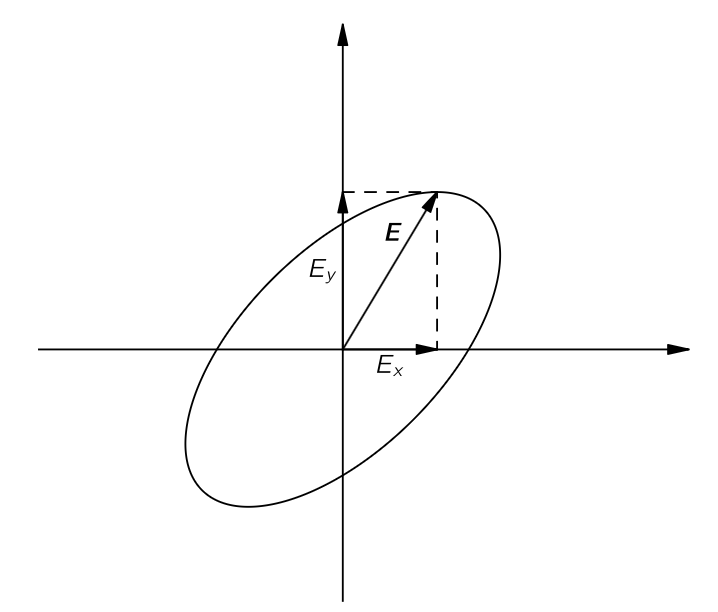{#fig-FLP_2_31_2 width=350}

$\bf{E}$ 의 세 성분을 모두 포함하도록 하면 단위 에너지 밀도에 대한 전기장 $\bf{E}$ 는 @fig-FLP_2_31_3 과 같이 타원체 표면에 있는 점을 나타낸다. 이 동일 에너지 타원체의 형태는 텐서의 편광성을 결정한다.

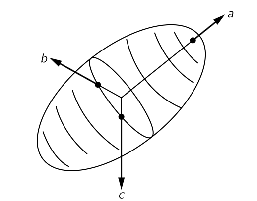{#fig-FLP_2_31_3 width=250}

타원체는 세 개의 **주축 (principal axes)** 방향과 각각의 주축 방향으로의 지름을 통해 간단히 기술될 수 있다. 주축은 가장 긴 지름과 가장 짧은 지름의 방향 및 두 축에 대한 직각 방향으로 @fig-FLP_2_31_3 의 $a$, $b$, $c$ 축이다. 이 축에 대해 타원체는 아래의 간단한 방정식으로 기술될 수 있다.

$$
\alpha_{aa}E_a^2 + \alpha_{bb}E_b^2 + \alpha_{cc}E^2_c = 2u_0.
$$

유전체 텐서는 이 세 축에 대해서 0이 아닌 성분은 $\alpha_{aa},\,\alpha_{bb},\,\alpha_{cc}$ 뿐이다. 즉, **결정이 아무리 복잡하더라도 편극 텐서가 세 개의 0이 아닌 성분만을 가진 축(반드시 결정 축일 필요는 없음)을 선택할 수 있다**. 그러한 축 집합을 사용하면, @eq-FLP_2_31_4 는 아래와 같이 간단히 쓸 수 있다.

$$
P_a=\alpha_{aa} E_a,\qquad P_b = \alpha_{bb}E_b,\qquad P_c = \alpha_{cc}E_c.
$$ {#eq-FLP_2_31_9}

주축 중 하나를 따라 전기장이 있으면 같은 축을 따라 편극을 일으키며, 세 축의 계수는 물론 다를 수 있다. 이 경우 텐서는 다음과 같은 대각행렬로 표현 할 수 있다.

$$
\begin{bmatrix} \alpha_{aa} 0 & 0 \\ 0 & \alpha_{bb} & 0 \\ 0 & 0 & \alpha_{cc} \end{bmatrix}.
$$ {#eq-FLP_2_31_11}

중요한 점은 모든 편극 텐서는 적절한 좌표축 집합을 선택함으로써 대각 형태로 만들수 있다는 것이다. 대각 편극 텐서의 세 대각 성분이 모두 동일하다면, 즉 

$$
\alpha_{aa} = \alpha_{bb} = \alpha_{cc} = \alpha 
$$ {#eq-FLP_2_31_12}

라면 에너지 타원체는 구가 되며, 편극률은 모든 방향에서 동일하다. 즉 그 물질은 등방성이다. 텐서 표기법으로는

$$
\alpha_{ij}=\alpha \delta_{ij}
$$ {#eq-FLP_2_31_13}

라고 쓰며 여기서 $\delta_{ij}$ 는 **단위 텐서 (unit tensor)** 혹은 **크로네커 델타 (Kronecker delta)** 이다.

$$
\delta_{ij}= \begin{bmatrix} 1 & 0 & 0 \\ 0 & 1 & 0 \\ 0 & 0 & 1 \end{bmatrix}.
$$ {#eq-FLP_2_31_14}

좌표계를 다른 직사각형 좌표계로 더라도 크로네커 델타 텐서(@eq-FLP_2_31_14) 는 정확히 같은 형태임을 증명할 수 있다. @eq-FLP_2_31_13 의 편극텐서 에 대해

$$
P_i = \alpha \sum_j \delta_{ij} E_j = \alpha E_i,
$$

이며, 이는 등방성 유전체에 대한 우리의 이전 결과 $\bf{P}=\alpha\bf{E}$ 와 동일함을 의미한다.

편극률 타원체의 형태와 방향은 때때로 결정의 대칭적 특성과 관련될 수 있다. 우리는 [$\mathrm{II}$.30 결정의 기하학](#sec-FLP_2_30) 에서 3차원 격자의 가능한 내부 대칭은 모두 230가지 이며, 이를 단위 셀의 형태에 따라 편리하게 일곱 개의 클래스로 구분할 수 있다고는 것을 안다. 이제 편극률 타원체는 결정의 내부 기하학적 대칭을 공유해야 한다. 예를 들어, 삼사정계(triclinic) 결정은 대칭이 낮으며, 편극성의 타원체는 축이 모두 다르며, 일반적으로 그 방향은 결정 축과 정렬되지 않는다. 반면에, 단사정(monoclinic) 결정은 결정이 한 축을 중심으로 $\pi$ 만큼 회전해도 동일하다. 따라서 편극 텐서 역시 $\pi$ 회전 뒤에도 동일해야 하며 편극률 타원체도 $\pi$ 회전 후 원위치 해야 한다. 그것은 타원체의 축 중 하나가 결정의 대칭축과 같은 방향일 경우에만 발생할 수 있다. 그렇지 않으면, 타원체의 방향과 크기는 제한되지 않습니다.

그러나 정방정계(orthorhombic) 결정의 경우, 타원체의 축은 결정 축과 일치해야 한다, 왜냐하면 세 축 중 어느 하나에 대해 $\pi$ 회전이 동일한 격자를 반복하기 때문이다. 만약 사방정계(tetragonal) 결정으로 가면, 타원은 동일한 대칭을 가져야 하므로 두 개의 동일한 직경을 가져야 한다. 마지막으로, 입방형(cubic) 결정의 경우, 타원체의 세 지름이 모두 동일해야 하며, 이는 구가 되고, 결정의 편극률은 모든 방향에서 동일하다.

결정의 가능한 모든 대칭에 대해 가능한 텐서의 종류를 구하는 큰 게임이 있다. 이는 “군론적” 분석이라고 한다 하지만 편극성 텐서의 단순한 경우에는 관계가 어떻게 되어야 하는지를 비교적 쉽게 알 수 있다.

### $\mathrm{II}$.31–4 다른 텐서, 특히 관성 텐서 {#sec-FLP_2_31_4}

#### **전기전도도**

물리학에서 텐서가 나타나는 다른 많은 예가 있다. 예를 들어, 금속이나 모든 도체에서 전류 밀도 $\bf{J}$ 가 전기장 $\bf{E}$ 에 대략 비례한다는 것을 자주 발견한다. 이 때 비례 상수를 **전도도 (conductivity)** $\sigma$ 라고 한다.

$$
\bf{J} = \sigma\bf{E}.
$$

그러나 결정의 경우, $\bf{J}$ 와 $\bf{E}$ 사이의 관계는 더 복잡하며, 전도도는 모든 방향에서 동일하지 않다. 전도도는 텐서이며, 다음과 같이 쓸 수 있다.

$$
J_i = \sum \sigma_{ij}E_j.
$$

#### **관성 모먼트**

물리적 텐서의 또 다른 예는 관성 모먼트 이다. [$\mathrm{I}$.18 2차원 회전](../vol1/vol1_3.qmd#sec-FLP_1_18) 에서는 고정된 축을 중심으로 회전하는 고체 물체가 각속도 $\omega$ 에 비례하는 각운동량 $L$ 을 가지고 있음을 확인했으며, 이 때 비례 계수 $I$ 를 **관성 모멘트 (moment of inertia)** 라고 한다.

$$
L = I \omega.
$$

임의의 형태를 가진 물체의 관성 모멘트는 회전축에 대한 방향에 따라 달라진다. 예를 들어, 직육면체 블록은 세 개의 직교 축 각각에 대해 서로 다른 모멘트를 갖게 된다. 이제 각속도 $\bf{\omega}$ 와 각운동량 $\bf{L}$ 은 모두 벡터이다. 대칭축 중 하나에 대한 회전은 평행하다. 하지만 관성 모멘트가 세 주요 축에 대해 다르면, 일반적으로 $\bf{omega}$ 와 $\bf{L}$ 은 같은 방향에 있지 않다(@fig-FLP_2_31_4). 그들은 $\bf{E}$ 와 $\bf{P}$ 사이의 관계와 유사한 방식으로 연관되어 있다. 일반적으로 우리는 다음과 같이 쓸 수 있다.

$$
\begin{bmatrix} L_x \\ L_y \\ L_z \end{bmatrix} = \begin{bmatrix} I_{xx} & I_{xy} & I_{xz} \\ I_{yx} & I_{yy} & I_{yz} \\ I_{zx} & I_{zy} & I_{zz}\end{bmatrix} \begin{bmatrix} \omega_x \\ \omega_y \\ \omega_z \end{bmatrix}.
$$ {#eq-FLP_2_31_16}

아홉 개의 계수 $\bf{I}=(I_{ij})$ 를 **관성 텐서 (inertia tensor)** 라고 한다. 편극에서와 같이 모든 각운동량에 대한 운동 에너지는 $\omega_x,\,\omega_y,\,\omega_z$ 성분의 이차 형태가 되어야 한다.

$$
\text{KE} = \dfrac{1}{2}\sum_{i, j} I_{ij}\omega_i\omega_j.
$$ {#eq-FLP_2_31_17}

편극의 경우와 같이 에너지를 사용하여 관성의 타원체를 정의할 수 있다. 또한, 에너지 인자를 사용하여 텐서가 대칭임을 보여줄 수 있다. 즉, $I_{ij} = I_{ji}$ 이다.

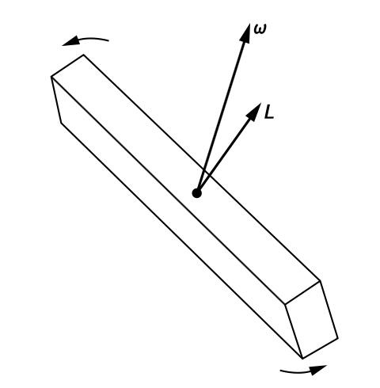{#fig-FLP_2_31_4 width=250}

강체에 대한 관성 텐서는 물체의 형태를 알면 계산할 수 있다. 우리는 몸 안에 있는 모든 입자들의 총 운동 에너지를 적기만 하면 된다. 질량이 $m$ 이고 속도가 $v$ 인 입자는 운동 에너지가 $\frac{1}{2}mv^2$ 이며, 전체 운동 에너지는 그 합일 뿐이다.

$$
\sum \dfrac{1}{2}mv^2
$$

신체의 모든 입자 위에 각 입자의 속도 $v$ 는 고체체의 각속도 $\omega$ 와 관련이 있다. 물체가 정지한 질량 중심을 중심으로 회전하고 있다고 하자. 입자의 질량 중심으로부터의 변위를 $\bf{r}$ 이라고 하면 , 그 속도 $\bf{v}=\bf{\omega}\times \bf{r}$ 이며, 따라서 전체 운동 에너지는

$$
\text{KE} = \sum \dfrac {1}{2}m(\bf{\omega} \times \bf{r})^2.
$$ {#eq-FLP_2_31_18}

위 벡터식을 풀면 관성 장력은 다음과 같이 표현될 수 있다는 것을 보일 수 있다.

$$
\bf{I} = \begin{bmatrix} \sum m(r^2-x^2) & -\sum mxy & -\sum mxz \\ -\sum mxy & \sum m(r^2-y^2) & - \sum myz \\ -\sum mxz & -\sum myz & \sum m(r^2-z^2) \end{bmatrix}.
$$ {#eq-FLP_2_31_19}

이것을 텐서 표기법으로 아래와 같이 쓸 수 있다.

$$
I_{ij}= \sum m \left( r^2\delta_{ij}−r_ir_j \right).
$$ {#eq-FLP_2_31_20}

여기서 $r_i$ 는 입자의 위치 벡터의 성분 $(x, y, z)$ 이며, $\sum$ 은 모든 입자를 합산한다는 의미이다. 그렇다면 관성 모멘트는 2차 텐서이며, 각 항은 물체의 성질로 $\bf{L}$ 을 $\bf{\omega}$ 와 다음의 관계로 관련시킨다.

$$
L_i = \sum_j I_{ij}\omega_j.
$$ {#eq-FLP_2_31_21}

어떤 형태의 물체라도 관성의 타원체를 찾을 수 있으며, 따라서 세 개의 주축을 포함한다. 이러한 주축에 대해 텐서는 대각선이며, 따라서 모든 물체에 대해 각속도와 각운동량이 평행한 세 개의 직교축이 항상 존재한다. 이것들을 **관성의 주축 (principal axes of inertia)** 라고 한다.

### $\mathrm{II}$.31–5 벡터곱 {#sec-FLP_2_31_5}

우리는 [$\mathrm{I}$.20 공간에서의 회전](../vol1/vol1_3.qmd#sec-FLP_1_20) 이후로 2차 텐서를 사용해 왔다. 평면에서의 토크 $\tau_{xy}$ 는 다음과 같다.

$$
\tau_{xy}=xF_y−yF_x.
$$

3차원으로 일반화하면, 

$$
\tau_{ij} = r_iFj−rjFi.
$$ {#eq-FLP_2_31_22}

여기서 $\tau_{ij}$ 는 2차 텐서이다. 이것을 확인해 보자. 이를 위해 $\tau_{ij}$ 를 단위 벡터 $\bf{e}$ 와 다음과 같이 결합한다.

$$
\sum_j \tau_{ij}\bf{e}_j.
$$

만약 이 양이 벡터라면, $\tau_{ij}$ 는 텐서로 변환되어야 한다. 이것이 텐서에 대한 우리의 정의이다. $\tau_{ij}$ 를 대입하면,

$$
\sum_j \tau_{ij}e_j = \sum_j r_iF_je_j−\sum_j r_je_jF_i = r_i(\bf{F\cdot e})−(\bf{r\cdot e})F_i.
$$

점곱이 스칼라이므로, 오른쪽에 있는 두 항은 벡터이며, 그 차도 마찬가지이다. 따라서 $\tau_{ij}$ 는 텐서이다.

여기서 $\tau_{ij}$ 는 특수한 종류의 텐서-**반대칭 텐서 (antisymmetric tensor)** 이다. 즉,

$$
\tau_{ij} = −\tau_{ji}.
$$

따라서 $\tau_{xy}, \tau_{yz}, \tau_{zx}$ 항만 0 이 아닌 텐서이다. [$\mathrm{I}$.20 공간에서의 회전](../vol1/vol1_3.qmd#sec-FLP_1_20) 에서 이 세 항이 거의 “우연하게” 벡터의 세 구성 요소처럼 변형된다는 것을 보여줄 수 있었으며, 이를 통해 우리는 다음과 같이 정의 할 수 있다.

$$
\bf{\tau} := (\tau_x,\tau_y,\tau_z)=(\tau_{yz}, \tau_{zx},\tau_{xy})
$$

이것을 “우연한 경우”라고 하는 이유는 이것이 3차원에서만 발생하기 때문이다. 예를 들어, 4차원에서는 2차 반대칭 텐서가 최대 여섯 개의 0이 아닌 항을 가지고 있으며, 네 개의 성분을 가진 벡터로 대체될 수 없다.

축 벡터 $\bf{τ}=\bf{r}\times \bf{F}$ 가 텐서인 것처럼, 두 극성 벡터의 모든 교차곱도 텐서이며, 동일한 논증이 적용된다. 하지만 운이 좋게도 그것들은 벡터(실제로 의사벡터)로도 표현될 수 있다.

수학적으로, $\bf{a}$ 와 $\bf{b}$ 가 임의의 두 벡터라면, 아홉 개의 양 $a_ib_j$ 는 텐서를 형성한다(하지만 유용한 물리가  없을 수도 있다). 따라서 위치 벡터 $\bf{r}$ 에 대해 $r_ir_j$ 는 텐서이며, $\delta_{ij}$ 도 텐서이므로 @eq-FLP_2_31_20 의 오른쪽 항이 실제로 텐서임을 알 수 있다. 마찬가지로 @eq-FLP_2_31_22 역시 텐서이다.

### $\mathrm{II}$.31–6 응력 텐서 {#sec-FLP_2_31_6}

::: {.callout-tip icon="false"}

#### **응력, 전단력, 압력에 대한 질문 to Claude**

> **Q:** 아.. 내가 학부때나 대학원때는 물리학 과목들에선 응력이나 전단력 같은걸 거의 배운적이 없거든... 재료공학 하는 사람들이 주로 배우는 것 같더라. 그래서 확인차 물어 봤어~

**[Claude]** : 왜 그렇게 됐는지 보면 역사적 사정이 있어. 19세기까지는 탄성론이 수리물리의 중심이었어 — Cauchy, Navier, Green, Stokes, Kelvin 전부 탄성론으로 텐서와 편미분방정식을 발전시켰고, 빛의 ether 이론도 사실상 탄성 고체 이론이었지. 그런데 20세기 들어 물리학이 상대론·양자론·입자·응집물질로 재편되면서 연속체역학은 통째로 공학(기계·토목·재료)으로 넘어갔어. 물리학과는 "원자 이하"를, 공학은 "원자 이상의 거시 변형"을 가져간 분업이 생긴 거야. 그래서 물리학도는 텐서를 상대론(계량 텐서, 전자기장 텐서)이나 양자역학(각운동량 텐서 연산자)에서 처음 만나고, 정작 텐서라는 개념이 태어난 곳인 응력은 건너뛰어. 파인만이 31장에서 분극률 텐서, 관성 텐서 다음에 응력 텐서를 넣은 건 이 역사를 알고 "텐서가 왜 필요한지 제일 손에 잡히는 예"를 복원하려는 거고.

그 빈칸이 가끔 물리학자 발목을 잡아. 전자기 응력 텐서(Maxwell stress tensor)가 2권 뒤쪽에 나오는데, 그게 "장이 공간을 통해 힘을 전달하는 방식"을 기술하는 거라 기계적 응력 개념이 있어야 직관이 서. 유체의 점성, 일반상대론의 에너지-운동량 텐서 $T^{\mu\nu}$(공간 성분이 정확히 응력 텐서야), 결정의 압전·탄성 상수, 중성자 산란에서 보는 격자 변형이나 잔류응력 측정 — 전부 이 텐서 위에 서 있는데 물리학 쪽은 각자 현장에서 그때그때 주워 배우지. 네가 "확인차" 물은 게 정확히 그 주워 배우는 과정이야.

좋은 소식은 재료공학 쪽이 배우는 응력론과 물리학이 필요로 하는 응력론이 같은 수학이라는 거야 — 대칭 2계 텐서, 주축, trace 분해. 파인만 31장 + 38장이면 물리학자에게 필요한 분량은 다 커버되고, 거기서 더 가고 싶으면 Landau-Lifshitz 탄성론 1-2장이 물리학자 입맛의 정석이야. 공학 교재들은 보 휨, 비틀림 같은 설계 문제로 금방 빠져서 물리하는 사람한테는 오히려 멀고

:::
지금까지 설명한 대칭 텐서는 한 벡터와 다른 벡터를 연결하는 계수로 나타났다. 우리는 이제 다른 물리적 의미를 가진 **스트레스 텐서 (stress tensor)** 에 대해 살펴보자. 다양한 힘이 작용하는 고체 물체를 생각하자. 이 경우 내부에 다양한 **응력 (stress)** 이 존재한다고 말한다. 이는 물질의 인접한 부분 사이에 내부 힘이 존재한다는 의미이다. 우리는 [$\mathrm{II}$.12–3 펼처진 막](vol2_2.qmd#sec-FLP_2_12_3) 에서 늘어난 다이어프램의 표면 장력에 대해 알아볼 때, 2차원 사례에서 이러한 응력에 대해 약간 논의했다. 이제 우리는 3차원 물체의 물질에 작용하는 내부 힘을 텐서로 기술할 수 있다는 것으르 보게 될 것이다.

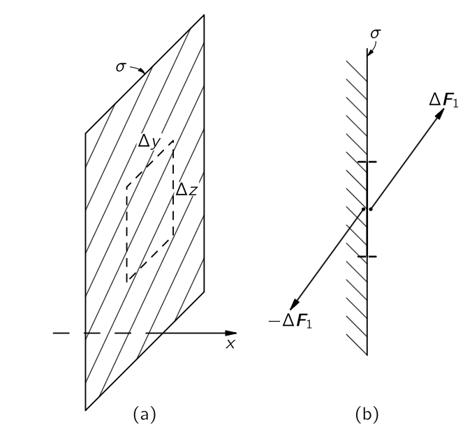{#fig-FLP_2_31_5 width=350}

탄성 물질, 예를 들어 젤로 한 덩어리를 생각해 보자. 덩어리를 절단하면, 절단면 양쪽의 물질은 일반적으로 내부 힘에 의해 이동하게 된다. 절단이 가해지기 전에, 재료를 자기 자리에 유지하는 덩어리의 두 부분 사이에 힘이 존재했음에 틀림없으며, 우리는 이러한 힘을 기준으로 응력을 정의할 수 있다. $x$ 축에 수직인 가상의 평면(@fig-FLP_2_31_5 의 $\sigma$ 평면처럼) 에서 작은 면적 $\Delta y\Delta z$ 을 가로지르는 대한 힘에 대해 알아보자. @fig-FLP_2_31_5 의 (b) 부분에 표시된 바와 같이, 영역 왼쪽에 있는 물질은 오른쪽 물질에 $\Delta F_1$ 의 힘을 가한다. 물론, 표면 왼쪽에 있는 물질에 작용하는 반대 반작용력 $−\Delta F_1$ 역시 존재한다. 면적이 충분히 작다면, $\Delta F_1$ 이 면적 $\Delta y\Delta z$ 에 비례할것이다.

당신은 이미 한 종류의 스트레스, 즉 정적 액체의 압력에 익숙하다. 그곳에서 힘은 압력에 면적을 곱한 값과 같으며, 표면 요소와 직각을 이룬다. 고체와 움직이는 점성 액체의 경우, 힘이 표면에 수직일 필요는 없으며, 압력(양수 또는 음수) 외에도 **전단력 (shear force)** 이 존재한다. (전단력은 표면을 가로지르는 힘의 접선 성분을 의미한다.) 힘의 세 성분을 모두 고려해야 하며, 또한 다른 방향의 평면에서 절단을 하면 힘이 달라진다는 점에 유의해야한다. 내부 응력을 설명하기 위해서는 텐서가 필요하다.

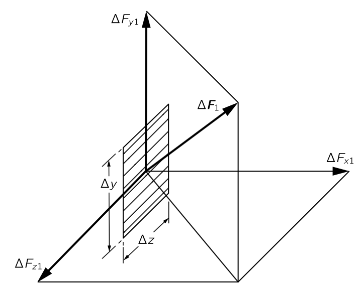{#fig-FLP_2_31_6 width=350}

우리는 응력 텐서를 다음과 같이 정의한다: 먼저, x축에 수직인 절단면을 가정하고, 그 절단을 가로지르는 힘 $\Delta F_1$ 을 @fig-FLP_2_31_6 과 같이 그 구성 요소인 $\Delta F_1$ 을 $(\Delta F_{x1}$, $\Delta F_{y1}$, $\Delta F_{z1})$ 으로 놓자. 이 힘과 면적 $\Delta y \Delta z$ 를 $S_{xx}, S_{yx}, S_{zx}$ 라고 하자. 예를 들면,

$$
S_{yx}=\dfrac{\Delta F_{y1}}{\Delta y\Delta z}.
$$

$S_{yx}$ 의 첫 번째 인덱스 $y$ 는 방향 힘 성분을 가리키며, 두 번째 인덱스 $x$ 는 해당 면적에 수직인 방향이다. 원한다면, 면적 $\Delta y\Delta z$ 는 $x$ 에 수직이므로 $a_x$ 로 표기하고 다음과 같이 쓸 수 있다.

$$
S_{yx}=\dfrac{\Delta F_{y1}}{\Delta a_x}.
$$

다음으로, 우리는 $y$ 축에 수직인 가상의 절단을 생각해 보자. 작은 면적 $\Delta x \Delta z$ 에 $\Delta F_2$ 의 힘이 존재한다. 앞서와 같이 다시 말해, 우리는 이 힘을 세 개의 성분으로 구분하고, @fig-FLP_2_31_7 에 표시된 바와 같이, 응력의 세 구성 요소인 $S_{xy}$, $S_{yy}$, $S_{zy}$ 를 세 방향의 단위 면적당 힘으로 정의한다. 마지막으로, 우리는 $z$ 에 수직인 가상의 절을 만들고 세 구성 요소인 $S_{xz}$, $S_{yz}$, $S_{zz}$ 를 정의한다. 이 아홉개의 숫자로 다음과 같이 응력 텐서를 정의 할 수 있다. 

$$
S_{ij}=\begin{bmatrix} S_{xx} & S_{xy} & S_{xz} \\ S_{yx} & S_{yy} & S_{yz} \\ S_{zx} & S_{zy} & S_{zz}\end{bmatrix}.
$$ {#eq-FLP_2_31_23}

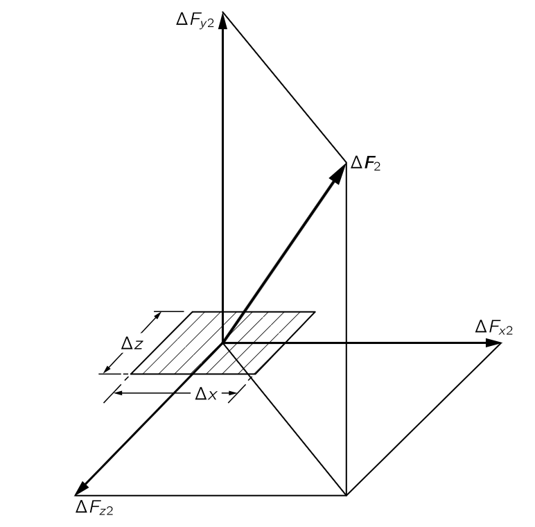{#fig-FLP_2_31_7 width=350}

우리는 이제 이 아홉 개의 수가 응력 내부 상태를 완전히 설명하기에 충분함을 보여주고자 하며, $S_{ij}$ 가 실제로 텐서임을 증명하고자 한다. 예를 들어, 임의의 각도로 배열된 표면을 가로지르는 힘을 알고 싶다고 하자. $S_{ij}$ 로부터 다음과 같이 구할 수 있다. 

이 표면에 면 $N$ 이 있고, 나머지 면들은 좌표축에 평행한 작은 입체 도형을 생각한다. 만약 면 $N$ 이 $z$ 축에 평행하다면, 우리는 @fig-FLP_2_31_8 에 표시된 삼각형 조각을 갖게 된다. (이 경우는 다소 특수한 경우이지만, 일반적인 방법을 충분히 잘 설명할 수 있다.) 이제 @fig-FLP_2_31_8 에 있는 작은 입체 삼각형에 작용하는 응력은 평형 상태에 있으며(적어도 무한소 차원의 한계에서는), 따라서 그에 대한 전체 힘은 $0$ 이어야 한다. 우리는 좌표축에 평행한 면에 작용하는 힘을 $S_{ij}$ 로부터 직접 알고 있다. 그들의 벡터 합은 면 $N$ 에 작용하는 힘과 같아야 하므로, 우리는 이 힘을 $S_{ij}$ 로 표현할 수 있다.

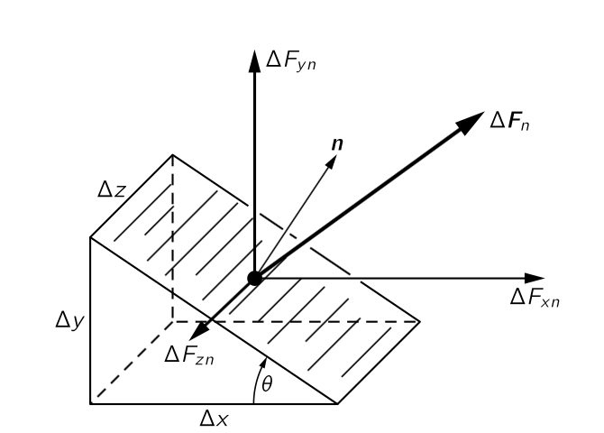{#fig-FLP_2_31_8 width=350}

우리의 작은 삼각형 부피에 작용하는 표면력이 평형 상태에 있다고 가정하면, 좌표계가 관성 기준틀이 아닌 경우 중력이나 의사 힘과 같이 존재할 수 있는 다른 물체 힘은 무시된다. 그러나 이러한 물체의 힘은 작은 삼각형의 부피에 비례하고, 따라서 $\Delta x \Delta y \Delta z$ 에 비례한다는 점에 유의하라. 반면 모든 표면 힘은 $\Delta x \Delta y, \Delta y\Delta z$ 등과 같은 면적에 비례한다. 따라서 작은 쐐기의 규모를 충분히 작게 하면, 물체의 힘은 표면 힘에 비해 항상 무시될 수 있다.

이제 작은 쐐기에 있는 힘을 더한다. 먼저 $x$-성분을 취하면, 이는 각 면에서 하나씩 다섯 부분의 합이다. 하지만 $\Delta z$ 가 충분히 작으면, $z$ 축에 수직인 삼각형 면에 작용하는 힘은 동일하고 방향은 반대가 되므로 우리는 그것들을 상쇄시킬 수 있다. 아래쪽 사각형에 있는 힘의 $x$-성분은

$$
\Delta F_{x2} = S_{xy} \Delta x\Delta z.
$$

수직 사각형에 작용하는 힘의 $x$-성분은

$$
\Delta F_{x1} = S_{xx}\Delta y\Delta z.
$$

이 두 개는 면 $N$ 을 가로질러 바깥쪽으로 향하는 힘의 $x$-성분과 같아야 한다. 면 N에 수직인 단위 벡터를 $\bf{n}$ 라고 하고, 그에 작용하는 힘을 $\bf{F}_n$ 라고 하면

$$
\Delta F_{xn} = S_{xx}\Delta y\Delta z + S_{xy} \Delta x \Delta z.
$$

이 평면을 가로지르는 응력의 $x$-성분 $S_{xn} 은 $\Delta F_{xn}$ 을 면적으로 나눈 값과 같으며, 이는 $\Delta z\sqrt{\Delta x^2 + \Delta y^2}$ 이다. 즉,

$$
S_{xn} = S_{xx}\dfrac{\Delta y}{\sqrt{\Delta x^2 + \Delta y^2}} + S_{xy} \dfrac{\Delta x}{\sqrt{\Delta x^2 + \Delta y^2}}.
$$

이제 $\Delta x/\sqrt{\Delta x^2 + \Delta y^2}$ 는 @fig-FLP_2_31_8 에 표시된 바와 같이 $\bf{n}$ 과 $y$ 축 사이의 각 $\theta$ 의 코사인이며, 따라서 $\bf{n}$ 의 $y$ 성분인 $n_y$ 로 표기할 수 있다. 마찬가지로 $\Delta y/\sqrt{\Delta x^2 + \Delta y^2}$ 는 $\sin\theta = n_x$ 이다. 이로부터

$$
S_{xn} = S_{xx}n_x + S_{xy}n_y.
$$

이제 임의의 표면 원소로 일반화하면

$$
S_{xn} = S_{xx}n_x + S_{xy}n_y + S_{xz}n_z
$$

또는 일반적으로,

$$
S_{in} = \sum_j S_{ij}n_j.
$$ {#eq-FLP_2_31_24} 

우리는 $S_{ij}$ 를 사용하여 모든 표면 요소를 가로지르는 힘을 찾을 수 있으므로, $S_{ij}$ 는 재료의 내부 응력 상태를 완전히 기술한다.

앞서 $\alpha_{ij}$ 가 $\bf{P}$ 를 $\bf{E}$ 와 연결하는 것처럼, @eq-FLP_2_31_24 는 텐서 $S_{ij}$ 가 응력 $\bf{S}_n$ 을 단위 벡터 $\bf{n}$ 에 연결한다는 것을 말한다. $\bf{n}$ 과 $\bf{S}_n$ 은 벡터이므로, $S_{ij}$ 의 성분은 좌표축의 변화에 따라 텐서로 변환되어야 한다. 따라서 $S_{ij}$ 는 실제로 텐서이다.

우리는 또한 작은 물질 정육면체에 작용하는 힘을 살펴보아 $S_{ij}$ 가 대칭 텐서임을 증명할 수 있다. 작은 정육면체를 우리 좌표축에 평행하게 배치하고, @fig-FLP_2_31_9 과 같이 단면으로 살펴보자. 만약 정육면체의 가장자리를 하나의 단위로 두면, $x$ 축과 $y$ 축에 수직인 면에 작용하는 힘의 $x$ 와 $y$ 성분은 그림과 같이 될 수 있다. 만약 정육면체가 작다면, 응력이 정육면체의 한쪽에서 반대쪽 쪽으로 크게 변하지 않으므로, 힘 성분은 그림과 같이 동일하고 반대쪽입니다. 이제 정육면체에 토크가 없어야 하며, 그렇지 않으면 회전하기 시작합니다. 중심에 대한 총 토크는 ($S_{yx}−S_{xy}$) (세제곱의 단위 간선에 곱한 값)이며, 총 토크가 $0$ 이므로 $S_{yx}$ 는 $S_{xy}$ 와 같고, 따라서 응력 텐서는 대칭 텐서이다.

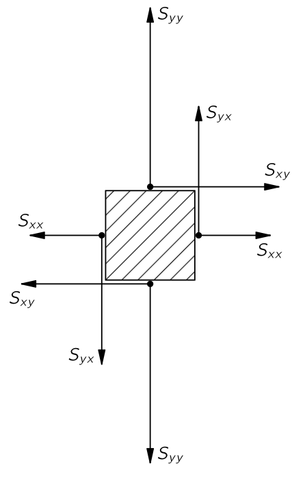{#fig-FLP_2_31_9 width=250}

$S_{ij}$ 는 대칭 텐서이므로, 세 개의 주축을 갖는 타원체로 기술될 수 있다. 이 축에 수직인 표면에서는 응력이 특히 단순하다—이는 표면에 수직인 밀기 또는 당김에 해당한다. 이 면들을 따라서는 전단력이 없다. 어떠한 응력이든, 우리는 언제든지 전단 성분이 0이 되도록 축을 선택할 수 있다. 타원체가 구라면, 어느 방향에서도 법선 힘만 존재한다. 이는 정수압(hydrostatic pressure) 에 해당한다. 따라서 정수압에 대해서는 텐서가 대각선이며 세 구성 요소가 모두 동일하다; 실제로는 압력 $p$ 와 동일하므로

$$
S_{ij}=p\delta_{ij}.
$$ {#eq-FLP_2_31_25}

응력 텐서와 그 타원체는 일반적으로 물질 블록 내에서 위치마다 변한다. 전체 블록을 설명하기 위해서는 위치에 대한 함수로서 $S_{ij}$ 의 각 성분 값을 제시해야 한다. 따라서 응력 텐서는 장이다. 우리는 공간의 각 점에 대해 하나의 숫자를 제공하는 온도 $T(x,y,z)$ 와 같은 스칼라장과 각 점에 대해 세 개의 숫자를 제공하는 $\bf{E}(x,y,z)$ 와 같은 벡터장을 안다. 이제 우리는 공간의 각 점에 대해 아홉 개의 숫자를 제공하는 텐서장에 대해 알게 되었다. 대칭 텐서 $S_{ij}$ 에 대해서는 실제로 여섯 개이다. 임의로 변형된 고체의 내부 힘에 대한 완전한 설명은 $x, y, z$ 에 대한 함수 여섯개를 필요로 한다.

### $\mathrm{II}$.31–7 고차 텐서 {#sec-FLP_2_31_7}

응력 텐서 $S_{ij}$ 는 물질의 내부 힘을 설명합니다. 탄성 재료의 경우, 내부 변형을 또 다른 텐서인 **변형률(strain)** 텐서 $T_{ij}$ 로 설명하는 것이 편리하다. 금속 막대와 같은 단순한 물체의 경우, 길이 변화인 $\Delta L$ 이 힘에 대략 비례한다는 것을 알 수 있으므로, 우리는 그것이 훅의 법칙을 따른다고 말한다.

$$
\Delta L=\gamma F.
$$

임의의 변형을 가진 고체 탄성체에 대해, 변형률 $T_{ij}$ 는 응력과 아래의 관계가 있다.

$$
T_{ij}=\sum_{k,l} \gamma_{ijkl} S_{kl}.
$$ {#eq-FLP_2_31_26}

또한, 당신은 스프링(또는 바)의 위치 에너지가

$$
\dfrac{1}{2}F\Delta L= \dfrac{1}{2}\gamma F^2.
$$

임을 안다. 고체에서 탄성 에너지 밀도에 대한 일반화는

$$
U_\text{elastic} = \sum_{ijkl}\dfrac{1}{2}\gamma_{ijkl}S_{ij}S_{kl}.
$$ {#eq-FLP_2_31_27}

결정의 탄성 특성에 대한 완전한 설명은 계수 $\gamma_{ijkl}$ 으로 제시되어야 한다. 이것은 우리에게 새로운 악몽을 소개한다. 4차 텐서. 각 인덱스는 $x,\,y,\,z$ 중 하나의 값을 취할 수 있으므로, $3^4=81$ 개의 계수가 있다. 하지만 실제로는 서로 다른 숫자는 21개 뿐이다. 우선, $S_{ij}$ 가 대칭이므로 서로 다른 값이 여섯 개뿐이며, @eq-FLP_2_31_27 에서는 서로 다른 계수가 36개만 필요하다. 하지만 또한 $S_{ij}$ 는 에너지를 바꾸지 않고 $S_{kl}$ 과 교환할 수 있으므로, $ij$ 와 $kl$ 을 교환한다면 $γ_{ijkl}$ 은 대칭이어야 한다. 이것은 서로 다른 계수의 수를 21 개로 감소시킨다. 따라서 가능한 가장 낮은 대칭을 가진 결정의 탄성 특성을 설명하려면 21개의 탄성 상수가 필요하다! 이 수는 물론, 대칭이 높은 결정에서는 감소한다. 예를 들어, 입방 결정은 탄성 상수가 세 개뿐이며, 등방성 물질은 두 개만 가지고 있다.

후자가 참이라는 것은 다음과 같이 볼 수 있습니다. $\gamma_{ijkl}$ 의 성분이 축의 방향과 무관할 수 있는 방법은, 물질이 등방성인 경우와는 반드시 독립적이어야 하는데 그들은 $\delta_{ij}$ 텐서로 표현 가능할 때만 독립적일 수 있다. $\delta_{ij}\delta_{kl}$ 와 $\delta_{ik}\delta_{jl} + \delta_{il}\delta_{jk}$ 라는 두 가지 가능한 표현이 있으며, 이는 요구되는 대칭성을 가지고 있으므로 $\gamma_{ijkl}$ 은 두 표현들의 선형 결합이어야 한다. 따라서, 등방성 물질에 대해서는,

$$
\gamma_{ijkl} = a(\delta_{ij}\delta_{kl}) + b(\delta_{ik}\delta_{jl} + \delta_{il} \delta_{jk}),
$$

이며, 그 물질의 탄성 특성을 설명하기 위해 두 개의 상수 $a$ 와 $b$ 가 필요하다. 입방체 결정이 세 개의 값만 필요하다는 것은 숙제로 남기겠다.

마지막 예로, 이번에는 3차 텐서에 대해 압전 효과가 있다. 응력 하에서 결정은 응력에 비례하는 전기장을 생성합니다; 따라서 일반적으로 그 법칙은

$$
E_i=\sum_{j,k} P_{ijk}S_{jk},
$$

여기서 $E_i$ 는 전기장이고, $P_{ijk}$ 는 **압전 계수(piezoelectric coefficients)**, 또는 **압전 텐서(piezoelectric tensor)**라고 한다. 결정에 반정 중심이 있을 경우, 즉 $x, y, z \to −x, −y, −z$ 에 불변인 점이 있을 경우 압전 계수가 모두 0임을 보일 수 있다.

### $\mathrm{II}$.31–8 전자기 운동량 4 텐서.

이 장에서 지금까지 살펴본 모든 텐서는 공간의 3차원과 관련이 있으며, 공간 회전 하에서 특정 변환 속성을 갖는 것으로 정의된다. [$\mathrm{II}$.26 장의 로런츠 변환](vol2_6.qmd#sec-FLP_2_26) 에서는 상대론적 4차원 시공간 에서 정의된 전자기장 텐서 $F^{\mu\nu}$ 를 사용할 기회가 있었다. 이 4텐서의 성분들은 우리가 수행했던 특별한 방식으로 좌표의 로렌츠 변환에 따라 변환된다. (비록 우리는 그렇게 하지 않았지만, 로렌츠 변환을 민코프스키 공간이라고 불리는 4차원 “공간”에서의 “회전”으로 간주할 수 있었을 것이며, 그렇다면 여기서 우리가 하고 있는 것과의 비유가 더 명확했을 것이다.)

우리의 마지막 예로서, 우리는 상대성 이론의 네 차원 $(t, x, y, z)$ 에서 또 다른 텐서를 알아보고자 한다. 우리가 응력 텐서를 작성할 때, 우리는 $S_{ij}$ 를 단위 면적에 걸친 힘의 구성 요소로 정의했다. 힘은 운동량의 시간 변화율과 같다. 따라서 **$S_{xy}$ 는 $y$ 에 수직인 단위 면적을 가로지르는 힘의 $x$ 성분이다** 라고 말하는 대신, **$S^{12}$ 는 $y$ 에 수직인 단위 면적을 통과하는 운동량의 $x$ 성분의 흐름 속도이다** 라고 말할 수 있다. 다시 말해, $S^{ij}$ 의 각 항은 또한 $j$ 방향에 수직인 단위 면적을 통과하는 운동량의 $i$ 성분의 흐름을 나타낸다. 이들은 순수한 공간 성분이지만, $S^{01}$, $S^{20}$, $S^{00}$ 등과 같은 추가 성분을 포함하는 4차원($\mu,\,\nu=0,\,1,\,2,\,3$) 에서 “더 큰” 텐서 $S^{\mu\nu}$ 의 일부이다. 이제 우리는 이러한 추가 구성 요소들의 물리적 의미를 찾아볼 것이다.

우리는 공간 성분이 운동량의 흐름을 나타낸다는 것을 알고 있다. 우리는 다른 종류의 “흐름”—전하의 흐름을 연구함으로써 이것을 시간 차원까지 확장하는 방법에 대한 단서를 얻을 수 있다. 스칼라 양인 전하에 대한 흐름 속도(흐름에 수직인 단위 면적당)는 공간 벡터이며, 전류 밀도 벡터 $\bf{J}$ 이다. 우리는 이 흐름 벡터의 시간 성분이 흐르는 물질의 밀도임을 확인했다. 예를 들어, $\bf{J}$ 와 시간 성분인 $J^0=\rho$, 전하 밀도와 결합하여 4벡터 $J^\mu = (c\rho ,\bf{J})$ 를 만들 수 있다.

이제 스칼라 양의 흐름에 대한 시간 성분에 관한 우리의 진술과 유사하게, $S^{11}$, $S^{12}$, $S^{13}$ 이 운동량의 $x$-성분 흐름을 설명할 때, 흐르는 모든 것의 밀도인 시간 성분 $S^{10}$ 가 존재할 것으로 예상할 수 있다; 즉, $S^{10}$ 는 $x$-모멘텀의 밀도가 되어야 한다. 따라서 우리는 텐서를 수평으로 확장하여 $t$-성분을 포함할 수 있다. 우리는 가지고 있습니다

$$
\begin{aligned}
S^{10} &= [x-\text{ 운동량의 밀도}], \\[0.3em]
S^{11} &= [x-\text{운동량의 }x\text{ 방향 흐름}], \\[0.3em]
S^{12} &= [x-\text{운동량의 }y\text{ 방향 흐름}], \\[0.3em]
S^{13} &= [x-\text{운동량의 }z\text{ 방향 흐름}]. 
\end{aligned}
$$

마찬가지로, 운동량의 $y$‐성분에 대해 우리는 흐름의 세 구성 요소인 $S^{21}$, $S^{22}$, $S^{23}$ 를 가지고 있으며, 이에 네 번째 항을 추가한다:

$$
S^{20} = y-\text{운동량의 밀도}.
$$

그리고 물론, $S^{30}$, $S^{31}$, $S^{32}$ 에 다음을 추가한다.

$$
S^{30} = z-\text{운동량의 밀도}.
$$

4차원에서는 또한 운동량의 $t$-성분이 존재하는데, 이는 우리가 알고 있는 에너지입니다. 따라서 텐서 $S^{\\mu\nu}$ 는 $S^{01}$, $S^{02}$ 및 $S^{03}$ 와 함께 수직으로 확장되어야 한다. 여기서

$$
\begin{aligned}
S^{01} &= [\text{에너지의 }x\text{ 흐름}], \\[0.3em]
S^{02} &= [\text{에너지의 }y\text{ 흐름}], \\[0.3em]
S^{03} &= [\text{에너지의 }z\text{ 흐름}].
\end{aligned}
$$(31.28)

즉, $S^{01}$ 는 $x$ 축에 수직인 표면을 가로질러 단위 면적당 및 단위 시간당 에너지 흐름이며 $S^{02},\,S_{03}$ 역시 각 방향에 대해 동일하다. 마지막으로, 우리의 텐서를 완성하려면 $S^{00}$ 가 필요하다. $S^{0}$ 는 에너지의 밀도이다. 우리는 3차원 스트레스 텐서 $S_{ij}$ 를 4차원 스트레스‐에너지 텐서 $S^{\mu\nu}$ 로 확장했다. 지수 $\mu$ 는 $0, \,1, \,2,\,3$  네 가지 값을 취할 수 있으며, 각각 “밀도”, “$x$ 방향의 단위 면적당 흐름”, “$y$ 방향의 단위 면적당 흐름”, “$z$ 방향의 단위 면적당 흐름”을 의미한다. 같은 방식으로, $\nu$ 역시  $0, \,1, \,2,\,3$ 네 가지 값을 사용하여 무엇이 흐르는지 알려준다. 즉, “에너지”, “$x$-방향의 모멘텀”, “$y$-방향의 모멘텀”, “$z$-방향 모멘텀”.

예를 들어, 우리는 이 텐서를 물질이 아니라 전자기장이 있는 자유 공간 영역에서 논의해 보자. 우리는 에너지 흐름이 Poynting 벡터 $\bf{S}=\epsilon_0 c^2\bf{E}\times \bf{B}$ 임을 알고 있다. 따라서 상대론적 관점에서 $\bf{S}$ 의 $x$-, $y$-, $z$ 성분은 우리 4차원 응력‐에너지 텐서의 구성 요소인 $S^{01}$, $S^{02}$, $S^{03}$ 이다. 텐서 $S_{ij}$ 의 대칭은 시간 성분에도 적용되므로, 4차원 텐서 $S^{\mu\nu}$ 는 대칭 텐서이다.

$$
S^{\mu\nu} = S^{\nu\mu}.
$$ {#eq-FLP_2_31_29}

다시 말해, $x$, $y$, $z$ 방향 운동량의 밀도인 $S^{10}$, $S^{20}$, $S^{30}$ 성분은 에너지 흐름인 Poynting 벡터 $\bf{S}$ 의 $x$-, $y$-, $z$- 성분과 동일하다(이미 이전 장에서 다른 종류의 논증으로 보였다.).

전자기 응력 텐서 $S^{\mu\nu}$ 의 남은 성분은 전기장과 자기장 $\bf{E}$ 와 $\bf{B}$ 를 이용하여 표현될 수 있다. 즉, 우리는 스트레스를 인정해야 하며, 덜 신비롭게 말하자면 전자기장의 운동량 흐름을 받아들여야 한다. 우리는 제27장에서 @eq-FLP_2_27_21 와 관련하여 이를 논의했다. 하지만 세부 사항을 해결하지 못했다.

4차원에서 텐서에 대한 자신의 전문성을 발휘하고자 하는 분들은 $S^{\mu\nu}$ 의 공식을 필드 측면에서 보고 싶어하실 수 있다:

$$
S^{\mu\nu} = −\epsilon_0\left( F^{\mu\alpha} {F^{\nu}}_\alpha−\dfrac{1}{4}g^{\mu\nu}F_{\alpha\beta}F_{\alpha\beta}\right),
$$

여기서 

$$
g^{\mu\nu} = \left\{\begin{array}{ll} +1 \qquad & \mu=\nu = 0, \\-1 &\mu=\nu \ne 0, \\0 &\mu\ne \nu.\end{array}\right.
$$

이다. 이것이 에너지 밀도 $S^{00} = (\epsilon_0/2)(E^2 + c^2 B^2)$ 와 Poynting 벡터 $\epsilon_0 c^2 (\bf{E}\times \bf{B})$ 를 제공한다는 것을 확인할 수 있나? $\bf{B}=0$ 인 정전기장에서 주축 응력축이 전기장의 방향을 향하고, 그 방향을 따라 장력 $(\epsilon_0/2)E^2$ 가 존재하며, 전장 방향에 수직인 방향에 동일한 압력이 존재함을 보여 주실 수 있을까??

## $\textrm{II}$.32 물질의 굴절률 {#sec-FLP_2_32}

## $\textrm{II}$.33 표면으로부터의 반사 {#sec-FLP_2_33}