 

## $\mathrm{III}$.5 스핀 $1$ 입자 {#sec-FLP_3_5}

### $\mathrm{III}$.5–1 슈테른-게를라흐 실험을 통한 원자 필터링 {#sec-FLP_3_5_1}

이 장에서 비로소 양자역학 자체를 시작한다. 즉, 양자역학 현상을 완전히 양자역학적인 방식으로 기술한다. 우리는 사과도 하지 않을 것이며 고전 역학과의 연관성을 찾으려는 시도도 하지 않을 것이다. 우리는 새로운 언어로 새로운 것에 대해 이야기 할 것이다. 우리가 설명하려는 특정 상황은 스핀 $1$ 입자에 대한 이른바 각운동량의 양자화 현상이다. 하지만 “각운동량”과 같은 용어나 고전역학의 다른 개념들을 당분간 사용하지 않을 것이다. 우리는 비교적 단순하지만 가능한 가장 간단한 예시는 아니기 때문에 이 예를 선택했다. 그것은 충분히 복잡하여 모든 양자역학 현상의 설명에 일반화될 수 있는 프로토타입으로 삼을 수 있다. 따라서, 특정 예를 다루고 있지만, 우리가 언급하는 모든 법칙은 즉시 일반화될 수 있으며, 양자역학적 설명의 일반적인 특성을 확인할 수 있도록 일반화하여 설명하려 한다. 우리는 **슈테른-게를라흐(Stern-Gerlach) 실험** 에서 원자 빔이 세 개의 별도 빔으로 분리되는 현상부터 시작한다.

#### **슈테른-게를라흐 장치**

[$\mathrm{II}$.35 상자성과 자기 공명](../vol2/vol2_8.qmd#sec-FLP_2_35) 에서 뾰족한 극 단자(pole tip)를 가진 자석에 의해 비균일한 자기장이 존재하고, 장치를 통해 빔을 보내면, 입자 빔이 여러 개의 빔으로 나뉘어질 수 있다는 것을 다루었다. 그 수는 특정 원자 종류와 그 상태에 따라 달라진다. 우리는 세 개의 빔을 갖는 원자의 경우를 생각하며, 이를 스핀 $1$ 입자라고 부른다. 다섯 빔, 일곱 빔, 두 빔 등과 같은 경우에 대해 당신이 직접 해 볼 수 있다—모든 것을 복사한 뒤, 세 개의 항이 있는 곳에 다섯, 혹은 일곱 개의 항이 되고, 이렇게 계속된다.

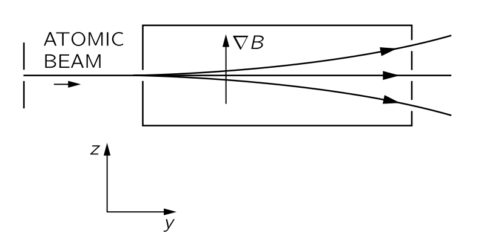{#fig-FLP_3_5_1 width=350}

@fig-FLP_3_5_1 에 그려진 장치를 상상하자. 원자(또는 모든 종류의 입자) 빔은 몇 개의 슬릿에 의해 콜리미네이트되어 비균일한 장을 통과한다. 빔이 $y$ 방향으로 이동하고, 자기장과 그 기울기가 모두 $z$ 방향에 있다고 가정한다. 옆에서 보면, 그림에 표시된 바와 같이 빔이 수직으로 세 개의 빔으로 나뉘는 것을 볼 수 있다. 이제 자석의 출구쪽에 작은 계수기를 설치하여 세 개의 빔 중 어느 하나에 입자가 도착하는 속도를 계산할 수 있다. 또는 두 개의 빔을 차단하고 세 번째 빔을 계속 사용할 수 있다.

아래 두 빔을 차단하고 가장 위에 있는 빔만 진행시킨 다음, 같은 종류의 두 번째 슈테른-게를라흐 장치를 @fig-FLP_3_5_2 처럼 배치한다고 하자. 무슨 일이 일어날까? 두 번째 장치에는 세 개의 빔이 없으며, 상단 빔만 있다. 이는 두 번째 장치를 첫 번째 장치의 단순한 연장선으로 생각했을 때 우리가 기대하는 결과이다. 위로 밀려 올라가는 그 원자들은 두 번째 자석에서 계속해서 위로 밀려 올라간다.

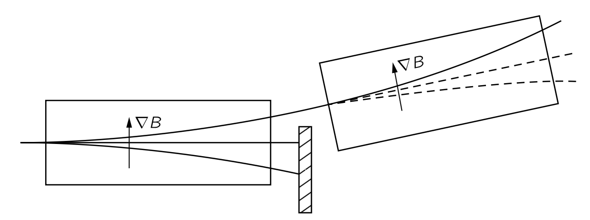{#fig-FLP_3_5_2 width=450}

결과적으로 첫 번째 장치가 특정한 불균일한 장 안에서 위로 굽어지는 원자만으로 이루어진“정제된” 빔을 생성한다. 원자들이 원래의 슈테른-게를라흐 장치에 들어갈 때, 세 가지 “변종”으로 구분되며, 세 종류는 서로 다른 궤적을 취한다. 하나만 남기고 모두 필터링함으로써, 동일한 종류의 장치에서 미래 거동이 결정되고 예측 가능한 빔을 만들 수 있다. 우리는 이를 필터링된 빔, 혹은 편광된 빔, 혹은 모든 원자가 일정한 상태에 있는 것으로 알려진 빔이라고 부를 것이다.

논의의 나머지 부분에서는, 다소 수정된 슈테른-게를라흐 유형의 장치를 고려하는 것이 더 편리할 것인다. 그 장치는 처음에 더 복잡해 보이지만, 모든 논증을 더 간단하게 만든다. 어쨌든, 그것들은 단지 "사고 실험"일 뿐이므로 장비를 복잡하게 만드는 데 비용이 들지 않는다. (우연히도, 이와 같이 설명할 모든 실험을 수행한 사람은 없지만, 우리는 양자역학의 법칙으로부터 어떤 일이 일어날지 알고 있으며, 이는 물론 다른 유사한 실험들을 기반으로 한다.) 이러한 다른 실험들은 처음에 이해하기가 더 어렵기 때문에, 우리는 몇 가지 이상화되었지만 가능한 실험들을 설명할 것이다.

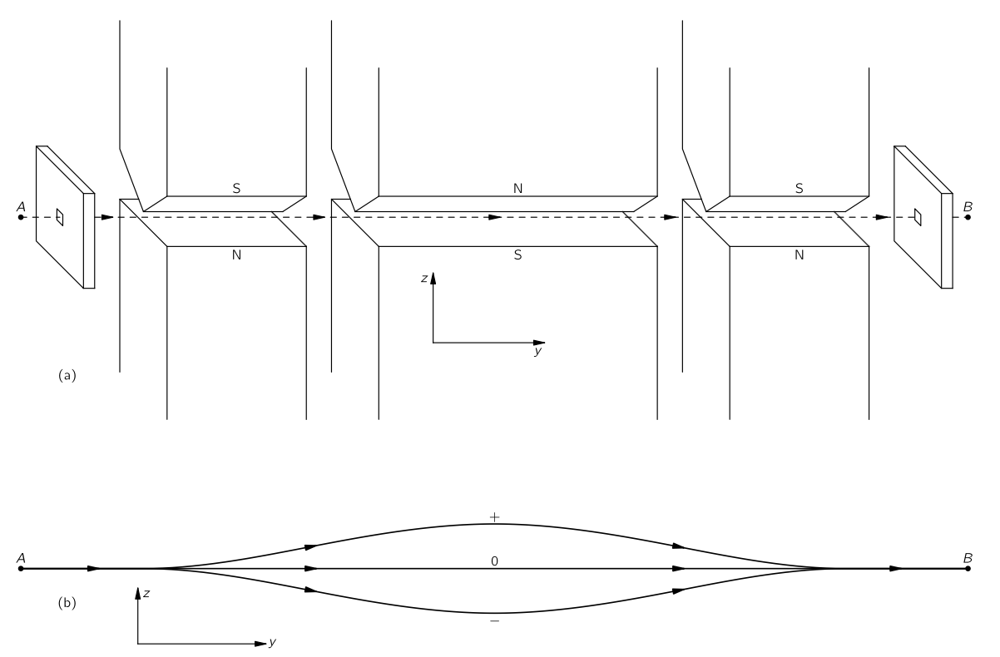{#fig-FLP_3_5_3 width=500}

@fig-FLP_3_5_3 (a) 는 우리가 사용하고자 하는 "수정된 슈테른‐게를라흐 장치"를 보여준다. 그것은 높은 그라디언트 자석 세 개의 연속으로 구성된다. 첫 번째(왼쪽)는 일반적인 슈테른-게르라흐 자석이며, 입사되는 스핀-1 입자빔을 세 개의 빔으로 분리한다. 두 번째 자석은 첫 번째와 같은 단면을 가지고 있지만, 길이가 두 배이며, 자기장의 극성은 첫번째의 자기장과 반대이다. 두 번째 자석은 원자 자석에 대해 반대 방향으로 밀어내며, 그림 하단에 그려진 궤적에 표시된 바와 같이 그 경로를 축 쪽으로 다시 굽힌다. 세 번째 자석은 첫 번째와 마찬가지로 세 개의 빔을 다시 결합시키며 축을 따라 출구 구멍으로 나간다. 마지막으로, 우리는 $A$ 의 구멍 앞에 원자를 정지에서 시작하게 하는 메커니즘이 존재하고, $B$ 의 출구 구멍 이후에는 원자를 $B$ 에서 다시 정지시키는 감속 메커니즘이 있다고 가정한다. 그것은 필수적이지는 않지만, 우리 분석에서는 원자가 나올 때 운동의 영향을 포함하는 것에 대해 걱정할 필요가 없으며, 스핀과 관련된 문제에만 집중할 수 있게 된다. 개선된 장치의 전체 목적은 모든 입자를 같은 장소에, 그리고 속도 $0$ 이 되도록 이동시키는 것이다.

#### **필터링된 빔과 연속된 슈테른-게를라흐 장치**

@fig-FLP_3_5_2 와 같은 실험을 수행할 때 장치 중앙에 판을 삽입하여 두 개의 빔을 차단시켜 필터링된 빔을 만들 수 있다(@fig-FLP_3_5_4). 이제 편광된 원자를 두 번째 동일한 장치에 통과시면, 모든 원자는 상위 경로를 택하게 되며, 이는 두 번째 $S$ 필터의 다양한 빔에 유사한 판을 배치하고 입자가 통과하는지 보고 확인할 수 있다.

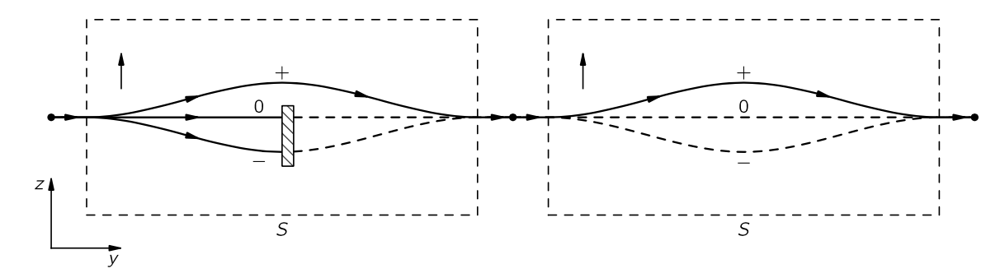{#fig-FLP_3_5_4 width=500}

첫 번째 장치를 $S$ 라고 하자. $S$ 에서 위쪽 경로를 취하는 원자들을 $S$ 에 대해 $+$ 상태에 있다고 말하고, 중간 경로를 취하는 원자들은 $S$ 에 대해 $0$ 상태에 있으며, 가장 낮은 경로를 취하는 원자들은 $S$ 에 대해 $-$ 상테에 있다고 하자. (보다 일반적인 표현에서는 각운동량의 $z$-성분이 각각 $+1\hbar$, $0$, $-1\hbar$ 라고 말할 수 있지만, 그 표현은 보류하자.) @fig-FLP_3_5_4 에서 두 번째 장치는 첫 번째와 같은 방향으로 배치되어 있어, 필터링된 원자들은 모두 위쪽 경로에 놓이게 된다. 또는 첫 번째 장치에서 상부와 하부 빔을 차단하고 제로 상태만 통과하도록 했다면, 모든 필터링된 원자는 두 번째 장치의 중간 경로를 통과하게 될 것이다. 그리고 첫 번째에서 가장 낮은 빔을 제외한 모든 것을 차단했다면, 두 번째에서는 낮은 빔만 있을 것이다. 각 경우마다 첫 번째 장치가 $S$ 에 대해 순수 상태의 필터링된 빔을 생성했다고 말할 수 있으며($+$, $0$, 또는 $−$), 원자를 두 번째 동일한 장치에 통과시켜 어떤 상태가 존재하는지 테스트할 수 있다.

우리는 두 번째 장치에 첫 번째 장치와 같은 마스크를 그 안에 삽입하여 특정 상태의 원자만 전송하도록 만들 수 있다. 그 후, 들어오는 빔의 상태를 먼 쪽 끝에서 무언가 나오는지 확인함으로써 테스트할 수 있다. 예를 들어, 두 번째 장치에서 두 개의 하위 경로를 차단하면 원자의 100%가 여전히 통과하지만, 상위 경로를 차단하면 아무것도 통과하지 않는다.

이러한 논의를 보다 쉽게 만들기 위해, 우리는 개선된 슈테른‐게를라흐 장치 중 하나를 나타내는 약식 기호를 사용한다. 

$$
\begin{array}{c}\left\{\begin{array}{c} + \\ 0 \\ - \end{array}\right\}\\ S \end{array}
$$ {#eq-FLP_3_5_1}

위 기호는 하나의 완전한 장치를 의미한다. 우리는 동시에 여러 장치를 사용하고 다양한 방향을 가지고자 하므로, 각각을 아래에 문자로 식별할 것이다. 따라서 @eq-FLP_3_5_1 맨 아래의 기호 $S$ 는 장치 $S$ 를 의미한다. 내부에 있는 하나 이상의 빔을 차단하면, 차단된 빔을 나타내는 수직 막대를 아래와 같이 표기한다.

$$
\begin{array}{c}\left\{\begin{array}{c@{\hspace{0pt}}c@{\hspace{0pt}}} + & \\ 0 &  ⎮ \\ - & ⎮ \end{array}\right\}\\ S \end{array}
$$ {#eq-FLP_3_5_2}

우리가 사용할 다양한 가능한 조합은 아래 @fig-FLP_3_5_5 에 표시되었다. 

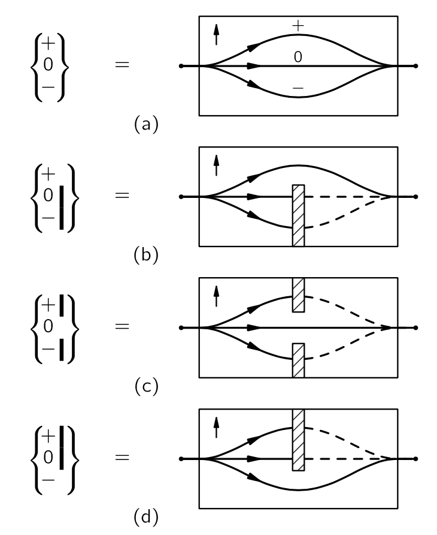{#fig-FLP_3_5_5 width=300}

@fig-FLP_3_5_4 와 같은 연속적인 두개의 필터는 두 기호를 아래과 같이 나란히 배치한다.

$$
\begin{array}{c}\left\{\begin{array}{c@{\hspace{0pt}}c@{\hspace{0pt}}} + & \\ 0 &  ⎮ \\ - & ⎮ \end{array}\right\}\\ S \end{array} \begin{array}{c}\left\{\begin{array}{c@{\hspace{0pt}}c@{\hspace{0pt}}} + & \\ 0 &  \\ - & \end{array}\right\}\\ S \end{array}
$$ {#eq-FLP_3_5_3}

이 설정에서는 첫 번째를 통해 들어오는 모든 것은 두 번째 장치의 $0$ 과 $-$ 채널을 차단하더라도 두 번째를 통과한다.  따라서

$$
\begin{array}{c}\left\{\begin{array}{c@{\hspace{0pt}}c@{\hspace{0pt}}} + & \\ 0 &  ⎮ \\ - & ⎮ \end{array}\right\}\\ S \end{array} \begin{array}{c}\left\{\begin{array}{c@{\hspace{0pt}}c@{\hspace{0pt}}} + & \\ 0 &  ⎮ \\ - & ⎮ \end{array}\right\}\\ S \end{array}
$$ {#eq-FLP_3_5_4}

에서도 여전히 두 번째 장치를 통해 100% 전송을 받는다. 반면,

$$
\begin{array}{c}\left\{\begin{array}{c@{\hspace{0pt}}c@{\hspace{0pt}}} + & \\ 0 &  ⎮ \\ - & ⎮ \end{array}\right\}\\ S \end{array} \begin{array}{c}\left\{\begin{array}{c@{\hspace{0pt}}c@{\hspace{0pt}}} + & ⎮ \\ 0 &  \\ - & ⎮ \end{array}\right\}\\ S \end{array}
$$ {#eq-FLP_3_5_5}

라면 최종적으로 전혀 아무것도 나오지 않는다. 마찬가지로,
$$
\begin{array}{c}\left\{\begin{array}{c@{\hspace{0pt}}c@{\hspace{0pt}}} + & ⎮ \\ 0 &  ⎮ \\ - &  \end{array}\right\}\\ S \end{array} \begin{array}{c}\left\{\begin{array}{c@{\hspace{0pt}}c@{\hspace{0pt}}} + &  \\ 0 & ⎮ \\ - & ⎮ \end{array}\right\}\\ S \end{array}
$$ {#eq-FLP_3_5_6}

역시 아무것도 나타나지 않는다. 반면에,
$$
\begin{array}{c}\left\{\begin{array}{c@{\hspace{0pt}}c@{\hspace{0pt}}} + & ⎮ \\ 0 &  ⎮ \\ - &  \end{array}\right\}\\ S \end{array} \begin{array}{c}\left\{\begin{array}{c@{\hspace{0pt}}c@{\hspace{0pt}}} + & ⎮ \\ 0 & ⎮ \\ - &  \end{array}\right\}\\ S \end{array}
$$ {#eq-FLP_3_5_7}

는
$$
\begin{array}{c}\left\{\begin{array}{c@{\hspace{0pt}}c@{\hspace{0pt}}} + & ⎮ \\ 0 &  ⎮ \\ - &  \end{array}\right\}\\ S \end{array} 
$$

와 그 자체로 동등하다.

이제 이러한 실험들을 양자역학적으로 설명해보자. 원자가 @fig-FLP_3_5_5 (b) 의 장치를 통과하면 ($+S$) 상태에 있다고 말하고, (c) 를 통과하면 ($0S$) 상태이며, (d) 를 통과하면 ($−S$) 상태에 있다고 하자. 그렇다는 $\langle b | a\rangle$ 를 상태 $a$ 에 있는 원자가 장치를 통과하여 $b$ 상태로 들어가는 진폭이다. 실험(@eq-FLP_3_5_4) 은

$$
\langle +S|+S\rangle =1
$$

임을 말한다. 반면에 @eq-FLP_3_5_5 는 

$$
\langle −S | +S\rangle = 0
$$

을 말한다. 마찬가지로, @eq-FLP_3_5_6 의 결과는

$$
\langle +S|-S\rangle =0
$$

이며, @eq-FLP_3_5_7 은

$$
\langle −S | −S\rangle = 1
$$

임을 말한다. 우리가 "순수" 상태만 다루는 경우—즉, 하나의 채널만 열려 있는 경우—그러한 진폭은 아홉 가지이며, 이를 표로 작성할 수 있다:

$$
\begin{array}{lc}
& \text{from} \\
\text{to} &
\begin{array}{c|ccc}
 & +S & 0S & -S \\ \hline
+S & 1 & 0 & 0 \\
0S & 0 & 1 & 0 \\
-S & 0 & 0 & 1
\end{array}
\end{array}.
$$ {#eq-FLP_3_5_8}

이 행렬은 우리가 설명해 온 현상을 요약한다.

### $\mathrm{III}$.5–2 골라진 원자를 이용한 실험 {#sec-FLP_3_5_2}

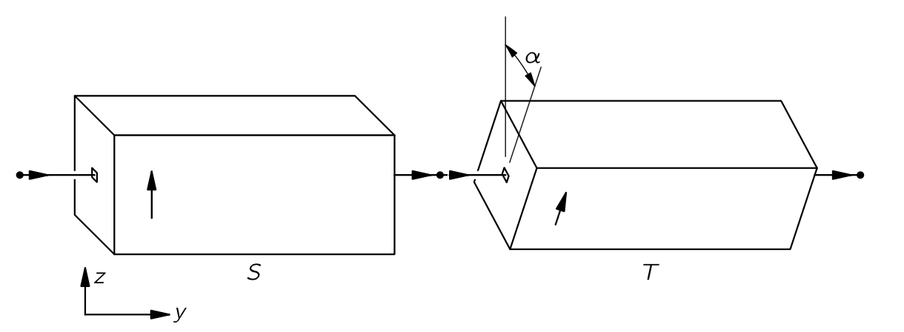{#fig-FLP_3_5_6 width=500}

이제 중요한 질문이 제기된다: 두 번째 장치를 다른 각도로 기울여 그 장축이 첫 번째와 더 이상 평행하지 않게 되면 어떻게 될까? 그것은 단순히 기울어질 수 있을 뿐만 아니라 다른 방향(예를 들어, 원래 방향에 대해 $90^\circ$ 에서 빔을 분리하는 것)을 향할 수도 있다. 우선, 먼저 @fig-FLP_3_5_6 에 표시된 바와 같이 두 번째 슈테른-게를라흐 실험이 $y$ 축을 중심으로 각도 $\alpha$ 만큼 기울어진 배치를 생각해 보자. 두 번째 장치를 $T$ 라고 한다. 이제 다음 실험을 설정해보자.

$$
\begin{array}{c}\left\{\begin{array}{c@{\hspace{0pt}}c@{\hspace{0pt}}} + & \\ 0 &  ⎮ \\ - & ⎮ \end{array}\right\}\\ S \end{array} \begin{array}{c}\left\{\begin{array}{c@{\hspace{0pt}}c@{\hspace{0pt}}} + & \\ 0 &  ⎮ \\ - & ⎮ \end{array}\right\}\\ T \end{array}.
$$

혹은

$$
\begin{array}{c}\left\{\begin{array}{c@{\hspace{0pt}}c@{\hspace{0pt}}} + & \\ 0 &  ⎮ \\ - & ⎮ \end{array}\right\}\\ S \end{array} \begin{array}{c}\left\{\begin{array}{c@{\hspace{0pt}}c@{\hspace{0pt}}} + &  ⎮ \\ 0 &   \\ - & ⎮ \end{array}\right\}\\ T \end{array}.
$$

이런 경우 최종적으로 나오는 것은?

답은 다음과 같다: 원자들이 $S$ 에 대해 특정 상태에 있다면, $T$ 에 대해서는 동일한 상태에 있지 않다. $(+S)$ 상태는 $(+T)$ 상태가 아니다. 그러나 원자를 $(+T)$ 상태, 또는 $(0T)$ 상태나 $(−T)$ 상태에서 찾기 위한 일정한 진폭이 존재한다.

다시 말해, 우리가 원자를 특정 상태에 두도록 아무리 신중히 확인했다 하더라도, 사실은 그것이 다른 각도로 기울어진 장치를 통과한다면, 말하자면 스스로를 재지향(reorient) 해야 한다는 것이다. 우리는 한 번에 하나의 입자만 통과시킬 수 있으며, 그 다음에는 다음과 같은 질문만 할 수 있다: 그것이 통과할 확률은 얼마인가? $S$ 를 통과한 원자 중 일부는 $(+T)$ 상태로 끝나며, 일부는 $(0T)$ 상태로, 일부는 $(−T)$ 상태로 끝난다. 모두 서로 다른 확률을 가진다. 이러한 확률은 복소 진폭의 절대제곱을 이용하여 계산할 수 있다. 우리가 원하는 것은 이러한 진폭에 대한 수학적 방법, 즉 양자역학적 설명이다. 우리가 알아야 할 것은 

$$
\langle -T |+S \rangle
$$

과 같은 종류의 다양한 양이다. 위 식은 원자가 처음 $(+S)$ 상태에 있다가 $(−T)$ 조건에 들어갈 수 있는 진폭을 의미한다. $T$ 와 $S$ 가 서로 평행하게 정렬되지 않는 한 0이 아니다. 아래와 같은 다른 진폭도 있다.

$$
\langle +T| 0S\rangle,\quad \text{or}\quad \langle 0T | -S\rangle, \quad \text{etc}.
$$

실제로 입자 이론을 통해 계산할 수 있는 그러한 진폭은 9개이며, 또 다른 행렬이다. $F=ma$ 가 어떤 상황에서도 고전 입자에 일어나는 현상을 계산하는 방법을 알려 주는 것처럼, 양자역학의 법칙은 입자가 특정 장치를 통과할 때 얻을 수 있는 진폭을 결정할 수 있게 한다. 핵심 문제는, 주어진 기울기 각도 $\alpha$ 에 대해, 혹은 실제로 어떤 방향에 대해서도 9개의 진폭을 계산할 수 있는가이다.

$$
\langle f|i\rangle, \qquad \text{where } i=+S,\, 0S,\, -S,\,\text{and }j = +T,\, 0T,\, -T.
$$ {#eq-FLP_3_5_9}

우리는 이미 이러한 진폭들 사이의 관계를 파악할 수 있다. 먼저, 우리의 정의에 따르면 절대 제곱 $|\langle +T|+S\rangle|^2$ 은 $(+S)$ 상태에 있는 원자가 $(+T)$ 상태에 들어갈 확률이다. 종종 절대제곱을 동등한 $\langle +T | +S \rangle \langle +T | +S\rangle^\ast$ 형태로 쓰는 것이 더 편리하다. 같은 표기법에서 $\langle 0T|+S\rangle \langle 0T |+S \rangle^\ast$ 는 입자가 $(+S)$ 상태에서 $(0T)$ 상태로 들어갈 확률이며 $\langle −T|+S\rangle \langle −T|+S\rangle^\ast$ 는 $(−T)$ 상태로 들어갈 확률이다. 하지만 우리 장치가 제작되는 방식상, $T$ 장치에 들어가는 모든 원자는 $T$ 장치의 세 가지 상태 중 하나에서 발견되어야 한다. 주어진 종류의 원자가 갈 다른 곳은 없다. 따라서 우리가 방금 적은 세 확률의 합은 $1$ 와 같아야 한다. 이로부터

$$
\langle +T|+S\rangle \langle +T | +S\rangle^\ast + \langle 0T|+S\rangle \langle 0T | +S\rangle^\ast + \langle -T|+S\rangle \langle -T | +S\rangle^\ast = 1
$$ {#eq-FLP_3_5_10}

물론, $0S$ 또는 $−S$ 상태로 시작하면 얻을 수 있는 두 가지 다른 방정식이 있다. 하지만 그것들은 모두 우리가 쉽게 얻을 수 있으므로, 다른 일반적인 질문으로 진행하자.

### $\mathrm{III}$.5–3 연결된 슈테른-게를라흐 필터 {#sec-FLP_3_5_3}

흥미로운 질문이 있다: 원자를 $(+S)$ 상태로 필터링했다고 가정하면, 두 번째 필터, 예를 들어 $(0T)$ 상태로 전환한 뒤 또 다른 $(+S)$ 필터를 통과시킨다. (첫번째 $S$ 필터와 구분하기 위해 마지막 필터를 $S'$ 라고 하자.) 원자들은 한때 $(+S)$ 상태에 있었던 것을 기억하고 있을까? 다시 말해, 다음과 같은 실험을 생각한다.

$$
\begin{array}{c}\left\{\begin{array}{c@{\hspace{0pt}}c@{\hspace{0pt}}} + & \\ 0 &  ⎮ \\ - & ⎮ \end{array}\right\}\\ S \end{array} \begin{array}{c}\left\{\begin{array}{c@{\hspace{0pt}}c@{\hspace{0pt}}} + &  ⎮ \\ 0 &   \\ - & ⎮ \end{array}\right\}\\ T \end{array} \begin{array}{c}\left\{\begin{array}{c@{\hspace{0pt}}c@{\hspace{0pt}}} + & \\ 0 &  ⎮ \\ - & ⎮ \end{array}\right\}\\ S' \end{array}.
$$ {#eq-FLP_3_5_11}

우리는 $T$ 를 통과하는 모든 입자들이 $S'$ 도 통과하는지 알고 싶다. 그러나 그렇지 않다. $T$ 에 의해 필터링된 후에는 $T$ 에 진입했을 때 자신이 $(+S)$ 상태였음을 전혀 기억하지 못한다. @eq-FLP_3_5_11 의 두 번째 $S$ 장치는 첫 번째와 정확히 동일한 방향으로 배치되어 있으므로 여전히 $S$ 형 필터이다. $S'$ 에 의해 필터링된 상태는 물론 여전히 $(+S)$, $(0S)$, 그리고 $(−S)$ 이다.

중요한 점은 다음과 같다: **$T$ 필터가 하나의 빔만 통과한다면, 두 번째 $S$ 필터를 통과하는 비율은 $T$ 필터의 설정에만 의존하며, 그 이전의 빔과는 완전히 독립적이다. 동일한 원자들이 한 번 $S$ 필터에 의해 분류되었다는 사실은 $T$ 필터에 의해 다시 순수한 빔으로 분류된 후 그들이 어떻게 될지에 전혀 영향을 미치지 않는다. 그때부터 서로 다른 상태에 들어갈 확률은 그들이 $T$ 장치에 들어가기 전에 무슨 일이 있었든 동일하다.**

예를 들어, @eq-FLP_3_5_11 실험을 다음 실험과 비교해 보자:
$$
\begin{array}{c}\left\{\begin{array}{c@{\hspace{0pt}}c@{\hspace{0pt}}} + & ⎮ \\ 0 &  \\ - & ⎮ \end{array}\right\}\\ S \end{array} \begin{array}{c}\left\{\begin{array}{c@{\hspace{0pt}}c@{\hspace{0pt}}} + &  ⎮ \\ 0 &   \\ - & ⎮ \end{array}\right\}\\ T \end{array} \begin{array}{c}\left\{\begin{array}{c@{\hspace{0pt}}c@{\hspace{0pt}}} + & \\ 0 &  ⎮ \\ - & ⎮ \end{array}\right\}\\ S' \end{array}.
$$ {#eq-FLP_3_5_12}

여기서는 첫 번째 $S$ 만 변경되었다. 예를 들어, $\alpha$ ($S$ 와 $T$ 사이의 각도)가 @eq-FLP_3_5_11 실험에서 $T$ 를 통과하는 원자의 $1/3$ 이 $S'$ 를 통과하도록 한다고 하자. @eq-FLP_3_5_12 실험에서는 일반적으로 $T$ 를 통과하는 원자 수가 다르지만, 그 중 동일한 비율인 $1/3$ 은 $S'$ 를 통과하게 된다.

우리가 실제로 앞서 배운 것을 통해, $T$ 에서 나와 특정 $S'$ 를 통과하는 원자들의 비율이 $T$ 와 $S'$ 에만 의존하고, 이전에 일어난 일에는 의존하지 않는다는 것을 보여줄 수 있다. @eq-FLP_3_5_12 실험과 비교해 보자.
$$
\begin{array}{c}\left\{\begin{array}{c@{\hspace{0pt}}c@{\hspace{0pt}}} + & ⎮ \\ 0 &  \\ - & ⎮ \end{array}\right\}\\ S \end{array} \begin{array}{c}\left\{\begin{array}{c@{\hspace{0pt}}c@{\hspace{0pt}}} + &  ⎮ \\ 0 &   \\ - & ⎮ \end{array}\right\}\\ T \end{array} \begin{array}{c}\left\{\begin{array}{c@{\hspace{0pt}}c@{\hspace{0pt}}} + & ⎮ \\ 0 &   \\ - & ⎮ \end{array}\right\}\\ S' \end{array}.
$$ {#eq-FLP_3_5_13}

@eq-FLP_3_5_12 실험에서 $S$ 에서 나온 원자가 $T$ 와 $S'$ 를 모두 통과하는 진폭은 

$$
\langle +S|0T \rangle \langle 0T|0S \rangle
$$

이며 해당 확률은

$$
|\langle +S|0T \rangle \langle 0T|0S \rangle|^2 = |\langle +S|0T \rangle|^2 |\langle 0T|0S \rangle|^2
$$

이다. 그러나 @eq-FLP_3_5_13 실험의 확률은

$$
|\langle 0S|0T\rangle \langle 0T|0S\rangle |^2= | \langle 0S|0T\rangle|^2| \langle 0T|0S\rangle|^2.
$$

이며 그 비율

$$
\dfrac{|\langle 0S|0T\rangle|^2}{|\langle +S|0T \rangle|^2}
$$

은 $T$ 와 $S'$ 에만 의존하며, $S$ 에 의해 선택된 빔 $(+S)$, $(0S)$ 또는 $(−S)$ 에 전혀 의존하지 않는다. (절대 수치는 $T$ 를 통과하는 정도에 따라 함께 상승하고 하락할 수 있다.) 우리가 원자들이 $S'$ 에 대해 플러스 또는 마이너스 상태로 들어갈 확률을 비교하거나, 제로 또는 마이너스 상태로 들어갈 확률의 비율을 비교하더라도 동일한 결과를 찾게 될 것이다.

실제로, 이러한 비율은 $T$ 를 통과하도록 허용되는 빔에만 의존하고 첫 번째 $S$ 필터가 선택한 것에 의존하지 않기 때문에, 마지막 장치가 $S$ 필터가 아니더라도 동일한 결과를 얻을 수 밖에 없다. 만약 우리가 제3의 장치(이것을 $R$ 이라고 하자)에 대해 $T$ 에 대해 임의의 각도만큼 회전한 장치를 사용한다면, 첫 번째 필터 $S$ 가 전달한 빔에 대해 $|\langle 0R |0T\rangle |^2/|\langle +R|0T\rangle|^2$ 와 같은 비율이 독립적라는 것을 알 수 있다.

### $\mathrm{III}$.5–4 기저 상태 {#sec-FLP_3_5_4}

#### **필터링과 기저상태**

이러한 결과는 양자역학의 기본 원리 중 하나를 보여준다: 

::: {.callout-important icon="false"}

#### **기저 상태에 대한 양자역학의 원리**

모든 원자계는 필터링 과정을 통해 우리가 **기저 상태(base state)** 라고 부르는 특정 집합으로 분리될 수 있으며, 특정 기저 상태에서 원자의 미래 행동은 오직 그 기저 상태의 특성에만 의존하며 이전 역사와 무관하다.

:::

물론 기저 상태는 사용되는 필터에 따라 달라진다; 예를 들어, 세 상태 $(+T)$, $(0T)$, $(−T)$ 는 하나의 기저 상태 집합이며, $(+S)$, $(0S)$, $(−S)$ 역시 또 다른 집합이다. 원하는 만큼의 선택지가 존재한다.

여기서 필터는 실제로 "순수" 빔을 생성할 만큼의 좋은 필터를 의미한다. 예를 들어, 우리의 슈테른-게를라흐 장치가 세 개의 빔을 충분히 분리하지 못해 마스크로 이를 깔끔하게 분리할 수 없다면 우리는 각각의 기저 상태로 분리 할 수 없다. 우리는 동일한 종류의 다른 필터에서 빔을 다시 분류할 수 있는지 여부를 확인함으로써 순수한 기저 상태를 가지고 있는지를 판단할 수 있다. 예를 들어 순수한 $(+T)$ 상태가 있다면, 모든 원자는 아래 필터를 통과한다.

$$
\begin{array}{c}\left\{\begin{array}{c@{\hspace{0pt}}c@{\hspace{0pt}}} + &  \\ 0 & ⎮ \\ - & ⎮ \end{array}\right\}\\ T \end{array}
$$

그리고 아무도 아래 필터를 통과하지 못할 것이다.

$$
\begin{array}{c}\left\{\begin{array}{c@{\hspace{0pt}}c@{\hspace{0pt}}} + & ⎮ \\ 0 & \\ - & ⎮ \end{array}\right\}\\ T \end{array} \qquad \text{or}\qquad \begin{array}{c}\left\{\begin{array}{c@{\hspace{0pt}}c@{\hspace{0pt}}} + & ⎮ \\ 0 &  ⎮ \\ - &\end{array}\right\}\\ T \end{array}
$$

**기저 상태는 순수한 상태로 필터링 될 수 있는 상태이며 따라서 동일한 장치에 의한 추가 필터링은 불가능하다.**

지금 우리가 말하고 있는 것은 다소 이상화된 상황에서만 정확히 사실임을 지적해야 한다. 실제 슈테른-게르라흐 장치에서는 슬릿에 의한 회절이 일부 원자를 서로 다른 각도에 해당하는 상태로 만들 수 있는지, 혹은 빔에 내부 상태가 서로 다른 들뜬 원자를 포함할 수 있는지 등을 고민해야 한다. 우리는 상황을 이상화하여 자기장 안에서 분리된 상태에 대해서만 이야기하고 있으며, 위치, 운동량, 내부 들뜸와 관련된 것들을 무시하고 있다. 일반적으로, 그러한 것들에 대해서도 분리된 기저 상태도 고려해야 한다. 하지만 개념을 단순하게 유지하기 위해 우리는 세 가지 상태만을 고려하고 있으며, 이는 원자가 장치를 통과하면서 파열되지 않거나 부적절하게 처리되지 않고 장치를 떠날 때 정지되는 이상적인 상황을 정확히 다루기에 충분하다.

우리는 항상 하나의 채널만 열려 있는 필터를 사용하여 사고 실험을 시작했으며, 따라서 우리는 특정 기저 상태에서 시작했다. 왜냐하면 퍼니스에서 나오는 원자들은 퍼니스 내부에서의 무작위적으로 발생하는 현상에 의해 결정되는 다양한 상태로 퍼니스에서 나오기 때문이다. (소위 비편극(unpolarized) 빔) 이러한 무작위성은 동전 던지기와 같은 “고전적” 유형의 확률을 의미하며, 이는 현재 우리가 우려하고 있는 양자역학적 확률과는 다르다. 비편극 빔을 다루면 추가적인 복잡함에 연연하게 되며, 편광 빔의 거동을 이해할 때까지 피하는 것이 좋다. 그러니 이 시점에서 첫 번째 장치가 하나 이상의 빔을 통과하게 할 경우 어떻게 되는지를 고려하지 않는 것이 좋다. (이 장의 마지막에 이러한 경우를 처리하는 법에 대해 배울것이다.)

#### **언제 기억을 잃는가?**

이제 본론으로 돌아가서 하나의 필터에 대한 기저 상태에서 다른 필터에 대한 기본 상태로 이동했을 때 어떤 일이 일어나는지 살펴보자. 이제 다음으로 다시 시작한다.:

$$
\begin{array}{c}\left\{\begin{array}{c@{\hspace{0pt}}c@{\hspace{0pt}}} + &  \\ 0 & ⎮ \\ - & ⎮ \end{array}\right\}\\ S \end{array} \begin{array}{c}\left\{\begin{array}{c@{\hspace{0pt}}c@{\hspace{0pt}}} + &  ⎮ \\ 0 &   \\ - & ⎮ \end{array}\right\}\\ T \end{array} .
$$ 

$T$ 에서 나오는 원자들은 기저 상태 $(0T)$ 이며 한때 $(+S)$ 상태였다는 기억이 없다. 어떤 사람들은 장치 $T$ 에서 원자를 세 개의 빔으로 분리했을 때 원자를 방해했기(disturbe) 때문에 $T$ 에 의한 필터링에서 이전 상태 $(+S)$ 에 대한 “정보를 잃었다”고 말할 지도 모른다. 그러나 이는 사실이 아니다. 과거의 정보는 세 개의 빔으로 분리되는 것이 아니라, 삽입되는 차단 마스크에 의해 손실되었다. 다음 실험 집합을 통해 확인할 수 있다.

$+S$ 필터를 통과하는 원자 수를 $N$ 이라고 하자. 여기에 $0T$ 필터를 적용한다면, 나오는 원자 수는 원래 수의 일부이며 이를 $\alpha N$ 이라고 할 수 있다. 여기에 또 다른 $+S$ 필터를 적용하면, 이러한 원자 중 $\beta$ 만큼만 최종단계에 도달하게 된다. 이를 다음과 같이 쓸 수 있다.

$$
\begin{array}{c}\left\{\begin{array}{c@{\hspace{0pt}}c@{\hspace{0pt}}} + &  \\ 0 & ⎮ \\ - & ⎮ \end{array}\right\}\\ S \end{array}  \xrightarrow{N} \begin{array}{c}\left\{\begin{array}{c@{\hspace{0pt}}c@{\hspace{0pt}}} + &  ⎮ \\ 0 &   \\ - & ⎮ \end{array}\right\}\\ T \end{array} \xrightarrow{\alpha N} \begin{array}{c}\left\{\begin{array}{c@{\hspace{0pt}}c@{\hspace{0pt}}} + &  \\ 0 & ⎮ \\ - & ⎮ \end{array}\right\}\\ S \end{array} \xrightarrow{\beta\alpha N}.
$$ {#eq-FLP_3_5_14}

세번째 장치 $S'$ 이 다른 상태, 예를 들어 $(0S)$ 상태를 선택한다면, 다른 비율 $\gamma$ 만큼만 통과하게 될 것이다. 
$$
\begin{array}{c}\left\{\begin{array}{c@{\hspace{0pt}}c@{\hspace{0pt}}} + &  \\ 0 & ⎮ \\ - & ⎮ \end{array}\right\}\\ S \end{array}  \xrightarrow{N} \begin{array}{c}\left\{\begin{array}{c@{\hspace{0pt}}c@{\hspace{0pt}}} + &  ⎮ \\ 0 &   \\ - & ⎮ \end{array}\right\}\\ T \end{array} \xrightarrow{\alpha N} \begin{array}{c}\left\{\begin{array}{c@{\hspace{0pt}}c@{\hspace{0pt}}} + & ⎮ \\ 0 &  \\ - & ⎮ \end{array}\right\}\\ S \end{array} \xrightarrow{\gamma\alpha N}.
$$ {#eq-FLP_3_5_15}

이제 이 두 실험을 반복하면서 $T$ 의 모든 마스크를 제거해 보자. 그러면 다음과 같은 놀라운 결과가 나타난다:

$$
\begin{array}{c}\left\{\begin{array}{c@{\hspace{0pt}}c@{\hspace{0pt}}} + &  \\ 0 & ⎮ \\ - & ⎮ \end{array}\right\}\\ S \end{array}  \xrightarrow{N} \begin{array}{c}\left\{\begin{array}{c} + \\ 0  \\ -  \end{array}\right\}\\ T \end{array} \xrightarrow{N} \begin{array}{c}\left\{\begin{array}{c@{\hspace{0pt}}c@{\hspace{0pt}}} + &  \\ 0 & ⎮ \\ - & ⎮ \end{array}\right\}\\ S \end{array} \xrightarrow{ N}.
$$ {#eq-FLP_3_5_16}

$$
\begin{array}{c}\left\{\begin{array}{c@{\hspace{0pt}}c@{\hspace{0pt}}} + &  \\ 0 & ⎮ \\ - & ⎮ \end{array}\right\}\\ S \end{array}  \xrightarrow{N} \begin{array}{c}\left\{\begin{array}{c} +  \\ 0    \\ -   \end{array}\right\}\\ T \end{array} \xrightarrow{N} \begin{array}{c}\left\{\begin{array}{c@{\hspace{0pt}}c@{\hspace{0pt}}} + & ⎮ \\ 0 &  \\ - & ⎮ \end{array}\right\}\\ S \end{array} \xrightarrow{0}.
$$ {#eq-FLP_3_5_17}

첫 번째 경우에는 모든 원자가 $S'$ 를 통과하지만, 두 번째 경우에는 전혀 통과하지 못한다! 이는 양자역학의 위대한 법칙 중 하나이다. 자연이 이렇게 작동한다는 것은 자명한 것이 아니지만, 이 결과는 이상화된 상황에 대해 수많은 실험에서 관찰된 양자역학이다.

### $\mathrm{III}$.5–5 간섭하는 진폭 {#sec-FLP_3_5_5}

#### **개방된 필터**

@eq-FLP_3_5_15 에서 @eq-FLP_3_5_17 로 옮길 때, 더 많은 채널을 열었음에도 불구하고 더 적은 원자가 통과하게 되는가? 이것이 바로 양자역학의 오래되고 깊은 미스터리인 진폭의 간섭이며 전자를 이용한 이중 슬릿 간섭 실험에서 본 것과 같은 종류의 현상이다. 우리는 양쪽 슬릿을 모두 열어 놓았을 때 일부 부위에서 한쪽 슬릿만 열었을 때 보다 전자를 더 적게 얻을 수 있음을 확인했다. 정량적으로는 이렇게 된다. @eq-FLP_3_5_17 장치에서 원자가 $T$ 와 $S'$ 를 통과하는 진폭을 $T$ 에 있는 세 빔 각각에 대해 하나씩 세 진폭의 합으로 쓸 수 있으며, 그 합은 0이다:

$$
\langle 0S|+T\rangle \langle +T|+S\rangle + \langle 0S|0T\rangle \langle 0T|+S\rangle + \langle 0S|-T\rangle \langle -T|+S\rangle =0.
$$ {#eq-FLP_3_5_18}

세 개의 개별 진폭 중 어느 것도 $0$ 이 아니며—예를 들어, 두 번째 진폭의 절대 제곱은 $\gamma\alpha$ 이지만(@eq-FLP_3_5_15 를 참조하라) 합은 $0$ 이다. $S'$ 를 $(−S)$ 상태를 선택하도록 설정한다면, 동일한 답을 얻게 될 것이다. 하지만 @eq-FLP_3_5_16 설정에서는 답이 다르다. $a$ 를 $T$ 와 $S'$ 를 통과하기 위한 진폭이라고 하면, 이 경우 

$$
a = \langle +S|+T\rangle \langle +T|+S\rangle + \langle +S | 0T\rangle \langle 0T|+S\rangle + \langle +S|-T\rangle \langle -T|+S\rangle =1.
$$ {#eq-FLP_3_5_19}

실험 @eq-FLP_3_5_16 에서 빔이 분할되고 재결합되었다. 원래 $(+S)$ 상태에 대한 정보가 유지된다. 마치 $T$ 장치가 전혀 존재하지 않은 것과 같다. 이는 모두 열린 $T$ 장치 뒤에 무엇이 놓이든지 사실이다. 우리는 그것에 $R$ 필터—이상한 각도의 필터—또는 원하는 것은 어떤 것이라도 사용할 수 있다. 답은 항상 첫 번째 $S$ 필터에서 원자를 직접 가져온 것과 동일하다.

따라서 이것이 중요한 원칙이다: $T$ 필터—혹은 아무 필터라도—의 활짝 열린 마스크는 전혀 변화를 일으키지 않는다. 우리는 추가 조건을 하나 더 만들어야 한다. **활짝 열린 필터-개방된 필터-는 세 개의 빔을 모두 전송할 뿐만 아니라, 세 개의 빔에 불균등한 교란을 발생시켜서는 안 된다.** 예를 들어, 하나의 빔 근처에 강한 전기장이 존재해서는 안 되고, 다른 빔에서도 그렇지 않아야 한다. 그 이유는 이 추가 교란이 여전히 모든 원자를 필터를 통과하게 하더라도, 일부 진폭의 위상을 변화시킬 수 있기 때문이다. 그렇다면 간섭이 변경되고, @eq-FLP_3_5_18 과 @eq-FLP_3_5_19 의 진폭도 변할 것이다. 우리는 항상 그러한 추가적인 방해가 없다고 가정할 것이다.

@eq-FLP_3_5_18 과 @eq-FLP_3_5_19 를 개선된 표기법으로 다시 작성하자. $i$ 는 $(+T)$, $(0T)$, $(−T)$ 중 하나를 나타낸다. 그러면 방정식을 다음과 같이 쓸 수 있다:

$$
\sum_{\text{all } i} \langle 0S|i\rangle \langle i|+S\rangle =0.
$$ {#eq-FLP_3_5_20}

그리고

$$
\sum_{\text{all } i} \langle +S|i\rangle \langle i|+S\rangle =1.
$$ {#eq-FLP_3_5_21}

마찬가지로, $S'$ 이 완전히 임의의 필터 $R$ 로 대체되는 아래와 같은 실험을 생각하자.

$$
\begin{array}{c}\left\{\begin{array}{c@{\hspace{0pt}}c@{\hspace{0pt}}} + &  \\ 0 & ⎮ \\ - & ⎮ \end{array}\right\}\\ S \end{array} \begin{array}{c}\left\{\begin{array}{c} + \\ 0 \\ - \end{array}\right\}\\ T \end{array} \begin{array}{c}\left\{\begin{array}{c@{\hspace{0pt}}c@{\hspace{0pt}}} + & \\ 0 & ⎮ \\ - & ⎮ \end{array}\right\}\\ R \end{array}.
$$ {#eq-FLP_3_5_22}

결과는 $T$ 장치를 제외하고 우리가 단지 가지고 있었던 경우와 항상 동일하다.

$$
\begin{array}{c}\left\{\begin{array}{c@{\hspace{0pt}}c@{\hspace{0pt}}} + &  \\ 0 & ⎮ \\ - & ⎮ \end{array}\right\}\\ S \end{array} \begin{array}{c}\left\{\begin{array}{c@{\hspace{0pt}}c@{\hspace{0pt}}} + & \\ 0 & ⎮ \\ - & ⎮ \end{array}\right\}\\ R \end{array}.
$$ {#eq-FLP_3_5_23}

이것을 수학적으로 표현하면,

$$
\sum_{\text{all }i} \langle +R|i\rangle \langle i|+S\rangle = \langle +R|+S\rangle.
$$ {#eq-FLP_3_5_23}

이것은 우리의 기본 법칙이며, $i$ 가 모든 필터의 세 가지 기본 상태를 의미하는 한 일반적으로 성립한다.

실험 @eq-FLP_3_5_22 에서 $S$ 와 $R$ 이 $T$ 와 특별한 관계가 없다는 것을 알게 될 것이다. 또한, 어떤 상태를 선택하든 논증은 동일하다. $S$ 와 $R$ 에 의해 선택된 특정 상태를 언급하지 않고, $\phi$ 를 첫 번째 필터가 준비한 상태라고 하고, $\chi$ 를 최종 필터가 테스트한 상태라고 하자. 그렇다면 우리는 식의 기본 법칙을 다음과 같이 쓸 수 있다.

$$
\langle \chi |\phi \rangle  = \sum_{\text{all } i} \langle \chi |i \rangle \langle i|\phi\rangle.
$$ {#eq-FLP_3_5_24}

여기서 $i$ 는 특정 필터의 세 가지 기저 상태를 전체를 넘나들도록 한다.

#### **기저상태와 표현**

우리는 기저 상태가 의미하는 바를 다시 강조하고자 한다. 그들은 우리 슈테른-게를라흐 장치 중 하나에 의해 선택될 수 있는 세 가지 상태와 같다. 한 가지 조건은 기저 상태가 존재한다면 미래가 과거와 독립적이라는 것이다. 또 다른 조건은 완전한 기저 상태 집합을 가지고 있다면, @eq-FLP_3_5_24 는 시작 및 종료 상태 $\phi$ 와 $\chi$ 의 모든 집합에 대해 참이다. 그러나 유일한 기저 상태 집합은 존재하지 않는다. 우리는 특정 장치 $T$ 에 대해 기저 상태를 고려하는 것부터 시작했다. 장치 $S$ 에 대해 혹은 $R$ 에 대해 다른 기저 상태 집합을 동등하게 고려할 수 있다. 이것을 보통 **특정 표현 에서의 기저 상태**라고 한다.

특정 표현에서의 기저 상태 집합에 대한 또 다른 조건은 그 모두가 완전하게 달랴야 한다는 것이다. 즉, $(+T)$ 상태가 존재하면 $(0T)$ 또는 $(−T)$ 상태로 들어갈 진폭이 없어야 한다는 뜻이다. 만약 $i$ 와 $j$ 를 특정 집합의 두 기저 상태를 의미하도록 두면, @eq-FLP_3_5_8 과 관련된 논의된 일반 규칙은 $i\ne j$ 인 모든 $i,\,j$ 에 대해

$$
\langle j|i\rangle =0
$$

라는 것이다. 물론

$$
\langle i|i \rangle=1
$$

이어야 한다. 이 두 식을 동시에 표현 할 수 있다.

$$
\langle j|i\rangle = \delta_{ij}.
$${#eq-FLP_3_5_25}

@eq-FLP_3_5_25 는 우리가 언급한 다른 법칙들과 독립적이지 않다. 우리는 모든 법칙을 결과로 나타내는 독립 공리들의 최소 집합을 찾는 수학적 문제에 특별히 관심이 없는 경우가 있다. 우리는 완전하고 겉보기에 일관되지 않은 집합을 가지고 있다면 만족한다. 하지만 우리는 @eq-FLP_3_5_25 와 @eq-FLP_3_5_24 가 독립적이지 않다는 것을 보일 수 있다. @eq-FLP_3_5_24 의 $\phi$ 가 $i$ 와 같은 집합의 기저 상태 중 하나인 $j$ 를 나타낸다고 하자. 그렇다면

$$
\langle \chi | j \rangle = \sum_i \langle \chi | i \rangle \langle i|j\rangle.
$$

하지만 @eq-FLP_3_5_25 에 의하면 $i\ne j$ 일 때 $\langle i| j\rangle = 0$ 이므로 $\langle \chi | j\rangle$ 이며 이는 두 법칙이 독립적이지 않음을 보여준다.

@eq-FLP_3_5_10 과 @eq-FLP_3_5_24 가 모두인 참인경우, 진폭 사이에 또 다른 관계가 존재해야 함을 알 수 있다. @eq-FLP_3_5_10 은

$$
\langle +T|+S\rangle \langle +T | +S\rangle^\ast + \langle 0T|+S\rangle \langle 0T | +S\rangle^\ast + \langle -T|+S\rangle \langle -T | +S\rangle^\ast = 1
$$ 

이며 @eq-FLP_3_5_24 를 이용하면서 $\phi$ 와 $\chi$ 를 모두 상태 $(+S)$ 로 두면, 좌변은 $\langle +S | +S\rangle$ 이며 명백히 $1$ 과 같다. 따라서 우리는 다시 한번 @eq-FLP_3_5_19 를 얻는다.

$$
\langle +S|+T\rangle \langle +T|+S\rangle  + \langle +S | 0T\rangle \langle 0T|+S\rangle  +  \langle +S|-T\rangle \langle -T|+S\rangle  = 1
$$ 

이 두 방정식은 ($T$ 와 $S$ 장치의 모든 상대적 방향에 대해) 아래가 성립할때만 일관된다.

$$
\langle +S | +T\rangle = \langle +T|+S\rangle^\ast,  \quad \quad \langle +S|0T\rangle = \langle 0T|+S\rangle^\ast ,\quad \langle +S|-T\rangle = \langle -T|+S\rangle^\ast.
$$

이것은 임의의 상태 $\phi,\,\chi$ 에 대해

$$
\langle \phi |\chi \rangle = \langle \chi | \phi\rangle^\ast 
$$ {#eq-FLP_3_5_26}

이 성립하는 것으로 부터 참이다. 만약 이것이 사실이 아니라면, 확률은 보존되지 않을 것이며, 입자는 상실될 것이다.

#### **확률진폭에 대한 세가지 법칙 정리**

계속 진행하기 전에, 우리는 진폭에 관한 세 가지 중요한 일반 법칙을 정리하자. 그들은 @eq-FLP_3_5_24, @eq-FLP_3_5_25, @eq-FLP_3_5_26 이다.

$$
\boxed{
\begin{aligned}
\mathrm{I} & & \langle j|i\rangle &= \delta_{ij}, \\[0.4em]
\mathrm{II} & & \langle \chi |\phi\rangle &= \sum_{\text{all }i} \langle \chi|i\rangle \langle i|\phi\rangle, \\[0.3em]
\mathrm{III} & & \langle \phi|\chi\rangle &= \langle \chi |\phi\rangle^\ast.
\end{aligned}
}
$$ {#eq-FLP_3_5_27}

이 방정식에서 $i$ 와 $j$ 는 어떤 하나의 표현에 대한 모든 기저 상태를 가리키며, $\phi$와 $\chi$ 는 원자의 가능한 모든 상태를 나타낸다. $\mathrm{II}$ 는 시스템의 모든 기저 상태(우리의 경우: $+T$, $0T$, $−T$ 세 가지)에 대해 합이 수행될 때만 유효함에 유념하라. 이러한 법칙은 우리 기저 상태 집합에 대한 기저를 무엇으로 선택해야 하는지에 대해 전혀 언급하지 않는다. 우리는 이는 임의의 방향을 가진 슈테른‐게를라흐 실험에서의 $T$ 장치를 사용하는 것으로 시작했지만 $W$ 같은 다른 방향도 마찬가지로 좋을 것이다. 우리는 $i$ 와 $j$ 에 대해 사용할 다른 상태 집합을 갖게 되겠지만, 모든 법칙은 여전히 괜찮을 것이다—유일한 집합은 없다. 양자역학의 위대한 게임 중 하나는 사물을 하나 이상의 방법으로 계산할 수 있다는 사실을 활용하는 것이다.

### $\mathrm{III}$.5–6 양자 역학의 방법 {#sec-FLP_3_5_6}

앞서 배운 법칙들의 유용함을 알아보자. 예를 들어, 특정 조건(즉, 특정 방식으로 준비된 원자를 의미함)에 원자에 대해 어떤 실험에서 그 원자가 어떻게 될지를 알아본다고 하자. 공식적으로 말한다면 $\phi$ 상태의 원자에서 시작했을 때, $\chi$ 조건에서만 원자를 받아들이는 장치를 통과할 확률이 얼마나 되는지 알고자 한다. 법칙에 따르면 우리는 장치를 세 개의 복소수 $\langle \chi|i\rangle$, 즉 각 기저 상태의 $\chi$ 조건에 대한 진폭으로 완전히 기술할 수 있으며, 원자를 장치에 넣었을 때 어떤 일이 일어날지를 세 개의 숫자 $\langle i |\phi\rangle$, 즉 원자의 원자의 원래 상태에 있는 진폭을 세 개의 기저 상태 각각에 대해 기술함으로써 설명할 수 있다. 이것은 중요한 아이디어이다.

다른 예시를 보자. $S$ 장치에서 시작해서, 그 다음에는 $A$ 라고 부를 수 있는 복잡한 잡동사니가 있으며, 그 다음에 $R$ 장치가 있다고 하자.

$$
\begin{array}{c}\left\{\begin{array}{c@{\hspace{0pt}}c@{\hspace{0pt}}} + &  \\ 0 & ⎮ \\ - & ⎮ \end{array}\right\}\\ S \end{array}  \begin{array}{c}\left\{\begin{array}{c} {}  \\ A  \\ {}   \end{array}\right\}\\ {} \end{array}  \begin{array}{c}\left\{\begin{array}{c@{\hspace{0pt}}c@{\hspace{0pt}}} + & ⎮ \\ 0 &  \\ - & ⎮ \end{array}\right\}\\ R \end{array}.
$$ {#eq-FLP_3_5_28}

$A$ 는 마스크, 또는 반 마스크가 있는슈테른-게를라흐 장치들의 복잡한 배열로, 특이한 각도로 배치되고 특이한 전기 및 자기장을 가진 것을 의미하며, 원칙상 거의 모든 것을 넣을 수 있다 (사고 실험!—실제로 장치를 만드는 모든 수고를 들일 필요가 없다!). 다음과 같은 문제를 생각하자: $(+S)$ 상태에서 $A$ 에 진입하는 입자가 $(0R)$ 상태로 $A$ 를 빠져 나와 마지막 $R$ 필터를 통과하는 진폭은 얼마인가? 그러한 진폭에 대한 일반적인 표기법은 다음과 같다.

$$
\langle 0R|A|+S\rangle.
$$

역시 히브리어처럼 오른쪽에서 왼쪽으로 읽어야 한다:

$$
\langle \text{종료}| \text{통과} | \text{시작}\rangle.
$$

만약 우연히 $A$ 가 아무것도 하지 않는, 단지 열린 채널일 뿐이라면 다음과 같이 쓸 수 있다.

$$
\langle 0R |1 |+S\rangle  = \langle 0R |+S\rangle ;
$$ {#eq-FLP_3_5_29}

두 기호는 동등하다. 보다 일반적인 문제에서는 $(+S)$ 를 일반 시작 상태 $\phi$ 로, $(0R)$ 을 일반 종료 상태 $\chi$ 로 교체할 수 있으며, 우리가 알고싶은 진폭은 다음과 같이 쓴다.

$$
\langle \chi | A |\phi \rangle.
$$

장치 $A$ 에 대한 완전한 분석을 수행하려면 가능한 모든 상태 쌍 $\phi$ 와 $\chi$ 에 대한 진폭 $\langle \chi | A|\phi\rangle$ 를 제시해야 한다. 무한히 많은 조합! 그렇다면 장치 $A$ 의 동작을 어떻게 간결하게 설명할 수 있을까? 다음과 같이 할 수 있다. @eq-FLP_3_5_28 의 장치가 아래와 같이 수정된다고 상상해 보라.

$$
\begin{array}{c}\left\{\begin{array}{c@{\hspace{0pt}}c@{\hspace{0pt}}} + &  \\ 0 & ⎮ \\ - & ⎮ \end{array}\right\}\\ S \end{array} 
\begin{array}{c}\left\{\begin{array}{c} + \\ 0 \\ - \end{array}\right\} \\ T\end{array}  
\begin{array}{c}\left\{\begin{array}{c} {}  \\ A  \\ {}   \end{array}\right\}\\ {} \end{array} 
\begin{array}{c}\left\{\begin{array}{c} + \\ 0 \\ - \end{array}\right\} \\ T\end{array}   
\begin{array}{c}\left\{\begin{array}{c@{\hspace{0pt}}c@{\hspace{0pt}}} + & ⎮ \\ 0 &  \\ - & ⎮ \end{array}\right\}\\ R \end{array}.
$$ {#eq-FLP_3_5_30}

완전히 개방된 $T$ 장치가 아무 일도 하지 않기 때문에 전혀 수정할 필요가 없다. 하지만 그들은 우리가 문제를 분석하는 방법을 제시한다. $\langle i|+S \rangle$ 의 원자들이 $T$ 의 $i$  상태에 도달하는 특정한 진폭 집합이 있다. 그 다음에는 $T$ 에 대한 $i$ 상태가 $A$ 에 들어가면 $T$ 에 대해 $j$ 상태로 나오는 또 다른 진폭 집합 역시 존재한다. 마지막으로, 각 $j$ 상태가 마지막 필터를 $(0R)$ 상태로 통과하는 진폭이 존재한다. 가능한 각 대체 경로마다, 아래 형태의 진폭이 존재한다.

$$
\langle 0R | j\rangle \langle j | A |i \rangle \langle i | +S \rangle.
$$

그리고 전체 진폭은 $i$ 와 $j$ 의 모든 가능한 조합을 사용하여 얻을 수 있는 항들의 합이다. 우리가 원하는 진폭은

$$
\sum_{ij} \langle 0R | j \rangle \langle j |A| i\rangle \langle i|+S \rangle.
$$ {#eq-FLP_3_5_31}

만약 $(0R)$ 과 $(+S)$ 를 일반적인 상태 $\chi$ 와 $\phi$ 로 대체한다면, 우리는 같은 종류의 식을 갖게 되며, 일반젹인 표기법을 사용하면 다음과 같다.

$$
\langle \chi |A| \phi \rangle = \sum_{ij} \langle \chi | j \rangle \langle j |A| i\rangle \langle i|\phi \rangle.
$$ {#eq-FLP_3_5_32}

@eq-FLP_3_5_32 의 오른쪽 항은 왼쪽 항보다 실제로 더 간단하다. 장치 $T$ 의 세 기저 집합에 대한 장치 $A$ 의 반응을  $\langle j| A | i\rangle$ 라는 수로 표현하며, 장치 $A$ 는 이렇게 표현되는 아홉 개의 수에 의해 완전히 기술된다. 우리가 이 아홉개의 수를 알면, 입력 및 출력 상태 $\phi$, $\chi$ 각각에 대해 세 개의 진폭 $\langle i |\phi\rangle$ 과 $\langle \chi | j\rangle$ 으로 정의하면 처리할 수 있다. 실험 결과는 @eq-FLP_3_5_32 를 사용하여 예측한다.

이것은 스핀-1 입자에 대한 양자역학적 처리법이다. 모든 상태는 선택된 기저 상태 집합 각각에 포함되는 진폭인 세 개의 숫자로 설명된다. 모든 장치는 장치 내에서 한 기저 상태에서 다른 기본 상태로 이동하는 진폭인 아홉 개의 숫자로 설명된다. 이 숫자들로부터 모든 것을 계산할 수 있다.

장치를 설명하는 아홉 개의 진폭은 종종 $\langle j|A|i\rangle$ 행렬이라고 불리는 정사각형 행렬로 표현된다:

$$
\begin{bmatrix}
   \langle  + | A | + \rangle & \langle + | A | 0 \rangle & \langle + | A | -\rangle \\
   \langle  0 | A | + \rangle & \langle 0 | A | 0 \rangle & \langle 0 | A | -\rangle \\
   \langle  - | A | + \rangle & \langle - | A | 0 \rangle & \langle - | A | -\rangle \\
\end{bmatrix}
$$ {#eq-FLP_3_5_33}

양자역학의 수학은 이 개념의 확장에 불과하다. 간단히 설명해보자. 우리가 분석하고자 하는 장치 $C$ 가 있다고 가정해 보자. 즉, 다양한 $\langle j|C|i\rangle$ 를 계산해야 한다. 예를 들어, 아래의 실험에서 어떤 일이 일어나는지 알고 싶다.

$$
\begin{array}{c}\left\{\begin{array}{c@{\hspace{0pt}}c@{\hspace{0pt}}} + &  \\ 0 & ⎮ \\ 0 & ⎮ \end{array}\right\}\\ S \end{array} 
\begin{array}{c}\left\{\begin{array}{c} {}  \\ C  \\ {}   \end{array}\right\}\\ {} \end{array}  
\begin{array}{c}\left\{\begin{array}{c@{\hspace{0pt}}c@{\hspace{0pt}}} + & ⎮ \\ 0 &  \\ 0 & ⎮ \end{array}\right\}\\ R \end{array}.
$$ {#eq-FLP_3_5_34}

그리고 $C$ 가 두 개의 장치 $A$ 와 $B$ 의 직렬 구성이라는 것을 알게 되었다면 아래와 같은 기호로 쓸 수 있다.

$$
\left\{\begin{array}{c} {} \\ C \\ {} \end{array}\right\} = \left\{\begin{array}{c} {} \\ A \\ {}\end{array}\right\} \cdot \left\{\begin{array}{c} {} \\ B \\ {}\end{array}\right\}
$$ {#eq-FLP_3_5_35}

그렇다면 $C$ 장치를 $A$ 와 $B$ 의 "곱"이라고 부를 수 있다. 또한 우리가 이미 두 부분을 분석하는 방법을 알고 있다면, $A$ 와 $B$ 의 $T$ 에 관한 행렬을 얻을 수 있다. 우리의 문제는 이제 해결된다. 임의의 입력과 출력 상태 $\phi$, $\chi$ 에 대해 $\langle \chi | C \phi\rangle$ 는

$$
\langle \chi|C|\phi \rangle = \sum_k \langle \chi | B |k \rangle \langle k|A|\phi \rangle.
$$

이렇게 쓸 수 있는 이유를 이해했는가? (힌트: $A$ 와 $B$  사이에 $T$ 장치를 넣는다고 상상해 보라.) 그렇다면 $\phi$ 와 $\chi$ 역시 $T$ 의 기본 상태인 특수한 경우, 예를 들어 $i$ 와 $j$ 라면,

$$
\langle j|C|i \rangle =\sum_k \langle j | B | k \rangle \langle k | A | i \rangle.
$$ {#eq-FLP_3_5_36}

이 방정식은 장치 $A$ 와 $B$ 의 두 행렬을 기준으로 곱 장치 $C$ 에 대한 행렬을 제공한다. 수학자들은 @eq-FLP_3_5_36 에 명시된 합 규칙에 따라 두 행렬 $\langle j|B|i\rangle$ 와 $\langle j|A|i\rangle$ 로 구성된 새로운 행렬 $\langle j|C|i\rangle$ 을 두 행렬 $B$ 와 $A$ 의 곱 행렬 $BA$ 라고 부른다. (순서는 중요하다, $AB\ne BA$.) 따라서, 두 개의 장치가 연속될 때 행렬은 첫 번째 장치를 곱의 오른쪽에 배치한 경우 두 장치에 대한 행렬들의 행렬 곱이라고 말할 수 있다 행렬 대수를 아는 사람이라면 누구나 우리가 단순히 @eq-FLP_3_5_36 이라는 것을 이해한다.

### $\mathrm{III}$.5–7 기저 변환 {#sec-FLP_3_5_7}

예를 들어 $S$ 기저와 같은 특정 기저로 작업하기로 선택했는데, 다른 사람이 다른 $T$ 기저로 동일한 계산을 수행했다고 하자. 명확히 하기 위해, 우리의 기저 상태를 $(iS)$ 상태라고 하자. 여기서 $i=+,\,0,\,−$ 이다. 마찬가지로 타인의 기저 상태를 $(jT)$ 라고 한다. 우리의 계산을 그의 것과 어떻게 비교할 수 있을까? 모든 측정 결과에 대한 최종 답은 동일해야 하지만, 계산에서는 사용되는 다양한 진폭과 행렬이 다르게 나타난다. 그렇다면 그들은 어떻게 관련되어 있을까? 예를 들어 둘 다 같은 $\phi$ 로 시작한다면, 우리는 $\phi$ 가 $S$ 표현에서의 3개의 기저상테로 들어가는 세개의 진폭 $\langle iS|\phi\rangle$ 로 기술하고, 그는 $\phi$ 가 그의 $T$ 표현에서 기저 상태에 들어가는 진폭 $\langle jT|\phi\rangle$ 로 설명한다. 우리가 실제로 동일한 상태 $\phi$ 를 기술하고 있는지 어떻게 확인할 수 있을까? 우리는 @eq-FLP_3_5_27 의 규칙 $\mathrm{II}$ 를 사용 할 수 있다. $\chi$ 를 그의 상태 중 하나 $jT$ 로 교체하면,

$$
\langle jT|\phi \rangle = \sum_i \langle jT|iS\rangle \langle iS|\phi \rangle .
$$ {#eq-FLP_3_5_37}

두 표현을 연결하기 위해서는 행렬 $\langle jT | iS \rangle$ 의 9개 복소수만 제시하면 된다. 이 행렬은 이후 우리의 모든 방정식을 그의 형태로 변환하는 데 사용할 수 있다. 그것은 한 집합의 기저 상태에서 다른 집합으로 변환하는 방법을 알려준다. (이 때문에 $\langle jT | iS\rangle$ 은 때때로 표현 $S$ 에서 표현 $T$ 로의 **변환 행렬 (transformation matrix)** 이라고 불린다.) 

스핀‐1 입자에 대해 기저 상태가 세 개뿐인 경우(더 큰 스핀에는 더 많은 경우가 있다), 수학적 상황은 벡터 대수에서 본 것과 유사하다. 모든 벡터는 $x,\,y,\,z$ 축 각각에 대한 세 개의 숫자로 표현될 수 있다. 즉, 모든 벡터는 세 개의 기저 벡터로 구분될 수 있으며, 이는 세 축을 따라 벡터이다. 하지만 다른 사람이 $x',\,y', \,z'$ 와 같은 다른 축을 사용한다고 가정해 보자. 그는 특정 벡터를 나타내기 위해 다른 숫자를 사용할 것이다. 그의 계산은 다르게 보일 것이지만, 최종 결과는 동일할 것이다. 우리는 이전에 이것을 고려했으며, 한 축 집합에서 다른 축 집합으로 벡터를 변환하는 규칙을 알고 있다.

양자역학 변환이 어떻게 작동하는지 직접 시도해 봐야 한다. 여기서는 증명 없이 $S$ 와 $T$ 필터 사이의 다양한 상대적 방향에 대해 $S$ 표현의 의 스핀‐1 진폭을 다른 표현 $T$ 로 변환하는 변환 행렬을 제시하도록 한다. (다음 장에서 동일한 결과를 도출하는 방법을 알아본다.)

**첫 번째 경우: ** $T$ 장치는 $S$ 장치와 동일한 $y$ 축(입자가 이동하는 방향)을 가지고 있지만, 공통 $y$ 축을 중심으로 각도 $\alpha$ 에 만큼 회전한 장치이다(@fig-FLP_3_5_6). 구체적으로, $x', y', z'$ 좌표 집합이 $T$ 장치에 고정되어 있으며, 이는 $S$ 장치의 $x, y, z$ 좌표와 다음과 같이 연결된다. $z'= z \cos\alpha + x \sin\alpha$, $x' = x \cos\alpha − z \sin\alpha$, $y'=y$. 그렇다면 변환 진폭은 다음과 같다:

$$
\begin{aligned}
\langle +T|+S\rangle &= \dfrac{1}{2}(1+\cos \alpha), \\[0.3em]
\langle 0T|+S\rangle &= -\dfrac{1}{\sqrt{2}}\sin \alpha, \\[0.3em]
\langle -T|+S\rangle &= \dfrac{1}{2}(1-\cos \alpha), \\[0.3em]
\langle +T|0S\rangle &= \dfrac{1}{\sqrt{2}}\sin \alpha, \\[0.3em]
\langle 0T|0S\rangle &=\cos  \alpha, \\[0.3em]
\langle -T|0S\rangle &= -\dfrac{1}{\sqrt{2}}\sin \alpha, \\[0.3em]
\langle +T|-S\rangle &= \dfrac{1}{2}(1-\cos \alpha), \\[0.3em]
\langle 0T|-S\rangle &= \dfrac{1}{\sqrt{2}}\sin \alpha, \\[0.3em]
\langle -T|-S\rangle &= \dfrac{1}{2}(1+\cos \alpha). \\[0.3em]
\end{aligned}
$$ {#eq-FLP_3_5_38}

**두 번째 경우:** $T$ 장치는 $S$ 와 동일한 $z$ 축을 가지고 있지만, $\beta$ 각도만큼 의해 z축을 중심으로 회전해 있다. (좌표 변환은 $z'=z$, $x' = x\cos\beta + y \sin\beta$, $y' = y \cos\beta − x\sin\beta$.) 그렇다면 변환 진폭은 다음과 같다:

$$
\begin{aligned}
\langle +T | +S\rangle &= e^{+i\beta}, \\[0.3em]
\langle 0T | 0S \rangle &= 1, \\[0.3em]
\langle -T | -S \rangle &= e^{-i\beta}, \\[0.3em]
\text{다른 모든 행렬 성분} &= 0.
\end{aligned}
$$ {#eq-FLP_3_5_39}

$T$ 의 모든 회전은 설명된 두 회전으로 이루어져야 함에 유의하라.

$\phi$ 상태가 아래 세개의 수에 의해 정의된다고 하자.

$$
\begin{aligned}
C_+ &= \langle +S | \phi\rangle , \\[0.3em]
C_0 &= \langle 0S|\phi \rangle, \\[0.3em]
C_- &= \langle -S|\phi\rangle. 
\end{aligned}
$$ {#eq-FLP_3_5_40}

그리고 동일한 상태는 $T$-표현에서 세개의 개의 수에 의해 기술된다.

$$
\begin{aligned}
C'_+ &= \langle +T | \phi\rangle , \\[0.3em]
C'_0 &= \langle 0T |\phi \rangle, \\[0.3em]
C'_- &= \langle -S|\phi\rangle. 
\end{aligned}
$$ {#eq-FLP_3_5_41}

그렇다면 @eq-FLP_3_5_38 또는 @eq-FLP_3_5_39 의 계수 $\langle jT | iS\rangle$ 는 $C_i$ 와 $C′_i$ 를 연결하는 변환을 제공한다. 다시 말해, $C_i$ 는 $S$ 와 $T$ 의 관점에서 다르게 보이는 벡터의 성분과 매우 유사하다.

스핀‐1 입자에 대해서만—세 개의 진폭이 필요하기 때문에—벡터와 매우 유사하다. 각 경우마다 좌표 변화와 함께 정해지며 특정 방식으로 변환해야 하는 세 개의 수가 있다. 실제로, 벡터의 세 구성 요소와 마찬가지로 변환되는 기본 상태들의 집합이 존재한다. 세 가지 조합

$$
\begin{aligned}
C_x &= -\dfrac{1}{\sqrt{2}}\left(C_+ - C_-\right), \\[0.3em]
C_y &= - \dfrac{i}{\sqrt{2}}\left(C_+ + C_-\right), \\[0.3em]
C_z & =C_0
\end{aligned}
$$

은 $x, y, z$ 가 $x', y', z'$ 로 변환되는 방식 그대로 $C'_x, C'_y, C'_z$ 로 변환한다. 변환 법칙 @eq-FLP_3_5_38 과 @eq-FLP_3_5_39 를 사용하여 이것이 그렇게 되는지 확인할 수 있다. 이때문에 스핀‐1 입자는 종종 **벡터 입자 (vector particle)** 라고 불린다.

### $\mathrm{III}$.5–8 다른 상황 {#sec-FLP_3_5_8}

우리는 스핀‐1 입자에 대한 우리의 논의가 모든 양자역학 문제의 원형이 될 것이라고 지적하며 시작했다. 일반화는 오직 상태의 수와만 관련이 있다. 세 개의 기저 상태만 있는 대신, 특정 상황에서는 $n$ 개의 기저 상태가 포함될 수 있으며, 심지어 무한개의 기저 상태도 있다. 우리의 기본 법칙은 @eq-FLP_3_5_27 에 있다. 모든 기저상태에 대해 @eq-FLP_3_5_27 은 정확히 동일한 형태를 가지고 있으며, $i$ 와 $j$ 가 모든 $n$ 개의 기저 상태를 포괄한다. 모든 현상은 각 기저 상태에서 시작하여 다른 기저 상태 중 하나에서 끝나는 진폭을 제시한 뒤, 전체 기저 상태 집합을 합산함으로써 분석할 수 있다. 적절한 기저 상태 집합을 사용할 수 있으며, 다른 집합을 사용해도 상관 없다. 두 집합은 $n \times n$ 변환 행렬을 사용하여 변환된다. 그러한 변환에 대해서는 나중에 더 알아보겠다.

마지막으로, 우리는 원자가 직접 퍼니스에서 나오고, $A$ 와 같은 장치를 통과한 뒤, 상태 $\chi$ 를 선택하는 필터에 의해 분석될 경우 어떻게 해야 하는지에 대해 언급하기로 약속했다. 당신은 그들이 시작하는 상태 $\phi$ 가 무엇인지 모른다. 아마도 아직 이 문제에 대해 걱정하지 말고, 대신 항상 순수한 상태로 시작하는 문제에 집중하는 것이 최선일 것이다. 하지만 굳이 설명한다면, 문제를 처리할 수 있는 방법은 다음과 같다.

우선, 퍼니스에서 나오는 원자들에서 상태가 어떻게 분포되는지에 대해 합리적인 추측을 할 수 있어야 한다. 예를 들어, 퍼니스에 특별한 점이 전혀 없다고 하면, 원자들이 용광로를 떠날 때의 방향이 무작위적이라고 합리적으로 추측할 수 있다. 양자역학적으로, 이는 상태에 대해 아무것도 모른다고 말하는 것과 같지만, $1/3$은 $(+S)$ 상태에, $1/3$ 은 $(0S)$ 상태에, $1/3$ 은 $(−S)$ 상태에 있다. $(+S)$ 상태에 있는 경우, 통과하기 위한 진폭은 $\langle \chi | A | +S\rangle$ 이며, 다른 경우도 마찬가지이다. 그렇다면 전체 확률은

$$
\dfrac{1}{3}\left| \langle \chi |A|+S\rangle\right|^2 +\dfrac{1}{3}\left| \langle \chi |A|0S\rangle \right|^2 + \dfrac{1}{3}\left| \langle \chi |A| −S \rangle \right|^2
$$

이다. 왜 $T$ 대신에 $S$ 를 사용을까? 답은 놀랍게도, 우리가 초기 결심을 어떻게 선택하든—완전히 무작위적인 방향을 다루는 한 동일하다는 것이다. 그것은 모든 $\chi$ 에 대해다음과 같다.

$$
\sum_i |\langle \chi | iS\rangle |^2 = \sum_j |\langle\chi | jT\rangle |^2.
$$

입력 상태가 $(+S)$에서 $\sqrt{1/3}$, $(0S)$ 에서 $\sqrt{1/3}$, $(−S)$ 에서 $\sqrt{1/3}$ 라는 진폭을 가진다고 말할 수는 없다. 이는 특정 간섭이 가능할 수 있음을 의미한다. 단순히 초기 상태가 무엇인지 모른다는 것이며, 시스템이 다양한 가능한 초기 상태로 시작될 확률을 고려한 뒤, 그 다양한 가능성에 대해 가중 평균을 취해야 한다.

 

## $\mathrm{III}$.6 스핀 $1/2$ 입자 {#sec-FLP_3_6}

### $\mathrm{III}$.6–1 진폭 변환 {#sec-FLP_3_6_1}

지난 장에서는 스핀 $1$ 시스템을 예시로 사용하여 양자역학의 일반 원리를 개괄했다:

- 모든 상태 $\psi$ 는 각 기저 상태에 대한 진폭을 통해 기저 상태 집합으로 기술될 수 있다.

- 어떤 상태에서 다른 상태로 이동하는 진폭은 일반적으로 곱들의 합으로 표현될 수 있으며, 각 곱은 기저 상태 중 하나로 들어가는 진폭에 그 기본 상태에서 최종 조건으로 가는 진폭을 곱한 것이며, 그 합에는 각 기저 상태에 대한 항이 포함된다.

$$
\langle \chi|\psi\rangle =\sum_i \langle \chi | i\rangle \langle i | \psi\rangle .
$$ {#eq-FLP_3_6_1}

- 기저 상태는 직교한다. 즉 한 상태에 있을 경우 다른 상태에 있어야 하는 진폭은 0 이다:

$$
\langle i |j \rangle = \delta_{ij}.
$$ {#eq-FLP_3_6_2}

- 한 상태에서 다른 상태로 가는 진폭은 그 역의 복소 켤레이다.:

$$
\langle \chi | \psi \rangle^\ast = \langle \psi|\chi \rangle.
$$ {#eq-FLP_3_6_3}

- 상태는 대해 여러 기저가 있을 수 있으며 한 기저에서 다른 기저로 변환하기 위해 @eq-FLP_3_6_1 를 사용할 수 있다. 예를 들어, 진폭 $\langle iS|\psi\rangle$ 을 가지고 있지만, 다른 기저 상태 집합, 즉 기저 $T$ 에 속하는 상태 $j$ 로 기술하는 것을 선호한다고 하자. @eq-FLP_3_6_1 에서 $\chi$ 대신 $jT$ 를 대입하여 아래 식을 얻을 수 있다.

  $$
  \langle jT | \psi \rangle = \sum_i \langle jT | iS\rangle \langle iS | \psi \rangle.
  $$ {#eq-FLP_3_6_4}

  $(jT)$ 기저 상태에 해당하는 상태 $\psi$ 의 진폭은 계수 집합 $\langle jT | iS\rangle$ 에 의해 $(iS)$ 기저 상태에 해당하는 진폭과 연관된다. 기저 상태가 $N$ 개라면, 그러한 계수는 $N^2$ 개이다. 이러한 계수 집합은 종종 $S$-표현에서 $T$-표현으로 가는 변환 행렬 이라고 불린다. 수학적으로는 다소 강력해 보이지만, 약간 이름을 변경하면 실제로 그렇게 나쁘지 않다는 것을 알 수 있다. 만약 우리가 $C_i$ 를 상태 $\psi$ 가 기저 상태 $iS$ 에 있는 진폭이라고 하고(즉,  $C_i=\langle iS|\psi$), 기저상태 $T$ 에 대한 진폭을 $C'_j=\langle jT|\psi \rangle$ 라고 하면, @eq-FLP_3_6_4 는 다음과 같이 쓸 수 있다.

  $$
  C'_j = \sum_i R_{ji}C_i.
  $$ {#eq-FLP_3_6_5}

  여기서 $R_{ji} = \langle jT|iS\rangle$ 이다. 이는 벡터를 한 좌표계에서 다른 좌표계로 변환하는 것과 동일한 형태를 가지고 있다.

추상적으로 진행하는 것이 너무 오래 지속되지 않도록, 스핀‐1 경우에 대한 이러한 계수들의 몇 가지 예시를 보였으며, 실제로 어떻게 활용할 수 있는지 확인할 수 있다. 반면에, 양자역학에는 매우 아름다운 점이 하나 있다. 세 가지 상태가 존재한다는 순수한 사실과 회전 하에서의 공간의 대칭적 특성으로부터, 이러한 계수는 순수하게 추상적 추론으로 찾을 수 있다. 이 초기 단계에서 이러한 논증을 제시하는 것은, 우리가 구체적인 상황에 대해 파악(down to earth)하기 전에 또 다른 일련의 추상화에 몰두하게 된다는 단점이 있다. 하지만 그것을 피하기엔 너무 아름답다.

이 장에서는 스핀 $1/2$ 입자에 대한 변환 계수를 어떻게 도출할 수 있는지 알아볼 것이다. 스핀 $1$ 보다는 스핀 $1/2$ 가 쉽기 때문에 선택했다. 우리의 문제는 슈테른‐게를라흐 장치에서 두 개의 빔으로 분할되는 입자의 $R_{ji}$ 를 결정하는 것이다. 우리는 순수한 추론과 몇 가지 가정을 통해 변환에 대한 모든 계수를 한 표현에서 다른 표현으로 도출할 것이다. '순수한' 추론을 사용하기 위해서는 언제나 몇 가지 가정이 필요하다! 비록 논증이 추상적이고 다소 복잡하겠지만, 우리가 얻는 결과는 비교적 설명하기 간단하고 이해하기 쉬우며, 그 결과가 가장 중요한 것이다. 원한다면 이것을 일종의 문화 체험으로 간주할 수도 있다. 우리는 실제로 여기서 도출된 모든 필수 결과가 이후 장에서 필요할 경우 다른 방식으로도 도출되도록 할 것이다. 따라서 이 장을 완전히 생략하거나 나중으로 미루더라도 양자역학 연구의 흐름을 잃는 것을 두려워할 필요가 없다. 이 탐구는 양자역학의 원리가 흥미로울 뿐만 아니라 매우 심오하여, 공간 구조에 대한 몇 가지 추가 가설만을 추가함으로써 물리 시스템의 많은 특성을 추론할 수 있음을 보여줄 수 있다는 의미에서 문화적(cultural) 이라고 할 수 있다. 또한, 양자역학의 다양한 결과가 어디에서 비롯되는지를 아는 것이 중요하다. 왜냐하면 우리가 알고 있는 바 우리 물리 법칙은 불완전하며, 우리 이론이 실험과 일치하지 않는 부분에서 논리가 가장 좋은지 아니면 가장 나쁜지를 찾는 것이 흥미롭기 때문이다. 지금까지는 우리 논리가 가장 추상적인 곳에서 항상 올바른 결과를 제공하는 것으로 보이며, 이는 실험과 일치한다. 오직 우리가 기본 입자들의 내부 메카니즘과 그 상호작용에 대한 구체적인 모델을 만들려고 할 때에만 실험과 일치하는 이론을 찾을 수 없다. 우리가 곧 설명하려는 이론은 실험이 수행된 모든 곳에서(이상한 입자뿐만 아니라 전자, 양성자 등에서) 일치한다.

진행하기 전에 짜증나지만 흥미로운 점 하나를 언급하자: 확률 진폭에 항상 어느 정도 임의성이 존재하기 때문에 계수 $R_{ji}$ 를 고유하게 결정할 수 없다. 만약 어떤 종류의 진폭 집합, 즉 여러 경로를 통해 특정 에 상태에 도달하도록 하는 진폭 집합이 있을 때, 모든 진폭에 동일한 위상 계수(예: $e^{iδ}$)를 곱하면 동일하게 좋은 또 다른 집합이 존재한다. 따라서, 원한다면 특정 문제에서 모든 진폭의 위상을 임의로 변경할 수 있다.

예를 들어 $(A+B+C+ \cdots)$ 와 같은 여러 진폭의 합을 적고 절대제곱을 취하여 확률을 계산한다고 하자. 그런 다음 다른 사람이 진폭 $(A'+B'+C′+\cdots)$ 의 합을 사용하고 절대제곱을 취하여 동일한 계산을 한다. 만약 $A',\,B',\,C',\cdots$ 가 $A,\,B,\,C,\cdots$ 와 $e^{i\delta}$ 라는 인수를 제외하고 동일하다면 절대값의 제곱을 취하여 얻은 모든 확률은 정확히 동일하며, $(A'+B'+C'+\cdots) = e^{i\delta}(A+B+C+\cdots)$ 이다. 예를 들어, @eq-FLP_3_6_1 를 사용하여 무언가를 계산한다고 하자. 그러다가 갑자기 특정 기저 시스템의 모든 위상을 변경한다. 모든 진폭 $\langle i|\psi\rangle$ 에 동일한 계수 $e^{i\delta}$ 가 곱해진다. 마찬가지로, 진폭 $\langle i|\chi\rangle$ 역시 $e^{i\delta}$ 만큼 변한다. 그러나 $\langle \chi|i\rangle = \langle i|\chi\rangle^\ast$ 이므로, $\langle \chi|i\rangle$ 은 $e^{−i\delta}$ 만큼 변한다. 지수의 플러스와 마이너스 $i\delta$ 가 소거되면, 우리는 이전과 같은 식을 갖게 된. 따라서 일반적인 규칙은 주어진 기본 시스템에 대한 모든 진폭을 같은 위상으로 바꾸거나, 혹은 어떤 문제에서 모든 진폭을 같은 위상으로 바꾸더라도 차이가 없다는 것이다. 따라서 우리 변환 행렬에서 위상들을 선택할 자유가 어느 정도 있다. 때때로 우리는 그런 임의적인 선택을 하게 되는데, 보통 일반적으로 사용되는 관습을 따릅니다.

### $\mathrm{III}$.6–2 회전된 좌표계로의 변환 {#sec-FLP_3_6_2}

#### **스핀 $1/2$ 입자와 수정된 슈테른-게를라흐 장치**

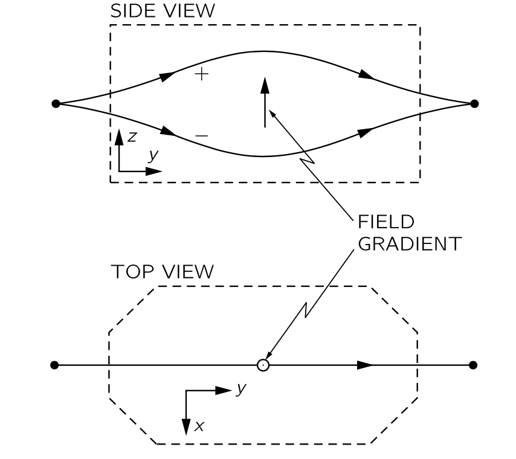{#fig-FLP_3_6_1 width=400}

지난 장에서 설명된 “수정된” 슈테른-게르라흐 장치를 다시 생각하자. 왼쪽에서 들어오는 스핀-$1/2$ 입자 빔은 일반적으로 두 개의 빔으로 나뉜다(@fig-FLP_3_6_1). 이전과 같이, 중간 지점에서 일부 빔을 차단하지 않는 한 다시 모인다. 그림에서는 장의 크기가 증가하는 방향(예를 들어, 날카로운 모서리가 있는 자석 기둥 방향)을 가리키는 화살표를 보였다. 이 화살표는 특정 장치의 "up" 축을 나타낸다. 이는 장치에 대해 고정되어 있으며, 여러 장치를 함께 사용할 때 상대적인 방향을 표시한다. 우리는 또한 각 자석의 자기장 방향이 화살표에 대해 항상 동일하다고 가정한다.

위쪽 빔에 들어가는 원자들은 그 장치에 대해 $(+)$ 상태에 있으며, 아래쪽 빔에 있는 원자들은 $(−)$ 상태에 있다고 하자. 스핀 $1/2$ 입자에서는 $(0)$ 상태는 존재하지 않는다.

이제 @fig-FLP_3_6_2 (a) 와 같이 수정된 슈테른‐게를라흐 장치 두 개를 순서대로 배치한다고 가정해 보자. 첫 번째 $S$ 는 하나의 빔이나 다른 빔을 차단함으로써 순수 $(+S)$ 또는 순수 $(−S)$ 상태를 준비하는 데 사용할 수 있다. 그림에서는 $(+S)$ 를 준비한다. 각 조건마다, $S$ 에서 나오는 입자가 두 번째 장치의 $(+T)$ 또는 $(−T)$ 빔 중 하나에 있어야 하는 진폭이 존재한다. 진폭은 다음 네 가지뿐이다: $(+S) \to (+T)$, $(+S) \to (-T)$, $(-S) \to (+T)$, $(-S) \to (-T)$. 이러한 진폭은 $S$-표현에서 $T$-표현으로 가는 변환 행렬 $R_{ji}$ 의 네 계수에 불과하다. 첫 번째 장치는 하나의 표현에 대한 특정 상태를 준비한다고 볼 수 있으며, 두 번째 장치는 그 상태를 두 번째 표현의 관점에서 분석한다고 볼 수 있다. 그렇다면 우리가 답하고자 하는 질문은 다음과 같다: 만약 원자가 특정 조건—예를 들어 $(+S)$ 상태—장치 $S$ 의 빔 중 하나를 차단하여 준비되었다면, 두 번째 장치 $T$ 를 통과할 확률은 얼마나 되는가? 예를 들어 $(−T)$ 상태로 설정된 경우, 결과는 당연히 두 시스템 $S$ 와 $T$ 사이의 각도에 따라 달라진다.

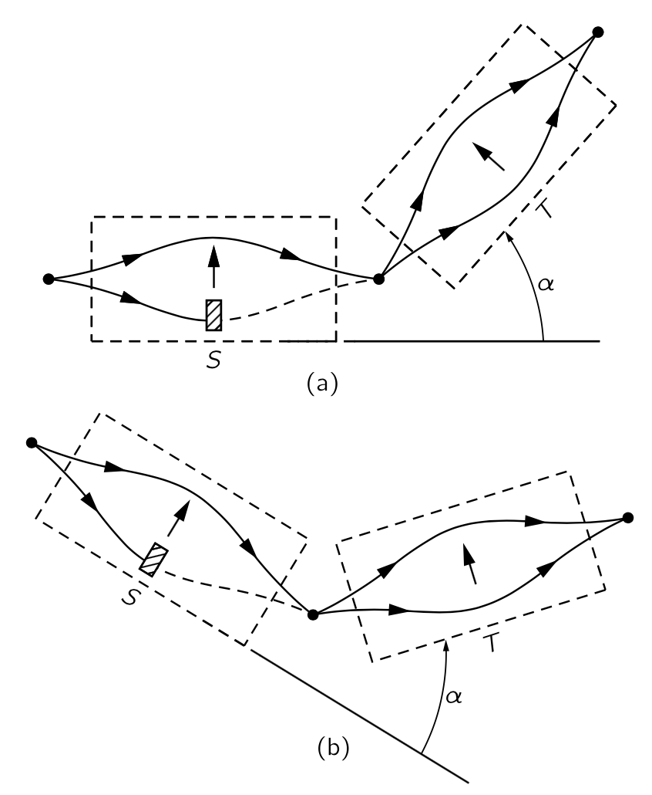{#fig-FLP_3_6_2 width=400}

우리는 왜 연역을 통해 계수 $R_{ji}$ 를 구할 수 있는 희망이 있는지 설명해야 한다. 입자의 스핀이 $+z$ 방향으로 정렬되어 있다면, 그 스핀이 $+x$ 방향을 향하거나 전혀 다른 방향을 가리키는 동일한 입자를 찾을 가능성이 거의 불가능하다는 것을 알고 있다. 사실, 거의 불가능에 가깝지만 완전히는 아니다. 그것은 거의 불가능에 가까워서 오직 하나의 방법만 있을 뿐이며, 그것이 우리가 그 독특한 방법이 무엇인지 알아낼 수 있는 이유이다.

우리가 제시할 수 있는 첫 번째 논증은 이것이다. 예를 들어, @fig-FLP_3_6_2 (a) 와 같은 배치가 있는데, 여기서는 두 장치 $S$ 와 $T$ 가 $S$ 에 대해 각 $\alpha$ 로 배치되고, $(+)$ 빔만 $S$ 를 통과하고 $(−)$ 빔이 $T$ 를 통과하도록 한다. 우리는 $S$ 에서 나오는 입자들이 $T$ 를 통과할 확률에 대해 일정한 수치를 관측하게 된다. 이제 @fig-FLP_3_6_2 (b) 의 장치를 사용하여 또 다른 측정을 수행한다고 하자. $S$ 와 $T$ 의 상대적인 방향은 동일하지만, 전체 시스템은 공간에서 서로 다른 각도에 놓여 있다. 우리는 이 두 실험에서 $S$ 에 대해 순수 상태인 입자가 $T$ 에 대해 특정 상태에 들어갈 확률이 동일하다고 가정한다. 다시 말해, 이러한 종류의 실험의 결과는 전체 장치가 공간에서 어떻게 배치되든 관계없이 동일하고, 물리도 동일하다고 가정한다. (당신은 "그것은 명백하다." 라고 말할 수도 있다.) 하지만 그것은 가정일 뿐이며, 실제로 일어나는 경우에만 "옳다"고 할 수 있다. 즉, 계수 $R_{ji}$ 는 $S$ 와 $T$ 의 공간적 관계에만 의존하고 $S$ 와 $T$ 의 절대적 상황에 의존하지 않는다. 다시 말하면, $R_{ji}$ 는 $S$ 를 $T$ 로 전달하는 회전에만 의존한다는 의미인데, 이는 @fig-FLP_3_6_2 (a) 와 @fig-FLP_3_6_2 (b) 에서 동일한 것은 장치 $S$ 를 장치 $T$ 의 방향으로 운반하는 3차원 회전임이 명백하기 때문이다. 여기서와 같이 변환 행렬 $R_{ji}$ 가 회전에만 의존할 때, 이를 **회전 행렬 (rotation matrix)** 라고 한다.

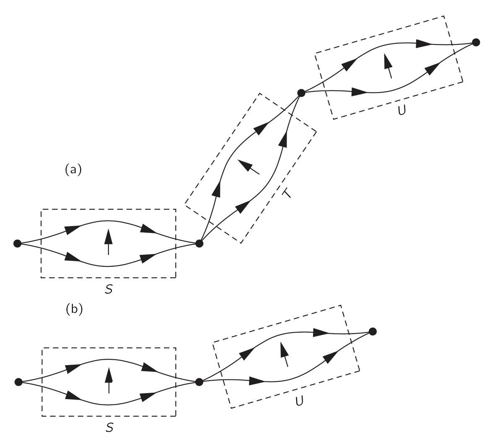{#fig-FLP_3_6_3 width=400}

다음 단계를 위해 추가 정보가 하나 더 필요하다. 예를 들어, @fig-FLP_3_6_3 (a) 와 같이 임의의 각도에서 $T$ 뒤에 설치된 제3의 장치 $U$ 를 추가한다. (이제 보기엔 끔찍해 보이지만, 그것이 추상적 사고의 재미이다—선만 그리면 가장 기이한 실험을 할 수 있다!) 그렇다면 $S \to T \to U$ 변환은 무엇인가? 우리가 실제로 묻고자 하는 것은 $S$ 에서 $T$ 로, 그리고 $T$ 에서 $U$ 로의 변환을 알고 있을 때, $S$ 에 대한 어떤 상태에서 $U$ 에 대한 다른 상태로 변하는 진폭이다. 우리는 $T$ 의 두 채널이 모두 열려 있는 실험에 대해 질문하고 있다. @eq-FLP_3_6_5 를 연속으로 두 번 적용하면 답을 얻을 수 있다. $S$-표현에서 $T$-표현으로 가기 위해

$$
C'_j = \sum_{i}R^{TS}_{ji}C_i,
$$ {#eq-FLP_3_6_6}

여기서 $R$ 에 위첨자 $TS$ 를 넣어 $T$ 에서 $U$ 로 갈 때의 계수 $R^{UT}$ 와 구별할 수 있도록 한다.

진폭 $C''_k$ 이 $U$-표현의 기저 상태에 대한 것이라고 하면, 이를 $T$-진폭에 대해 @eq-FLP_3_6_5 를 사용하여 연관시킬 수 있다. 

$$
C''_k = \sum_j R^{UT}_{kj}C'_j.
$$ {#eq-FLP_3_6_7}

이제 @eq-FLP_3_6_6 과 @eq-FLP_3_6_7 를 결합하여 $S$ 에서 $U$ 로의 직접 변환을 얻을 수 있다. @eq-FLP_3_6_7 의 $C'_j$ @eq-FLP_3_6_6  로 대체하면

$$
C''_k = \sum_j R^{UT}_{kj}\sum_i R^{TS}_{ji}C_i.
$$ {#eq-FLP_3_6_8}

$i$ 가 $R^{UT}_{kj}$ 에 나타나지 않기 때문에, $\sum_i$ 를 앞으로 배치하면 

$$
C''_k = \sum_i \sum_j R^{UT}_{kj}R^{TS}_{ji}C_i.
$$ {#eq-FLP_3_6_9}

이것은 이중 변환에 대한 식이다.

$T$ 에 있는 모든 빔이 차단되지 않도록 했으므로 $T$ 에서 나오는 상태는 들어갔을 때와 동일하다. 우리는 $S$-표현을 직접 $U$-표현으로 변환하는 것과 마찬가지로 할 수 있을 것이다. @fig-FLP_3_6_3 (b) 와 같이 $U$ 장치를 $S$ 바로 뒤에 배치하는 것과 동일해야 한다. 그 경우라면, 

$$
C''_k= \sum_i R^{US}_{ki}C_i,
$$ {#eq-FLP_3_6_10}

이 변환에 속하는 $R^{US}_{ki}$ 계수와 함께. 이제 분명히 @eq-FLP_3_6_9 와 @eq-FLP_3_6_10 은 동일한 진폭 $C''_k$ 을 제겅해야하며, 이는 원래 상태 $\phi$ 가 진폭 $C_i$ 를 제공했는지에 관계없이 사실이어야 한다. 그렇다면 

$$
R^{US}_{ki}=\sum_j R^{UT}_{kj}R^{TS}_{ji}.
$$ {#eq-FLP_3_6_11} 

다시 말해, 임의의 기준 기저 회전 $S\to U$ 는 두 개의 연속 회전 $S \to T$ 와 $T \to U$ 의 합성으로 간주되며, 두 부분 회전의 행렬로부터 회전 행렬 $R^{US}_{ki}$ 를 @eq-FLP_3_6_11 로부터 얻을 수 있다. 원하시면 @eq-FLP_3_6_1 로부터 @eq-FLP_3_6_11 를 구할 수 있다. 이는 $\langle kU|iS\rangle = \sum_j \langle kU|jT\rangle \langle jT|iS\rangle$ 에 대한 다른 표현일 뿐이다.

엄밀하게 하려면 추가적인 수정이 필요하다. 우리가 말한 내용은 정확하지 않다. 우리는 실제로 @eq-FLP_3_6_9 와 @eq-FLP_3_6_10 이 정확히 동일한 진폭을 가져야 한다고 말할 수 없으며 물리학만이 동일해야 한다. 모든 진폭은 $e^{i\delta}$ 와 같은 일반적인 위상 계수에 의해 달라질 수 있으며, 이것은 실제 세계에 대한 계산 결과를 변경하지 않는다. 따라서, @eq-FLP_3_6_11 대신에 우리가 정말 말할 수 있는 전부는

$$
e^{i\delta}R^{US}_{ki} = \sum_j R^{UT}_{kj}R^{TS}_{ji},
$$ {#eq-FLP_3_6_12}

이다. 여기서 $\delta$ 는 실수인 상수이다. 물론 $e^{i\delta}$ 가 의미하는 바는, 행렬 $R^{US}$ 를 사용할 경우 얻는 진폭이 두 회전인 $R^{UT}$ 와 $R^{TS}$ 를 사용할 때 얻는 진폭과 동일한 위상($e^{−i\delta}$) 만큼 모두 다를 수 있다는 것이다. 우리는 모든 진폭이 같은 위상으로 변해도 상관없다는 것을 알고 있으므로, 원한다면 이 위상 요인을 무시할 수 있다. 그러나 모든 회전 행렬을 특정한 방식으로 정의하면, 이 추가적인 위상 인자는 결코 나타나지 않을 것이다. 즉 @eq-FLP_3_6_12 의 $\delta$ 는 항상 0이 된다. 비록 이것이 나머지 논증에 대해서는 중요하지 않지만, 우리는 행렬식(determinant)에 관한 수학 정리를 사용하여 빠른 증명을 제시할 수 있다. 아직 행렬식에 대해 잘 모른다면, 증명에 대해 걱정하지 말고 그냥 @eq-FLP_3_6_15 의 정의로 넘어가도 된다.

먼저, @eq-FLP_3_6_11 은 두 행렬의 “곱”에 대한 수학적 정의이다. 둘째, 두 행렬의 곱의 행렬식은 두 행렬 각각의 행렬식의 곱이다. 이 정리를 @eq-FLP_3_6_12 에 적용하면

$$
e^{i2\delta}\left[\det \left(R^{US}\right)\right]=\left[\det\left(R^{UT}\right)\right]\cdot \left[\det \left(R^{TS}\right)\right].
$$ {#eq-FLP_3_6_13}

이제  @eq-FLP_3_6_12 를 @eq-FLP_3_6_13 의 제곱근으로 나누면

$$
\dfrac{R^{US}_{ki}}{\sqrt{\det (R^{US})}} =\sum_j \dfrac{R^{UT}_{kj}}{\sqrt{\det(R^{UT})}} \dfrac{R^{TS}_{ji}}{\sqrt{\det (R^{TS})}}.
$$ {#eq-FLP_3_6_14}

추가적인 위상 인자가 사라졌다.

이제 밝혀진 바에 따르면, 주어진 표현에서 모든 진폭을 정규화하고자 한다면($\sum_i\langle \phi |i\rangle \langle i|\phi\rangle = 1$), 회전 행렬의 행렬식은 모두 $e^{i\alpha}$ 형태이다. 따라서 원한다면, 모든 회전 행렬 $R$ 을 고유한 위상으로 만들기 위해 $\det(R)=1$ 로 만들 수 있다. 임의의 방식으로 회전 행렬 $R$ 을 구한다고 하자. 다음과 같이 **표준 형태 (standard form)** 를 정의 할 수 있다.

$$
R_\text{standard} := \dfrac{R}{\sqrt{\det (R)}}.
$$ {#eq-FLP_3_6_15}

 $R$ 의 각 항에 동일한 위상 계수를 곱하면 원하는 위상을 얻을 수 있기 때문에 이렇게 할 수 있다. 다음에서는 우리 행렬이 표준 형태로 설정되었다고 항상 가정한다. 그러면 추가적인 위상 인자 없이 @eq-FLP_3_6_11 을 사용할 수 있다.

### $\mathrm{III}$.6–3 $z$ 축에 대한 회전 {#sec-FLP_3_6_3}

우리는 이제 두 개의 서로 다른 표현 사이에서 변환 행렬 $R_{ji}$ 를 찾을 준비가 되었다. 복합 회전 규칙과 공간에 선호되는 방향이 없다는 가정은 임의의 회전 행렬을 찾는 데 필요한 열쇠이다. 해결책은 하나 뿐. 우리는 $z$ 축을 중심으로 회전하는 변환부터 시작한다. @fig-FLP_3_6_4 (a) 에 표시된 바와 같이, 축이 평행하고 화면을 향하도록 직선으로 직렬로 배치된 두 장치 $S$ 와 $T$ 가 있다고 하자. 우리는 $z$-축을 이 방향으로 잡는다. 확실히, $S$ 장치에서 빔이 위쪽($+z$ 방향으로) 이동한다면, $T$ 장치에서도 동일하게 될 것이다. 마찬가지로, $S$ 에서 내려가면 $T$ 에서도 내려간다. 그러나 @fig-FLP_3_6_4 (b) 처럼 $T$ 장치를 다른 각도에 배치했지만 여전히 축이 $S$ 축에 평행하도록 배치했다고 하자. 직관적으로, $S$ 의 $(+)$ 빔이 $T$ 의 $(+)$ 빔과 여전히 함께 갈 것이라고 말할 수 있다, 왜냐하면 장과 장 기울기가 여전히 같은 물리적 방향에 있기 때문이다. 그리고 그것은 꽤 옳다. 또한, $S$ 의 $(−)$ 빔은 여전히 $T$ 의 $(−)$ 빔으로 들어간다. 동일한 결과는 $S$ 의 $xy$ 면에서 $T$ 의 모든 방향에 적용된다. 이것이 $C'_+ = \langle +T|\psi\rangle$, $C'_- =\langle −T| \psi\rangle$, $C_+=\langle +S|\psi\rangle$, $C_-= \langle -S|\psi \rangle$ 사이의 관계에 대해 우리에게 무엇을 알려 주는가? 당신은 기저 상태에 대한 관성기준틀을 $z$ 축을 중심으로 회전하면 진폭이 이전과 동일하게 "위"와 "아래"가 될 것이라고 결론지을 수 있다. 우리는 $C'_+= C_+$ 와 $C'_-=C_-$ 라고 쓸 수 있지만, 그것은 잘못되었다. 우리가 결론지을 수 있는 것은 이러한 회전에 대해 "up" 빔에 있을 확률이 $S$ 와 $T$ 장치에 대해 동일하다는 것이다. 즉,

$$
|C'_+|= |C_+| \qquad \text{and} \qquad |C'_-|=|C_-|.
$$

우리는 @fig-FLP_3_6_4 의 (a) 와 (b) 에 있는 두 가지 다른 방향에 대해 $T$ 장치의 진폭의 위상이 다르지 않다고 말할 수 없다.

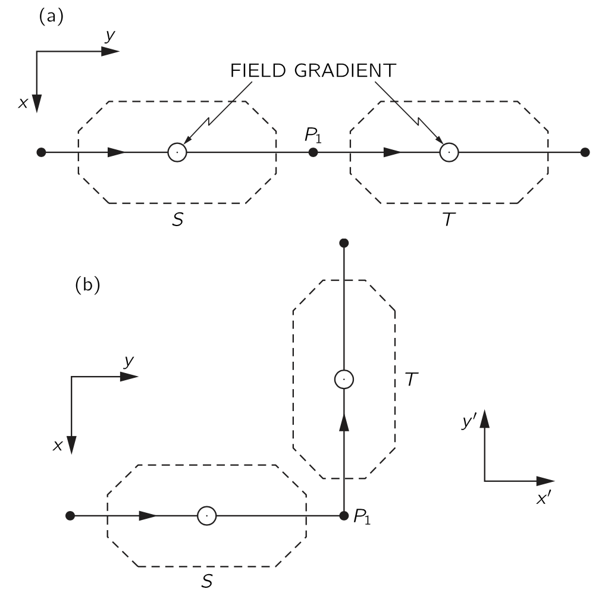{#fig-FLP_3_6_4 width=300}

@fig-FLP_3_6_4 의 (a) 와 (b) 에 있는 두 장치가 실제로 다르다는 것을 다음과 같이 확인할 수 있다. $S$ 앞에 순수 $(+x)$ 상태를 생성하는 장치를 놓았다고 하자. ($x$ 축은 그림의 아래쪽을 가리킨다.) 이러한 입자들은 $S$ 에서 $(+z)$ 와 $(−z)$ 빔으로 분할되지만, 두 빔은 다시 결합되어 $P_1$ ($S$ 의 출구) 에서 다시 $(+x)$ 상태를 형성한다. @fig-FLP_3_6_5 (a) 와 같이 $T$ 다음에 장치의 축이 $(+x)$ 방향인 세번째 장치 $U$ 를 놓자. 이제 $T$ 와 $U$ 를 $90^\circ$ 정도 함께 회전시켜 @fig-FLP_3_6_5 (b) 와 같이 하면 어떤 일이 일어나는지 상상해 보자. 다시 말하지만, $T$ 장치는 들어오는 것을 그대로 출력하므로, $U$ 에 들어가는 입자들은 $S$ 에 대해 $(+x)$ 상태에 있다. 하지만 $U$ 는 이제 $S$ 에 대한 $(+y)$ 상태를 분석하고 있으며, 이는 다르다. (대칭에 따라, 이제 우리는 입자의 절반만이 $U$ 의 $(+)$ 빔에 들어갈 것으로 예상한다.)

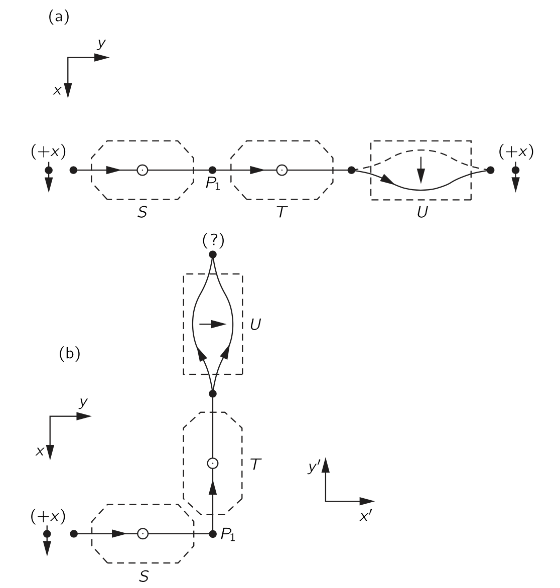{#fig-FLP_3_6_5 width=400}

무엇이 바뀌었을까? 장치 $T$ 와 $U$ 는 여전히 서로 동일한 물리적 관계에 있다. $T$ 와 $U$ 가 다른 방향에 있다는 이유만으로 물리학을 바꿀 수 있는가? 우리의 원래 가정은 그것이 그렇게 해서는 안 된다는 것이다. @fig-FLP_3_6_5 에 표시된 두 경우에서 $T$ 에 대한 진폭이 서로 달라야 하며, 따라서 @fig-FLP_3_6_4 에서도 마찬가지이다. 입자가 $P_1$ 에서 전환점을 알 수 있는 방법이 반드시 있을 것이다. 어떻게 알 수 있나? 음, 우리가 결정한 것은 $C'_+$ 와 $C_+$ 의 크기가 두 경우 모두 동일하지만, 실제로는 서로 다른 위상을 가질 수 있다는 것이다. 우리는 $C'_+$ 와 $C_+$ 가 다음 관계에 있어야 한다는 결론을 내린다.

$$
C'_+ = e^{i\lambda} C_+.
$$

그리고 $C'_−$ 와 $C_−$ 는 다음 관계를 가진다.

$$
C'_− = e^{i\mu} C_−
$$

여기서 $\lambda$ 와 $\mu$ 는 실수이며, $S$ 와 $T$ 사이의 각도와 어떤 식으로는 관련이 있어야 한다.

현재 우리가 $\mu$ 와 $\mu$ 에 대해 말할 수 있는 유일한 것은 두 값이 동일해서는 안 된다는 것이다(단, @fig-FLP_3_6_5 (a) 에 표시된 $T$ 와 $S$ 가 같은 방향인 특수한 경우를 제외하고). 우리는 모든 진폭에서 동일한 위상 변화가 물리적인 결과를 초래하지 않는다는 것을 확인했다. 같은 이유로, 우리는 언제든지 $\lambda$ 와 $\mu$ 모두에 동일한 임의의 양을 아무 것도 바꾸지 않고 더할 수 있다. 따라서 우리는 $\lambda$ 와 $\mu$ 를 같은 수의 플러스와 마이너스로 만들도록 선택할 수 있다. 즉, 우리는 언제든지 

$$
\lambda' = \lambda  − \dfrac{\lambda + \mu}{2},\qquad \mu' = \mu - \dfrac{\lambda + \mu}{2}.
$$

라고 놓을 수 있으며, 이경우

$$
\lambda' = \dfrac{\lambda - \mu}{2} = -\mu'.
$$

따라서 우리는 $\mu =−\lambda$ 라는 관례를 채택한다$^1$. 그렇다면 기준 장치를 $z$ 축을 중심으로 어느 각도로 회전할 경우, 변환은 [$^1$ 다른 방식으로 보면, 우리는 @eq-FLP_3_6_15 를 사용하여 [$\mathrm{III}$.6.2 회전된 좌표계로의 변환](#sec-FLP_3_6_2)에 설명된 “표준 형태”에 변환을 넣고 있다.]{.aside}

$$
C'_+ = e^{+i\lambda}C_+,\qquad C'_− = e^{−i\lambda}C_−.
$$ {#eq-FLP_3_6_16}

절대값은 동일하고, 위상만 다르다. 이러한 위상 인자은 @fig-FLP_3_6_5 의 두 실험에서 서로 다른 결과를 초래하는 원인이다.

이제 우리는 $\lambda$ 와 $S$ 와 $T$ 사이의 각을 연관시키는 법칙을 알아야 한다. 우리는 이미 한 경우에 대한 답을 알고 있다. 각이 $0$ 이면 $\lambda = 0$ 이다. 이제 우리는 위상 이동 $\lambda$ 가 $S$ 와 $T$ 사이의 각도 $\phi$ 의 함수이며 $\phi$ 가 $0$ 이 될 때 연속이라고 가정한다(@fig-FLP_3_6_4 참조). 다시 말해, 직선에서 $S$ 를 통과하는 작은 각 $\epsilon$ 만큼 $T$ 를 회전시키면, $\lambda$ 도 작은 양이며, 어떤 수 $m$ 에 대해 $m\epsilon$ 이라고 하자. 우리는 $\lambda$ 가 $\epsilon$ 에 비례한다는 것을 증명할 수 있다. 예를 들어, $T$ 뒤에 또 다른 장치 $T'$ 를 배치하되 각 $T$ 와의 각이 $\epsilon$ 이 되도록 하자. 즉 $S$ 와 $2\epsilon$ 의 각을 이룬다. 그렇다면 $T$ 에 대해

$$
C'_+ = e^{i\lambda}C_+
$$

이며 $T'$ 에 대해서는

$$
C''_+ =e^{i\lambda}C'_+ = e^{i2\lambda} C_+
$$

이다. 하지만 우리는 $S$ 바로 뒤에 $T'$ 를 붙이면 같은 결과가 나올 것이라는 것을 알고 있다. 따라서 각도가 두 배가 되면 위상도 두 배가 된다. 이 논증을 확장하면 무한소 회전의 연속을 통해 모든 회전을 구현할 수 있다. 모든 각 $\phi$ 에 대해 $\lambda$ 가 $\phi$ 에 비례한다는 결론을 내릴 수있다. 따라서 $\lambda =m\phi$. 

우리가 얻는 일반적인 결과 : $S$ 에 대해 각도 $z$ 축을 중심으로 각도 $\phi$ 만큼 회전한 $T$ 에 대해

$$
C'_+ = e^{im\phi} C_+, \qquad C'_− = e^{−im\phi} C_−.
$$ {#eq-FLP_3_6_17}

이 $\phi$ 와 앞으로 언급할 모든 회전에 대해, 기준축의 양의 방향을 기준으로 하는 오른쪽 회전을 양의 회전으로 간주하는 표준적인 관례를 따르도록 하자. 양의 $\phi$ 는 양의 $z$ 방향으로 전진하는 오른손잡이 나사의 회전을 생각하자.

이제 우리는 $m$ 이 무엇인지 찾아야 한다. 먼저, 다음 주장을 시도해 볼 수 있습니다: $T$ 가 $360^\circ$ 만큼 회전한다면 명확히 $0^\circ$ 로 정확히 되돌릴 수 있으며, $C'_+=C_+$ 이고 $C'_−=C_−$ 이다. 즉 $e^{im2π}=1$ 이 된다. 우리는 $m=1$ 을 얻는다. 그러나 이 주장은 틀렸다! 그것을 확인하려면, $T$ 의 $180^\circ$ 회전을 생각하자. 만약 $m=1$ 이라면, $C'_+= e^{i\pi}C_+= −C_+$ 이며 $C'_−= e^{−i\pi}C_− = −C_−$ 가 된다. 하지만, 이것은 다시 원래 상태일 뿐이다. 두 진폭은 단순히 $−1$ 을 곱하면 원래 물리 시스템을 복원한다. (다시 한 번 일반적인 위상 변화의 경우이다.) 이는 @fig-FLP_3_6_5 (b) 에서 $T$ 와 $S$ 사이의 각도를 $180^\circ$ 로 증가시킬 경우, $T$ 에 대한 시스템이 $0^circ$ 상황과 구별되지 않으며, 입자들이 다시 $U$ 장치의 $(+)$ 상태를 통과하게 됨을 의미한다. 그러나 $180^\circ$ 에서 $U$ 장치의 $(+)$ 상태는 원래 $S$ 장치의 $(−x)$ 상태와 같다. 따라서 $(+x)$ 상태는 $(−x)$ 상태가 된다. 하지만 우리는 원래 상태를 바꾸기 위해 아무것도 하지 않았으며, 답은 틀렸습니다. $m\ne 1$ 이다.

우리는 $360^\circ$ 회전과 더 작은 각도가 동일한 물리적 상태를 재현하지 않는 상황을 가져야 한다. $m=\frac{1}{2}$ 인 경우에 이 현상이 발생한다. 그때에야, 그리고 그때에만, 동일한 물리적 상태를 재현하는 첫 번째 각은 $\phi=360^\circ$ 가 된다.$^2$ 그것은 [$^2$ $m=−\frac{1}{2}$ 도 가능한 것처럼 보인다. 그러나 @eq-FLP_3_6_17 에서 부호의 변화가 단순히 스핀-업 입자에 대한 표기법을 재정의한다는 것을 알 수 있다.]{.aside}

$$
\left.\begin{array}{c} C'_+ = -C_+ \\ C'_- = -C_- \end{array}\right\} {z\text{ 축에 대해 }360^\circ \text{ 회전}}.
$$

장치를 $360^\circ$ 회전하면 새로운 진폭을 얻는다는 것이 매우 흥미롭다. 하지만 그것들은 실제로 새롭지는 않다, 왜냐하면 일반적인 부호 변화가 다른 물리학을 제공하지 않기 때문이다. 다른 사람이 $360^\circ$ 를 돌렸다고 생각해서 진폭의 모든 부호를 바꾸기로 결정했다면 괜찮다; 동일한 물리학을 얻게 된다$^3$. 따라서 우리의 최종 답은 스핀 $1/2$ 입자에 대한 진폭 $C_+$ 와 $C_−$ 를 기준계 $S$ 에 대해 알고, $z$ 축을 중심으로 $\phi$ 만큼 회전시켜 얻은 $T$ 라는 기본 시스템을 사용한다면, 새로운 진폭은 기존의 아래 식에 의해 주어진다는 것이다$^3$.[$^3$ 또한, 어떤 것이 작은 회전 연속에 의해 회전되어 그 결과가 원래 방향으로 되돌아가게 된다면, 전체 역사를 기록해 두셨다면, 그것이 $360^circ$ 회전했다는 개념을 정의할 수 있다—순 회전이 전혀 없는 경우와는 구별된다. (흥미롭게도, 순 회전이 $720^\circ$ 인 경우 이는 사실이 아니다.)]{.aside}

$$
\left.\begin{array}{c} C'_+ = e^{i\phi/2} C_+ \\ C'_- = e^{-i\phi/2}C_- \end{array}\right\} {z\text{ 축에 대해 }360^\circ \text{ 회전}}.
$$ {#eq-FLP_3_6_19}

