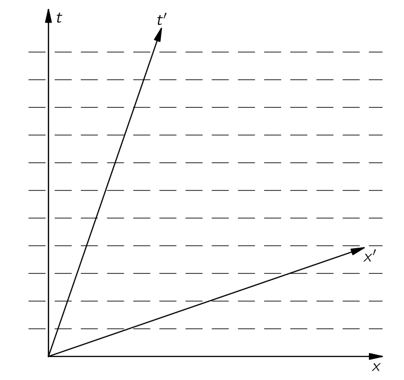
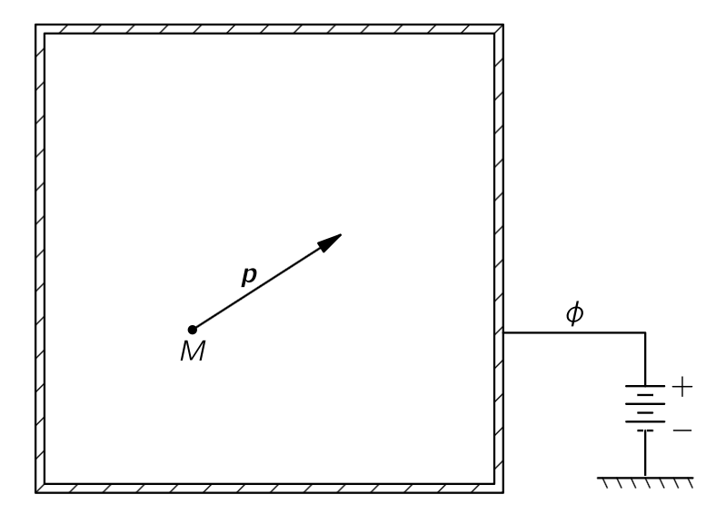
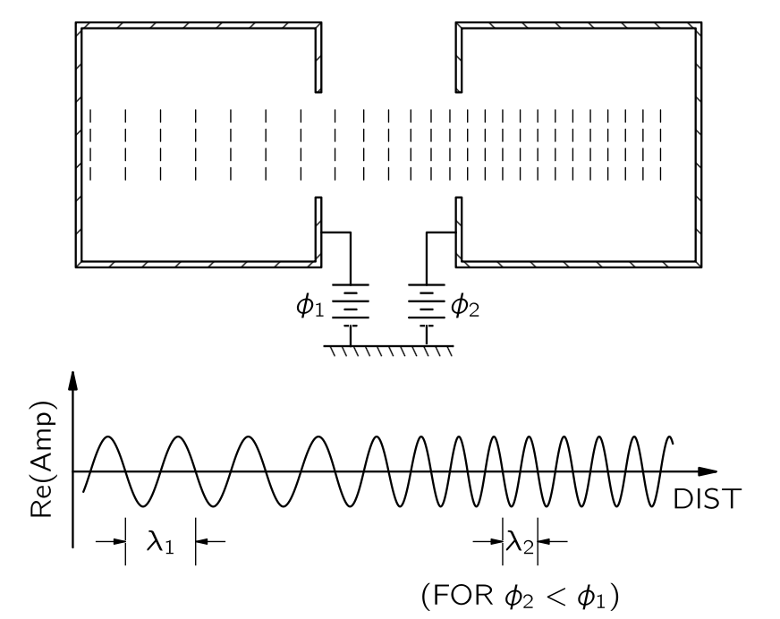
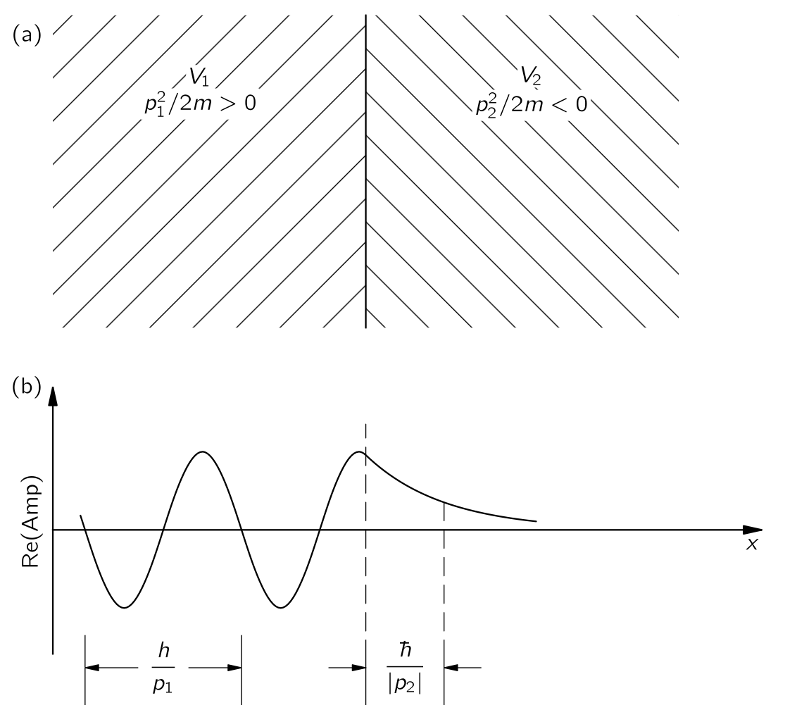
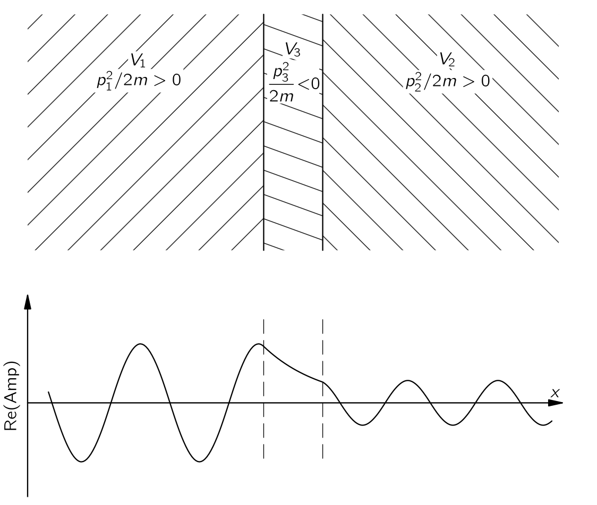
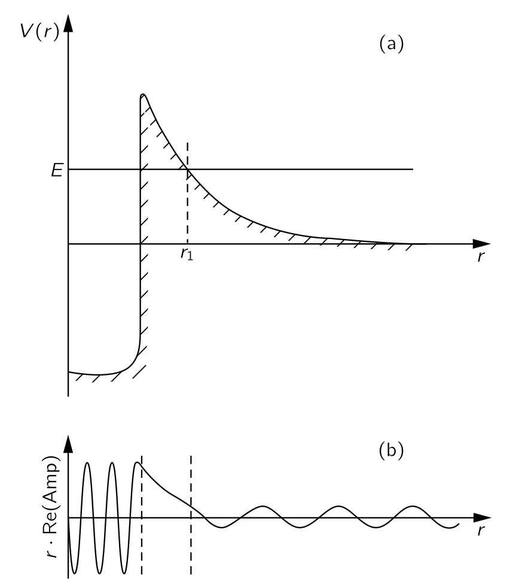
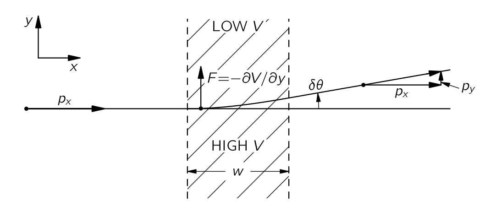
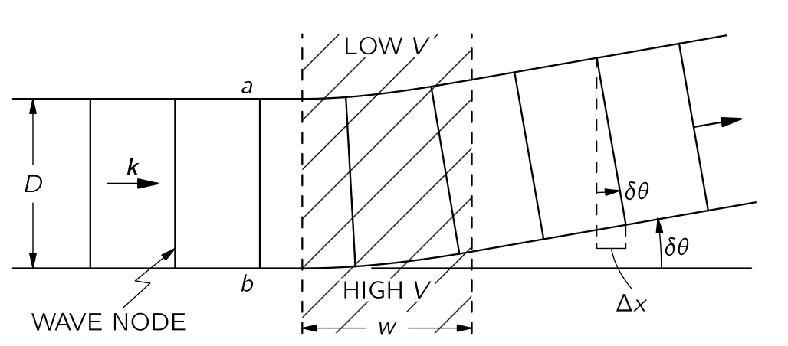
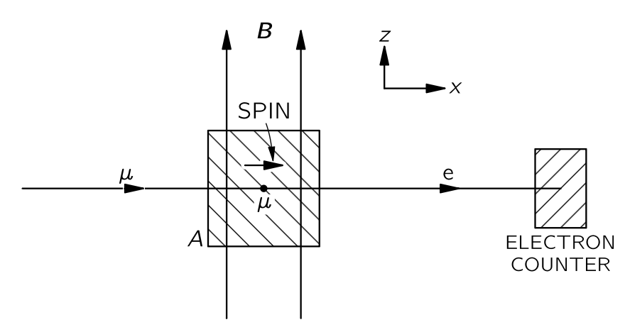

 

## $\mathrm{III}$.7 진폭의 시간의존성 {#sec-FLP_3_7}

### $\mathrm{III}$.7–1 정지 상태의 원자 {#sec-FLP_3_7_1}

#### **사전 주의 사항**

이제 확률 진폭의 시간에 대한 거동에 대해 약간 이야기하고자 한다. "약간". 왜냐하면 실제 시간 행동은 공간에서의 행동과도 필연적으로 관련되기 때문이다. 따라서, 우리가 그것을 정확하고 상세하게 수행한다면 즉시 가장 복잡한 상황에 들어가게 된다. 우리는 언제나 논리적으로 엄밀하지만 상당히 추상적인 방식으로 무언가를 다루거나, 전혀 엄격하지 않지만 실제 상황에 대한 어느 정도의 아이디어를 제공하는 일만 할 수 있는 어려움에 처해 있다. 보다 신중한 처리는 이후로 미룬다. 에너지 의존과 관련하여, 우리는 두 번째 과정으로 진행하겠다. 우리는 여러 진술을 할 것이다. 우리는 엄밀하게 하려 하지 않으며, 단지 밝혀진 사실들을 알려주고, 시간에 따른 진폭의 거동에 대한 감각을 보여준다. 진행에 따라 설명의 정밀도가 높아지므로, 우리가 허공에서 무언가를 골라내는 것처럼 보인다고 해서 긴장하지 말길 바란다. 물론, 그것은 모두 허공에서 벗어나는 것이다. 실험실과 상상력의 허공. 하지만 역사적 발전을 검토하는 데 너무 오래 걸릴 것이므로, 우리는 그 중간 어딘가에 뛰어들어야 한다. 우리는 추상적인 것에 뛰어들어 모든 것을 추론할 수 있지만 이는 당신이 이해하지 못할 것이다. 또는 각 진술을 정당화하기 위해 수많은 실험을 진행할 수도 있다. 우리는 그 사이에 무언가를 선택한다.

빈 공간에 있는 전자는 특정 상황에서 특정한 정해진 에너지를 가질 수 있다. 예를 들어, 그것이 정지해 있는 경우(즉, 병진운동도 없고, 운동에너지도 없다), 정지 에너지를 가지고 있다. 원자와 같은 보다 복잡한 물체는 정지해 있을 때도 일정한 에너지를 가질 수 있지만, 내부적으로 다른 에너지 수준으로 들뜰 수도 있다. (우리는 나중에 이것의 메카니즘에 대해 설명한다.) 우리는 종종 들뜬 상태에 있는 원자가 일정한 에너지를 가지고 있다고 생각할 수 있지만, 실제로는 대략적으로만 사실이다. 원자는 전자기장과의 상호작용을 통해 에너지를 방출할 수 있기 때문에 영원히 들뜬 상태를 유지하지 못한다. 따라서 새로운 상태가 생성되는 진폭이 존재한다. 원자는 낮은 상태에, 전자기장은 높은 상태의 들뜬 상태에 있습니다. 시스템의 총 에너지는 전후가 동일하지만, 원자의 에너지는 감소한다. **따라서 들뜬 원자가 일정한 에너지를 가진다고 말하는 것은 정확하지 않지만, 그렇게 말하는 것이 종종 편리하고 크게 틀리지 않을 것이다.**

그런데, 왜 한 방향으로만 가고 다른 방향으로는 가지 않는 걸까? 왜 원자는 빛을 방출하나? 답은 엔트로피와 관련이 있다. 에너지가 전자기장에 있을 때, 그것이 존재할 수 있는 다양한 방식이 존재하고, 이동할 수 있는 다양한 위치도 매우 많으며, 평형 조건을 찾아보면 가장 가능성이 높은 상황에서는 장이 광자에 의해 여기되고 원자가 이완(de-excited)된다는 것을 알 수 있다. 광자가 다시 돌아와서 원자를 다시 들뜨게 할 수 있다는 것을 발견하는 데는 매우 오랜 시간이 걸린다. 이는 고전적인 문제와 상당히 유사하다: 왜 가속하는 전하는 복사하는가? 그것이 에너지를 잃고 싶어한다는 것이 아니라, 실제로 그것이 방출될 때 세계의 에너지는 이전과 동일하다. 복사 또는 흡수는 엔트로피가 증가하는 방향으로 진행된다.

핵은 또한 다양한 에너지 준위에서 존재할 수 있으며, 전자기 효과를 배제한 근사법에서는 들뜬 상태에 있는 핵이 그곳에 머무른다고 말할 수 있다. 비록 그것이 영원히 지속되지 않는다는 것을 알고 있지만, 다소 이상화되고 생각하기 쉬운 근사값으로 시작하는 것이 종종 유용하다. 또한 특정 상황에서는 종종 정당한 근사값이 된다. (우리가 처음 낙하하는 물체의 고전 법칙을 도입했을 때는 마찰을 포함하지 않았지만, 마찰이 전혀 없는 경우는 거의 없는것과 마찬가지다.)

그렇다면 다양한 질량을 가진 아원자의 이상한 입자가 있다. 하지만 무거운 것들은 다른 빛 입자로 분해되므로, 다시 말해 그것들이 정확히 정의된 에너지를 가지고 있다고 말하는 것은 옳지 않다. 그것은 그들이 영원히 지속될 경우에만 사실일 것이다. 따라서 그들이 일정한 에너지를 가지고 있다고 근사하면, 우리는 그들이 폭발해야 한다는 사실을 잊고 있는 것이다. 우선, 우리는 그러한 과정을 의도적으로 잊고 나중에 이를 고려하는 방법을 배우겠다.

#### **정지 입자의 진폭**

원자—또는 전자, 혹은 모든 입자—가 정지 상태일 때 일정한 에너지 $E_0$ 를 가진다고 하자. 에너지 $E_0$ 는 전체의 질량에 $c^2$ 를 곱한 것을 의미한다. 이 질량은 모든 내부 에너지를 포함하고 있으므로, 들뜬 원자는 같은 원자의 질량과 다른 질량을 가진다. 이제 $E_0$ 를 **정지 에너지 (energy at rest)** 라고 한다.

정지 상태의 원자에 대해, 원자를 한 장소에서 찾기 위한 양자역학적 진폭은 모든 곳에서 동일하며, 위치에 의존하지 않는다. 이는 물론, 어디에서든 원자를 찾을 확률이 동일함을 의미한다. 하지만 그것은 더 많은 의미를 가진다. 확률은 위치와 무관할 수 있으며, 여전히 진폭의 위상은 점마다 달라질 수 있다. 하지만 정지된 입자에 대해서는 전체 진폭이 모든 곳에서 동일하다. 하지만 시간에 따라 달라진다. 입자가 일정한 에너지 $E_0$ 상태에 있을 때, $(x,y,z)$ 위치에서 시간 $t$ 에 입자를 찾는 진폭은

$$
ae^{−i(E_0/\hbar)t}.
$$ {#eq-FLP_3_7_1}

여기서 $a$ 는 어떤 상수이다. 공간의 어느 지점에서든 진폭은 모든 점에서 동일하지만, @eq-FLP_3_7_1 에 따라 시간에 의존한다. 우리는 이 규칙을 단순히 사실이라고 가정한다. @eq-FLP_3_7_1 을 다음과 같이 쓸 수 있다.

$$
ae^{−i\omega t}, \qquad \text{where } \omega = E_0/\hbar = Mc^2/\hbar.
$$ {#eq-FLP_3_7_2}

여기서 $M$ 은 원자 또는 입자의 질량이다. 에너지를 지정하는 방법은 세 가지가 있다: 진폭의 주파수, 고전적 의미의 에너지, 혹은 관성입니다. 그것들은 모두 동등하며, 단지 같은 말을 표현하는 다른 방식일 뿐이다.

전체 공간에 걸쳐 동일한 진폭을 가진 "입자" 가 매우 이상하다고 생각할 수도 있다. 우리는 보통 "입자"를 "어디"에 위치한 작은 물체로 상상합니다. 하지만 불확정성 원칙!!!. 입자가 일정한 에너지를 가지고 있다면, 그 입자는 또한 일정한 운동량을 가지고 있다. 운동량에 대한 불확실성이 $0$ 이면, 불확정성 관계인 $\delta p \delta x=\hbar$ 는 해당 위치의 불확실성이 무한해야 함을 알려준다. 이는 우리가 공간의 모든 지점에서 입자를 찾기 위한 동일한 진폭을 가진다고 말할 때 바로 그 의미이다.

원자의 내부 부분이 서로 다른 상태에 있고 전체 에너지가 다르면, 시간에 따른 진폭의 변동은 달라진다. 만약 그것이 어느 상태에 있는지 모른다면, 한 상태에 있을 때 일정한 진폭이 존재하고 다른 상태에 있을 때 역시 일정한 진폭이 존재하게 되며, 각각의 진폭은 서로 다른 진동수를 갖게 된다. 이러한 서로 다른 구성 요소들 사이에 간섭(예를 들어 비트 노트와 같이)이 발생할 수 있으며, 이는 변동 가능한 확률로 나타날 수 있다. 비록 그 원자는 질량 중심이 떠다니지 않고 있다는 의미에서 “정지” 상태에 있더라도 원자 내부에서 무언가가 “일어나고” 있을 것이다. 그러나 원자가 하나의 일정한 에너지를 가지고 있다면, 진폭은 @eq-FLP_3_7_1 로 주어지며, 이 진폭의 절대 제곱은 시간에 따라 달라지지 않는다. 보시다시피, 어떤 사물이 일정한 에너지를 가지고 있고 그에 대해 어떤 확률적 질문을 하면 그 답은 시간에 의존하지 않는다. 진폭은 시간에 따라 변하지만, 에너지가 확정된 경우 허수 지수로 변하며 절대값은 변하지 않는다.

**그렇기 때문에 우리는 종종 일정한 에너지 준위의 원자가 정지 상태에 있다고 말한다.** 내부의 사물에 대해 어떤 측정을 하면, 시간이 지나면서 아무것도 변하지 않을 것임을 (확률적으로) 알게 될 것이다. 시간에 따라 확률이 변하기 위해서는 서로 다른 두 주파수에서 두 진폭의 간섭이 발생해야 하며, 이는 에너지가 무엇인지 알 수 없다는 것을 의미한다. 그 물체는 하나의 에너지 상태에 있는 하나의 진폭과 다른 에너지 상태에 있는 또 다른 진폭을 갖게 된다. 그것은 그 행동이 시간에 따라 달라지는 것에 대한 양자역학적 설명이다.

만약 서로 다른 에너지를 가진 두 개의 서로 다른 상태가 혼합된 “조건”이 있다면, 두 상태 각각의 진폭은 @eq-FLP_3_7_2 에 따라 시간에 대해 변한다. 즉,

$$
e^{−i(E_1/\hbar)t}, \qquad \text{and} \qquad e^{−i(E_2/\hbar)t}.
$$ {#eq-FLP_3_7_3}

그리고 두 가지가 결합된 경우, 간섭이 발생한다. 하지만 두 에너지에 상수를 더하면 차이가 없다는 점을 주목하라. 다른 사람이 모든 에너지가 일정한 양, 예를 들어 $A$ 만큼 증가(또는 감소)되는 다른 에너지 스케일을 사용한다면, 그의 관점에서 두 상태의 진폭은

$$
e^{−i(E_1+A)t/\hbar}, \qquad \text{and} \qquad e^{−i(E_2+A)t/\hbar}.
$$ {#eq-FLP_3_7_4}

모든 진폭에 동일한 계수 $e^{−i(A/\hbar)t}$ 가 곱해지며, 모든 선형 결합, 즉 간섭은 동일한 계수를 갖게 된다. 절대제곱을 취하여 확률을 찾으면, 모든 답은 동일하다. 우리 에너지 스케일의 원점 선택은 차이가 없으며, 원하는 어떤 영점에서도 에너지를 측정할 수 있다. 상대론적 목적에서는 에너지 $\gamma Mc^2$ 를 측정하는 것이 좋지만, 상대론적이지 않은 많은 목적에서는 나타나는 모든 에너지에서 일정량을 빼는 것이 종종 좋다. 예를 들어, 원자의 경우 일반적으로 에너지 $M_sc^2$ 를 빼는 것이 편리하며, 여기서 $M_s$ 는 모든 개별 조각—핵과 전자—의 질량을 의미한다. 이는 물론 원자의 질량과는 다르다. 다른 문제들의 경우, 모든 에너지에서 $M_gc^2$ 를 빼는 것이 유용할 수 있다. 여기서 $M_g$ 는 바닥 상태에 있는 전체 원자의 질량이며, 그러면 나타나는 에너지는 원자의 들뜸 에너지일 뿐이다. 따라서 때때로 우리는 에너지의 영점을 매우 큰 상수로 이동시켜도 되지만, 동일한 상수로 특정 계산에서 모든 에너지를 이동시키는 한 차이는 없다. 입자가 가만히 서 있는 것은 그 정도다.

### $\mathrm{III}$.7–2 균일한 운동 {#sec-FLP_3_7_2}

상대성 이론이 옳다고 가정한다면, 한 관성 기준틀에서 정지한 입자는 다른 관성계에서 균일한 운동을 할 수 있다. 입자 정지 기준틀에서 확률 진폭은 $x, y, z$ 모두에 대해 동일하지만 $t$ 에 따라 달라진다. 진폭의 크기는 모든 $t$ 에 대해 동일하지만, 위상은 $t$ 에 따라 달라진다. 우리는 $x$ 와 $t$ 의 함수로 같은 위상을 가진 선, 예를 들어 위상이 $0$ 인 선을 그리면 진폭의 거동에 대한 일종의 그림을 얻을 수 있다. 입자가 정지 상태일 때, 이러한 동등한 위상의 선들은 $x$ 축에 평행하며 $t$-좌표에서 균등하게 배치된다. 이는 @fig-FLP_3_7_1 의 점선으로 표시된다.

{#fig-FLP_3_7_1 width=400}

입자에 대해 움직이는 다른 기준틀—$x', y', z', t'$—을 생각한다. $x$-방향 으로 움직이는 경우, 로런츠 변환에 의해 $x$, $t$ 와 관련된다. 이 변환은 @fig-FLP_3_7_1 과 같이 $x'$ 와 $t'$ 축을 그려 표현 할 수 있다. $x'-t'$ 좌표계에서, 같은 위상의 점들은$^1$ $t'$-축을 따라 서로 다른 간격을 가지고 있으며, 따라서 시간 변동 빈도가 다르니다. 또한 $x'$ 에 따라 위상의 변동이 존재하므로, 확률 진폭은 $x'$ 의 함수여야 한다. [$^1$ 우리는 두 좌표계의 해당 지점에서 위상이 동일한 값을 가져야 한다고 가정하고 있다. 하지만 이는 미묘한데, 양자역학 진폭의 위상이 상당 부분 임의적이기 때문이다. 이 가정의 완전한 정당성을 위해서는 두 개 이상의 진폭 간섭에 관한 보다 상세한 논의가 필요하다.]{.aside}

속도 $v$ 에 대한 로렌츠 변환에서, 예를 들어 음의 $x$ 방향을 따라, 시간 $t$ 는 시간 $t'$ 의 관계는 다음과 같다.

$$
t=\dfrac{t'−x'v/c^2}{\sqrt{1−v^2/c^2}}.
$$

따라서 우리의 진폭은 이제 

$$
e^{−(i/\hbar)E_0t} = e^{−(i/\hbar)(E_0t'/\sqrt{1−v^2/c^2}−E_0vx'/c^2/\sqrt{1−v^2/c^2})}.
$$

프라임 기준틀에서는 공간뿐만 아니라 시간에서도 변한다. 진폭을

$$
e^{−(i/\hbar)(E'pt'−p'x')},
$$

와 같이 쓰면 $E'_p = E_0/\sqrt{1−v^2/c^2}$ 가 속도 $v$ 로 이동하는 정지 에너지 $E_0$ 입자에 대해 고전적으로 계산된 에너지이며, $p'= E'pv/c^2$ 는 해당 입자 운동량임을 확인한다.

당신은 X^\mu=(ct,\,x,\,y,\,z)$ 와 $P^\mu = (E/c,\,p_x,\,p_y,\,p_z)$ 가 4-벡터이며, $P^\mu X_\mu = Et−\bf{p\cdot x}$ 가 스칼라 불변량임을 알고 있다. 입자 정지 기준틀에서 $P^\mu X_\mu$ 는 단지 $Et$ 이며, 따라서 다른 기준틀로 변환하면 $Et$ 는 

$$
E't'−\bf{p}'\bf{\cdot x}'.
$$

로 대체된다. 따라서, 운동량이 $\bf{p}$ 인 입자의 확률 진폭

$$
e^{−(i/\hbar)(E_p t−\bf{p\cdot x})}
$$ {#eq-FLP_3_7_5}

에 비례한다. 여기서 $E_p$ 는 운동량이 $p$ 인 입자의 에너지

$$
E_p = \sqrt{(pc)^2+E_0^2 }
$$ {#eq-FLP_3_7_6}

이고, 여기서 $E_0$ 는 이전과 같이 정지 에너지이다. 비 상대론적 문제에 대해서는 우리는 다음과 같이 쓸 수 있다.

$$
E_p = M_sc^2 + W_p.
$$ {#eq-FLP_3_7_7}

여기서 $W_p$ 는 원자 부분들의 나머지 에너지 $M_sc^2$ 를 초과하는 에너지이다. 일반적으로, $W_p$ 는 원자의 운동 에너지와 그 결합 또는 들뜸 에너지를 모두 포함하며, 이를 "내부 에너지" 라고 부를 수 있다. 다음과 같이 쓸 수 있다.

$$
W_p=W_\text{int}+\dfrac{p^2}{2M},
$$ {#eq-FLP_3_7_8}

그리고 진폭은

$$
e^{−(i/\hbar)(W_p t−\bf{p\cdot x})}.
$$ {#eq-FLP_3_7_9}

우리는 일반적으로 비상대론적 계산을 수행하게 되므로, 확률 진폭에 이 형태를 사용할 것이다. 여기서 상대론적 변환으로 인해 추가적인 가정 없이 공간에서 움직이는 원자의 진폭에 변화가 발생했다. 공간 변동의 파수는 @eq-FLP_3_7_9 로부터 

$$
k=\dfrac{p}{\hbar}.
$$ {#eq-FLP_3_7_10}

이로부터 파장은

$$
\lambda = \dfrac{2\pi}{k} = \dfrac{h}{p}.
$$ {#eq-FLP_3_7_11}

이는 이전에 운동량이 $p$ 인 입자에 사용하던 파장과 동일하다. 이 공식은 이 방법으로 드브로이(de Broglie)에 의해 처음 도출되었다. 움직이는 입자에 대해, 진폭 변동의 진동수는 여전히

$$
\hbar \omega = W_p.
$$ {#eq-FLP_3_7_12}

@eq-FLP_3_7_9 의 절대 제곱은 $1$ 에 불과하므로, 일정한 에너지를 가진 움직이는 입자에 대해 그 입자를 찾을 확률은 모든 곳에서 동일하며 시간에 따라 변하지 않는다. 

우리는 물론, 입자가 한 장소에서 다른 장소로 이동하는 상황이 존재한다는 것을 알고 있으며, 그 경우 확률은 위치에 따라 달라지고 시간에 따라 변한다. 그러한 상황을 어떻게 설명하나? 우리는 일정한 에너지 상태에 대해 두 개 이상의 진폭을 중첩한 진폭을 고려함으로써 이를 수행할 수 있다. 우리는 [$\mathrm{I}$.48 비트](../vol1/vol1_8.qmd#sec-FLP_1_48) 에서 이 상황에 대해 진폭을 포함해서 논의했다. 서로 다른 파수 $k$ (즉, 운동량)와 진동수 $\omega$ (즉, 에너지)를 가진 두 진폭의 합이 간섭 혹, 즉 비트를 발생시켜 진폭의 제곱이 공간과 시간에 따라 변한다는 것을 발견했다. 우리는 또한 이러한 비트가 소위 아래와 같이 주어지는 **군속도 (group velocity)** $v_g$ 로 움직인다는 것을 발견했다.

$$
v_g=\dfrac{\Delta \omega}{\Delta k}.
$$

여기서 $\Delta k$ 와 $\Delta \omega$ 는 두 파동에 대한 파수와 진동수의 차이이다. 보다 복잡한 파동—다수의 진폭이 모두 같은 주파수에 가까운 합으로 구성된—의 경우, 군속도는

$$
v_g = \dfrac{d\omega}{dk}.
$$ {#eq-FLP_3_7_13}

$\omega =E_p/\hbar$ 와 $k=p/\hbar$ 에 대해

$$
v_g=\dfrac{dE_p}{dp}.
$$ {#eq-FLP_3_7_14}

@eq-FLP_3_7_6 으로부터 

$$
\dfrac{dE_p}{dp} = c2\dfrac{p}{E_p}.
$$ {#eq-FLP_3_7_15}

비 상대론적 속도에서 $E_p\approx Mc^2$ 이며,

$$
\dfrac{dE_p}{dp}=\dfrac{p}{M}
$$ {#eq-FLP_3_7_16}

이다. 이는 입자의 고전적인 속도이다. 대안으로, 비상대론적 표현식 @eq-FLP_3_7_7, @eq-FLP_3_7_8 을 사용할 경우

$$
\omega = \dfrac{W_p}{\hbar}\qquad \text{and} \qquad k=\dfrac{p}{\hbar}
$$

이며,

$$
\dfrac{d\omega}{dk} = \dfrac{dW_p}{dp} = \dfrac{d}{dp}\left(\dfrac{p^2}{2M}\right) = \dfrac{p}{M}.
$$ {#eq-FLP_3_7_17}

이는 다시 고전적인 속도이다.

이로부터 거의 동일한 에너지의 순수 에너지 상태에 대한 여러 진폭이 있을 경우, 진폭들의 간섭이 확률상의 덩어리-그 에너지를 가진 고전 입자의 속도와 같은 속도로 공간을 움직이는-를 만든다는 것이다. 그러나 서로 다른 파수의 두 진폭을 더하여 움직이는 입자에 해당하는 비트-노트를 얻을 수 있다고 말할 때, 우리는 새로운 것을 도입했다는 것을 언급해야 한다—상대성 이론으로는 추론할 수 없는 것이다. 우리는 입자가 정지해 있을 때 진폭이 무엇을 하는지 말하고, 그 입자가 움직이고 있다면 어떻게 될지 추론했다. 하지만 우리는 이러한 논증으로부터 서로 다른 속도로 움직이는 두 파동이 있을 때 어떤 일이 일어날지 추론할 수 없다. 하나를 멈추면, 다른 것을 멈출 수 없다. 따라서 우리는 @eq-FLP_3_7_9 가 가능한 해결책일 뿐만 아니라 동일한 시스템에 대해 다양한 $p$ 를 가진 해결책이 존재하고, 서로 다른 항들이 간섭할 것이라는 추가 가설을 암묵적으로 제시했다.

### $\mathrm{III}$.7–3 포텐셜 에너지와 에너지 보존 {#sec-FLP_3_7_3}

{#fig-FLP_3_7_2 width=400}

이제 입자의 에너지가 변할 때 어떤 일이 일어나는지 알아보자. 우선 전위에 의해 기술되는 힘장 안에서 움직이는 입자를 생각하자. 먼저 일정한 전위의 효과에 대해 논의한다. @fig-FLP_3_7_2 에서 처럼 큰 금속 캔을 전기적 전위 $\phi$ 로 상승시킨다고 하자. 만약 캔 안에 전하를 띤 물체가 있다면, 그들의 위치 에너지 $V=q\phi$ 이며 위치에 독립적이다. 그렇다면 일정한 전위가 캔 내부에서 일어나고 있는 모든 것에 대해서는 아무런 차이를 만들지 않기 때문에 내부 물리에 변화가 없을 것이다. 이제는 답이 무엇이어야 할지 추론할 방법이 없으니, 우리는 추측해야 한다. 정확학 추측은 대체로 예상할 수 있는 것과 같다. 에너지에 대해서는 위치 에너지 $V$ 와 에너지 $E_p$ 의 합을 사용해야 하며, 이는 내부 에너지와 운동 에너지의 합이다. 진폭은 아래에 비례한다.

$$
e^{−(i/\hbar)[(E_p+V)t−\bf{p\cdot x}]}. 
$$ {#eq-FLP_3_7_18}

일반 원리는 $t$ 의 계수(소위 $\omega$)는 항상 시스템의 전체 에너지, 즉 내부(또는 “질량”) 에너지에 운동 에너지와 위치 에너지를 더한 값이라는 것이다.

$$
\hbar \omega = E_p + V.
$$ {#eq-FLP_3_7_19}

혹은 비 상대론적 상황인 경우,

$$
\hbar \omega = W_\text{int} + \dfrac{p^2}{2M}+V.
$$ {#eq-FLP_3_7_20}

그렇다면 상자 안의 물리 현상은 어떠한가? 여러 가지 다른 에너지 상태가 있다면, 우리는 무엇을 얻게 될까? 각 상태의 진폭은 $V=0$ 일 경우보다 동일한 추가 인자을 가지고 있습니다.

$$
e^{−(i/\hbar)Vt}.
$$

이것은 우리 에너지 스케일의 영점이 변한 것과 같다. 모든 진폭에서 동일한 위상 변화를 발생시키지만, 이전에 보았듯이 이는 어떤 확률도 변하지 않는다. 모든 물리 현상은 동일하다. (우리는 같은 전하를 띤 물체의 서로 다른 상태에 대해 이야기하고 있다고 가정했으므로, $q\phi$ 가 모든 입자에 대해 동일하다고 가정한다. 만약 물체가 한 상태에서 다른 상태로 이동할 때 전하를 변화시킬 수 있다면, 우리는 전혀 다른 결과를 얻게 되지만, 전하 보존이 이를 방해한다.)

지금까지 우리의 가정은 에너지 기준 레벨 변화에 대해 기대할 수 있는 것과 일치한다. 하지만 그것이 정말 옳다면, 그것은 단순히 상수가 아닌 위치 에너지에 대해 유지되어야 한다. 일반적으로 $V$ 는 시간과 공간 모두에 따라 임의로 변할 수 있으며, 진폭에 대한 완전한 결과는 미분 방정식으로 주어져야 한다. 우리는 현재 일반적인 경우에 대해 신경 쓰고 싶지 않으며, 단지 어떤 일들이 어떻게 일어나는지에 대한 아이디어를 얻고자 하므로, 시간적으로 일정하고 공간적으로 매우 천천히 변동하는 가능성만을 생각할 것이다. 그렇다면 우리는 고전적 아이디어와 양자적 아이디어를 비교할 수 있다.

{#fig-FLP_3_7_3 width=400}

@fig-FLP_3_7_3 의 상황을 생각하자. 일정한 전위 $\phi_1$ 과 $\phi_2$ 로 고정된 두 개의 상자와 그 사이의 영역이 있으며, 여기서 우리는 전위가 서로 부드럽게 변한다고 가정한다. 우리는 어떤 입자가 그 영역 중 하나에서 발견될 수 있는 진폭을 가지고 있다고 하자. 우리는 또한 운동량이 충분히 커서 파장이 많은 작은 영역에서 전위가 거의 일정하다고 가정한다. 그렇다면 우리는 그 공간의 어느 부분에서든 진폭이 @eq-FLP_3_7_18 와 같이 보여야 하며, 그 부분에 대해 적절한 $V$ 가 있어야 한다고 생각한다.

$\phi_1=0$ 인 특수한 경우를 생각해 보자. 그곳에서 퍼텐셜 에너지는 $0$ 이다. 또한 $q\phi_2<0$ 이라고 하자. 그렇다면 고전적으로 입자는 두 번째 상자에 더 많은 에너지를 갖게 된다. 고전적으로는 두 번째 상자에서 더 빠르게 움직이며, 에너지가 더 많아져 따라서 더 큰 운동량을 갖게 된다. 그렇다면 양자역학에서 어떻게 될지 알아보자.

우리의 가정에 따라, 첫 번째 상자에서의 진폭은 다음에 비례한다.

$$
e^{−(i/\hbar)[(W_\text{int}+p_1^2/2M+V_1)t−\bf{p}_1\bf{\cdot x}]}.
$$ {#eq-FLP_3_7_21}

그리고 두 번째 상자의 진폭은 은 다음에 비례한다.

$$
e^{−(i/\hbar)[(W_\text{int} + p_2^2/2M + V_2)t−\bf{p}_2\bf{\cdot x}]}.
$$ {#eq-FLP_3_7_22}

(내부 에너지가 두 영역 모두 동일하게 유지된다고 가정한다.) 질문은 다음과 같다: 이 두 진폭이 상자 사이의 영역을 통해 어떻게 일치하는가?

우리는 전위가 모두 시간에 따라 일정하다고 가정하며, 따라서 조건의 어떤 것도 변하지 않을 것이다. 그렇다면 우리는 진폭의 변동(즉, 위상)이 모든 곳에서 동일한 진동수를 가진다고 가정하게 된다—왜냐하면, 말하자면, “매체”에는 시간에 의존하는 것이 없기 때문이다. 만약 공간에 아무것도 변하지 않는다면, 우리는 한 영역의 파동이 우주 전역에 걸쳐 보조 파동을 “생성”하며, 이 파동들은 모두 같은 진동수로 진동한다는 것을 고려할 수 있다—이는 마치 정지된 물질을 통과하는 광자의 진동수가 변화하지 않는 것과 같다. 만약 @eq-FLP_3_7_21 와 @eq-FLP_3_7_22 의 진동수가 동일하다면

$$
W_\text{int}+\dfrac{p_1^2}{2M}+V_1 = W_\text{int}+\dfrac{p_2^2}{2M} + V_2
$$ {#eq-FLP_3_7_23}

이어야 한다. 양쪽 모두 고전적인 전체 에너지일 뿐이므로, @eq-FLP_3_7_23 은 에너지 보존을 말한다. 다시 말해, 에너지 보존에 대한 고전적 명제는 조건이 시간에 따라 변하지 않을 경우 입자의 진동수가 어디서든 동일하다는 양자역학적 명제와 동등하다. 모든 것이 $\hbar \omega =E$ 라는 생각에 부합한다.

$V_1=0$ 이고 $V_2<0$ 인 특별한 예에서, @eq-FLP_3_7_23 으로부터 $p_2 > p_1$ 이므로, 영역 2에서 파동의 파장이 더 짧다고 말한다. 동등한 위상의 표면은 @fig-FLP_3_7_3 의 점선으로 표시되었다. 우리는 또한 진폭의 실수 부분을 나타내는 그래프를 그렸으며, 이는 영역 1에서 영역 2로 갈 때 파장이 어떻게 감소하는지를 다시 보여준다. 파동의 군속도는 $p/M$ 이며, 고전 에너지 보존에서 기대되는 방식으로 증가하는데, 이는 @eq-FLP_3_7_23 과 동일하기 때문이다.

$V_2$ 가 매우 커서 $V_2−V_1 > p_1^2/2M$ 인 경우, 

$$
p_2^2=2M\left[ \dfrac{p_1^2}{2M}−V_2+V_1\right] < 0.
$$ {#eq-FLP_3_7_24}

즉, $p_2$ 는 허수이며, $p_2=ip'$ 로 놓을 수 있다. 고전적으로는 입자가 절대 영역 2에 진입하지 않는다는 것을 의미한다—포텐셜 언덕을 오를 충분한 에너지가 없다. 양자역학적으로는, 그러나 진폭은 여전히 @eq-FLP_3_7_22 에 의해 주어집니다. 그 공간 변동은 여전히

$$
E^{(i/\hbar)\bf{p}_2\bf{\cdot x}}.
$$

인데 $p_2$ 가 허수라면, 공간 의존성은 실수 지수가 된다. 입자가 처음에 $+x$ 방향으로 이동한다면 진폭이 

$$
E^{−p'x/\hbar}.
$$ {#eq-FLP_3_7_25}

에 따라 변한다. 즉 $x$ 가 증가함에 따라 진폭이 급격히 감소한다.

{#fig-FLP_3_7_4 width=400}

두 영역이 서로 다른 퍼텐셜에 매우 가깝게 위치해 있다고 가정하면, 위치 에너지가 $V_1$ 에서 $V_2$ 로 급격히 변하게 된다(@fig-FLP_3_7_4 (a)). 확률 진폭의 실수 부분을 플롯하면, 그림의 (b) 부분에 표시된 의존성을 얻을 수 있다. 첫 번째 영역에 있는 파동은 입자가 두 번째 영역에 진입하려는 것에 해당하지만, 그곳의 진폭은 급격히 감소한다. 두 번째 영역에서는 고전적으로 관측될 가능성이 다소 있지만, 경계 바로 근처를 제외하고는 진폭이 매우 작다. 그 상황은 빛의 전체 내부 반사에 대해 우리가 발견한 것과 매우 유사하다. 빛은 보통 밖으로 나가지 않지만, 표면의 파장 한두 개 안에 무언가를 두면 관찰할 수 있다.

{#fig-FLP_3_7_5 width=400}

빛이 완전히 반사되는 경계 근처에 두 번째 표면을 놓으면, 두 번째 물질에 약간의 빛이 전달될 수 있다는 것을 기억할 것이다. 양자역학에서 입자에 해당하는 현상이 일어난다. 만약 전위 $V$ 를 가진 좁은 영역이 존재하고, 그 영역이 고전 운동 에너지가 음수가 될 정도로 매우 크다면, 그 입자는 고전적으로 결코 통과하지 못할 것이다. 하지만 양자역학적으로, 지수적으로 감소하는 진폭은 영역을 가로질러 도달할 수 있으며, 그 결과 입자가 운동 에너지가 다시 양수인 반대쪽에서 발견될 작은 확률이 존재한다. 그 상황은 @fig-FLP_3_7_5 에 표시되어 있다. 이 효과는 **양자 터널링(Quantum Tunneling)**$^2$이라고 한다.[$^2$ 파인만은 “penetration of a barrier” 라는 용어를 썼지만 현재는 터널링 혹은 터널 효과라는 용어를 더 많이 쓴다.]{.aside}

{#fig-FLP_3_7_6 width=400}

양자 터널링은 우라늄 핵의 $\alpha$ 입자 붕괴를 설명한다. $\alpha$ 입자의 위치 에너지는 중심으로부터의 거리의 함수로서 @fig-FLP_3_7_6 (a) 에 표시되어 있다. 만약 에너지 $E$ 를 가진 $\alpha$ 입자를 핵에 쏘려고 시도한다면, 핵전하 $z$ 로부터 정전기 반발을 느끼게 되며, 고전적으로는 전체 에너지가 위치 에너지 $V$ 와 같은 거리 $r_1$ 보다 더 가까워지지 않을 것이다. 그러나 더 가까워질수록, 단거리 핵력의 강한 인력 때문에 퍼텐셜 에너지가 훨씬 낮아진다. 그렇다면 방사성 붕괴에서 핵 내부에서 시작하여 에너지 $E$ 를 가진 $\alpha$ 입자를 발견하는 것은 어떻게 가능한가? 왜냐하면 그들은 핵 내부의 에너지 $E$ 로 시작하여 전위 장벽을 통해 새기 때문이다. 확률 진폭은 @fig-FLP_3_7_6 (b) 에 대략적으로 스케치된 것과 같지만, 실제로는 지수 감쇠가 표시된 것보다 훨씬 크다. 실제로, 우라늄 핵 내 $\alpha$ 입자의 평균 수명이 45 억 년에 달한다는 사실은 매우 놀라운 일이며, 핵 내부의 자연 진동이 매우 빨라 $10^{-22}$ 초에 달한다. $10^{−22}$ 초에서 $10^9$ 년과 같은 숫자를 어떻게 구할 수 있을까? 답은 지수가 약 $e^{−45}$ 라는 매우 작은 계수를 제공한다는 것이며, 이는 매우 작지만 확실한 누출 확률을 말한다. $\alpha$ 입자가 핵에 들어가면 외부에서 이를 찾을 수 있는 진폭이 거의 없다; 그러나 많은 핵을 가지고 충분히 오래 기다리면 운이 좋게도 이미 나온 핵을 발견할 수도 있다.

### $\mathrm{III}$.7–4 힘-고전적인 극한 {#sec-FLP_3_7_4}

{#fig-FLP_3_7_7 width=400}

입자가 움직임에 수직으로 변하는 전위가 있는 영역을 통과한다고 하자. 고전적으로, 상황을 @fig-FLP_3_7_7 과 같이 설명한다. 입자가 $x$ 방향을 따라 이동하고 $y$ 에 따라 변하는 전위가 있는 영역에 들어가면, 입자는 힘 $F=−\partial V/\partial y$ 에 의해 횡가속을 얻게 된다. 만약 힘이 $w$ 의 제한된 영역에만 존재한다면, 그 힘은 $w/v$ 의 시간 동안만 작용된다. 그 입자에는 횡운동량 $p_y= Fwv$ 이 부여되며 편향각 $\delta \theta$ 는

$$
\delta \theta = \dfrac{p_y}{p}=\dfrac{Fw}{pv}
$$

이다. 여기서 $p$ 는 초기 운동량이다. $F$ 에 대해 $−\partial V/\partial y$ 를 사용하면,

$$
\delta \theta = −\dfrac{w}{pv}\dfrac{\partial V}{\partial y}.
$$ {#eq-FLP_3_7_26}

@eq-FLP_3_7_20 으로 움직이는 파동이 같은 결과를 설명할 수 있는지 확인해 보는 것은 우리에게 달려 있다. 모든 것이 우리 확률 진폭의 파장에 비해 매우 큰 규모라고 가정하고, 동일한 현상을 양자역학적으로 바라보자. 어떤 작은 영역에서도 진폭이 

$$
e^{−(i/\hbar)[(W+p^2/2M + V) t−\bf{p\cdot x}]}.
$$ {#eq-FLP_3_7_27}

에 따라 변한다고 할 수 있다. $V$ 가 횡방향 구배를 가지고 있을 때, 이것이 입자의 편향을 초래한다는 것을 확인할 수 있을까? 우리는 @fig-FLP_3_7_8 에서 확률 진폭 파동이 어떻게 보일지 스케치했다. 우리는 진폭의 위상이 $0$ 인 표면이라고 생각할 수 있는 “파형 노드” 집합을 그렸다. 모든 작은 영역에서 파장(연속적인 노드들 사이의 거리)은

$$
\lambda =\dfrac{h}{p}
$$

이며, 여기서 $p$ 는 

$$
W+\dfrac{p_2^2}{2M} + V=\text{const.}
$$ {#eq-FLP_3_7_28}

이다. $V$ 가 더 큰 영역에서는 $p$ 가 더 작으며, 파장이 더 길다. 따라서 파동 노드의 각도가 @fig-FLP_3_7_8 에 표시된 대로 변화한다.

{#fig-FLP_3_7_8 width=400}

파동 노드의 각도 변화를 찾기 위해 @fig-FLP_3_7_8 의 두 경로 $a$ 와 $b$ 에 대해 전위 차 $\Delta V=(\partial V/\partial y)D$ 가 존재함을 확인했으며, 따라서 두 트랙을 따라 운동량에 Δp가 존재하는데, 이는 @eq-FLP_3_7_28 로부터 얻을 수 있다.

$$
\Delta \left(\dfrac{p_2^2}{2M}\right) =\dfrac{p}{M}\Delta p = −\Delta V.
$$ {#eq-FLP_3_7_29}

파수 $p/\hbar$ 는 두 경로에서 서로 다른데, 이는 위상이 서로 다른 속도로 진행되고 있다는 의미이다. 위상 증가율의 차이는 $\Delta k = \Delta p/\hbar$ 이며, 따라서 전체 거리 $w$ 에 대한 누적 위상 차이는

$$
\Delta(\text{phase})= \Delta k\cdot w= \dfrac{\Delta p}{\hbar}\cdot w = −\dfrac{M}{p\hbar}\Delta V\cdot w.
$$ {#eq-FLP_3_7_30}

이는 파동이 $w$-띠를 떠날 때 경로 $b$ 의 위상이 경로 $a$ 의 위상보다 앞서게 되는 양이다. 하지만 스트립 외부에서, 이 양의 위상 전진은 파동 노드가 그 양만큼 앞에 있는 것에 해당한다.

$$
\Delta x = \dfrac{\lambda}{2\pi} \Delta (\text{phase}) = \dfrac{\hbar}{p}\Delta(\text{phase})
$$

즉

$$
\Delta x = −\dfrac{M}{p^2}\Delta V \cdot w.
$$ {#eq-FLP_3_7_31}

@fig-FLP_3_7_8 을 참고하면, 새로운 파면은 아래와 같은 $\delta \theta$ 의 각을 이룬다.

$$
\Delta x = D\delta \theta 
$$ {#eq-FLP_3_7_32}

이로부터 다음의 결론을 얻는다.

$$
D\delta \theta = −\dfrac{M}{p^2}\Delta V\cdot w.
$$ {#eq-FLP_3_7_33}

이는 $p/M$ 을 $v$ 로, $\Delta V/D$ 를 $\partial V/\partial y$ 로 교체하면 @eq-FLP_3_7_26 과 동일하다.

우리가 방금 얻은 결과는 포텐셜이 천천히, 그리고 부드럽게 변화하는 경우-우리가 고전적 극한이라고 부르는-에만 정확하다. 전위가 확률 진폭의 위상에 $Vt/\hbar$ 만큼 기여한다고 가정하면, 우리는 이러한 조건 하에서 $F=ma$ 에서 얻는 입자 운동과 동일한 입자 운동을 얻을 수 있다는 것을 보였다. 고전 극한에서 양자역학은 뉴턴 역학과 일치한다.

### $\mathrm{III}$.7–5 스핀 $1/2$ 입자의 세차운동 {#sec-FLP_3_7_5}

우리는 위치 에너지에 대해 특별한 것을 가정하지 않았다. 그저 미분이 힘인 에너지일 뿐. 예를 들어, 슈테른-게를라흐 실험에서는 에너지 $U=−\bf{\mu \cdot B}$ 이었다. 양자역학적으로 설명하자면, 한 빔에 있는 입자들은 에너지가 한쪽 방향으로 변하고 다른 빔에 있는 입자들은 반대 방향의 에너지 변화를 가진다. 자기 에너지 $U$ 를 위치 에너지 $V$ 로 간주하거나 내부 에너지 $W$ 로 간주해도 된다. 에너지 변화로 인해 파동이 굴절되고, 빔이 위아래로 휘어진다. 앞서 양자역학이 고전역학에서 계산한 것과 동일한 빔의 굽음을 보여준다는 것을 이미 다루었다.

진폭이 위치 에너지에 의존하므로 입자가 $z$ 방향을 따라 균일한 자기장에 놓여 있다면, 그 확률 진폭은 시간에 따라 다음과 같이 변할 것이다.

$$
e^{−(i/\hbar)(−\mu_zB)t}.
$$

(우리는 이것을 실질적으로 $\mu_z$ 의 정의라고 볼 수 있다.) 다시 말해, 입자를 균일한 장 $\bf{B}$ 에 시간 $\tau$ 동안 두면, 자기장이 없을 때의 확률 진폭에 다음 인자가 곱해진다.

$$
e^{−(i/\hbar)(−μ_zB)\tau}.
$$

스핀-$1/2$ 입자의 경우 $\mu_z$ 는 어떤 수 $\mu$ 에 대해 $\pm \mu$ 이므로, 균일한 장에서 두 가능한 상태는 위상이 같은 속도로 반대 방향으로 변하게 된다. 두 진폭에 

$$
e^{\pm(i/\hbar)\mu B\tau}
$$ {#eq-FLP_3_7_34}

가 곱해진다.

이로부터 흥미로운 결과가 나타난다. 예를 들어, 순수하게 스핀 업이나 순수한 스핀 다운이 아닌 어떤 상태의 스핀-$1/2$ 입자가 있다고 하자. 우리는 그 상태를 순수한 스핀 업 상태와 순수한 스핀 다운 상태의 진폭으로 설명할 수 있다. 하지만 자기장에서는 이 두 상태가 서로 다른 속도로 상이 변한다. 따라서 진폭은 그 장에 얼마나 오래 있었는가에 따라 달라진다.

예를 들어, 자기장 내에서 뮤온이 분해되는 것을 생각하자. 뮤온이 파이온의 분해 생성물로 생성될 때, 그것들은 편극된다(다시 말해, 선호되는 스핀 방향이 있다). 뮤온은 차례로 평균 약 $2.2$ 마이크로초에 분해되어 전자 하나와 중성미자 두 개를 방출한다:

$$
\mu \to e + \nu + \overline{\nu}.
$$

이 붕괴에서는 (최소한 가장 높은 에너지에 대해서는) 전자가 뮤온의 스핀 방향과 반대 방향으로 우선적으로 방출된다는 것이 알려져 있다.

{#fig-FLP_3_7_9 width=400}

@fig-FLP_3_7_9 에 표시된 실험을 생각하자. 편극된 뮤온이 왼쪽에서 들어와 $A$ 에 있는 물질 블록에서 멈추면, 잠시 후 붕괴한다. 방출된 전자는 일반적으로 가능한 모든 방향으로 방출된다. 그러나, 뮤온들이 모두 정지 블록 $A$ 에 진입하고, 그들의 스핀이 $x$-방향에 있다고 가정하자. 자기장이 없으면 붕괴 방향의 각분포를 볼 수 있다. 우리는 이러한 분포가 자기장의 존재에 의해 어떻게 변하는지 알고 싶다. 우리는 시간이 지나면서 어느 정도 변할 수 있다고 예상한다. 우리는 언제든지 뮤온이 $(+x)$ 상태에서 발견될 진폭이 무엇인지 물어보면 어떤 일이 일어나는지 알 수 있다.

우리는 문제를 다음과 같이 진술할 수 있다: 뮤온은 $t=0$ 에서 $+x$ 방향에 스핀이 있는 것으로 알려져 있다; $\tau$ 시점에 동일한 상태에 있을 경우의 진폭은 얼마인가? 현재 우리에게는 스핀-$1/2$ 입자가 스핀에 직각을 이루는 자기장 내 행동에 대한 규칙이 없지만, 자기장에 대해 스핀 업 및 스핀 다운 상태가 어떻게 되는지는 알고 있다—그 진폭은 @eq-FLP_3_7_34 라는 계수로 곱해진다. 이제 우리는 $z$ 방향(필드 방향)에 대해 기저 상태가 위쪽과 아래쪽으로 회전하는 표현을 선택한다. 어떠한 질문도 이러한 상태들의 진폭을 참조하여 표현될 수 있다.

뮤온의 상태를 $\psi$(t)$ 가 라고 하자. 그것이 블록 $A$ 에 들어갈 때를 $\psi(0)$ 이라고 하고 $\tau$ 시간 후의 $\psi(\tau)$ 를 구해보자.  $\psi(0)$ 가 스핀 $(+x)$ 상태이며, 기저 상태를 $(+z)$ 와 $(−z)$ 로 표현하면 $\langle +z|\psi(0)\rangle$ 와 $\langle −z | \psi(0)\rangle$ 라는 두 진폭을 알 수 있다. [$\mathrm{III}$.6 스핀 $1/2$ 입자](vol3_2.qmd#sec-FLP_3_6) 의 결과에 따르면,

$$
\begin{aligned}
\langle +z | +x \rangle &= C_+ = \dfrac{1}{\sqrt{2}}, \\[0.3em]
\langle -z | +x \rangle &= C_- = \dfrac{1}{\sqrt{2}}.
\end{aligned}
$$ {#eq-FLP_3_7_35}

이 값은 우연히 같다. 이 진폭은 $t=0$ 에서의 조건을 가리키므로, 이를 $C_+(0)$ 와 $C_−(0)$ 라고 하자. 이제 우리는 시간이 지나면서 이 두 진폭이 어떻게 되는지 알게 되었습니다. @eq-FLP_3_7_34 로부터

$$
\begin{aligned}
C_+(t) &= C_+ (0) e^{-(i/\hbar) \mu Bt}, \\[0.3em]
C_0(t) &= C_-(0) e^{+(i/\hbar) \mu Bt}.
\end{aligned}
$$ {#eq-FLP_3_7_36}

하지만 $C_+(t)$ 와 $C_−(t)$ 를 알면, $t$ 에서의 조건에 대해 알 수 있는 모든 것을 얻게 된다. 유일한 문제는 우리가 알고자 하는 것이 $t$ 에서 스핀이 $+x$ 방향에 있을 확률이라는 점이다. 하지만 일반 규칙을 통해 이 문제를 해결할 수 있다. 시간 $t$ 에서 $(+x)$ 상태에 있는 진폭을 $A+(t)$ 라고 하면, 

$$
A_+(t) = \langle +x|\psi(t)\rangle = \langle +x|+z\rangle \langle +z|\psi(t)\rangle  + \langle +x|−z\rangle \langle −z| \psi(t)\rangle
$$

이며, 따라서

$$
A_+(t) = \langle +x|+z \rangle C_+(t) + \langle +x|-z\rangle C_−(t).
$$ {#eq-FLP_3_7_37}

다시 한 번 마지막 장의 결과—또는 더 정확히는 제5장의 ⟨φ|χ⟩=⟨χ⟩∗=⟨φ⟩∗)를 사용하면—알 수 있습니다.

⟨+x,⟨+x|−z⟩=12–√.

따라서 우리는 식에 있는 모든 양을 알고 있습니다. (7.37). 우리는 받습니다

A+(t)=12e(i/ℏ)μBt+12e−(i/ℏ)μBt,

또는

A+(t)=cosμBℏt.

특히 간단한 결과입니다! 답이 t=0에 대해 우리가 기대하는 것과 일치한다는 점에 유의하십시오. 우리는 A+(0)=1을 얻으며, 이는 옳습니다. 왜냐하면 뮤온이 t=0일 때 (+x) 상태에 있다고 가정했기 때문입니다.