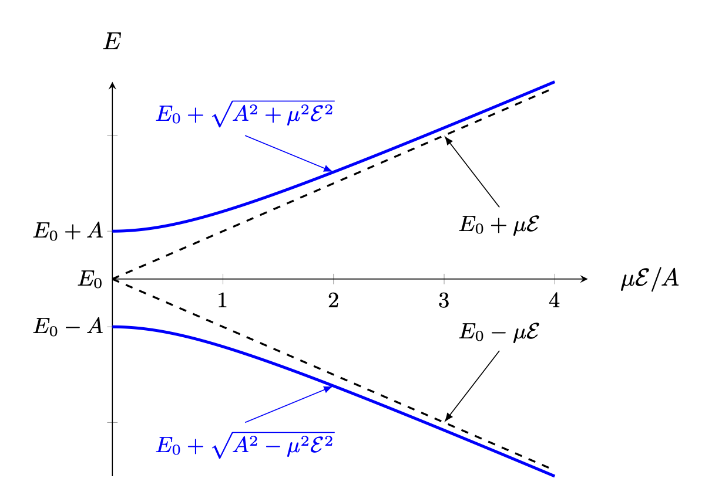
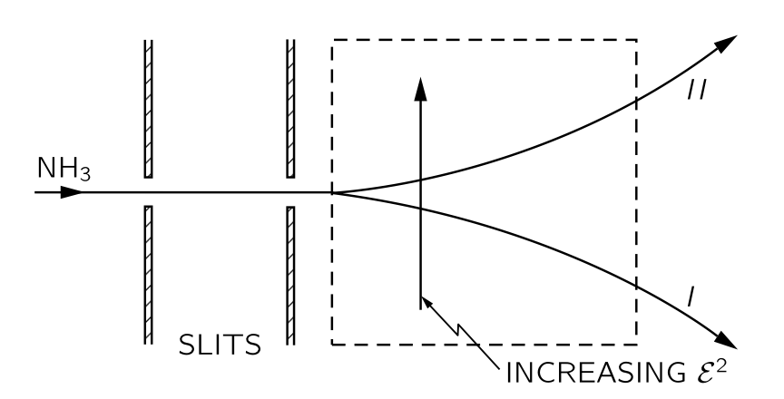
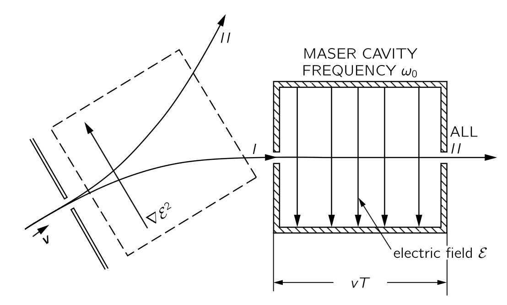
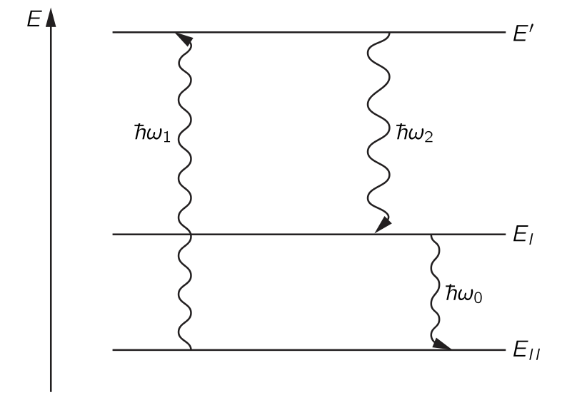
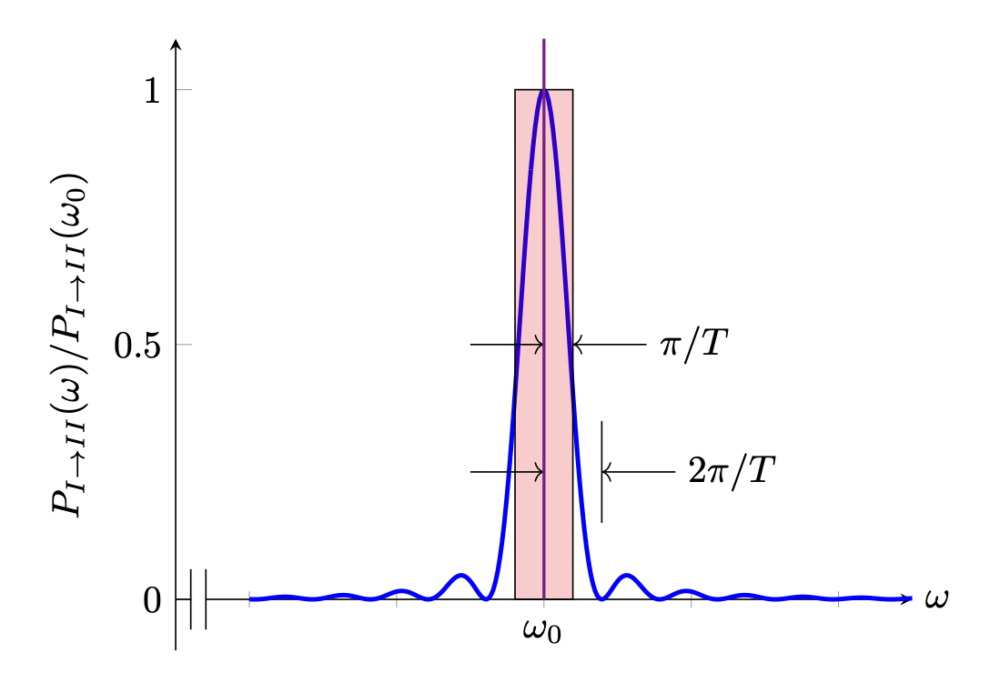
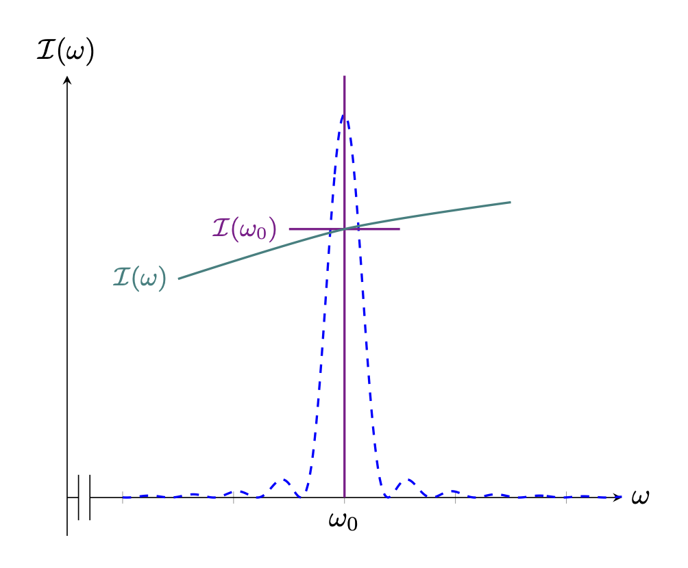

 

## $\mathrm{III}$.9 암모니아 메이저 {#sec-FLP_3_9}

### $\mathrm{III}$.9–1 암모니아 분자의 상태들 {#sec-FLP_3_9_1}

이 장에서는 실용적인 장치인 암모니아 메이저에 대한 양자역학의 적용에 대해 논의한다. 양자역학의 형식적인 진전을 중단하고 특정 문제를 해결하는 이유는, 이 특별한 문제의 많은 특징들이 양자역학 일반 이론에서 꽤 흔하다는 것을 알게 될 것이며, 이 하나의 문제를 자세히 고찰함으로써 많은 것을 배울 수 있을 것이다. 암모니아 메이저는 전자기파를 생성하는 장치이며, 그 작동은 지난 장에서 간략히 논의한 암모니아 분자의 특성을 기반으로 한다. 우선 지난장의 결과를 정리하자.

암모니아 분자는 여러 상태를 가지고 있지만, 우리는 이를 두 개의 상태 시스템으로 간주하며, 현재는 분자가 특정 회전이나 평행 이동 상태에 있을 때 어떤 일이 일어나는지에 대해서만 생각하고 있다. 두 상태에 대한 물리 모델은 다음과 같이 시각화될 수 있다. 암모니아 분자를 질소 원자를 통과하는 축을 중심으로 회전하고, @fig-FLP_3_9_1 에 표시된 바와 같이 수소 원자 평면에 수직이라고 간주한다면, 여전히 두 가지 가능한 조건이 존재한다—질소가 수소 원자 평면의 한쪽에 있거나 반대쪽에 있을 수 있다. 우리는 이 두 상태를 $|\mathcal{1}\rangle$ 와 $|\mathcal{2}\rangle$ 라고 한다. 그것들을 암모니아 분자의 거동을 분석하기 위한 기저 상태 집합으로 간주한다.

{#fig-FLP_3_9_1 width=400}

두 개의 기저 상태를 가진 시스템에서는, 어떤 상태든 하나의 기저 상태에 있는 특정 진폭 $C_1$ 과 다른 기본 상태에 있는 진폭 $C_2$ 가 존재한다. 그 상태벡터를 다음과 같이 쓸 수 있다.

$$
|\psi\rangle = |\mathcal{1}\rangle C_1 + |\mathcal{2}\rangle C_2.
$$

여기서

$$
C_1 = \langle \mathcal{1}|\psi \rangle, \qquad \text{and} \qquad C_2=\langle \mathcal{2}|\psi \rangle.
$$

이 두 진폭은 해밀토니안 방정식 @eq-FLP_3_8_43 에 따라 시간에 대해 변합니다. 암모니아 분자의 두 상태 대칭을 이용하여 $H_{11}=H_{22}=E_0$, $H_{12}=H_{21}=−A$ 라고 하고 해를 구하면 [@eq-FLP_3_8_50, @eq-FLP_3_8_51]

$$
C_1 (t) = \dfrac{a}{2} e^{-(i\hbar)(E_0-A)t} + \dfrac{b}{2} e^{-(i/\hbar) (E_0+A)t}, 
$$ {#eq-FLP_3_9_2}
$$
C_2 (t) = \dfrac{a}{2} e^{-(i\hbar)(E_0-A)t} - \dfrac{b}{2} e^{-(i/\hbar) (E_0+A)t}.
$$ {#eq-FLP_3_9_3}

이제 이러한 일반해들을 자세히 살펴보고자 한다. 분자를 처음에 $b=0$ 인 $|\psi_{II}\rangle$ 상태로 두었다고 가정하자. 그렇다면 $t=0$ 에서 $|\mathcal{1}\rangle$ 상태일때와 $|\mathcal{2}\rangle$ 상태일 때의 진폭은 동일하며 전 기간 동안 그렇게 유지된다. 각각의 위상은 모두 시간에 따라 같이 변하며, 그 진동수는 $(E_0−A)/\hbar$ 이다. 마찬가지로, 분자를 $a=0$ 인 $|\psi_I\rangle$ 상태에 두면, 진폭 $C_2 = -C_1$ 이며, 이 관계는 영원히 유지된다. 두 진폭은 이제 $(E_0+A)/\hbar$ 의 진동수로 시간에 따라 변한다. 이 두가지가 $C_1$ 과 $C_2$ 사이의 관계가 시간에 의존하지 않을 유일한 두 가지 상태 가능성이다.

우리는 두 진폭이 크기가 변하지 않고, 또한 같은 진동수로 변하는 위상을 갖는 두 개의 특수 해를 발견했다. 이것들은 [$\mathrm{III}$.7–1 정지 상태의 원자;정상 상태](vol3_3#sec-FLP_3_7_1) 에서 정의한 바와 같이 정상 상태이며, 이는 일정한 에너지의 상태이다. $|\psi_{II}\rangle$ 상태의 에너지는 $E_{II}=E_0-A$ 이며 $|\psi_I\rangle$ 는 에너지 $E_I=E_0+A$ 이다. 그것들은 존재하는 유일한 두 정상 상태이므로, 우리는 그 분자가 두 개의 에너지 준위를 가지고 있으며, 에너지 차이가 $2A$ 임을 알 수 있다. (물론, 우리는 초기 가정에서 언급한 가정된 회전 및 진동 상태에 대한 두 개의 에너지 준위를 의미한다.)

만약 우리가 질소가 앞뒤로 뒤집히는 가능성을 허용하지 않았다면, 우리는 $A=0$ 으로 취했을 것이며, 두 에너지 레벨은 에너지 $E_0$ 에서 서로 겹쳐 놓이게 될 것이다. 실제 레벨은 이와 같이 되지 않으며, 평균 에너지는 $E_0$ 이지만 $\pm A$ 로 나누어져 두 상태의 에너지 사이에 $2A$ 의 차이가 난다. $A$ 는 실제로 매우 작기 때문에, 에너지 차이도 매우 작다.

원자 내부의 전자를 들뜨게 하기 위해서는 관련된 에너지가 상대적으로 매우 높기 때문에, 가시광선 혹은 자외선 영역의 광자가 필요하다. 분자의 진동을 자극하려면 적외선 광자를 사용한다. 회전을 들게 하는 것에 대해 이야기하자면, 상태들의 에너지 차이는 원적외선 영역의 광자에 해당한다. 하지만 에너지 차이 $2A$ 는 그 중 어느 것보다 낮으며, 실제로 적외선보다 낮고 마이크로파 영역까지 충분히 들어간다. 실험적으로, $10^{−4}\,\text{eV}$ 간격을 가진 한 쌍의 에너지 레벨이 존재한다는 것이 밝혀졌다—이는 $24\,\text{GHz}$ 진동수에 해당한다. 분명히 이것은 $2A=hf$ 이며, $f=24\,\text{GHz}$ ($\lambda =  1.25\,\text{cm}$)임을 의미한다. 따라서 여기에는 일반적인 의미에서 빛을 방출하지 않고 마이크로파를 방출하는 전이를 가진 분자가 있다.

다음 작업을 위해서는 이 두 가지 정상 상태를 조금 더 잘 설명해야 한다. $C_1$ 과 $C_2$ 의 합으로 진폭 $C_{II}$ 를 구성한다고 하자.

$$
C_{II}=C_1+C_2=\langle \mathcal{1}|\phi \rangle + \langle \mathcal{2}|\phi\rangle.
$$ {#eq-FLP_3_9_4}

이것은 무슨 뜻인가? 음, 이것은 원래 기본 상태들의 진폭이 동일한 새로운 상태 $|II\rangle$ 에서 상태 $|\phi\rangle$ 를 찾기 위한 진폭일 뿐이다. 즉, $C_{II}=\langle II|\phi\rangle$ 라고 쓰면, 우리는 @eq-FLP_3_9_4 로부터 $|\phi\rangle$ 라고 하면 모든 $\phi$ 에 대해 참이기 때문에 다음과 같이 $\phi$ 를 제거 할 수 있다.

$$
\langle II| = \langle \mathcal{1}| + \langle \mathcal{2}|.
$$

이는 

$$
|II\rangle =|\mathcal{1}\rangle +|\mathcal{2}\rangle 
$$ {#eq-FLP_3_9_5} 

와 같은 의미이다. 상태 $|II\rangle$ 이 상태 $|1\rangle$ 에 있는 진폭은

$$
\langle \mathcal{1} | II\rangle = \langle \mathcal{1}|\mathcal{1}\rangle + \langle \mathcal{1}|\mathcal{2}\rangle
$$

인데, $|\mathcal{1}\rangle$ 와 $|\mathcal{2}\rangle$ 는 기저 상태이므로 위 식은 단순히 $1$ 이다. $|II\rangle$ 상태가 $|2\rangle$ 상태에 있을 진폭 역시 $1$ 이므로, 상태 $|II\rangle$ 는 두 기저 상태 $|\mathcal{1}\rangle$ 와 $|\mathcal{2}\rangle$ 에 대해 동일한 진폭을 가진 상태이다.

여기서 약간 곤란한 상황임을 알아야 한다. 상태 $|II\rangle$ 이 어떤 기저 상태에 있거나 다른 상태에 있을 전체 확률이 $1$ 보다 크다. 하지만 이는 단순히 상태 벡터가 제대로 **정규화(normalization)** 되지 않았음을 의미한다. $\langle II|II\rangle = 1$ 이어야 하며(이는 다른 모든 상태에 대해서도 성립한다), 일반적으로 성립하는 다음 관계식

$$
\langle \chi|\phi\rangle = \sum_i \langle \chi|i\rangle \langle i|\phi\rangle
$$

에서 $\phi$ 와 $\chi$ 를 모두 상태 $II$ 로 두고, 기본 상태들의 합을 취하면, 

$$
\langle II|II\rangle = \langle II|1\rangle \langle 1|II\rangle + \langle II|2\rangle \langle 2|II\rangle.
$$

$C_{II}$ 에 대한 정의를 @eq-FLP_3_9_4 에서 아래와 같이 변경한다면, 위 식의 값이 $1$ 이 될 것이다.

$$
C_{II}=\dfrac{1}{\sqrt{2}}[C_1+C_2].
$$

같은 방식으로 진폭을 구성할 수 있다.

$$
C_I=\dfrac{1}{\sqrt{2}}[C_1−C_2]
$$

또는
$$
C_I=\dfrac{1}{\sqrt{2}}[\langle \mathcal{1}|\phi\rangle - \langle \mathcal{2}|\phi\rangle].
$$ {#eq-FLP_3_9_6}

이 진폭은 상태 $|\phi\rangle$ 를 새로운 상태 $|I\rangle$ 로 투영한 것으로, 그 상태는 서로 반대되는 진폭을 가지고 상태 $|\mathcal{1}\rangle$ 와 $|\mathcal{2}\rangle$ 에 속한다. 즉, @eq-FLP_3_9_6 

$$
\langle I| = \dfrac{1}{\sqrt{2}}[\langle \mathcal{1}|-\langle \mathcal{2}|]
$$

혹은

$$
|I\rangle = \dfrac{1}{\sqrt{2}} [|\mathcal{1}\rangle - |\mathcal{2}\rangle]
$$ {#eq-FLP_3_9_7}

과 같은 의미이다. 이로부터

$$
\langle \mathcal{1}|I\rangle =\dfrac{1}{\sqrt{2}}=− \langle \mathcal{2}|I\rangle.
$$

지금까지 이 모든 작업을 수행한 이유는 상태 $|I\rangle$ 와 $|II\rangle$ 를 새로운 기저 상태 집합으로 볼 수 있으며, 이는 암모니아 분자의 정지 상태를 설명하는 데 특히 편리하기 때문이다. 기저 상태는 다음을 만족해야 한다.

$$
\langle i|j\rangle = δ_{ij}.
$$

우리는 이미 이 문제를 해결하여

$$
\langle I|I\rangle = \langle II|II\rangle = 1
$$

이며,  @eq-FLP_3_9_5 와 @eq-FLP_3_9_7 을 이용하여 다음을 쉽게 보일 수 있다.

$$
\langle I|II\rangle = \langle II|I\rangle =0.
$$

새로운 기본 상태 $|I\rangle$ 와 $|II\rangle$ 에 대한 진폭 $C_I=\langle I|\phi\rangle$ 와 $C_{II}=\langle II|\phi\rangle$ 는 또한 @eq-FLP_3_8_39 의 해밀토니안 방정식을 만족해야 한다. 실제로, 두 방정식 @eq-FLP_3_9_2 와 @eq-FLP_3_9_3 을 단순히 빼고 $t$ 에 대해 미분하면,

$$
iℏ\dfrac{dC_I}{dt}=(E_0+A)C_I = E_IC_I.
$$ {#eq-FLP_3_9_8}

그리고 @eq-FLP_3_9_2 와 @eq-FLP_3_9_3 을 더하고 $t$ 에 대해 미분하면,

$$
iℏ\dfrac{dC_{II}}{dt} =(E_0−A)C_{II} = E_{II}C_{II}.
$$ {#eq-FLP_3_9_9}

기저 상태로 $|I\rangle$ 과 $|II\rangle$ 사용하면 해밀토니안 행렬은 아래와 같이 단순한 형태를 가진다.

$$
H_{I,I} = E_I,\quad H_{I,II} = 0, \quad H_{II, I} =0, \quad H_{II, II} = E_{II}.
$$

@eq-FLP_3_9_8 과 @eq-FLP_3_9_9 는 1‐상태 시스템 방정식에 대해 [$\mathrm{III}$.8-6 암모니아 분자](vol3_3.qmd#sec-FLP_3_8_6) 에서 우리가 가지고 있던 것과 똑같이 보인다. 그들은 단일 에너지에 해당하는 단순한 지수 시간 의존성을 가지고 있다. 시간이 흐름에 따라 각 상태에 있는 진폭은 독립적으로 작용한다.

두 정상 상태는 물론 @eq-FLP_3_9_8 과 @eq-FLP_3_9_9 의 해이다. 상태 $|\psi_I\rangle$ ($C_1=−C_2$)인 경우

$$
C_I=e^{−(i/\hbar)(E_0+A)t},\qquad C_{II}=0.
$$ {#eq-FLP_3_9_10}

그리고 상태 $|\psi_{II}\rangle$ ($C_1=C_2$)는

$$
C_I=0,\qquad C_{II}=e^{−(i/\hbar)(E_0−A)t}.
$$ {#eq-FLP_3_9_11}

@eq-FLP_3_9_10 의 진폭은

$$
C_I = \langle I|\psi_I\rangle,\qquad  C_{II}= \langle II|\psi I\rangle
$$

이므로 @eq-FLP_3_9_10 은

$$
|\psi_I\rangle = |I\rangle e^{−(i/\hbar)(E_0+A)t}
$$

와 같은 의미이다. 즉, 정상 상태 $|\psi_I\rangle$ 의 상태 벡터는 기저 상태 $|I\rangle$ 와 상태의 에너지에 적합한 지수 계수를 제외하고는 동일하다. 실제로 $t=0$ 일 때 $|\psi_I\rangle =|I\rangle$ 이다. 여기서 상태 $|I\rangle$ 는 에너지 $E_0+A$ 의 정상 상태와 동일한 물리적 구성을 가지고 있다. 같은 방식으로, 우리는 두 번째 정상 상태에 대해

$$
|\psi_{II}\rangle =|II\rangle e^{−(i/\hbar)(E_0−A)t}.
$$

상태 $|II\rangle$ 는 $t=0$ 에서 에너지 $E_0−A$ 의 정상 상태일 뿐이다. 따라서 우리의 두 새로운 기저 상태는 지수 시간 계수를 제거하여 시간에 독립적인 기저 상태가 될 수 있다. (이로부터 정상 상태 $|\psi_I\rangle$, $|\psi_{II}\rangle$ 과 기저상태 $|I\rangle$, $|II\rangle$ 를 항상 구분할 필요가 없다는 것이 편리하다, 왜냐하면 그것들은 명백한 시간 인자만 다르기 때문입니다.)

요약하면, 상태 벡터 $|I\rangle$ 와 $|II\rangle$ 는 암모니아 분자의 명확한 에너지 상태를 기술하는 데 적합한 한 쌍의 기저 벡터이다. 그들은 우리의 원래 기저 벡터와 관련이 있다.

$$
|I\rangle = \dfrac{1}{\sqrt{2}}[|\mathcal{1}\rangle - |\mathcal{2}\rangle],\qquad |II\rangle = \dfrac{1}{\sqrt{2}}[|\mathcal{1}\rangle + |\mathcal{2}\rangle].
$$ {#eq-FLP_3_9_12}

$|I\rangle$ 와 $|II\rangle$ 의 진폭은 $C_1$ 및 $C_2$ 와 관련이 있다.

$$
C_I=\dfrac{1}{\sqrt{2}}[C_1−C_2],\qquad C_{II}=\dfrac{1}{\sqrt{2}}[C_1+C_2].
$$ {#eq-FLP_3_9_13}

어떠한 상태도 $|\mathcal{1}\rangle$ 와 $|\mathcal{2}\rangle$ 의 선형 결합(그 계수를 $C_1,\,C_2$ 라고 하고), 또는 일정한 에너지 기본 상태 $|I\rangle$ 와 $|II\rangle$ 의 선형 결합(그 계수를 $C_I,\, C_{II}$ 라고 하고)으로 나타낼 수 있다.

$$
|\phi⟩=|\mathcal{1}\rangle C_1 + |\mathcal{2}\rangle C_2
$$

또는

$$
|\phi⟩=|I\rangle C_I + |II\rangle C_{II}.
$$

두 번째 형태는 에너지 $E_I=E_0+A$ 인 상태 또는 에너지 $E_{II}=E_0−A$ 인 상태에서 상태 $|\phi\rangle$ 를 찾기 위한 진폭을 제공한다.

### $\mathrm{III}$.9-2 정전기장 안의 분자 {#sec-FLP_3_9_2}

암모니아 분자가 두 가지 에너지 상태 중 하나에 있고, $\hbar \omega = E_I−E_{II}=2A$ 인 진동수 $\omega$ 로 교란하면, 시스템은 한 상태에서 다른 상태로 전이할 수 있다. 또는, 높은 에너지 상태에 있는 경우, 낮은 에너지 상태로 전이하며 광자를 방출할 수 있다. 하지만 이러한 전이을 유도하기 위해서는 상태들과의 물리적인 연결-시스템을 교란하는 어떤 방식-이 필요하다. 상태에 영향을 주는 외부 메커니즘, 예를 들어 자기장이나 전기장 등이 반드시 존재해야 한다. 이 특별한 경우, 이러한 상태들은 전기장에 민감하다. 따라서 우리는 다음으로 외부 전기장에서의 암모니아 분자의 거동 문제를 살펴보겠다.

전기장에서의 거동을 논의하기 위해서는 $|I\rangle$ 와 $|II\rangle$ 를 사용하는 대신 원래의 기저 시스템으로 돌아간다. 수소 원자 평면에 수직인 방향의 전기장이 있다고 가정하자. 잠시 동안 앞뒤로 뒤집을 가능성을 무시하고, 질소 원자의 가능한 두 위치에서 동일할까? 일반적으로는 동일하지 않다. 전자는 수소 핵보다 질소에 더 가깝게 위치하는 경향이 있어, 수소는 약간 양전하에 가깝다. 실제 양은 전자 분포의 세부 사항에 따라 달라진다. 이 분포가 정확히 무엇인지 파악하는 것은 복잡한 문제이지만, 어쨌든 최종 결과는 암모니아 분자가 전기 쌍극자 모멘트를 가지고 있다는 것이며, 이는 @fig-FLP_3_9_1 에 표시된 바와 같다. 우리는 전하의 방향이나 변위량을 자세히 알지 못한 채 분석을 계속할 수 있다. 그러나 다른 사람들의 표기와 일관되게 하려면, 전기 쌍극자 모멘트를 $\bf{\mu}$ 라고 가정한다. 그 방향은 질소 원자에서 방향을 가리키며 수소 원자 평면에 수직이다.

이제 질소가 한쪽에서 다른 쪽으로 뒤집히면 질량 중심은 움직이지 않지만 전기 쌍극자 모멘트는 뒤집어진다. 이 순간의 결과로, 전기장 $\bf{\mathcal{E}}$ 의 에너지는 분자 방향에 따라 달라진다.$^1$ 위에서 가정한 바와 같이, 질소 원자가 전기장의 방향을 가리키면 위치 에너지가 더 높고, 반대 방향을 가리키면 낮으며, 두 에너지 사이의 간격은 $2\mu\mathcal{E}$ 가 된다.[$^1$ $\bf{p}$ 와 $E$ 를 운동량과 에너지를 나타냈는데 사용했기 때문에 $\bf{\mu}$ 와 $\bf{\mathcal{E}}$ 를 각가가 전기쌍극자와 전기장으로 사용할 수 밖에 없었다.]{.aside}

지금까지 우리는 $E_0$ 와 $A$ 의 값을 계산하는 방법을 알지 못한 채 가정해 왔다. 올바른 물리 이론에 따르면, 모든 핵과 전자의 위치와 운동을 기준으로 이러한 상수를 계산할 수 있어야 한다. 하지만 아무도 그것을 해본 적이 없다. 그러한 시스템은 전자 10개와 핵 4개를 포함하고 있으며, 이는 너무 복잡한 문제이다. 사실, 이 분자에 대해 우리보다 더 많이 아는 사람은 없다. 누구든지 말할 수 있는 것은 전기장이 있을 때 두 상태의 에너지가 다르며, 그 차이는 전기장에 비례한다는 것이다. 그 비례 계수는 $2\mu$ 이지만, 그 값은 실험적으로 결정되어야 한다. 우리는 또한 그 분자가 뒤집을 수 있는 진폭 $A$ 를 가지고 있다고 말할 수 있지만, 이는 실험적으로 측정되어야 한다. 계산이 너무 복잡해서 자세히 할 수 없기 때문에 아무도 $\mu$ 와 $A$ 에 대한 정확한 이론값을 제공할 수 없다.

전기장에 있는 암모니아 분자에 대해서는 우리의 설명을 변경해야 한다. 만약 분자가 한 구성에서 다른 구성으로 전환되는 진폭을 무시한다면, 두 상태 $|\mathcal{1}\rangle$ 와 $|\mathcal{2}\rangle$ 의 에너지는 $(E_0 \pm \mu \mathcal{E})$ 일 것이다. 마지막 장의 절차에 따라, 

$$
H_{11}=E_0 + \mu\mathcal{E},\qquad H_{22}=E_0 − μ\mathcal{E}.
$$ {#eq-FLP_3_9_14}

또한 우리는 우리가 관심있는 전기장에 대해 그 전기장이 분자의 기하학에 크게 영향을 미치지 않으며, 따라서 질소가 한 위치에서 다른 위치로 점프하는 진폭에도 영향을 주지 않는다고 가정하겠다. 그렇다면 $H_{12}$ 와 $H_{21}$ 은 변경되지 않은 것으로 볼 수 있다. 이로부터

$$
H_{12} = H_{21} = −A.
$$ {#eq-FLP_3_9_15}

우리는 이제 새로운 $H$ 에 대해 해밀토니안 방정식 @eq-FLP_3_8_43 을 풀어야 풀어야 한다. 이전의 과정을 똑같이 해 가며풀 수 있겠지만, 두 상태 시스템에 대한 해가 아주 자주 쓰일 것이기 때문에, 임의의 $H_{ij}$ 라는 일반적인 경우에 대해 풀어 보자. 단, 시간이 지나면 변하지 않는다는 가정하에.

이제 아래의 해밀토니안 방정식 쌍의 일반 해를 구할 것이다.

$$
i\hbar \dfrac{dC_1}{dt} = H_{11}C_1 + H_{12}C_2, 
$$ {#eq-FLP_3_9_16}
$$
i\hbar \dfrac{dC_2}{dt} = H_{21}C_1 + H_{22}C_2.
$$ {#eq-FLP_3_9_17}

이것들은 상수 계수를 갖는 선형 미분 방정식이므로, 종속 변수 $t$ 의 지수 함수인 해를 언제든지 찾을 수 있다. 먼저 $C_1$ 과 $C_2$ 가 동일한 시간 의존성을 갖는 해를 찾아본다. 시험 함수(trial function) 을 다음과 같이 놓는다.

$$
C_1=a_1e^{−i\omega t},\qquad C_2=a_2e^{−i\omega t}.
$$

이 해는 에너지 상태 $E=\hbar \omega$ 에 해당하므로, 

$$
C_1 = a_1 e^{-(i/\hbar)Et}, 
$$ {#eq-FLP_3_9_18}
$$
C_2 = a_2 e^{-(i/\hbar)Et}, 
$$ {#eq-FLP_3_9_19}

라고 쓰면, 여기서 $E$ 는 아직 모르며, 미분 방정식 @eq-FLP_3_9_16 과 @eq-FLP_3_9_17 을 만족하도록 정해져야 한다.

미분 방정식 @eq-FLP_3_9_16 과 @eq-FLP_3_9_17 에 @eq-FLP_3_9_18 과 @eq-FLP_3_9_19 의 $C_1$ 과 $C_2$ 를 대입하면 다음과 같은 방정식을 얻는다.

$$
\begin{bmatrix} E-H_{11} & -H_{12} \\ -H_{23} & E-H_{22}\end{bmatrix} \begin{bmatrix} a_1 \\ a_2 \end{bmatrix} = \begin{bmatrix} 0 \\ 0 \end{bmatrix}.
$$ {#eq-FLP_3_9_20}

이 방정식에서 $a_1,\,a_2$ 가 $0$ 이 아닌 해를 가지려면

$$
\det \left(\begin{bmatrix} E-H_{11} & -H_{12} \\ -H_{23} & E-H_{22}\end{bmatrix}\right)=0.
$$ {#eq-FLP_3_9_22}

이어야 하며 이로부터

$$
(E−H_{11})(E−H_{22})−H_{12}H_{21}=0.
$$

이어야 한다. 이 식을 만족하는 두 $E$ 값은 다음과 같다.

$$
E=\dfrac{H_{11}+H_{22}}{2} \pm \sqrt{\dfrac{(H_{11}−H_{22})^2}{4} + H_{12}H_{21}}
$$ {#eq-FLP_3_9_25}

에너지 $E$ 에 대해 두 가지 가능한 값이 있으며 두 값 모두 실수이다. 왜냐하면 $H_{11}$ 과 $H_{22}$ 는 실수이며, $H_{12}H_{21}=|H_{12}|^2 >0$ 이기 때문이다.  

앞서와 동일한 관례를 사용하여, 높은 에너지를 $E_I$ 라고 하고 낮은 에너지를 $E_{II}$ 라고 하자. 

$$
E_I=\dfrac{H_{11}+H_{22}}{2} + \sqrt{\dfrac{(H_{11}−H_{22})^2}{4} + H_{12}H_{21}},
$$ {#eq-FLP_3_9_26}
$$
E_{II}=\dfrac{H_{11}+H_{22}}{2} - \sqrt{\dfrac{(H_{11}−H_{22})^2}{4} + H_{12}H_{21}}.
$$ {#eq-FLP_3_9_26}

@eq-FLP_3_9_18 과 @eq-FLP_3_9_19 에서 이 두 에너지를 각각 별도로 사용한다, 우리는 두 정상 상태(정확한 에너지 상태)의 진폭을 가지고 있다. 외부 교란이 없으면, 이러한 상태 중 하나에 있는 시스템은 영원히 그 상태를 유지하게 되며, 오직 위상 변화만 존재한다.

우리는 두 가지 특수한 경우에 대한 결과를 확인할 수 있다. $H_{12} = H_{21} = 0$ 인 경우, $E_I=H_{11}$ 이고 $E_{II}=H_{22}$ 가 된다. 이것은 확실히 올바릅니다, 왜냐하면 @eq-FLP_3_9_16 와 @eq-FLP_3_9_17 은 분리되어 있으며, 각각은 $H_{11}$ 과 $H_{22}$ 의 에너지 상태를 나타내기 때문이다. 다음으로, $H_{11} = H_{22} = E_0$ 와 $H_{21} = H_{12} = −A$ 라고 정하면, 이전에 찾은 해를 얻는다.

$$
E_I = E_0 + A\qquad \text{and} \qquad E_{II}=E_0−A.
$$

일반적인 경우, 두 해 $E_{I}$ 와 $E_{II}$ 는 각각 아래의 두 상태를 가리킨다.

$$
|\psi_I\rangle = |I\rangle e^{−(i/\hbar)E_I t} \qquad \text{and} \qquad |\psi_{II}\rangle =|II\rangle e^{−(i/\hbar)E_{II}t}
$$

이러한 상태는 @eq-FLP_3_9_18 과 @eq-FLP_3_9_19 에 제시된 대로 $C_1$ 과 $C_2$ 를 갖게 된다. 여기서 $a_1$ 과 $a_2$ 는 아직 결정되지 않았으며 그들의 비율은 @eq-FLP_3_9_20 로부터 

$$
\dfrac{a_1}{a_2} = \dfrac{H_{12}}{E-H_{11}}
$$ {#eq-FLP_3_9_23}

혹은 

$$
\dfrac{a_1}{a_2} = \dfrac{E-H_{22}}{H_21}
$$ {#eq-FLP_3_9_24}

중 하나에 의해 주어진다. 그들은 또한 또 하나의 조건을 충족해야 한다. 시스템이 정상 상태 중 하나에 있다면, $|\mathcal{1}\rangle$  또는 $|\mathcal{2}\rangle$ 에서 발견될 확률의 합은 반드시 $1$ 이어야 하며 따라서,

$$
|C_1|^2+|C_2|^2 =1,
$$ {#eq-FLP_3_9_28}

혹은, 동등하게

$$
|a_1|^2 + |a_2|^2=1.
$$ {#eq-FLP_3_9_29}

이러한 조건들은 $a_1$ 과 $a_2$ 를 유일하게 정하지 않으며, 여전히 임의의 위상, 즉 $e^{i\delta}$ 와 같은 인자와 같은 불확실성이 있다. $a_1,\,a_2,...$ 에 대한 일반적인 해를 적어 두는 것은 가능하지만, 특정 경우마다 이를 직접 푸는것이 보통 더 간단하다.

이제 전기장 속의 암모니아 분자로 돌아가자. @eq-FLP_3_9_14 와 @eq-FLP_3_9_15 에 제시된 $H_{11},\,H_{22}, H_{12}$ 값을 사용하여 두 정상 상태의 에너지를 구하면

$$
\begin{aligned}
E_I &= E_0 + \sqrt{A^2+\mu^2\mathcal{E}^2}, \\[0.3em]
E_{II} &= E_0 - \sqrt{A^2+\mu^2\mathcal{E}^2}.
\end{aligned}
$$ {#eq-FLP_3_9_30}

이 두 에너지를 전기장의 강도 $\mathcal{E}$ 에 대한 함수로 표현사면 @fig-FLP_3_9_2 와 같다. $\mathcal{E}=0$ 일 때, 두 에너지는 물론 $E_0  \pm A$ 이다. 전기장이 가해지면 두 레벨 사이의 차이가 증가한다. 에너지 차이는 처음에 $\mathcal{E}$ 에 대해 천천히 증가하지만, 결국 $\mathcal{E}$ 에 비례하게 된다. 매우 강한 전기장서의 에너지는

$$
\begin{aligned}
E_I &= E_0 + \mu \mathcal{E} = H_{11}, \\[0.3em]
E_{II} &= E_0 - \mu \mathcal{E} = H_{22}.
\end{aligned}
$$ {#eq-FLP_3_9_31}

질소가 앞뒤로 뒤집어지는 진폭이 존재한다는 사실은 두 위치의 에너지 차이가 매우 클 때 거의 영향을 미치지 않는다. 이것은 흥미로운 점이며, 나중에 다시 다시 논의한다.

{#fig-FLP_3_9_2 width=450}

아제 암모니아 매이저의 작동 방식을 알아보자. 아이디어는 다음과 같다. 먼저, 우리는 $|I\rangle$ 상태의 분자를  $|II\rangle$ 상태의 분자와 분리하는 방법을 찾는다$^2$. 높은 에너지 상태 $|I\rangle$ 는 공동을 $24\,\text{GHz}$ 의 진동수로 지나간다. 분자는 공동에 에너지를 전달할 수 있으며(에너지 전달 방식은 나중에 논의한다), 공동을 $|II\rangle$ 상태로 남긴다. 이런 전이를 하는 각각의 분자는 에너지 $E=E_I−E_{II}$ 를 공동에 전달한다. 분자에서 나오는 에너지는 공동에 전기 에너지로 나타납니다.[$^2$ 앞으로는 $|\psi_I\rangle$ 와 $|\psi_{II}\rangle$  대신에 $|I\rangle$ 와 $|II\rangle$ 를 사용한다. 실제 상태 $|\psi_I\rangle$ 와 $|\psi_{II}\rangle$ 는 에너지 기본 상태에 적절한 지수 계수를 곱한 것임을 기억하자.]{.aside}

두 분자 상태를 어떻게 분리 할 수 있을까? 한 가지 방법은 다음과 같다. 암모니아 가스는 작은 제트에서 배출되어 두 개의 슬릿을 통과하면서 좁은 빔이 된다(@fig-FLP_3_9_3). 그 빔은 큰 횡전기장이 있는 영역을 통과하며 전송된다. 전기장을 생성하는 전극은 전기장이 빔 전체에 걸쳐 빠르게 변하도록 구성되었다. 그렇다면 전기장의 제곱 $\bf{\mathcal{E}\cdot \mathcal{E}}$ 는 빔에 수직인 큰 구배를 갖게 된다. 이제 $|I\rangle$ 상태의 분자는 $\mathcal{E}^2$ 로 증가하는 에너지를 갖게 되며, 따라서 이 빔의은 낮은 $\mathcal{E}^2$ 영역으로 휘어진다. 반면에 $|II\rangle$ 상태의 분자는 $\mathcal{E}^2$ 가 증가함에 따라 에너지가 감소하기 때문에 더 큰 $\mathcal{E}^2$ 영역으로 휜다.

{#fig-FLP_3_9_3 width=400}

우연히도, 실험실에서 발생할 수 있는 전기장을 사용할 경우, 에너지 $\mu \mathcal{E}$ 는 항상 $A$ 보다 훨씬 작다. 이경우 @eq-FLP_3_9_30 의 제곱근은 다음으로 근사된다.  

$$
A\left( 1 +\dfrac{1}{2}\dfrac{\mu^2 \mathcal{E}^2}{A^2}\right).
$$ {#eq-FLP_3_9_32}

따라서 실용적으로 에너지 레벨은

$$
E_I = E_0 + A + \dfrac{\mu^2 \mathcal{E}^2}{2A} 
$$ {#eq-FLP_3_9_33}

과

$$
E_{II} = E_0 − A − \dfrac{\mu^2 \mathcal{E}^2}{2A}
$$ {#eq-FLP_3_9_34}

이다. 그리고 에너지는 $\mathcal{E}^2$ 에 대해 근사적으로 선형적으로 변한다. 그때 분자에 작용하는 힘은

$$
\bf{F} = \dfrac{\mu^2}{2A}∇\mathcal{E}^2.
$$ {#eq-FLP_3_9_35}

많은 분자들은 전기장에서 $\mathcal{E}^2$ 에 비례하는 에너지가 있으며, 그 계수는 분자의 편극률이다. 암모니아는 분모의 $A$ 값이 작아 비정상적으로 높은 분극성을 가지고 있다. 따라서 암모니아 분자는 전기장에 비정상적으로 민감하다. (NH3 기체의 유전율은 어떻게 예상하십니까?)

### $\mathrm{III}$.9–3 시간에 따라 변하는 장에서의 전이 {#sec-FLP_3_9_3}

{#fig-FLP_3_9_4 width=400}

암모니아 메이저에서 @fig-FLP_3_9_4 에 표시된 바와 같이 에너지 $E_I$ 를 가진 $|I\rangle$ 상태의 있는 분자를 가진 빔은 공명 공동으로 보내지고 나머지 암모니아 빔은 폐기된다. 공동 내부에는 시간에 따라 변하는 전기장이 존재하므로, 이제 시간에 따라 변하는 전기장 내 분자의 행동을 알아보겠다. 우리는 전혀 다른 종류의 문제-시간마다 달라지는 해밀토니안을 가진 문제-를 갖게 되었다. $H_{ij}$ 는 $\mathcal{E}$ 에 의존하므로 $H_{ij}$ 는 시간에 따라 변하며, 우리는 이 상황에서 시스템의 동작을 정해야 한다.

우선, 풀어야 할 방정식은 다음과 같다.

$$
\begin{aligned}
i\hbar \dfrac{dC_1}{dt} &= (E_0 + \mu \mathcal{E}) C_1 - AC_2, \\[0.3em]
i\hbar \dfrac{dC_2}{dt} &= -AC_1 + (E_0 - \mu \mathcal{E})C_2.
\end{aligned}
$$ {#eq-FLP_3_9_36}

전기장이 사인함수로 변한다고 가정하자. 그렇다면 다음과 같이 쓸 수 있다.

$$
\mathcal{E} = 2\mathcal{E}_0 \cos \omega t = \mathcal{E}_0 (e^{i\omega t}  +e^{−i\omega t}).
$$ {#eq-FLP_3_9_37}

실제 작동에서는 진동수 $\omega$ 가 분자 전이 공명 주파수 $\omega_0=2A/\hbar$ 와 거의 동일하지만, 일단은 일반성을 유지하기 위해 어떤 값이든 가능하도록 한다. 이 방정식을 푸는 가장 좋은 방법은 이전에 했던 것처럼 $C_1$ 과 $C_2$ 의 선형 결합을 형성하는 것이다. 따라서 우리는 두 방정식을 더하고, $\sqrt{2}$ 로 나눈 뒤, @eq-FLP_3_9_13 에 있던 $C_I$ 와 $C_{II}$ 의 정의를 사용한다. 

$$
i\hbar \dfrac{dC_{II}}{dt}=(E_0−A)C_{II}  + \mu \mathcal{E} C_I.
$$ {#eq-FLP_3_9_38}

이것이 전기장으로 인한 추가항을 제외하면 @eq-FLP_3_9_9 과 동일하다는 점을 확인할 수 있다. 마찬가지로, 두 방정식 @eq-FLP_3_9_36 를 빼면 

$$
i\hbar \dfrac{dC_I}{dt} = (E_0 + A)C_I + \mu\mathcal{E}C_{II}.
$$ {#eq-FLP_3_9_39}

이제 질문은 이 방정식들을 어떻게 풀 것인가인데, $\mathcal{E}$ 가 $t$ 에 의존하기 때문이며 이전의 경우보다 어렵다. 실제로 일반적인 $\mathcal{E}(t)$ 의 경우 해는 기본 함수로 표현될 수 없다. 하지만 전기장이 작기만 하면 좋은 근사값을 얻을 수 있다. 먼저 다음과 같이 놓자.

$$
\begin{aligned}
C_I &= \gamma_I e^{-i(E_0+A)t/\hbar} = \gamma_I e^{-iE_It/\hbar}, \\[0.3em]
C_{II} &= \gamma_{II} e^{-i(E_0-A)t/\hbar} = \gamma_{II} e^{-iE_{II}t/\hbar}.
\end{aligned}
$$ {#eq-FLP_3_9_40}

전기장이 없을 경우, $\gamma_I$ 와 $\gamma_{II}$ 를 두 개의 복소 상수로 선택하면 정확할 해를 얻는다. 실제로, $|I\rangle$ 상태에 있을 확률은 $C_I$ 의 절대값 제곱이며 $|II\rangle$ 상태에 있을 확률은 $C_{II}$ 의 절대값제곱이므로 $|I\rangle$ 혹은 $|II\rangle$ 상태에 있을 확률은 단지 $|\gamma_I|^2$ 또는 $|\gamma_{II}|^2$ 이다. 예를 들어, 시스템이 $|II\rangle$ 상태로 시작한다면, 이 조건은 영원히 지속된다. 만약 그 분자가 원래 상태 $|II\rangle$ 상태에 있었다면, 상태 $|I\rangle$ 에 들어갈 가능성은 전혀 없다.

이제 방정식을 @eq-FLP_3_9_40 형태로 쓰는 아이디어는 $\mu\mathcal{E}$ 가 $A$ 에 비해 작을 경우, 해를 여전히 이렇게 쓸 수 있지만, 그 경우 $\gamma_I$ 와 $\gamma_{II}$ 는 시간에 따라 서서히 변하는 함수가 되며, 여기서 천천히 변한다는것은 지수 함수와 비교했을 때 느리다는 의미이다. 그것이 요령이다. 우리는 $\gamma_I$ 와 $\gamma_{II}$ 가 천천히 변한다는 사실을 이용하여 근사값을 얻는다.

이제 미분 방정식 @eq-FLP_3_9_39 에서 @eq-FLP_3_9_40 의 $C_I$ 를 사용한다. 단 $\gamma_I$ 도 $t$ 의 함수임을 기억해야 한다. 그렇다면,

$$
i\hbar \dfrac{dC_I}{dt} = E_I\gamma_I e^{−iE_I t/\hbar} +  i\hbar \dfrac{d\gamma_I}{dt}e^{−iE_It/\hbar}
$$

이며 미분 방정식은

$$
\left( E_I \gamma_ I + i\hbar \dfrac{d\gamma_I}{dt}\right) e^{−(i/\hbar)E_It} = E_I\gamma_I e^{−(i/\hbar)E_It} + \mu \mathcal{E}\gamma_{II}e^{−(i/\hbar)E_{II}t}.
$$ {#eq-FLP_3_9_41}

마찬가지로, $dC_{II}/dt$ 방정식은 다음과 같이 된다.

$$
\left( E_{II}\gamma_{II} + i\hbar \dfrac{d\gamma_{II}}{dt} \right) e^{−(i/\hbar)E_{II} t} = E_{II} \gamma_{II}e^{−(i/\hbar)E_{II}t} + \mu \mathcal{E} \gamma_I e^{−(i/\hbar )E_It}.
$$ {#eq-FLP_3_9_42}

각 방정식의 양변에 동일한 항이 있다는 것을 알 수 있다. 우리는 이러한 항을 제거하고, 첫 번째 식에 $e^{+iE_It/\hbar}$ 를, 두 번째 식에 $e^{+iE_{II}t/\hbar}$ 를 곱한다. $(E_I−E_{II}) = 2A= \hbar \omega_0$ 임을 기억하면, 결국 다음 식을 얻는다.

$$
\begin{aligned}
i\hbar \dfrac{d\gamma_I}{dt} &= \mu \mathcal{E}(t) e^{i\omega_0 t}\gamma_{II}, \\[0.3em]
i\hbar \dfrac{d\gamma_{II}}{dt} &= \mu \mathcal{E}(t) e^{-i\omega_0 t} \gamma_I.
\end{aligned}
$$ {#eq-FLP_3_9_43}

이제 우리는 겉보기에 단순한 두 개의 방정식을 갖게 되었으며, 물론 그것들은 여전히 정확하다. 한 변수의 미분은 시간에 대한 함수$\mu \mathcal{E}(t)e^{i\omega_0t}$ 에 두번째 변수의 곱이며, 두 번째 변수의 미분은 첫 번째 변수에 유사한 시간 함수를 곱한 것이다. 비록 이런 간단한 방정식도 일반적으로 풀 수 없지만, 일부 특수한 경우에는 풀 수 있다.

우리는 최소한 현재로서는 진동하는 전기장의 경우에만 관심이 있다. $\mathcal{E}(t)$ 가 @eq-FLP_3_9_37 로 주어진다면 $\gamma_I$ 와 $\gamma_{II}$ 에 대한 방정식은 다음과 같다.

$$
\begin{aligned}
i\hbar \dfrac{d\gamma_I}{dt} &= \mu \mathcal{E}_0 \left[e^{i(\omega + \omega_0)t} + e^{-i(\omega-\omega_0)t}\right]\gamma_{II}, \\[0.3em]
i\hbar \dfrac{d\gamma_{II}}{dt} &= \mu \mathcal{E}_0 \left[e^{i(\omega - \omega_0)t} + e^{-i(\omega + \omega_0)t}\right]\gamma_{I}.
\end{aligned}
$$ {#eq-FLP_3_9_44}

이제 $\mathcal{E}_0$ 가 충분히 작다면, $\gamma_I$ 와 $\gamma_{II}$ 의 변화율도 작다. 두 $\gamma$ 는 $t$ 에 대해 크게 변하지 않으며, 특히 지수 항에 의한 급격한 변동과 비교했을 때 그렇다. 이러한 지수항은 실수부와 허수부를 가지고 있으며, $\omega + \omega_0$ 또는 $\omega−\omega_0$ 의 주파수에서 진동한다. $\omega + \omega_0$ 를 가진 항은 평균값이 0이 될 때 매우 빠르게 진동하므로 $\gamma$ 의 변화율에 평균에 크게 기여하지 않습니다. 따라서 우리는 이러한 항들을 평균값인 $0$ 으로 대체함으로써 비교적 좋은 근사값을 만들 수 있다. 그것들dms 그냥 빼고, 우리의 근사로 다음을 취한다.

$$
\begin{aligned}
i\hbar \dfrac{d\gamma_I}{dt} &= \mu \mathcal{E}_0 e^{-i(\omega-\omega_0)t}\gamma_{II}, \\[0.3em]
i\hbar \dfrac{d\gamma_{II}}{dt} &= \mu \mathcal{E}_0 e^{i(\omega - \omega_0)t} \gamma_{I}.
\end{aligned}
$$ {#eq-FLP_3_9_45}

$(\omega − \omega_0)$ 에 비례하는 지수를 가진 나머지 항들조차도 $\omega$ 가 $\omega_0$ 에 가깝지 않는 한 빠르게 변한다. $\omega \approx \omega_0$ 인 경우에야 오른쪽 변이 충분히 느리게 변하여, $t$ 에 대해 방정식을 적분할 때 어느 정도의 가치 있는 양이 누적된다. 다시 말해, 전기장이 약할 경우 유의미한 진동수는 $\omega_0$ 에 가까운 진동수 뿐이다.

@eq-FLP_3_9_45 를 얻는 데 사용한 근사를 사용하여 방정식은 정확히 풀 수 있지만 작업이 다소 복잡하므로 같은 유형의 다른 문제를 나중에 다룰 때까지는 미룬다. 이제 우리는 그것들을 근사적으로 풀것이다. 정확하게는, 완전 공명 경우인 $\omega = \omega_0$ 에 대한 정확한 해를 찾고, 공명에 가까운 주파수에 대한 근사 해를 찾을 것이다.

### $\mathrm{III}$.9–4 공명에서의 전이 {#sec-FLP_3_9_4}

먼저 완벽한 공명의 경우를 살펴보자. $\omega = \omega_0$ 라면 @eq-FLP_3_9_45 는

$$
\dfrac{d\gamma_I}{dt} - - \dfrac{i\mu\mathcal{E}_0}{\hbar}\gamma_{II},\qquad \dfrac{d\gamma_{II}}{dt} = - \dfrac{i\mu\mathcal{E}_0}{\hbar} \gamma_I 
$$ {#eq-FLP_3_9_46}

이 된다. 이 식의 $\gamma_I,\,\gamma_{II}$ 는 모두 단순 조화 진동 운동의 미붕방정식을 만족한다는 것을 알 수 있다.

$$
\dfrac{d^2\gamma}{dt^2} = −\left(\dfrac{\mu\mathcal{E}_0}{\hbar}\right)^2\gamma. 
$$ {#eq-FLP_3_9_47}

이 방정식의 해는 사인과 코사인 함수의 선형결합이다.

$$
\begin{aligned}
\gamma_I &= a \cos \left(\dfrac{\mu\mathcal{E}_0t}{\hbar}\right) + b \sin \left(\dfrac{\mu\mathcal{E}_0t}{\hbar}\right), \\[0.3em]
\gamma_{II} &= ib \cos \left(\dfrac{\mu\mathcal{E}_0t}{\hbar}\right) -i a \sin \left(\dfrac{\mu\mathcal{E}_0t}{\hbar}\right) , \\[0.3em]
\end{aligned}
$$

여기서 $a$ 와 $b$ 는 특정 물리적 상황에 맞추어 결정되는 상수입이다.

예를 들어, $t=0$ 에서 우리 분자 시스템이 상위 에너지 상태 $|I\rangle$ 에 있었다면, 이는 $t=0$ 일 때 @eq-FLP_3_9_40 에서 $\gamma_I=1$ 이고 $\gamma_{II}=0$ 이다. 이 상황에서는 $a=1$ 과 $b=0$ 이어야 한다. 분자가 $t$ 에서 $|I\rangle$ 상태에 있을 확률 $P_I(t)$ 는 $|\gamma_I(t)|^2$ 이므로,

$$
P_I(t)= |\gamma_I(t)|^2 = \cos^2\left(\dfrac{\mu \mathcal{E}_t}{\hbar}\right).
$$ {#eq-FLP_3_9_49}

마찬가지로, 그 분자가 $|II\rangle$ 상태에 있을 확률 $P_{II} = |\gamma_{II}|^2$ 이므로,

$$
P_{II}(t) = |\gamma_{II}(t)|^2 = \sin^2 \left(\dfrac{\mu \mathcal{E}_t}{\hbar}\right).
$$ {#eq-FLP_3_9_50}

$\mathcal{E}$ 가 작고 우리가 공명에 있는 한, 확률은 단순한 진동 함수로 주어진다. $|I\rangle$ 상태에 있을 확률이 $1$ 에서 $0$ 으로 떨어지는 동안 상태 $|II\rangle$ 에 있을 확률은 $0$ 에서 $1$ 로 상승한다. 말할 필요도 없이, 두 확률의 합은 항상 1과 같으며, 그 분자는 항상 어떤 상태에 있다!

분자가 공동을 통과하는 데 걸리는 시간을 $T$ 라고 하자. 만약 공동을 $μ\mathcal{E}_0T/\hbar = \pi/2$ 가 될 정도로 충분히 길게 만들면, 상태 $|I\rangle$ 로 들어간 분자는 반드시 상태 $|II\rangle$ 에 남게 된다. 높은 에너지 상태에서 공동에 들어가면 낮은 에너지 상태에서 공동을 떠난다. 그 에너지는 감소했으며, 잃어버린 에너지는 전기장을를 생성하는 기계 외에는 다른 곳으로 갈 수 없다. 분자의 에너지가 공동의 진동에 어떻게 전달되는지를 확인할 수 있는 세부 사항은 간단하지 않다; 그러나 우리는 에너지 보존 원리를 사용할 수 있기 때문에 이러한 세부 사항을 고민할 필요가 없다. 필요하다면 그것들을 연구 할 수 있지만, 원자의 양자역학 외에도 공동 내 장의 양자역학을 다루어야 한다.

요약하면: **분자가 공동에 들어가면, 정확한 주파수로 진동하는 공동의 전기장이 높은 에너지 상태에서 낮은 에너지 상태로의 전이를 유도하고, 방출된 에너지는 진동하는 장으로 전달된다.** 작동 중인 메이저에서는 분자들이 공동 진동을 유지할 수 있을 만큼 충분한 에너지를 전달하며, 이는 공동 손실을 보충할 충분한 전력을 제공할 뿐만 아니라 공동에서 끌어낼 수 있는 소량의 초과 전력을 제공하기도 한다. 따라서, 분자 에너지는 외부 전자기장의 에너지로 변환된다.

빔이 공동에 들어가기 전에, 높은 에너지 상태만 들어오도록 빔을 분리하는 필터를 사용한다는 것을 기억하자. 낮은 에너지 상태의 분자로 시작한다면, 과정이 반대 방향으로 진행되어 공동에서 에너지를 뺏는다는 것을 쉽게 입증할 수 있다. 필터링되지 않은 빔을 삽입하면, 에너지를 투입하는 만큼 많은 분자들이 에너지를 빼가므로 별다른 일은 일어나지 않을 것이다. 실제 작동에서는 당연히 $(\mu\mathcal{E}_0T/\hbar)$ 를 정확히 $\pi/2$ 로 만들 필요가 없다. 다른 모든 값($\pi$ 의 정확한 정수배를 제외하고)에 대해서는 상태 $|I\rangle$ 에서 상태 $|II\rangle$ 로 전이될 확률이 있다. 다른 값에 대해서는, 그러나 이 장치가 100% 효율적이지 않으며, 공동을 떠나는 많은 분자들이 공동에 약간의 에너지를 전달할 수 있었지만 전달하지 못했다.

실제 사용에서는 모든 분자의 속도가 동일하지 않으며, 일종의 맥스웰 분포를 가지고 있다. 이는 서로 다른 분자에 대한 이상적인 시간이 다를 것이며, 모든 분자에 대해 한 번에 100% 효율을 얻는 것은 불가능하다는 것을 의미한다. 또한, 고려하기 쉬운 또 다른 복잡성이 있지만, 현재 단계에서는 그것에 신경 쓰지 않겠다. 당신은 공동 내 전기장이 보통 공동 전체에 걸쳐 장소마다 다르다는 것을 기억한다. 따라서, 분자들이 공동을 가로질러 떠다닐 때, 분자의 전기장은 우리가 가정한 단순한 사인 진동보다 더 복잡한 방식으로 변한다. 문제를 정확히 해결하려면 더 복잡한 적분을 사용해야 하지만, 일반적인 아이디어는 여전히 동일하다.

메이저를 만드는 다른 방법이 있다. 슈테른-게를라흐 장치를 이용하여 $|I\rangle$ 상태의 원자를 $|II\rangle$ 상태에서 분리하는 대신, 이미 공동에 있는 원자(기체 또는 고체)를 가지고 어떤 방법으로든 원자를 상태 $|II\rangle$ 에서 상태 $|I\rangle$ 로 이동시킬 수 있다. 한가지 방법은 이른바 삼중 상태 메이저의 방법이다. 이를 위해, @fig-FLP_3_9_6 에 표시된 바와 같이 세 개의 에너지 레벨을 가진 원자 시스템이 사용되며, 다음과 같은 특별한 특성을 가지고 있습니다. 시스템은 주파수 $\hbar\omega_1$ 의 복사(예를 들어 빛)를 흡수하고 가장 낮은 에너지 준위 $E_{II}$ 에서 고에너지 준위 $E'$ 로 이동한 뒤, 빠르게 주파수 $\hbar \omega_2$ 의 광자를 방출하여 에너지 $E_I$ 를 가진 상태 $|I\rangle$ 에 도달한다. 상태와 조건은 상태 $|I\rangle$ 와 $|II\rangle$  사이의 매이저 동작에 적당하다. 이러한 장치를 "3-상태 메이저" 라고 부르지만, 메이저 작동은 실제로 우리가 설명하고 있는 두 상태 시스템과 동일하게 작동한다.

{#fig-FLP_3_9_6 width=350}

레이저(laser, **L**ight **A**mplification by **S**timulated **E**mission of **R**adiation)는 광 주파수에서 작동하는 단순한 메이저일 뿐이다. 레이저의 “공진기”는 일반적으로 두 개의 평면 거울만으로 구성되며, 그 사이에 정상파가 생성된다.

### $\mathrm{III}$.9–5 공명의 전이 {#sec-FLP_3_9_5}

마지막으로, 공동 주파수가 $\omega_0$ 와 거의 동일하지만 정확히 일치하지는 않은 상황에서 상태가 어떻게 변하는지 알아보자. 우리는 이 문제를 정확히 해결할 수 있지만, 그렇게 시도하기보다는 전기장이 작고 시간 주기 $T$ 가 작아 $\mu\mathcal{E}_0 T/\hbar  \ll 1$ 인 중요한 경우를 생각한다. 그렇다면, 우리가 방금 계산한 완벽한 공명의 경우에도 전이가 이루어질 확률은 작니다. $\gamma_I=1$ 과 $\gamma_{II}=0$ 으로 시작한다고 가정한다. 시간 $T$ 동안 우리는 $\gamma_I$ 가 거의 $1$ 과 동일하게 유지되고, $\gamma_{II}$ 가 $1$ 에 비해 매우 작게 유지될 것으로 예상한다. 그렇다면 문제는 매우 쉽다. 우리는 @eq-FLP_3_9_45 의 두 번째 방정식으로부터 $\gamma_{II}$ 를 계산할 수 있으며, $\gamma_I(t=0)=1$ 로 정하고 $t=0$ 에서 $t=T$ 로 적분하면

$$
γ_{II}=\dfrac{\mu\mathcal{E}_0}\hbar \left[\dfrac{1−e^{i(\omega − \omega_0)T}}{\omega − \omega_0}\right].
$$ {#eq-FLP_3_9_51}

이 $\gamma_{II}$ 이 @eq-FLP_3_9_40 과 함께 $T$ 의 시간간격동안 $|I\rangle$ 상태에서 $|II\rangle$ 상태로의 전이가 이루어지는 진폭을 제공한다. 전이확률 $P(I\to II) = |\gamma_{II}^2$ 이며,

$$
P(I \to II)= |\gamma_{II}|^2 = \left(\dfrac{\mu \mathcal{E}_0 T}{\hbar}\right)^2 \dfrac{ \sin^2 [(\omega-\omega_0)T/2]}{[(\omega-\omega_0)T/2]^2}.
$$ {#eq-FLP_3_9_52}

공진 주파수 $\omega_0$ 근처의 주파수에 대한 민감도를 확인하기 위해, 정해진 시간동안의 확률을 그려보았다. @fig-FLP_3_9_7 은 $P(I\to II)$ 플롯을 보여준다. (수직 스케일은 $\omega =\omega_0$ 일 때 확률 값으로 나누어 피크에서 1이 되도록 조정했다.) 회절 이론에서 이와 같은 곡선을 본 적이 있으므로 이미 익숙할 것이다. 곡선은 $(\omega−\omega_0)=2\pi/T$ 일 때 상당히 급격히 $0$ 으로 떨어지며, $\omega_0$ 에서 어느 정도 벗어나면 의미 있는 크기를 회복하지 않는다. 실제로, 곡선 아래 면적의 가장 큰 부분은 $\pi \pi/T$ 범위 내에 있다. 곡선 아래 면적이 단지 $2\pi/T$ 이며 그림에 그려진 붉은 사각형의 면적과 동일하다.$^3$.[$^3$ $\int_{-\infty}^\infty (\sin^2 x/x^2) \,dx = \pi$ 임을 이용한다.]{.aside}

{#fig-FLP_3_9_7 width=450}

우리의 이 결과가 실제 매이저에 미치는 함의를 살펴보자. 암모니아 분자가 공동에 합리적인 시간, 예를 들어 1 밀리초 동안 존재한다고 하자. 그렇다면 $f_0=24\,\text{GHz}$ 에 대해, 주파수 편차가 $(f−f_0)/f_0=1/f_0T$ 인 경우 전이가 $0$ 이 될 확률을 계산할 수 있으며, 이는 $4\times 10^{-8}$ 이다. 분명히 주파수는 $\omega_0$ 에 매우 가깝게 있어야 유의미한 전이 확률을 얻을 수 있다. 이러한 효과는 메이저 원리를 기반으로 작동하는 원자 시계로 얻을 수 있는 높은 정밀도의 기반이다.

### $\mathrm{III}$.9–6 빛의 흡수 {#sec-FLP_3_9_6}

위의 방법은 암모니아 메이저보다 더 일반적인 상황에도 적용된다. 지금까지 전기장의 영향을 받는, 그 전기장이 공동 안으로 제한되는지 여부와 무관하게, 분자의 행동을 다루었다. 따라서 단순히 마이크로파 진동수의 “빛” 을 분자에 비추었을 때의 방출 또는 흡수 확률을 물어볼 수 있다. 우리가 구성한 식은 이 경우에도 동일하게 적용되지만, 전기장이 아니라 복사의 강도에 대해 다시 써 보자. 강도 $\mathcal{I}$ 는 단위 면적당 초당 평균 에너지 흐름으로 이며, [$\mathrm{II}$.27 장의 에너지와 운동량](../vol2/vol2_6.qmd#sec-FLP_2_27) 에서 다음과 같이 쓸 수 있다는 것을 이미 다루었다.

$$
\mathcal{I} = \epsilon_0 c^2|\bf{\mathcal{E}} \times \bf{B}|_\text{ave} = \dfrac{1}{2}\epsilon_0 c^2|\bf{\mathcal{E}} \times \bf{B}|_\text{max} = 2\epsilon_0c\mathcal{E}^2_0.
$$

($\mathcal{E}$ 의 최대값은 $2\mathcal{E}_0$ 이다.) 전이 확률은 이제 다음과 같다:

$$
P(I \to II) = 2π\left[ \dfrac{\mu^2}{4\pi \epsilon_0 \hbar^2c }\right]\mathcal{I} T^2 \dfrac{\sin^2 [(\omega − \omega_0)T/2]}{[(\omega − \omega_0)T/2]^2}.
$$ {#eq-FLP_3_9_53}

보통 이러한 시스템에 비추는 빛은 정확히 단색이 아니다. 따라서 다음 역시 흥미로운 문에이다. 빛의 $\omega_0$ 를 포함하는 넓은 범위에서 단위 주파수 구간당 강도 $\mathcal{I}(\omega)$ 를 가질 때의 전이 확률을 계산하는 것이다. 그렇다면, $|I\rangle$ 에서 $|II\rangle$ 로 갈 확률은 

$$
P(I \to II)=2π\left[ \dfrac{\mu^2}{4\pi \epsilon_0 \hbar^2c }\right] T^2\int_{-\infty}^\infty \mathcal{I}(\omega) \dfrac{\sin^2 [(\omega − \omega_0)T/2]}{[(\omega − \omega_0)T/2]^2} \,d\omega.
$$ {#eq-FLP_3_9_54}

 
 
일반적으로 $\mathcal{I}(\omega)$ 는 $\omega$ 에 대해 날카로운 공명 항보다 훨씬 더 천천히 변한다. 두 함수는 @fig-FLP_3_9_8 에 표시된 대로 나타날 수 있다. 이러한 경우, 우리는 날카로운 공명 곡선의 중심에서 $\mathcal{I}(\omega)$ 를 값 $I(\omega_0)$ 로 교체하고 이를 적분 밖으로 가져갈 수 있다. 남아 있는 것은 @fig-FLP_3_9_7 의 곡선 아래에 있는 적분 뿐이며, 우리가 보았듯이 이는 $2\pi/T$ 와 동일하다. 그 결과

$$
P(I \to II)=4\pi^2 \left[ \dfrac{\mu^2}{4\pi \epsilon_0 \hbar^2c }\right] \mathcal{I}(\omega_0)T.
$$ {#eq-FLP_3_9_55}

{#fig-FLP_3_9_8 width=450}

이는 모든 분자 또는 원자 시스템에 의한 빛의 흡수에 관한 일반 이론으로서 중요한 결과이다. 비록 상태 $|I\rangle$ 이 상태 $|II\rangle$  보다 높은 에너지를 갖는 상황을 생각했지만, 우리의 주장 중 어느 것도 그 사실에 의존하지 않았다. @eq-FLP_3_9_55 는 상태 $|I\rangle$ 이 상태 $|II\rangle$ 보다 낮은 에너지를 가지고 있더라도 여전히 성립한다. 그러면 $P(I \to II)$ 는 입사 전자기파로부터 에너지를 흡수하는 전이의 확률을 나타낸다. 어떠한 원자 시스템에 의한 빛의 흡수는 항상 에너지 $E=\hbar \omega_0$ 에 의해 분리된 두 상태 사이의 진동 전기장 전이에 대한 진폭을 포함한다. 특정한 경우에 대해서는, 여기서 우리가 한 대로 항상 해결되며, @eq-FLP_3_9_55 와 같은 식을 얻는다. 따라서 우리는 이 결과의 다음과 같은 특징을 강조합니다. 첫째, 확률은 $T$ 에 비례한다. 다시 말해, 전이가 발생할 확률은 단위 시간당 일정한 확률을 가지고 있다. 둘째, 이 확률은 시스템에 입사하는 빛의 강도에 비례한다. 마지막으로, 전이 확률은 $\mu^2$ 에 비례한다. 기억하시지만 $\mu \mathcal{E}$ 는 전기장 $\mathcal{E}$ 에 의한 에너지 이동을 정의한다. 이 때문에 $\mu\mathcal{E}$ 도 식에 나타났다. @eq-FLP_3_9_38 와 @eq-FLP_3_9_39 는 본래 고정된 상태인 $|I\rangle$ 와 $|II\rangle$ 사이의 전이를 담당하는 결합항이다. 다시 말해, 우리가 고려하고 있는 작은 $\mathcal{E}$ 에 대해, $\mu \mathcal{E}$ 는 상태 $|I\rangle$ 와 $|II\rangle$ 를 연결하는 해밀토니안 행렬 원소에서 이른바 섭동 항이다. 일반적인 경우에는 $\mu\mathcal{E}$ 가 행렬의 $\langle II | H | I \rangle$ 성분으로 대체된다([$\mathrm{III}$.5-6 스핀 $1/2$ 입자](vol3_2.qmd#sec-FLP_3_5_6) 를 참조하라).

제1권(섹션 42–5)에서는 빛 흡수, 유도 방출 및 자발적 방출 사이의 관계에 대해 아인슈타인 $A$‐계수와 $B$‐계수를 기준으로 논의했다. 여기서 우리는 마침내 이러한 계수를 계산하기 위한 양자역학적 절차를 갖게 되었다. 우리가 두 상태 암모니아 분자에 대해 $P(I \to II)$ 라고 부른 값은 정확히 아인슈타인 복사 이론의 흡수 계수 $B_{nm}$ 에 해당한다. 복잡한 암모니아 분자—누구도 계산하기엔 너무 어려운—에 대해 우리는 매트릭스 원소 $\langle II |H |I\rangle$ 를 취했으며, 실험에서 $\mu$ 를 얻어야 한다고 말한다. 보다 간단한 원자 시스템의 경우, 특정 전이에 속하는 $μ_{mn}$ 은 정의로부터 계산될 수 있다.

$$
μ_{mn}\mathcal{E} = \langle m|H|n\rangle = H_{mn}
$$ {#eq-FLP_3_9_56}

여기서 $H_{mn}$ 은 약한 전기장의 효과를 포함하는 해밀토니안의 행렬 성분이다. 이와 같이 계산된 $\mu_{mn}$ 은 전기 쌍극자 매트릭스 성분이라고 한. 따라서 빛의 흡수와 방출에 관한 양자역학 이론은 특정 원자 시스템에 대한 이러한 행렬 원소들의 계산으로 환원된다.

우리는 단순한 두 상태 시스템에 대한 연구를 통해 빛의 흡수와 방출이라는 일반적인 문제에 대한 이해 할 수 있었다.