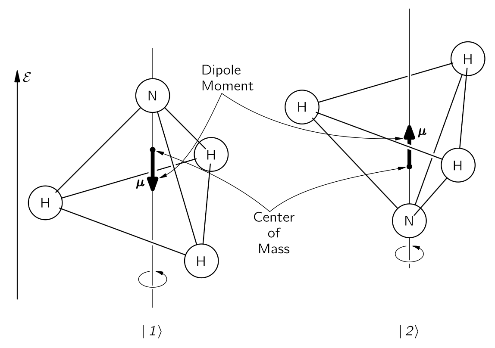

 

## $\mathrm{III}$.9 암모니아 메이저 {#sec-FLP_3_9}

### $\mathrm{III}$.9–1 암모니아 분자의 상태들 {#sec-FLP_3_9_1}

이 장에서는 실용적인 장치인 암모니아 메이저에 대한 양자역학의 적용에 대해 논의한다. 양자역학의 형식적인 진전을 중단하고 특정 문제를 해결하는 이유는, 이 특별한 문제의 많은 특징들이 양자역학 일반 이론에서 꽤 흔하다는 것을 알게 될 것이며, 이 하나의 문제를 자세히 고찰함으로써 많은 것을 배울 수 있을 것이다. 암모니아 메이저는 전자기파를 생성하는 장치이며, 그 작동은 지난 장에서 간략히 논의한 암모니아 분자의 특성을 기반으로 한다. 우선 지난장의 결과를 정리하자.

암모니아 분자는 여러 상태를 가지고 있지만, 우리는 이를 두 개의 상태 시스템으로 간주하며, 현재는 분자가 특정 회전이나 평행 이동 상태에 있을 때 어떤 일이 일어나는지에 대해서만 생각하고 있다. 두 상태에 대한 물리 모델은 다음과 같이 시각화될 수 있다. 암모니아 분자를 질소 원자를 통과하는 축을 중심으로 회전하고, @fig-FLP_3_9_1 에 표시된 바와 같이 수소 원자 평면에 수직이라고 간주한다면, 여전히 두 가지 가능한 조건이 존재한다—질소가 수소 원자 평면의 한쪽에 있거나 반대쪽에 있을 수 있다. 우리는 이 두 상태를 $|1\rangle$ 와 $|2\rangle$ 라고 한다. 그것들을 암모니아 분자의 거동을 분석하기 위한 기저 상태 집합으로 간주한다.

{#fig-FLP_3_9_1 width=400}

두 개의 기저 상태를 가진 시스템에서는, 어떤 상태든 하나의 기저 상태에 있는 특정 진폭 $C_1$ 과 다른 기본 상태에 있는 진폭 $C_2$ 가 존재한다. 그 상태벡터를 다음과 같이 쓸 수 있다.

$$
|\psi\rangle = |1\rangle C_1 + |2\rangle C_2.
$$

여기서

$$
C_1 = \langle 1|\psi \rangle, \qquad \text{and} \qquad C_2=\langle 2|\psi \rangle.
$$

이 두 진폭은 해밀토니안 방정식 @eq-FLP_3_8_43 에 따라 시간에 대해 변합니다. 암모니아 분자의 두 상태 대칭을 이용하여 $H_{11}=H_{22}=E_0$, $H_{12}=H_{21}=−A$ 라고 하고 해를 구하면 [@eq-FLP_3_8_50, @eq-FLP_3_8_51]

$$
C_1 (t) = \dfrac{a}{2} e^{-(i\hbar)(E_0-A)t} + \dfrac{b}{2} e^{-(i/\hbar) (E_0+A)t}, 
$$ {#eq-FLP_3_9_2}
$$
C_2 (t) = \dfrac{a}{2} e^{-(i\hbar)(E_0-A)t} - \dfrac{b}{2} e^{-(i/\hbar) (E_0+A)t}.
$$ {#eq-FLP_3_9_3}

이제 이러한 일반해들을 자세히 살펴보고자 한다. 분자를 처음에 $b=0$ 인 $|\psi_{II}\rangle$ 상태로 두었다고 가정하자. 그렇다면 $t=0$ 에서 $|1\rangle$ 상태일때와 $|2\rangle$ 상태일 때의 진폭은 동일하며 전 기간 동안 그렇게 유지된다. 각각의 위상은 모두 시간에 따라 같이 변하며, 그 진동수는 $(E_0−A)/\hbar$ 이다. 마찬가지로, 분자를 $a=0$ 인 $|\psi_I\rangle$ 상태에 두면, 진폭 $C_2 = -C_1$ 이며, 이 관계는 영원히 유지된다. 두 진폭은 이제 $(E_0+A)/\hbar$ 의 진동수로 시간에 따라 변한다. 이 두가지가 $C_1$ 과 $C_2$ 사이의 관계가 시간에 의존하지 않을 유일한 두 가지 상태 가능성이다.

우리는 두 진폭이 크기가 변하지 않고, 또한 같은 진동수로 변하는 위상을 갖는 두 개의 특수 해를 발견했다. 이것들은 [$\mathrm{III}$.7–1 정지 상태의 원자;정상 상태](vol3_3#sec-FLP_3_7_1) 에서 정의한 바와 같이 정상 상태이며, 이는 일정한 에너지의 상태이다. $|\psi_{II}\rangle$ 상태의 에너지는 $E_{II}=E_0-A$ 이며 $|\psi_I\rangle$ 는 에너지 $E_I=E_0+A$ 이다. 그것들은 존재하는 유일한 두 정상 상태이므로, 우리는 그 분자가 두 개의 에너지 준위를 가지고 있으며, 에너지 차이가 $2A$ 임을 알 수 있다. (물론, 우리는 초기 가정에서 언급한 가정된 회전 및 진동 상태에 대한 두 개의 에너지 준위를 의미한다.)

만약 우리가 질소가 앞뒤로 뒤집히는 가능성을 허용하지 않았다면, 우리는 $A=0$ 으로 취했을 것이며, 두 에너지 레벨은 에너지 $E_0$ 에서 서로 겹쳐 놓이게 될 것이다. 실제 레벨은 이와 같이 되지 않으며, 평균 에너지는 $E_0$ 이지만 $\pm A$ 로 나누어져 두 상태의 에너지 사이에 $2A$ 의 차이가 난다. $A$ 는 실제로 매우 작기 때문에, 에너지 차이도 매우 작다.

원자 내부의 전자를 들뜨게 하기 위해서는 관련된 에너지가 상대적으로 매우 높기 때문에, 가시광선 혹은 자외선 영역의 광자가 필요하다. 분자의 진동을 자극하려면 적외선 광자를 사용한다. 회전을 들게 하는 것에 대해 이야기하자면, 상태들의 에너지 차이는 원적외선 영역의 광자에 해당한다. 하지만 에너지 차이 $2A$ 는 그 중 어느 것보다 낮으며, 실제로 적외선보다 낮고 마이크로파 영역까지 충분히 들어간다. 실험적으로, $10^{−4}\,\text{eV}$ 간격을 가진 한 쌍의 에너지 레벨이 존재한다는 것이 밝혀졌다—이는 $24\,\text{GHz}$ 진동수에 해당한다. 분명히 이것은 $2A=hf$ 이며, $f=24\,\text{GHz}$ ($\lambda =  1.25\,\text{cm}$)임을 의미한다. 따라서 여기에는 일반적인 의미에서 빛을 방출하지 않고 마이크로파를 방출하는 전이를 가진 분자가 있다.

다음 작업을 위해서는 이 두 가지 정상 상태를 조금 더 잘 설명해야 한다. $C_1$ 과 $C_2$ 의 합으로 진폭 $C_{II}$ 를 구성한다고 하자.

$$
C_{II}=C_1+C_2=\langle 1|\phi \rangle + \langle 2|\phi\rangle.
$$ {#eq-FLP_3_9_4}

이것은 무슨 뜻인가? 음, 이것은 원래 기본 상태들의 진폭이 동일한 새로운 상태 $|II\rangle$ 에서 상태 $|\phi\rangle$ 를 찾기 위한 진폭일 뿐이다. 즉, $C_{II}=\langle II|\phi\rangle$ 라고 쓰면, 우리는 @eq-FLP_3_9_4 로부터 $|\phi\rangle$ 라고 하면 모든 $\phi$ 에 대해 참이기 때문에 다음과 같이 $\phi$ 를 제거 할 수 있다.

$$
\langle II| = \langle 1| + \langle 2|.
$$

이는 

$$
|II\rangle =|1\rangle +|2\rangle 
$$ {#eq-FLP_3_9_5} 

와 같은 의미이다. 상태 $|II\rangle$ 이 상태 $|1\rangle$ 에 있는 진폭은

$$
\langle 1 | II\rangle = \langle 1|1\rangle + \langle 1|2\rangle
$$

인데, $|1\rangle$ 와 $|2\rangle$ 는 기저 상태이므로 위 식은 단순히 $1$ 이다. $|II\rangle$ 상태가 $|2\rangle$ 상태에 있을 진폭 역시 $1$ 이므로, 상태 $|II\rangle$ 는 두 기저 상태 $|1\rangle$ 와 $|2\rangle$ 에 대해 동일한 진폭을 가진 상태이다.

여기서 약간 곤란한 상황임을 알아야 한다. 상태 $|II\rangle$ 이 어떤 기저 상태에 있거나 다른 상태에 있을 전체 확률이 $1$ 보다 크다. 하지만 이는 단순히 상태 벡터가 제대로 **정규화(normalization)** 되지 않았음을 의미한다. $\langle II|II\rangle = 1$ 이어야 하며(이는 다른 모든 상태에 대해서도 성립한다), 일반적으로 성립하는 다음 관계식

$$
\langle \chi|\phi\rangle = \sum_i \langle \chi|i\rangle \langle i|\phi\rangle
$$

에서 $\phi$ 와 $\chi$ 를 모두 상태 $II$ 로 두고, 기본 상태들의 합을 취하면, 

$$
\langle II|II\rangle = \langle II|1\rangle \langle 1|II\rangle + \langle II|2\rangle \langle 2|II\rangle.
$$

$C_{II}$ 에 대한 정의를 @eq-FLP_3_9_4 에서 아래와 같이 변경한다면, 위 식의 값이 $1$ 이 될 것이다.

$$
C_{II}=\dfrac{1}{\sqrt{2}}[C_1+C_2].
$$

같은 방식으로 진폭을 구성할 수 있다.

$$
C_I=\dfrac{1}{\sqrt{2}}[C_1−C_2]
$$

또는
$$
C_I=\dfrac{1}{\sqrt{2}}[\langle 1|\phi\rangle - \langle 2|\phi\rangle].
$$ {#eq-FLP_3_9_6}

이 진폭은 상태 $|\phi\rangle$ 를 새로운 상태 $|I\rangle$ 로 투영한 것으로, 그 상태는 서로 반대되는 진폭을 가지고 상태 $|1\rangle$ 와 $|2\rangle$ 에 속한다. 즉, @eq-FLP_3_9_6 

$$
\langle I| = \dfrac{1}{\sqrt{2}}[\langle 1|-\langle 2|]
$$

혹은

$$
|I\rangle = \dfrac{1}{\sqrt{2}} [|1\rangle - |2\rangle]
$$ {#eq-FLP_3_9_7}

과 같은 의미이다. 이로부터

$$
\langle 1|I\rangle =\dfrac{1}{\sqrt{2}}=− \langle 2|I\rangle.
$$

지금까지 이 모든 작업을 수행한 이유는 상태 $|I\rangle$ 와 $|II\rangle$ 를 새로운 기저 상태 집합으로 볼 수 있으며, 이는 암모니아 분자의 정지 상태를 설명하는 데 특히 편리하기 때문이다. 기저 상태는 다음을 만족해야 한다.

$$
\langle i|j\rangle = δ_{ij}.
$$

우리는 이미 이 문제를 해결하여

$$
\langle I|I\rangle = \langle II|II\rangle = 1
$$

이며,  @eq-FLP_3_9_5 와 @eq-FLP_3_9_7 을 이용하여 다음을 쉽게 보일 수 있다.

$$
\langle I|II\rangle = \langle II|I\rangle =0.
$$

새로운 기본 상태 $|I\rangle$ 와 $|II\rangle$ 에 대한 진폭 $C_I=\langle I|\phi\rangle$ 와 $C_{II}=\langle II|\phi\rangle$ 는 또한 @eq-FLP_3_8_39 의 해밀토니안 방정식을 만족해야 한다. 실제로, 두 방정식 @eq-FLP_3_9_2 와 @eq-FLP_3_9_3 을 단순히 빼고 $t$ 에 대해 미분하면,

$$
iℏ\dfrac{dC_I}{dt}=(E_0+A)C_I = E_IC_I.
$$ {#eq-FLP_3_9_8}

그리고 @eq-FLP_3_9_2 와 @eq-FLP_3_9_3 을 더하고 $t$ 에 대해 미분하면,

$$
iℏ\dfrac{dC_{II}}{dt} =(E_0−A)C_{II} = E_{II}C_{II}.
$$ {#eq-FLP_3_9_9}

기저 상태로 $|I\rangle$ 과 $|II\rangle$ 사용하면 해밀토니안 행렬은 아래와 같이 단순한 형태를 가진다.

$$
H_{I,I} = E_I,\quad H_{I,II} = 0, \quad H_{II, I} =0, \quad H_{II, II} = E_{II}.
$$

@eq-FLP_3_9_8 과 @eq-FLP_3_9_9 는 1‐상태 시스템 방정식에 대해 [$\mathrm{III}$.8-6 암모니아 분자](vol3_3.qmd#sec-FLP_3_8_6) 에서 우리가 가지고 있던 것과 똑같이 보인다. 그들은 단일 에너지에 해당하는 단순한 지수 시간 의존성을 가지고 있다. 시간이 흐름에 따라 각 상태에 있는 진폭은 독립적으로 작용한다.

두 정상 상태는 물론 @eq-FLP_3_9_8 과 @eq-FLP_3_9_9 의 해이다. 상태 $|\psi_I\rangle$ ($C_1=−C_2$)인 경우

$$
C_I=e^{−(i/\hbar)(E_0+A)t},\qquad C_{II}=0.
$$ {#eq-FLP_3_9_10}

그리고 상태 $|\psi_{II}\rangle$ ($C_1=C_2$)는

$$
C_I=0,\qquad C_{II}=e^{−(i/\hbar)(E_0−A)t}.
$$ {#eq-FLP_3_9_11}

@eq-FLP_3_9_10 의 진폭은

$$
C_I = \langle I|\psi_I\rangle,\qquad  C_{II}= \langle II|\psi I\rangle
$$

이므로 @eq-FLP_3_9_10 은

$$
|\psi_I\rangle = |I\rangle e^{−(i/\hbar)(E_0+A)t}
$$

와 같은 의미이다. 즉, 정상 상태 $|\psi_I\rangle$ 의 상태 벡터는 기저 상태 $|I\rangle$ 와 상태의 에너지에 적합한 지수 계수를 제외하고는 동일하다. 실제로 $t=0$ 일 때 $|\psi_I\rangle =|I\rangle$ 이다. 여기서 상태 $|I\rangle$ 는 에너지 $E_0+A$ 의 정상 상태와 동일한 물리적 구성을 가지고 있다. 같은 방식으로, 우리는 두 번째 정상 상태에 대해

$$
|\psi_{II}\rangle =|II\rangle e^{−(i/\hbar)(E_0−A)t}.
$$

상태 $|II\rangle$ 는 $t=0$ 에서 에너지 $E_0−A$ 의 정상 상태일 뿐이다. 따라서 우리의 두 새로운 기저 상태는 지수 시간 계수를 제거하여 시간에 독립적인 기저 상태가 될 수 있다. (이로부터 정상 상태 $|\psi_I\rangle$, $|\psi_{II}\rangle$ 과 기저상태 $|I\rangle$, $|II\rangle$ 를 항상 구분할 필요가 없다는 것이 편리하다, 왜냐하면 그것들은 명백한 시간 인자만 다르기 때문입니다.)

요약하면, 상태 벡터 $|I\rangle$ 와 $|II\rangle$ 는 암모니아 분자의 명확한 에너지 상태를 기술하는 데 적합한 한 쌍의 기저 벡터이다. 그들은 우리의 원래 기저 벡터와 관련이 있다.

$$
|I\rangle = \dfrac{1}{\sqrt{2}}[|\mathcal{1}\rangle - |\mathcal{2}\rangle],\qquad |II\rangle = \dfrac{1}{\sqrt{2}}[|\mathcal{1}\rangle + |\mathcal{2}\rangle].
$$ {#eq-FLP_3_9_12}

$|I\rangle$ 와 $|II\rangle$ 의 진폭은 $C_1$ 및 $C_2$ 와 관련이 있다.

$$
C_I=\dfrac{1}{\sqrt{2}}[C_1−C_2],\qquad C_{II}=\dfrac{1}{\sqrt{2}}[C_1+C_2].
$$ {#eq-FLP_3_9_13}

어떠한 상태도 $|\mathcal{1}\rangle$ 와 $|\mathcal{2}\rangle$ 의 선형 결합(그 계수를 $C_1,\,C_2$ 라고 하고), 또는 일정한 에너지 기본 상태 $|I\rangle$ 와 $|II\rangle$ 의 선형 결합(그 계수를 $C_I,\, C_{II}$ 라고 하고)으로 나타낼 수 있다.

$$
|\phi⟩=|\mathcal{1}\rangle C_1+|\mathcal{2{\rangle C_2
$$

또는

$$
|\phi⟩=|I\rangle C_I + |II\rangle C_{II}.
$$

두 번째 형태는 에너지 $E_I=E_0+A$ 인 상태 또는 에너지 $E_{II}=E_0−A$ 인 상태에서 상태 $|\phi\rangle$ 를 찾기 위한 진폭을 제공한다.

### $\mathrm{III}$.9-2 정전기장 안의 분자 {#sec-FLP_3_9_2}

암모니아 분자가 두 가지 에너지 상태 중 하나에 있고, $\hbar \omega = E_I−E_{II}=2A$ 인 진동수 $\omega$ 로 교란하면, 시스템은 한 상태에서 다른 상태로 전이할 수 있다. 또는, 높은 에너지 상태에 있는 경우, 낮은 에너지 상태로 전이하며 광자를 방출할 수 있다. 하지만 이러한 전이을 유도하기 위해서는 상태들과의 물리적인 연결-시스템을 교란하는 어떤 방식-이 필요하다. 상태에 영향을 주는 외부 메커니즘, 예를 들어 자기장이나 전기장 등이 반드시 존재해야 한다. 이 특별한 경우, 이러한 상태들은 전기장에 민감하다. 따라서 우리는 다음으로 외부 전기장에서의 암모니아 분자의 거동 문제를 살펴보겠다.

전기장에서의 거동을 논의하기 위해서는 $|I\rangle$ 와 $|II\rangle$ 를 사용하는 대신 원래의 기저 시스템으로 돌아간다. 수소 원자 평면에 수직인 방향의 전기장이 있다고 가정하자. 잠시 동안 앞뒤로 뒤집을 가능성을 무시하고, 질소 원자의 가능한 두 위치에서 동일할까? 일반적으로는 동일하지 않다. 전자는 수소 핵보다 질소에 더 가깝게 위치하는 경향이 있어, 수소는 약간 양전하에 가깝다. 실제 양은 전자 분포의 세부 사항에 따라 달라진다. 이 분포가 정확히 무엇인지 파악하는 것은 복잡한 문제이지만, 어쨌든 최종 결과는 암모니아 분자가 전기 쌍극자 모멘트를 가지고 있다는 것이며, 이는 @fig-FLP_3_9_1 에 표시된 바와 같다. 우리는 전하의 방향이나 변위량을 자세히 알지 못한 채 분석을 계속할 수 있다. 그러나 다른 사람들의 표기와 일관되게 하려면, 전기 쌍극자 모멘트를 $\bf{\mu}$ 라고 가정한다. 그 방향은 질소 원자에서 방향을 가리키며 수소 원자 평면에 수직이다.

이제 질소가 한쪽에서 다른 쪽으로 뒤집히면 질량 중심은 움직이지 않지만 전기 쌍극자 모멘트는 뒤집어진다. 이 순간의 결과로, 전기장 $\bf{\mathcal{E}}$ 의 에너지는 분자 방향에 따라 달라진다.$^1$ 위에서 가정한 바와 같이, 질소 원자가 전기장의 방향을 가리키면 위치 에너지가 더 높고, 반대 방향을 가리키면 낮으며, 두 에너지 사이의 간격은 $2\mu\mathcal{E}$ 가 된다.[$^1$ $\bf{p}$ 와 $E$ 를 운동량과 에너지를 나타냈는데 사용했기 때문에 $\bf{\mu}$ 와 $\bf{\mathcal{E}}$ 를 각가가 전기쌍극자와 전기장으로 사용할 수 밖에 없었다.]{.aside}

지금까지 우리는 $E_0$ 와 $A$ 의 값을 계산하는 방법을 알지 못한 채 가정해 왔다. 올바른 물리 이론에 따르면, 모든 핵과 전자의 위치와 운동을 기준으로 이러한 상수를 계산할 수 있어야 한다. 하지만 아무도 그것을 해본 적이 없다. 그러한 시스템은 전자 10개와 핵 4개를 포함하고 있으며, 이는 너무 복잡한 문제이다. 사실, 이 분자에 대해 우리보다 더 많이 아는 사람은 없다. 누구든지 말할 수 있는 것은 전기장이 있을 때 두 상태의 에너지가 다르며, 그 차이는 전기장에 비례한다는 것이다. 그 비례 계수는 $2\mu$ 이지만, 그 값은 실험적으로 결정되어야 한다. 우리는 또한 그 분자가 뒤집을 수 있는 진폭 $A$ 를 가지고 있다고 말할 수 있지만, 이는 실험적으로 측정되어야 한다. 계산이 너무 복잡해서 자세히 할 수 없기 때문에 아무도 $\mu$ 와 $A$ 에 대한 정확한 이론값을 제공할 수 없다.

전기장에 있는 암모니아 분자에 대해서는 우리의 설명을 변경해야 한다. 만약 분자가 한 구성에서 다른 구성으로 전환되는 진폭을 무시한다면, 두 상태 $|\mathcal{1}\rangle$ 와 $|\mathcal{2}\rangle$ 의 에너지는 $(E_0 \pm \mu \mathcal{E})$ 일 것이다. 마지막 장의 절차에 따라, 

$$
H_{11}=E_0 + \mu\mathcal{E},\qquad H_{22}=E_0 − μ\mathcal{E}.
$$ {#eq-FLP_3_9_14}

또한 우리는 우리가 관심있는 전기장에 대해 그 전기장이 분자의 기하학에 크게 영향을 미치지 않으며, 따라서 질소가 한 위치에서 다른 위치로 점프하는 진폭에도 영향을 주지 않는다고 가정하겠다. 그렇다면 $H_{12}$ 와 $H_{21}$ 은 변경되지 않은 것으로 볼 수 있다. 이로부터

$$
H_{12} = H_{21} = −A.
$$ {#eq-FLP_3_9_15}

우리는 이제 새로운 $H$ 에 대해 해밀토니안 방정식 @eq-FLP_3_8_43 을 풀어야 풀어야 한다. 이전의 과정을 똑같이 해 가며풀 수 있겠지만, 두 상태 시스템에 대한 해가 아주 자주 쓰일 것이기 때문에, 임의의 $H_{ij}$ 라는 일반적인 경우에 대해 풀어 보자. 단, 시간이 지나면 변하지 않는다는 가정하에.

이제 아래의 해밀토니안 방정식 쌍의 일반 해를 구할 것이다.

$$
i\hbar \dfrac{dC_1}{dt} = H_{11}C_1 + H_{12}C_2, 
$$ {#eq-FLP_3_9_16}
$$
i\hbar \dfrac{dC_2}{dt} = H_{21}C_1 + H_{22}C_2.
$$ {#eq-FLP_3_9_17}

이것들은 상수 계수를 갖는 선형 미분 방정식이므로, 종속 변수 $t$ 의 지수 함수인 해를 언제든지 찾을 수 있다. 먼저 $C_1$ 과 $C_2$ 가 동일한 시간 의존성을 갖는 해를 찾아본다. 시험 함수(trial function) 을 다음과 같이 놓는다.

$$
C_1=a_1e^{−i\omega t},\qquad C_2=a_2e^{−i\omega t}.
$$

이 해는 에너지 상태 $E=\hbar \omega$ 에 해당하므로, 

$$
C_1 = a_1 e^{-(i/\hbar)Et}, 
$$ {#eq-FLP_3_9_18}
$$
C_2 = a_2 e^{-(i/\hbar)Et}, 
$$ {#eq-FLP_3_9_19}

라고 쓰면, 여기서 $E$ 는 아직 모르며, 미분 방정식 @eq-FLP_3_9_16 과 @eq-FLP_3_9_17 을 만족하도록 정해져야 한다.

미분 방정식 @eq-FLP_3_9_16 과 @eq-FLP_3_9_17 에 @eq-FLP_3_9_18 과 @eq-FLP_3_9_19 의 $C_1$ 과 $C_2$ 를 대입하면 다음과 같은 방정식을 얻는다.

$$
\begin{bmatrix} E-H_{11} & -H_{12} \\ -H_{23} & E-H_{22}\end{bmatrix} \begin{bmatrix} a_1 \\ a_2 \end{bmatrix} = \begin{bmatrix} 0 \\ 0 \end{bmatrix}.
$$ {#eq-FLP_3_9_20}

이 방정식에서 $a_1,\,a_2$ 가 $0$ 이 아닌 해를 가지려면

$$
\det \left(\begin{bmatrix} E-H_{11} & -H_{12} \\ -H_{23} & E-H_{22}\end{bmatrix}\right)=0.
$$ {#eq-FLP_3_9_22}

이어야 하며 이로부터

$$
(E−H_{11})(E−H_{22})−H_{12}H_{21}=0.
$$

이어야 한다. 이 식을 만족하는 두 $E$ 값은 다음과 같다.

$$
E=\dfrac{H_{11}+H_{22}}{2} \pm \sqrt{\dfrac{(H_{11}−H_{22})^2}{4} + H_{12}H_{21}}
$$ {#eq-FLP_3_9_25}

에너지 $E$ 에 대해 두 가지 가능한 값이 있으며 두 값 모두 실수이다. 왜냐하면 $H_{11}$ 과 $H_{22}$ 는 실수이며, $H_{12}H_{21}=|H_{12}|^2 >0$ 이기 때문이다.  

앞서와 동일한 관례를 사용하여, 높은 에너지를 $E_I$ 라고 하고 낮은 에너지를 $E_{II}$ 라고 하자. 

$$
E_I=\dfrac{H_{11}+H_{22}}{2} + \sqrt{\dfrac{(H_{11}−H_{22})^2}{4} + H_{12}H_{21}},
$$ {#eq-FLP_3_9_26}
$$
E_{II}=\dfrac{H_{11}+H_{22}}{2} - \sqrt{\dfrac{(H_{11}−H_{22})^2}{4} + H_{12}H_{21}}.
$$ {#eq-FLP_3_9_26}

@eq-FLP_3_9_18 과 @eq-FLP_3_9_19 에서 이 두 에너지를 각각 별도로 사용한다, 우리는 두 정상 상태(정확한 에너지 상태)의 진폭을 가지고 있다. 외부 교란이 없으면, 이러한 상태 중 하나에 있는 시스템은 영원히 그 상태를 유지하게 되며, 오직 위상 변화만 존재한다.

우리는 두 가지 특수한 경우에 대한 결과를 확인할 수 있다. $H_{12} = H_{21} = 0$ 인 경우, $E_I=H_{11}$ 이고 $E_{II}=H_{22}$ 가 된다. 이것은 확실히 올바릅니다, 왜냐하면 @eq-FLP_3_9_16 와 @eq-FLP_3_9_17 은 분리되어 있으며, 각각은 $H_{11}$ 과 $H_{22}$ 의 에너지 상태를 나타내기 때문이다. 다음으로, $H_{11} = H_{22} = E_0$ 와 $H_{21} = H_{12} = −A$ 라고 정하면, 이전에 찾은 해를 얻는다.

$$
E_I = E_0 + A\qquad \text{and} \qquad E_{II}=E_0−A.
$$

일반적인 경우, 두 해 $E_{I}$ 와 $E_{II}$ 는 각각 아래의 두 상태를 가리킨다.

$$
|\psi_I\rangle = |I\rangle e^{−(i/\hbar)E_I t} \qquad \text{and} \qquad |\psi_{II}\rangle =|II\rangle e^{−(i/\hbar)E_{II}t}
$$

이러한 상태는 @eq-FLP_3_9_18 과 @eq-FLP_3_9_19 에 제시된 대로 $C_1$ 과 $C_2$ 를 갖게 된다. 여기서 $a_1$ 과 $a_2$ 는 아직 결정되지 않았으며 그들의 비율은 @eq-FLP_3_9_20 로부터 

$$
\dfrac{a_1}{a_2} = \dfrac{H_{12}}{E-H_{11}}
$$ {#eq-FLP_3_9_23}

혹은 

$$
\dfrac{a_1}{a_2} = \dfrac{E-H_{22}}{H_21}
$$ {#eq-FLP_3_9_24}

중 하나에 의해 주어진다. 그들은 또한 또 하나의 조건을 충족해야 한다. 시스템이 정상 상태 중 하나에 있다면, $|\mathcal{1}\rangle$  또는 $|\mathcal{2}\rangle$ 에서 발견될 확률의 합은 반드시 $1$ 이어야 하며 따라서,

$$
|C_1|^2+|C_2|^2 =1,
$$ {#eq-FLP_3_9_28}

혹은, 동등하게

$$
|a_1|^2 + |a_2|^2=1.
$$ {#eq-FLP_3_9_29}

이러한 조건들은 $a_1$ 과 $a_2$ 를 유일하게 정하지 않으며, 여전히 임의의 위상, 즉 $e^{i\delta}$ 와 같은 인자와 같은 불확실성이 있다. $a_1,\,a_2,...$ 에 대한 일반적인 해를 적어 두는 것은 가능하지만, 특정 경우마다 이를 직접 푸는것이 보통 더 간단하다.